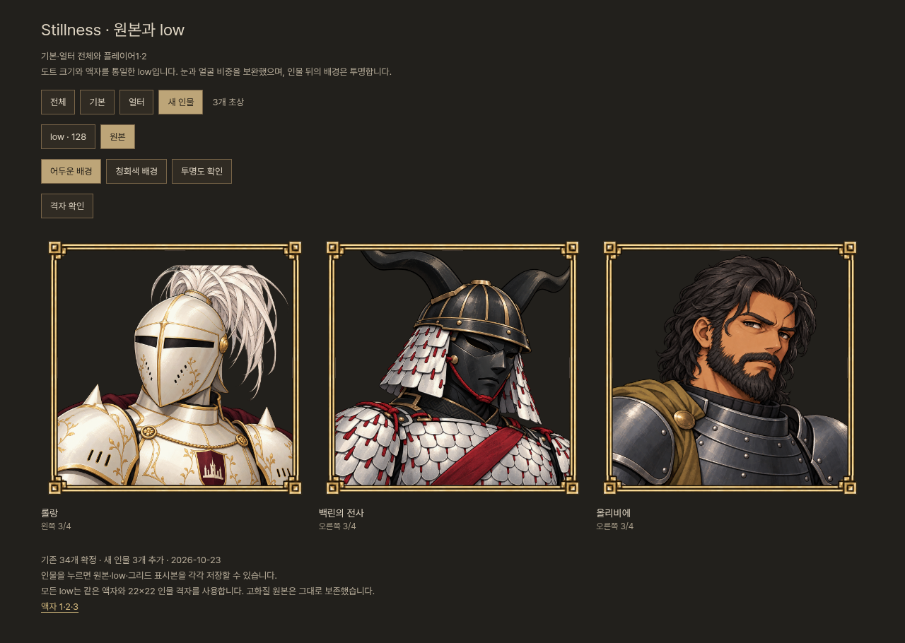
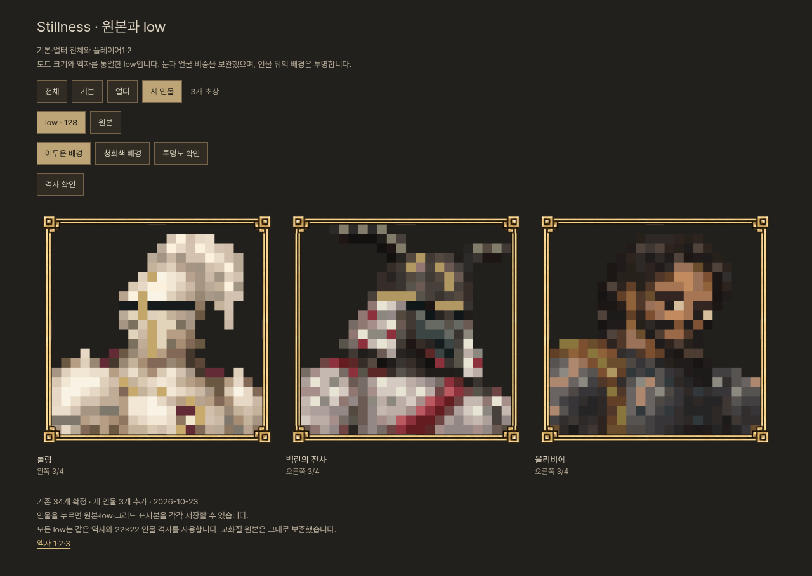

# 롤랑 · 백린의 전사 · 올리비에 프로필

2026-10-23 사용자 요청: 세 캐릭터의 프로필을 기존 생성 규칙에 맞춰 제작. 기존 34개 확정 초상에 세 기본형을 추가했다. 새 3개는 사용자 검토 전이며, 게임 UI 연결과 우화 발송은 아직 하지 않았다.




## 보존과 제작

- 인물 ID: `sebastian`(롤랑), `white_scale`(백린의 전사, 작업명), `black_king`(올리비에). 현재 승인된 실제 모델의 복식·머리·가림 설정을 반영했다.
- 먼저 고화질 인물 원본을 만들고 `master-figures/`에 생성 결과 그대로 보존했다. 각 정사각형 원본에 기존 공통 액자 1을 코드로 합성해 `original.png`를 저장했다. 롤랑의 눈선과 턱선을 맞추기 위해 인물 영역 안에서 70px 아래로 배치했다. 원본과 low 모두 1254×1254 RGBA다.
- 마지막 원본 검수에서 올리비에의 얼굴에 설정에 없는 흉터가 생긴 것을 확인해 제거했다. 최초 생성본도 보존하고, 최종 합성에는 `black_king-clean.png`를 사용한다. low에는 그 흉터를 묘사하지 않았으므로 셀 원본을 유지했다.
- low는 최종 합성 원본에서 큰 색면 초안을 얻은 뒤, 눈·눈꺼풀·투구 눈틈·코 능선·곱슬머리·수염·갑찰·끈·옷과 금속 면을 개별 셀로 다시 그렸다. 단순 축소만 한 결과는 최종본으로 쓰지 않았다. `cell-edits.json`에 251회 수정 기록이 있다(같은 셀의 후속 교정 포함, 서로 다른 251셀이라는 뜻은 아님).
- 재현 가능한 최종 편집 원본은 `sprites.json`. `blocked-planes.json`은 중간 색면 초안이다. 일반 빌더는 초안을 다시 축소하지 않고 최종 셀만 사용한다.
- `original.png`, `low.png`, 실제 선이 그려진 `grid.png`를 인물마다 따로 저장했다. 게임용은 선 없는 low이고, grid는 검수용이다.

## 적용한 검수 기준

| 항목 | 기준·확인 |
|---|---|
| 캔버스 | 세 인물의 원본/low/grid 모두 1254×1254 |
| 인물 격자 | 22×22셀, 셀마다 50×50px, 원점(77,77), 영역1100×1100 |
| 액자 | 기존 frame1.png 동일 파일·좌표 사용; 고해상도 장식 유지 |
| 인물 색·alpha | low 각 셀 단색, alpha0/255; 배경 투명 |
| 얼굴 핵심 폭 | 롤랑8셀 / 백린7셀 / 올리비에8셀 |
| 턱·크롭 | 모두 턱14행 기준, 아래8행의 어깨·윗가슴; 맨 아래22셀 모두 몸이 채움 |
| 눈 | 올리비에 두 눈 유지, 눈~턱6/5행. 두 무사의 실제 불투명 면갑은 가림 설정 유지 |
| 원본 보존 | 기존34개 original/low/grid102장+액자5개, 총107파일 SHA256 불변 |

얼굴 박스·턱 위치는 그림을 보며 정한 수동 검수 좌표다. 자동 얼굴 인식 측정이나 사용자 미감 승인을 뜻하지 않는다. 원본/low를 함께 보며 방향과 주요 특징을 대조했다. 원본 생성 그림은 게임 스크린샷이 아니다.

## 검토와 재현

기존 갤러리의 **새 인물** 필터에서 세 명을 볼 수 있다. `?new=1`로 바로 진입하고 `&grid=1`로 격자를 켠다. 기존34개 기록은 그대로이며 전체37개(기본21/얼터16)다. 원본/low/그리드 저장, 배경 전환, 확대와 이전/다음 기능을 유지했다.

```sh
python3 tools/content/refine_hero_cells_20261023.py  # 편집 기록 재현, 필요할 때만
python3 tools/content/build_hero_profiles_20261023.py
python3 -m http.server 5230 --directory public
node docs/art/hero_profiles_20261023/browser.mjs
```

빌더는 기존107파일 해시·원본34개 manifest 레코드 보존을 확인하고 새3개만 쓴다. `asset-validation.json`에는 셀 단색/프레임/눈·얼굴/alpha 검사, `browser-verification.json`에는320/390/844/1280px에서111PNG 디코딩·가로넘침·격자·저장 링크·확대/순환 검사 결과가 있다. 게임 소스·전투 동작을 바꾸지 않아 물리 대련을 다시 실행하지 않았다.

공개 완료 여부는 `publication.json`을 따른다. 사용자 검토와 별도 전달 지시 전에는 우화 메시지를 새로 발행하지 않는다. 캐릭터 외형 원본과 기존 초상은 덮어쓰지 않았다.
