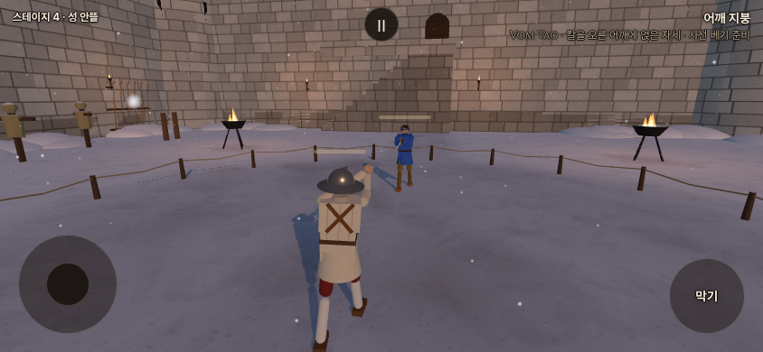
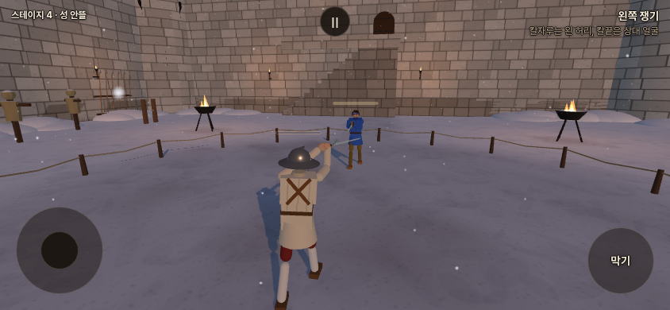
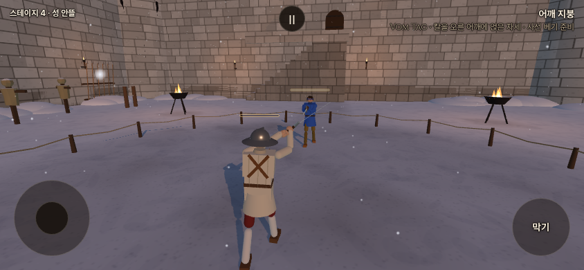
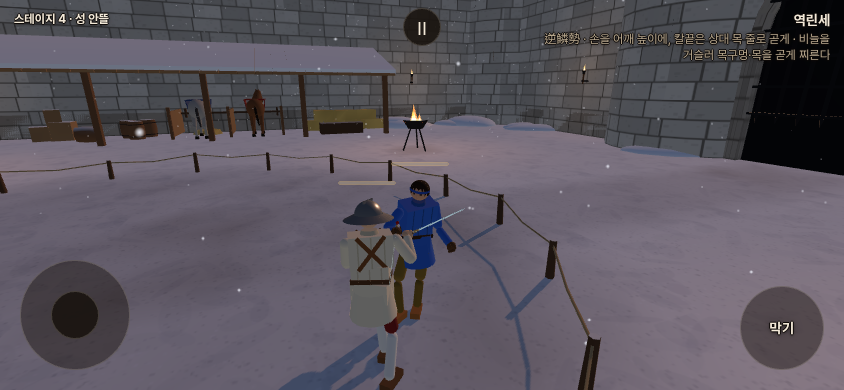
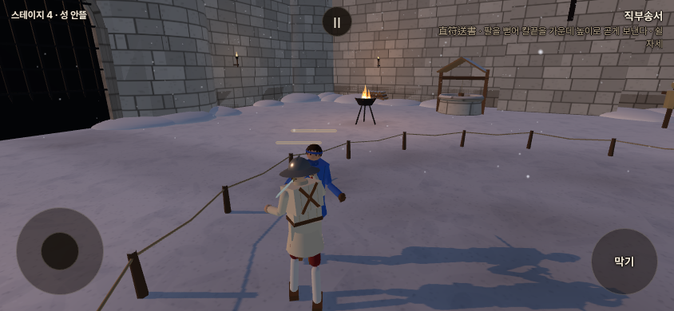

# 기력 공격 템포 · 동방 AI 후속 실험 — 2026-10-16

**우화 시스템 통합은 완료했다. 첨부한 두 설계안의 새 기본값 채택은 미완료다.** 통과 조건을 낮추지 않았으며, 시험 후보는 작업 브랜치에서만 기본 끔으로 보존한다. 공개 `main`에는 검증한 우화 통합 커밋 `e2f04f61`을 먼저 올렸다. 배포 실행 완료와 공개 서버 직접 접속은 별도 릴리스 기록으로 구별한다.

기준은 [우화 통합 기록](UHWA_IMPORT_20261016.md)의 `4f17370d`를 합친 `e2f04f61`. 사용자 지시대로 **동방192→96판/무기/갈래**, **기력48→24판/무기**로 줄였다. 탐색 후보는48판으로 먼저 걸렀고, 최종 비교 두 후보만96판으로 확장했다. 원본 설계서의 수천 판을 그대로 반복하지 않았다. 다른 팀 저장소에 쓰지 않았다.

## 1. 구현과 보존

- 도구: `e59135d2`, 계기 교정 `72ae15d5`. 19무기×대표 베기/탭 찌르기/폼멜/비기×사람 입력 재생/AI×100/−10/−60. 비기가 없는4무기의24조건은 적용 대상 없음으로 기록했다.
- 시험 구현: `da779d99`. 몸 자세 추종 dt를 기력 빠르기로 늦추고, 지친 사람의 몸 목표를 걸러진 손 목표로 바꾸는 후보. 힘/관절 한도는 따로 시험할 수 있다. **`STAMINA.attackTempo=false` 기본 유지.**
- 동방 시험: `CN_AI_FEET` 표, `GAIT.cnAiTune` 및 URL 인자. 동방·가벼운 발이 켜진 스텝에만 스틱 판단을 바꾼다. 공격 판단·공통 toStick·사람 몸·가속1.5·최고 속도·기력 장부는 유지한다. **`cnAiTune=0`, `cnLightAi=1` 기본 유지.**
- 수치 변화와 미채택 상태는 [사장님 확인표](../strike/owner_defaults_table.md)와 [유파 지도](../strike/school_kit_map.md)에 적었다. 원전의 유파 동작/조건을 재설계하지 않았다.

## 2. 기력 공격 템포

### 전수 결과

[기존 전수표](followup_20261016/tempo-final-baseline-table.md) · [후보 전수표](followup_20261016/tempo-final-candidate-table.md) · [요약 JSON](followup_20261016/tempo-summary.json)

| 항목 | 기존 | 몸 목표/시간표 후보 |
|---|---:|---:|
| 실제 측정 조건 | 432 | 432 |
| 지친 단계만 통과 | 67/288 | 77/288 |
| 전체 통과/실패 | 211/221 | 221/211 |
| 공격자 칼 충돌 끔 시험 NaN / 동작 미완료 | 0 / 0 | 0 / 0 |
| 생생한 조건 | 152조건(비기 없음 포함) 모두 원자료 바이트 동일 | 동일 |

목표는 기존 설계대로 최고 속도 도달 시각 비1/0.7·2.0, 상대오차±7%다. **211개 미달을 남긴 후보를 완료나 채택으로 처리하지 않았다.** 힘 .49/.25→.7/.5 및 관절 한도 해제 후보는 교정한5무기×3동작×2조종×3단계90조건에서46통과44실패로, 기존52통과38실패보다 나빠 채택하지 않았다. 감쇠를 올리거나 피해 에너지를 보정하지 않았다.

접촉 에너지는 별도 충돌 시험의 실제 상처 이벤트 J다. 기존208/후보204조건에는 이벤트가 없어 `no hit`로 표시했으며 0J나 추정값으로 채우지 않았다. 이 표본만으로 모든 공격의 에너지 비를 검증했다고 할 수 없다. 공격자 칼 충돌을 끈 시간 시험과 접촉 시험을 섞어 시간 비율을 만들지 않았다.

시간 시험에서는 공격자의 칼 충돌만 끈다. 수동 상대의 몸·칼은 남아 있으므로 완전히 격리한 단일 강체 실험이 아니다. 위 결과는 동일 출발 상태와 대본 사이의 조건부 비교이며, 이 한계도 후속 계기에서 분리할 대상이다.

### 측정에서 발견한 비기 문제

현재 주 판정값은 기존 계기의 `sword.velocityAtPoint(bladePoint(.7))`다. **운동학적으로 배치하는 비기에서는 실제 칼 이동과 다른 값을 내므로 이 값 하나로 비기를 보정하면 잘못된 결론이 난다.** 독립적으로 같은 칼날 점의 매 물리 스텝 이동거리/시간도 기록했다. 원래 판정값을 유리한 값으로 조용히 바꾸지는 않았다.

우치가타나 사람 발도, 같은 출발 자세:

| 기력 | 엔진 속도 최고 시각 | 실제 칼날 이동 최고 시각 | 실제 시간 비 | 실제 최고 빠르기 m/s |
|---|---:|---:|---:|---:|
| 100 | 1.650s | .075s | 1 | 50.06 |
| −10 | 1.758s | .1083s | 1.444 | 35.66 |
| −60 | 1.825s | .150s | 2.000 | 25.62 |

발도 본체는 이미 목표에 맞는다. 엔진값은 뒤의 회수 운동을 최고로 잡았다. 동방 연환도 엔진 최고와 실제 이동 최고가 다르고, 심한 지침에서는 시작 배치의 작은 위치 보정이 실제 최고로 잡히는 경우가 있다. 다음 수정은 **공격 본체/준비 배치/회수 구간을 계기에서 명시하고, 실제 이동과 엔진값을 대조하는 것부터** 해야 한다. 전 무기 공통 상수만 맞추거나 이미 맞는 발도를 다시 늦추는 것은 근거가 없다. 무기별 임의 보정표를 추가하지 않았다.

### 대련 — 무기당24판

[기존 원자료](followup_20261016/stamina-duels-before.json) · [후보 원자료](followup_20261016/stamina-duels-candidate.json)

| 무기 | 승(기존→후보) | 평균 길이 s | 탈진 수 |
|---|---|---|---|
| 롱소드 | 10→10 | 24.43→24.43 | 0→0 |
| 레이피어 | 10→10 | 19.84→19.84 | 0→0 |
| 츠바이핸더 | 4→4 | 26.14→25.99 | 0→0 |
| 우치가타나 | 4→4 | 21.26→21.26 | 0→0 |
| 청강검 | 8→8 | 20.74→20.74 | 0→0 |

normal·walls·main 유파 꾸러미, 롱소드 상대 자리 교대, 40초 시한. 기본 AI의 숨 고르기 때문에 심한 지침/탈진 사례가 드물어 이 대련만으로 지친 모든 공격을 검증할 수 없다. 위 강제 단계 전수 계기를 별도로 쓴 이유다.

## 3. 동방 AI — 결과와 미채택 이유

[모든 갈래 표](followup_20261016/cn-table.md) · [상세 요약/판정](followup_20261016/cn-summary.json) · [전체 판 원자료 gzip](followup_20261016/cn-raw.json.gz)

| 무기 | 가벼운 발 끔 | 전부 켬·옛 판단 | 현재 공격 때만 | 후보1 | 후보4 |
|---|---:|---:|---:|---:|---:|
| 청강검 /96 | 32승 | 23승 | 29승 | 26승 | 29승 |
| 월왕구천검 /96 | 18승 | 10승 | 14승 | 20승 | 16승 |
| 합 /192 | 50승 | 33승 | 43승 | 46승 | 45승 |

- 후보1: 잔걸음 주기×.82, 접근 대응×2/3, 회피 막기 스틱−1→−.8. 합계 승수는 현재보다 늘었지만 **청강검26<끄기32**라 불통과다.
- 후보4: 후보1에서 간격 이득1.6→2.4, 가까운 상한.18→.27. 합계는 늘었지만 **두 무기 모두 끄기 기준보다 낮다.**
- 48판 선별 후보2(접근 대응1·회피−.5)는14/5승, 후보3(간격 이득1.067·상한.12)은9/9승으로 확장하지 않았다.
- 후보1의 월왕구천검 넘어짐은125→86회로 줄었다. 악화로 표현하지 않는다. 다만 설계서의 문자 그대로인 “기준95%띠 안”에는 못 들었다. 청강검 승수 기준 미달만으로도 채택 불가다.
- 승률95%는 Wilson, 사건/넘어짐·클린치 평균의 띠는 판 단위 평균±1.96표준오차다. 표본이 작으며 동등성을 증명하는 검사가 아니다.

원인 분리도 각각96판으로 축소했다. `noshuffle`·`noflee`·`nohold`를 추가했다. 청강검 승수는24/28/30, 월왕구천검9/14/15. 이 탐색은 양쪽 씨앗1..48, 최종 비교는1..24+49..72로 **서로 다른 씨앗 묶음**이다. 직접 짝 비교로 오해하지 않는다. 따라서 높은 탐색 승수만 골라 최종 통과로 대체하지 않았다.

홀로 재기78조건에서는 NaN/넘어짐0. 가벼운 발의 회피 스틱−1을 .4초 주었을 때 후퇴가 .032→.265m로 늘었고, 보통 막기−.3은 .088→.091m로 비슷했다. 간격 유지의 지나침 증가가 모든 조건에서 재현되지는 않았다. [홀로 재기 원자료](followup_20261016/feet-baseline-rows.json.gz)는 가상의 상대 거리/접근 신호로 **실제 Rapier 몸과 실제 moveFeet**를 움직인 것이다. 실제 대련 결과와 구별한다. 이 초기 홀로 재기에서 tune 갈래는 구현 전이라 on과 같다.

미완료: 채택 가능한 판단 조합, 실제 판의 잔걸음 한 번 거리·물러남 회차별 길이/노출/피해·막기 성공 사건의 정밀 계측, 관절 한도 개별 분리 실험. 현재 자료에는 모드별 총시간, 공격 결심/분, 상대 stepin, 받은 상처/에너지, 넘어짐, 클린치, 상대 칼 막힘 수가 있다. `bound`를 막기 버튼 성공률로 바꾸어 부르지 않는다.

## 4. 회귀와 실제 화면

- 기력 끔5관문 모두 통과: fights12 `7f5860c7`, live `648aca66`, finish `2de06c03`, corr12/12동일, weapons23/23·`7085b282`.
- 기력 켬 기본5관문도 유지: fights12 `a071c0af`, 나머지 동일. 기대값을 바꾸지 않았다. [끔](followup_20261016/off-gates.json) · [켬](followup_20261016/on-gates.json)
- `cnAiTune=0`에서 두 무기×off/on/ai×4판=24판의 **전체 game 원자료 객체가 통합 기준과 정확히 같음**. 후보 메타데이터만 비교에서 제외했다.
- 사람 동방 걷기 전수 출력16,244바이트가 후보 스위치 켬/기존에서 SHA256까지 동일. 기력 검사45개 재확인 통과. [검증 기록](followup_20261016/checks.json)
- 빌드 성공, 화면 문구752개·표기 위반0. 우화 통합의 진입20개·카메라 경로·기력45개 검사는 [앞선 통합 기록](UHWA_IMPORT_20261016.md)에 있다.

아래는 **로컬 게임, 같은 롱소드 베기를 재생한 현행 기본값**이다. 휴대폰 가로844×390,8fps,3초. 새 보정이 승인/적용됐다는 사진이 아니다. 각 영상은1초 준비 후 같은 입력을 재생한다. 사진/영상 합성·외형 보정 없음.

| 생생100 | 지침−10 | 심한 지침−60 |
|---|---|---|
|  |  |  |
| [영상](../screenshots/followup_20261016/fresh.mp4) | [영상](../screenshots/followup_20261016/tired.mp4) | [영상](../screenshots/followup_20261016/severe.mp4) |

동방 비교 촬영은 씨앗71·수동 상대·공격 진입을 끈 간 보기 대본에서 약0/10/20/30초를 촬영했다(실제 물리 진행29.98/29.89초). 실제 대련 승률 자료와 별개다. 최초 대련 촬영은 승리 화면으로 일찍 끝나30초 간 보기 근거로 쓰지 않았다. 상세 촬영 manifest는 사진 폴더에 보존한다.

| 현재 공격 때만 가벼운 발 · 10초 | 모든 꼴+후보1 · 10초 (미채택) |
|---|---|
|  |  |

## 5. 재현

```sh
# 전 무기 계기(기력 단계는 도구 안에서 고정)
node tools/sim/stamina_tempo_probe.mjs /tmp/tempo-before all cut,thrust,pommel,secret human,ai
node tools/sim/with_config.mjs STAMINA.attackTempo=true stamina_tempo_probe.mjs /tmp/tempo-candidate all cut,thrust,pommel,secret human,ai
# 힘 강화/한도 해제 후보는 추가로 STAMINA.tempoPowerTired=0.7 STAMINA.tempoPowerSevere=0.5 STAMINA.tempoCaps=false
# 양쪽 합96판: 24판/자리 × 씨앗0·48 두 묶음
CLD_SEED0=0 CLD_JSON=/tmp/cn-0.json node tools/sim/cn_light_duel.mjs qinggang 24 off,on,ai,tune
CLD_SEED0=48 CLD_JSON=/tmp/cn-48.json node tools/sim/cn_light_duel.mjs qinggang 24 off,on,ai,tune
# goujian도 동일. 후보4는 CLD_FEET='{"holdGain":2.4,"holdNear":0.27}'
node tools/sim/cn_ai_feet_probe.mjs /tmp/feet
node tools/sim/stamina_duels.mjs main on
node tools/sim/stamina_gates.mjs off /tmp/gates
node tools/sim/stamina_gates.mjs on /tmp/gates
node tools/browser/stamina_tempo_capture.mjs http://127.0.0.1:4173 /tmp/tempo-media
node tools/browser/cn_ai_watch_capture.mjs http://127.0.0.1:4173 /tmp/watch-shots
```

기력 계기는 warmup의 손 누름 상태, AI strikeSpeed 적용, 비기 출처(TRADITIONS)를 교정했다. 교정 전 파일럿은 최종 통과율에 섞지 않았다. 최종표 이후 보완한 칼날 실제 이동거리 칼럼은 추가 관측이며, 위 기존 엔진 기준의 판정값을 바꾸지 않는다.

## 6. 계정 인증 localhost 제보

사용자 사진은 메일 발송과 `localhost` 복귀 실패를 보여 준다. 앱은 현재 페이지 origin/path를 `emailRedirectTo`로 보낸다. 가장 유력한 원인은 Supabase 기본 Site URL 또는 허용 리다이렉트 설정이다. 대시보드 설정은 직접 확인/변경하지 못했으므로 확정 진단이라고 하지 않는다.

[해당 Supabase 프로젝트](https://supabase.com/dashboard/project/xrdxiyhhvdqiyklevgap) → Authentication → URL Configuration:

- Site URL: `https://yoonjl-svg.github.io/halfsword-codex/`
- Redirect URLs: 위 주소와 `https://yoonjl-svg.github.io/halfsword-codex/index.html`
- Email Templates의 Confirm signup/Magic Link(익명 계정 이메일 연결은 Change Email Address 포함): 링크 `{{ .ConfirmationURL }}`, 번호 표시 `{{ .Token }}`.
- 저장 후 새 메일 요청. 기존 메일 링크는 설정 변경으로 고쳐지지 않는다.

**링크 인증 또는 메일의 인증번호 입력 중 하나만 완료하면 된다.** 사용자가 올린 현재 메일에는 번호가 없으므로 링크 방식만 가능하다. 관리자 설정 변경·실제 복귀/인증 완료를 여기서 검증했다고 주장하지 않는다.


## 7. 발행·공개 배포 확인

우화 통합본의 Pages 배포는 [실행38774553348](https://github.com/yoonjl-svg/halfsword-codex/actions/runs/38774553348)에서 **성공**했다(빌드20초·배포8초·전체36초). 배포 소스는 `af4cba4ddf1256eefda0e582299347cb79cf7be8`이며 게임 코드는 통합 `e2f04f61`과 같다. 첫 배포가 남긴 잠금을 해제한 뒤 임시 복구 단계를 제거하고 원래 워크플로로 배포했다. 후속 기력 템포/동방 AI 후보는 공개판 기본값으로 채택하지 않았다.

[공개 게임](https://yoonjl-svg.github.io/halfsword-codex/) · [배포 기록](uhwa_import_20261016_release.json). 공개 주소의 직접 HTTP 접속은 이 환경에서 검증하지 못했다. 위 성공은 GitHub Actions 결과이며, 이 문서의 게임 사진은 로컬 촬영이다.

사용자 요청의 [중간 개발 일지](https://github.com/yoonjl-svg/halfsword-codex/blob/67bd2b87761fe3f32b7d745bf03a11a022991c41/docs/devmeet/interim/2026-10-16-015747.md)는 원격 발행 후 본문·manifest 바이트와 SHA256을 다시 확인했다. [발행 영수증](followup_20261016_publication.json). 일지 발행 뒤 배포가 성공했으므로 최종 배포 상태는 이 절과 릴리스 기록을 따른다. 기존 발행본은 덮어쓰지 않았다.
