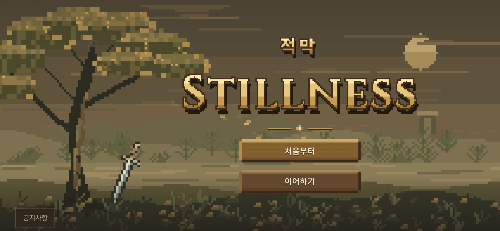
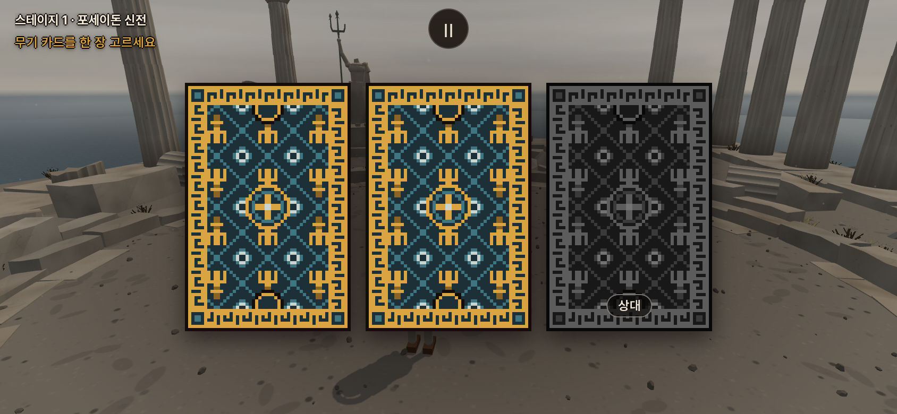
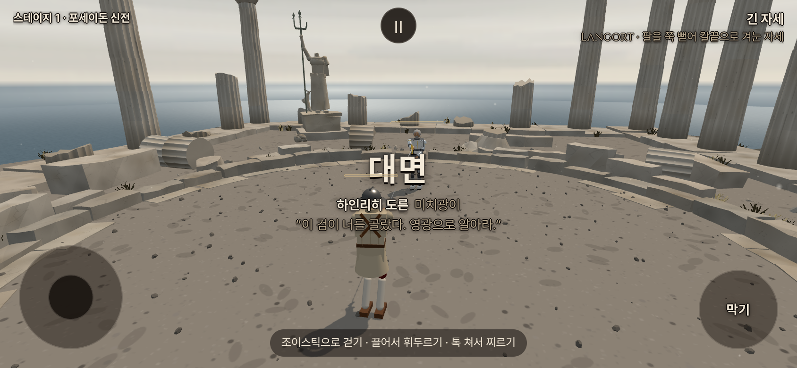

# 승인된 시작 화면을 본 게임에 연결 — 2026-10-15 KST

사용자가 승인한 픽셀 시작 화면을 포크 게임에 적용해 직접 판단하겠다고 요청했다. 구현 `215d7b7e3e70e357262c9a1592c7f0b4f2ccb214`.

일반 게임 주소 `/`·`index.html`·설치 앱의 진입은 **공지 → 바람/낙엽과 픽셀 제목 → 처음부터/이어하기 → 카드 선택 또는 저장된 판의 시작 → 실제 대련**이다. 제목·롱소드·버튼·한 줄 공지 하단은 승인된 시안 그대로다. 비교용 `start-pixel.html`, `start.html`은 선택 반응까지만인 시안으로 남긴다.

`game_entry.js`는 시안의 HTML/CSS와 공지 동작을 재사용하며 Shadow DOM으로 게임 HUD 스타일과 격리한다. 공지를 읽는 동안 게임을 준비하지만 제목이 앞에 있으면 뒤의 물리·3D 렌더는 멈춘다. 진입 시 시작 화면의 프레임/ResizeObserver/이벤트를 정리한다. 최초 로딩에 이전 메뉴가 잠깐 보이거나 입력을 받지 않게 한다. 기존 `?test=1`, 무기·상대·무대·외형 직접 링크는 기존 진입 흐름을 유지한다.

기존 기준에는 해금 저장만 있고 여정 재개 지점 저장은 없었다. 별도 포크 키 `stillness.fork.journey.v1`에 스테이지 시작 지점을 저장한다.

- **처음부터**: 첫 스테이지·새 무기 카드. 획득한 해금과 설정은 유지한다.
- **이어하기**: 저장된 스테이지의 시작부터. 아직 고르지 않았다면 같은 카드 두 장과 상대/상대 무기를, 골랐다면 그 무기와 상대를 복원한다. 승리 직후 다음 스테이지를 저장해 재접속으로 같은 승리/인장을 다시 받지 않는다.
- 저장이 없거나 잘못된 버전/내용이면 시작 화면에서 안내한다. 저장소가 차단돼도 새 게임은 가능하다. 기존 직접 테스트 링크는 여정 저장을 덮어쓰지 않는다.
- 브라우저 로컬 저장이며 계정 인증/기기 간 동기화는 아니다. 전투 중 상처·자세·물리 좌표를 저장하지 않는다. 적용 전 종료한 여정의 위치를 소급 복구할 수는 없다.

`main.js`의 시작·카드·승리 저장 연결만 변경했고 유파 동작/보법·몸/AI·기력 계산은 수정하지 않았다.

검증:

- 통합 브라우저16/16, 실행/콘솔/HTTP 오류0. 실제 클릭으로 처음부터, 같은 카드 재개, 선택 무기 복원, 승리 후 다음 무대 재접속, 해금/설정 보존, 일시정지·재개·재시작, 기존 직접 링크를 확인했다. 실제 터치 조이스틱 이동·탭 공격도 확인했다.
- PC1440×900, 휴대폰844×390·390×844·320×568에서 승인된 픽셀 스타일/하단 배치 확인. 움직임 줄이기 설정도 확인했다. 실제 휴대폰/Safari/FPS 검증은 아니다.
- 픽셀 시안14/14, 첫 시안13/13 회귀 통과. 저장 모듈5/5: 카드/무기 왕복 저장, 다음 무대 상태, 손상/미래 버전/불완전 저장, 저장소 차단, 직접 링크 분리.
- 실제 서비스 워커 캐시353파일 준비 뒤 네트워크를 끊고 `/` 재로딩 → 시작 화면 → 첫 스테이지 카드 선택까지 성공했다.
- 공통5관문(기력 켬): fights12 `18a6e736`, live_battery `e7ee3d96`, finish_thrust `433ac984`, corr12/12 IDENTICAL, 무기23OK/FAIL0/NaN0(`27b922fc`). 이전 기력판과 같다.
- 최종 빌드/PWA `67cbc1b32fc8e40754c9593f`,353파일/6,824,268바이트. 기존 대형 번들 경고 외 오류 없음.

초기 통합 촬영에서 빌드된 CSS가 속성 선택자의 따옴표를 생략해 픽셀 스타일 변환이 빠지는 것을 발견했고, 따옴표 유무를 모두 처리해 해결했다. 최초 브라우저 검사의 서비스 워커 차단 모형은 등록 결과를 undefined로 돌려 기존 PWA 코드에서 예외를 냈다. 실제 워커를 허용해 검증했고, 소프트웨어 GPU에서300ms 사이 물리 진행이 잡히지 않는 검사도 물리스텝 증가를 기다리는 방식으로 고쳤다. 게임 공식·시간/기대값은 바꾸지 않았다. 최초 로그/사진과 수정 후 성공 기록은 모두 저장소 밖 원본 폴더에 남긴다.

[검증 영수증](game_entry_20261015_checks.json). 원본: `/workspace/game-entry-validation/`. 명령은 `node tools/browser/game_entry_smoke.mjs http://127.0.0.1:4173 <출력폴더>`, `node --test tools/sim/journey_save.test.mjs`; 오프라인 검사는 원본 폴더의 `offline-check.mjs`.

아래는 **로컬 프로덕션 실제 게임844×390·DPR2 촬영**이다. 기존 카드 테스트 인자로 롱소드/레이피어만 고정했다. 사진은 입력 검사에서 AI를 멈추거나 저장 경계 검사에서 승리를 강제하기 **전에** 촬영했으며 이미지 합성은 없다.

[게임 공지창](../screenshots/game_entry/notices-in-game.png) · [세로 시작 화면](../screenshots/game_entry/title-portrait.png).

본 게임 주소: <https://yoonjl-svg.github.io/halfsword-codex/>. 배포 결과는 후속 영수증에 기록한다. 공개 직접 접속은 클라우드 정책으로 차단되어 위 사진은 로컬 검증과 구분한다.
