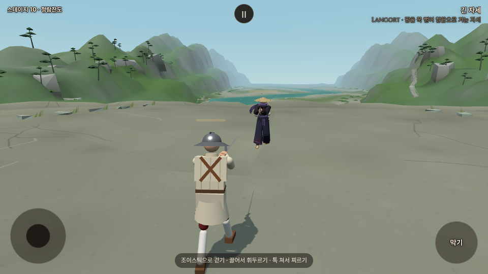
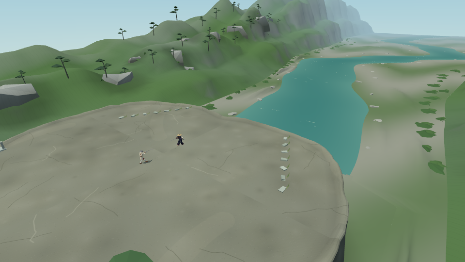

# 우화 최신 청람잔도 이식 · 2026-10-16

사용자가 ‘우화가 청람잔도 고쳤거든. 그거 가져와서 다시 작업해’라고 지시했다. 기존 포크는 전투 면적만 확대한 옛 나무 마루판이었다. 이번 작업은 우화가 되돌리고 개선한 화강암 쉼터 판을 가져와 면적2배 기준에서 다시 검증하는 것이다.

## 출처와 적용 범위

- 작업 전 포크: `ba919a6c` (`codex/refork-20261015`).
- 열람한 우화 main: `466626567566059d75b2d6aba7e4617924eac67d`. 해당 파일의 마지막 변경은 **`c46f6fb70aaf6564dde87f0b7414a1c398056970`** (청람잔도 되돌림·리뷰 여섯 가지 보정).
- 명시적 사용자 지시에 따라 청람잔도 관련 코드·기록을 읽었다. 우화 저장소에는 쓰지 않았다. 최신 main의 다른 시스템은 이번 범위에 포함하지 않았다.
- `src/stage_qinglan.js`, `src/stage_qinglan_vista.js`를 해당 커밋 그대로 이식하고 쓰지 않는 `src/stage_qinglan_gorge.js`를 제거했다. 두 소스의 Git blob이 출처와 같은지 확인한다. `src/stages.js`의 설명과 포크 공지도 갱신했다.
- 화강암 쉼터·큰 강·겹친 능선·정자·샘·돌계단, 뒤 바위에 붙은 옛 판자 잔도, 바위 밑동 묻기, 바닥 밝기·격자 개선, 바위 턱·절벽 면, 세로 면 명암·해 방위를 가져왔다. 우화의 작업을 우리 신규 제작 성과로 집계하지 않는다.
- 포크의 공통 반지름 **9.192388m**를 유지한다. 기존6.5m 대비 면적2배이며 인물·무기·시작 간격5.6m·유파 동작·보법은 그대로다. 이식한 바위 바닥이 확대된 전투 영역 전체를 덮는지 확인했다.

## 포크에서 확인한 결과

- 생산 빌드 성공. 로컬 Chromium/SwiftShader 검사이며 실기기 성능 측정은 아니다.
- `stage_area_probe.mjs … qinglan`: 바닥96점 누락0·불투명 장식 침범0. 실제 물리벽32개, 경계128방향 단절0. 앱·콘솔·HTTP 오류0.
- `stage_area_play.mjs … qinglan`: 키보드 후진10초로 반지름2.939 → **9.122m**. 옛 반경6.5m 밖까지 실제 이동, 오류0. 이동 검사만 기본 상대를 멈춰 분리했다.
- `cam_open_shots.mjs … qinglan --n=30`: 시작 카메라31지점, 무대 뚫음0·검객 시선 가림0·콘솔 오류0. 무대까지 최소2.30m.
- `qinglan_import_check.mjs`: 실제 무대 상대 김씨를 두고 경기 화면/조망 화면 촬영. 성 안뜰↔청람잔도3회 전환 후 geometry151·texture10·program35로 세 번 모두 동일, 오류0.
- 공통5관문은 이식 전 확대판과 동일: fights12 `5dfe035c`, live `648aca66`, finish `2de06c03`, corr12/12 IDENTICAL, weapon23/23·NaN0(`7085b282`). 검사기에는 확대 전 fights12 기대값 `a071c0af`가 남아 종료코드1이다. 이는 이전 [면적 확대 대조 실험](STAGE_AREA_20261016.md)에서 확인한 기존 차이이며, 이번 이식으로 새로 생긴 차이가 아니다. 기대값을 바꾸지 않았다.
- [기계 판독 결과](qinglan_import_20261016_checks.json). 원자료·빌드 로그·상대 작성 기록 사본: `/workspace/qinglan-import-20261016/`.

## 실제 화면

로컬 생산 빌드. 경기 화면은 기본 플레이 카메라에서 김씨의 AI를 멈추고 촬영했다. 두 번째 사진은 무대를 보여주기 위한 조망 카메라다. 게임 카메라 설정은 변경하지 않았다.

동일 위치/화각의 상공 사진: [이전 나무 마루](../screenshots/stage_area_20261016/qinglan-after.png) → [이식한 화강암 쉼터](../screenshots/qinglan_import_20261016/top.png). 확대 전후 면적 비교가 아니라 **옛 무대와 새 무대의 외형 비교**다. 양쪽 모두 포크의 확대된 전투 반경을 사용한다.

## 배포

공개 소스 **`e1f09c3e7d59416764c53ab0b05f4ae15c00a5fd`**를 우리 main·작업 가지 원격 해시로 확인했다. [Pages 38838574389](https://github.com/yoonjl-svg/halfsword-codex/actions/runs/38838574389) **Success**, 총44초(빌드24초·배포11초). 최종 로컬 생산 빌드에서 새 청람잔도 공지 표시도 확인했다.

[청람잔도 직접 열기](https://yoonjl-svg.github.io/halfsword-codex/?stage=qinglan&weapon=longsword&foe=renji). 이 환경의 공개 게임 도메인은 프록시 CONNECT403으로 접근이 막혀 공개판 직접 조작은 검증하지 못했다. 게임/화면 검증은 동일 코드의 로컬 생산 빌드, 공개 배포 완료는 Actions에서 확인했다. 저장소에 공개한 경기 화면은 HTTP200이며 로컬 사진과 SHA256이 일치한다. [배포 영수증](qinglan_import_20261016_release.json).
