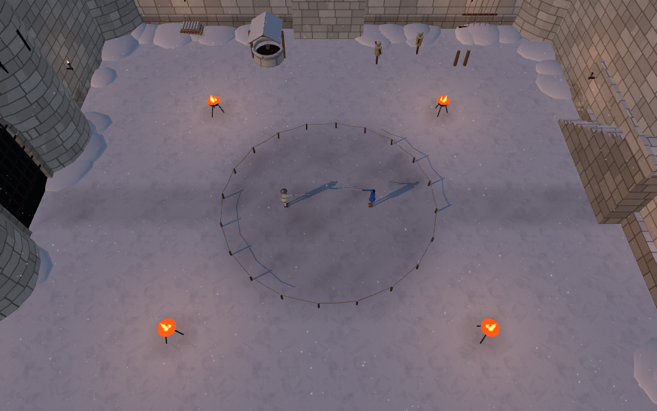
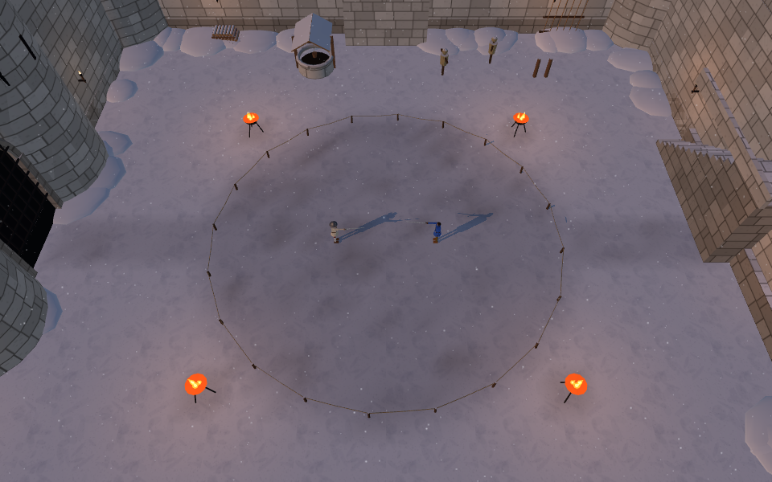

# 전 스테이지 전투 면적 2배 · 2026-10-16 KST

사용자가 ‘바닥 면적 2배 — 가로·세로 약 1.414배’로 확정했다. 작업 기준은 우리 `codex/refork-20261015`의 `72269e27`, 수정·배포 대상은 `yoonjl-svg/halfsword-codex`뿐이다.

## 적용

- 공통 `ARENA.radius`: 6.5 → 9.192388m. 기준 지름 13 → 18.384776m, 원 면적 132.7323 → 265.4646㎡. 정식 여정 15곳과 보관용 3곳 모두 적용한다. 기존 32분할 충돌 벽·벽 두께·5cm 접촉 여유는 유지한다.
- 캐릭터·무기·건물 크기, 시작 간격 5.6m, 유파 동작·보법, 공격·걷기·회복 수치는 유지한다. AI 경계 판단과 물리 도구도 공통 반지름을 읽는다.
- 신전의 바닥 테두리와 잔해 위치, 숲의 디딤돌·이끼 띠, 얼음판·눈 둑, 성 안뜰·화전 터의 밟힌 흙과 장식을 새 경계에 맞췄다. 통나무 테두리는 회전 부호를 고쳐 긴 끝이 결투장 안으로 파고들지 않게 했다. 화전 터 비탈은 이미 반지름 13m까지 평평해 높이 공식 변경이 필요 없었다.
- 습지는 섬 외곽과 웅덩이의 좌표·가로·세로를 √2배로 함께 확대했다. 젖음의 그림·이동 판정·AI는 같은 정의를 사용한다. 중심 석상의 크기·충돌체는 유지한다.
- 화산섬 물가는 z 5.25 → 7.424621m로 옮겨 위험 구역의 상대 비율을 유지했다. 평균 경사 10°, 화상 규칙은 그대로다. 용암면·감지 상자·AI 회피가 같은 물가 값을 읽는다.
- 첫 화면 공지에 ‘더 넓어진 결투장’을 추가했다.

## 확인 결과

- `npm run build` 성공. 생산 빌드를 로컬 Chromium/SwiftShader에서 검사했다.
- `tools/browser/stage_area_probe.mjs`: 18무대, 바닥 1,728점, 실제 게임 충돌 경계 2,304방향 확인. 바닥 누락·경계 단절·검사점의 불투명 장식 침범·앱/콘솔/HTTP 오류 0. 빛줄기와 화산의 용암 표면은 장식 장애물에서 제외한다. 정해진 표본 검사이며 모든 위치/실기기 성능의 보장은 아니다.
- `tools/sim/stage_area_check.mjs`: 평지·화산에 움직이는 구체 16개씩 총32개로 새 구역 이동·바닥 지지·벽 봉쇄를 확인했다. 용암 물가 높이73점, 습지 외곽360방향, 웅덩이5개 확인.
- `tools/browser/stage_area_play.mjs`: 실제 키보드 후진 입력10초. 플레이어 반지름2.942 → 9.121m, 오류0. 상대 AI만 멈춰 경계 확인을 분리했고, 사람의 입력·보법·기력·물리 수치를 바꾸지 않았다. [실제 플레이 카메라](../screenshots/stage_area_20261016/castle-play.png).
- 공통 관문: live_battery `648aca66`, finish_thrust `2de06c03`, corr 12/12 IDENTICAL, weapon_smoke 23/23·NaN0(`7085b282`).
- fights12는 정상 종료했지만 기존 해시와 다르다: `a071c0af` → `5dfe035c`. 현재 코드에서 **반지름만 6.5로 되돌린 대조 실행이 정확히 `a071c0af`**를 재현했다. 넓어진 경계가 대전에 미치는 의도된 차이로 기록하며, 관문 기대값은 고치지 않았다.
- [기계 판독 결과](stage_area_20261016_checks.json). 원시 로그·18무대 사진은 `/tmp/stage-area-{before,after,final,gates}`에 보존했다. 초기 개발 서버 검사1회는 HMR 재탐색으로 중단됐고, 수정 완료 후 생산 빌드 전체 검사로 대체했다.
- 동일 원자료를 `/workspace/stage-area-20261016/`에도 보존하고 파일별 SHA256을 기록했다.

## 실제 화면

이 절의 청람잔도 설명·사진은 우화 최신판을 가져오기 전 기록이다. 사용자의 후속 지시로 화강암 쉼터 판을 이식한 현행 상태는 [청람잔도 이식 기록](QINGLAN_IMPORT_20261016.md)을 따른다.

청람잔도 후속 확인: 공통 이동 반경은 6.5 → 9.192388m로 바뀌었으나 `stage_qinglan.js`의 마루·난간 외형은 확대하지 않았다. 기존 마루가 새 이동 범위를 포함해 외형 변경 없이 진행한 것이다. 바닥96점·물리 경계128방향 검사는 통과했지만 이는 마루 외형을 확대했다는 뜻이 아니다. 사용자에게 이 차이를 명시하고 [실제 확대 후 청람잔도 사진](../screenshots/stage_area_20261016/qinglan-after.png)을 보고한다. 사진은 공개 소스 `12905c0c`와 같은 게임 코드의 로컬 생산 빌드에서 촬영했다.

아래는 변경 전 로컬 개발판과 변경 후 로컬 생산 빌드의 실제 성 안뜰이다. 같은 960×600 해상도·같은 위치/화각의 **검사용 상공 카메라**로 촬영했다. 게임 플레이 카메라 설정은 바꾸지 않았다.

확대 전:

확대 후:

## 배포

공개 소스는 `12905c0c634c63e40cb7fd8f40d2417dd28811bb`. 우리 main과 작업 가지의 원격 해시를 확인했다. [Pages 38796329214](https://github.com/yoonjl-svg/halfsword-codex/actions/runs/38796329214) **Success**, 총1분14초(빌드28초·배포38초). 첫 화면의 새 공지도 최종 로컬 생산 빌드에서 실제 표시를 확인했다.

[게임 열기](https://yoonjl-svg.github.io/halfsword-codex/). 현재 클라우드의 공개 게임 도메인 요청은 프록시 CONNECT403으로 차단되어 공개판 직접 조작 검증은 하지 못했다. 화면/입력/지형 검증은 로컬 생산 빌드, 공개 배포 성공은 GitHub Actions에서 확인했다. 저장소에 공개한 확대 후 스크린샷은 HTTP200 및 로컬 바이트 SHA256 일치도 확인했다. [배포 영수증](stage_area_20261016_release.json).
