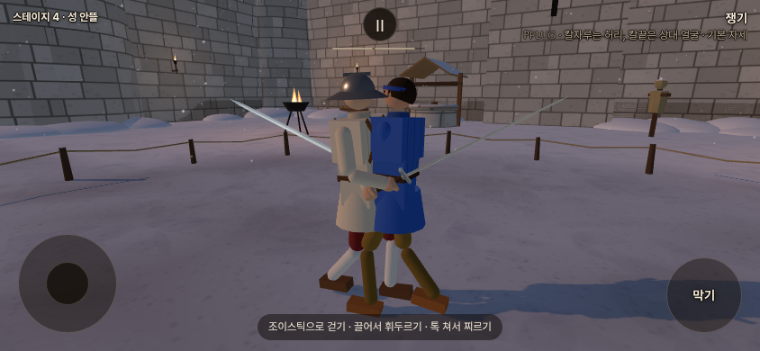
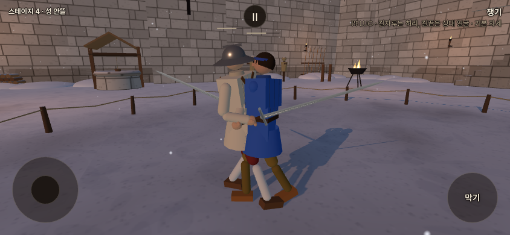
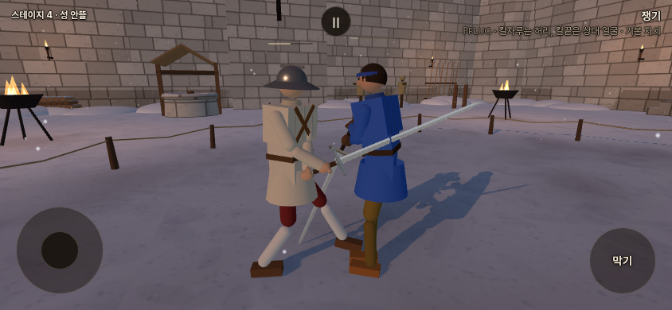

# 클린치 기력 적용 · 2026-10-15

## 사용자 결정

- 실제로 붙어 밀고 버티는 동안 양쪽 각각 초당10 소모·회복 중단.
- 무기 무게 배율 없이 같은 비용. 동시에 양쪽이 밀어도 두 번 청구하지 않는다.
- 클린치 중 발 디딤에는 걷기 비용을 겹치지 않는다.
- 종료 후0.6초부터 일반 회복. 한쪽 탈진 시 클린치 소모 종료,2.5초 강제 회복 우선.
- 초마다10을 한꺼번에 빼지 않고 **물리 시간 `10 × dt`**로 소수점 차감한다. 기본120Hz에서 스텝당 약0.083333이다.

기준은 포크 `codex/refork-20261015`의 `9db75870`. 게임 변경은 `src/stamina.js`와 `src/config.js` 두 파일이다. 기존 밀기 입력/접촉/자세·유파 동작·보법 정의를 재사용했다. 원본 저장소 쓰기·공개 배포는 하지 않았다. 두 팀이 분담에 합의했다고 주장하지 않는다.

같은 스텝에 두 검객을 순서대로 갱신하므로, 클린치 소모는 양쪽의 장부가 공유하는 한 번의 계산으로 확정한다. 한쪽이−50에 닿는 마지막 스텝은 그 경계까지만 양쪽에 똑같이 청구하고 다음 스텝부터 탈진 회복을 진행한다. 종료 후 회복 시계와 사망·부활·기력 끔도 검사한다.

## 적용과 판정

`STAMINA.clinchPerSecond = 10`. 다른 공격 비용과 마찬가지로 플레이어·AI 공통이며 질량 배율을 곱하지 않는다. 소수점 값을 장부에 그대로 보관하고 기존 HUD의 채움 비율에 반영한다. 실제1/120초 스텝에서10/120≈0.083333,0.1초에1,0.5초에5,1초에10이다. 게임 시간 기준이므로 일시정지에서는0이며 멈칫·게임 속도 조절을 따른다.

한쪽 이상의 기존 `barge.phase === 'press'`, 전진 누르기 유지, 밀기 거리 안, `closeTouch()`의 실제 팔·칼 접촉이 동시에 필요하다. 두 사람 모두 서 있고 살아 있어야 하며 공격·비기·탈진·부활 중에는 성립하지 않는다. 닿아 있기만 하거나 딛기 준비만 하는 것은 비용을 만들지 않는다. 한 사람이 밀고 다른 사람이 버틸 때도 같은 한 쌍으로 처리한다.

클린치 동안 걷기 누적·일반 회복을 건너뛴다. 누르다가 칼이 튕긴 접촉을 예전 공격 번호의 막기 비용으로 다시 청구하지 않는다. 실제 새 공격을 시작하면 클린치 조건이 풀리고 기존 공격·접촉 비용을 따른다. 막기 성공률·자세는 바꾸지 않았다.

누군가−50에 닿으면 양쪽 누르기를 종료한다. 같은 마지막 스텝의 비용까지 동일하며 다음 스텝부터 탈진자의 강제 회복이 우선한다. 나머지 검객의 일반 회복은 마지막 클린치 비용 이후0.6초 조건을 따른다. 기존 밀기 재발사에는 다시 스틱을 놓았다 미는 조건이 유지된다. 저기력 클린치를 새로 선택하는 AI 판단은 추가하지 않았다.

## 검증

- 단위·실물리 **37/37** 통과. 기존26개에 클린치11개를 추가했다. 순서 반전·동시 밀기·서로 다른 질량·한쪽만 밀기·접촉 없는 근접·상태 예외·걷기/막기 중복·0.6초 회복 지연·경계 소수점·동시 탈진·다른dt·일시정지·기력 끔을 검사했다.
- 실물리3검사는 입력으로 접근→놓기→누르기를 수행하며 실제 접촉과 기존 밀기 동작을 통과한다. 클린치 비용이 생기는 매 스텝마다 양쪽 비용 동일, 각 스텝10×dt 이하, 회복0·걷기 추가0을 검증한다. 상대를 탈진시키는 장면에서는 누르기 해제와2.5초 회복을 검증했다.
- 별도 준비 장면에서 한쪽 밀기는 실제 접촉 약0.9083초 동안 각9.0833, 양쪽 밀기는 약2.9417초 동안 각29.4167 소모했다.9초 전체 장면의 비용이 아니라 **조건이 성립한 접촉 시간**의 비용이다. 입력만 유지해도 접촉이 풀리면 계속 청구하지 않는다. 이 장면은 준비한 검증 입력이며 자연 결투의 평균 클린치 길이를 의미하지 않는다.
- 빌드 성공: PWA `c41576dc9712e0d15dc515ea`,345파일. 기존 대형 번들 경고만 남는다.
- 고정 빌드 미리보기의 기존 브라우저10개 + 클린치7개, **17/17·오류0**. 두 바 연속 차감·정지·탈진 종료·AI 방어 중 강제 회복을 확인했다. Playwright 가짜 시계·모바일844×390 에뮬레이션이며 실제 휴대폰 FPS 검사는 아니다.
- 공통 관문 켬/끔 모두 통과. 이 관문의 기본 인물들은 적극적인 밀기를 사용하지 않으므로 기력 켬의 기존2차 결과도 유지된다. 실제 클린치 검증은 위 별도 검사로 보완했다.

| 관문 | 기력 끔 | 기력 켬 |
| --- | --- | --- |
| fights12 | `7c95ba21` | `5a02a22d` |
| live_battery | `e7ee3d96` | `807dc4e9` |
| finish_thrust | `433ac984` | 동일 |
| corr_s0 | 12/12 IDENTICAL | 12/12 IDENTICAL |
| weapon_smoke | `27b922fc`,23OK | 동일 |

기력 끔의 고정 stdout 해시는 원래 공통 기준과 일치한다. corr의 출력에는 실행 시간이 들어 있으므로 전체 해시 동일을 요구하지 않고12/12 비교 결과를 확인한다. 기대값 파일은 수정하지 않았다. 이전 [기력2차 공속 보정 한계](STAMINA_V2_20261015.md)는 그대로이며 이번 작업에서 공속을 조정하지 않았다.

## 실제 화면

**로컬 빌드 미리보기**에서 찍었다. 양쪽 기력80으로 비교 장면을 준비하고 기존 스틱·물리·접촉으로 밀게 했다. 두 바가 보이도록 측면 관찰 카메라를 사용했으며 게임의 기본 카메라나 밀기 자세를 바꾼 것은 아니다. 전후의 실제 시간·기력·누적 비용은 [검증 영수증](stamina_clinch_validation.json)에 있다.







## 재현

```sh
node --test tools/sim/stamina.test.mjs tools/sim/stamina_integration.test.mjs tools/sim/stamina_clinch.test.mjs
npm run build
node tools/sim/stamina_gates.mjs off /tmp/stamina-clinch
node tools/sim/stamina_gates.mjs on /tmp/stamina-clinch
# 별도 터미널에서 npm run preview -- --port 4173 실행 후:
PW_CHROMIUM=/usr/bin/chromium node tools/browser/stamina_smoke.mjs http://127.0.0.1:4173 /tmp/stamina-regression
PW_CHROMIUM=/usr/bin/chromium node tools/browser/stamina_clinch_smoke.mjs http://127.0.0.1:4173 /tmp/stamina-clinch-browser
```

원시 로그·초기 탐침은 `/workspace/stamina-clinch-validation/`에 보관했다. 브라우저 검사 초안에서 일시정지 해제 버튼을 잘못 지정해 메뉴에 가려 클릭이 실패했다. 실제 `계속하기` 버튼으로 수정한 뒤 전체7개가 통과했다.
