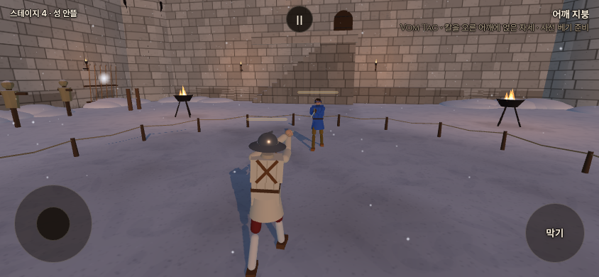
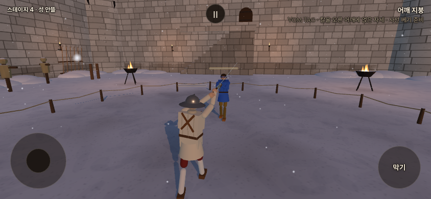

# 기력 감속 — 실제 접촉 기준 보정

사용자가 지정한 이동 .7/.4, 공격 .8/.6을 분리하고 포크 기본값에 적용했다. 접촉 시간 목표는 정상 대비 **1.25/1.6667배**다. 이전 ±7% 전수 일치 요구는 사용자의 “딱 맞진 않더라도 지금보단 훨씬 근사치” 지시로 대체됐다. 평균 오차는 줄었지만 모든 공격이 일치하지 않으며, 접촉을 잃은 조건도 아래에 공개한다.

작업 가지 `codex/refork-20261015`. 구현 `86e141fb`, 계기 `295f7b9a`, 미채택 동방 실험 보존 `0af3936f`(기본 끔). 우화 `adc87f41`를 먼저 통합한 뒤 작업했다. 원본 저장소에는 쓰지 않는다. 공개 배포 상태·전달용 커밋은 별도 `stamina_contact_20261016/release.json`에서 확인한다.

## 적용 규칙과 내부 계수

| 기력 단계(소모할 때) | 이동 명령 | 공격 속도 목표 | 접촉 시간 목표 |
|---|---:|---:|---:|
| 정상 | 1 | 1 | 1 |
| 0 미만 | .7 (−30%) | .8 (−20%) | 1.25 |
| −40 미만 | .4 (−60%) | .6 (−40%) | 1.6667 |
| −80 도달 | 이동 불가 | 공격 불가 | 2.5초 탈진 후 0 |

회복할 때의 단계 되돌림 +15, 사람21/s·AI15/s, 지연0.6초, 방어 유지 회복 중단, 탈진 중 강제 회복, 비용/클린치/파손 전 질량은 유지한다. 이동 값은 기존 이동 명령에 적용하는 배율이며 실제 골반 속도가 모든 순간 정확히 같은 비율이 된다는 뜻은 아니다.

| 내부 명령 시간 계수 | 지침 | 심한 지침 | 선택 근거 |
|---|---:|---:|---|
| 베기·비기 기본 | .8 | .6 | 경로와 추종 필터를 함께 늦춰 공격 호가 축소되는 현상 방지 |
| 일반 찌르기 | .75 | .55 | 준비·뻗기와 실제 접촉 사이의 지연을 보정 |
| 찌르기 특성 무기 또는 원래 질량 ≥2.5kg의 찌르기 | .8 | .6 | 일반 찌르기 계수를 쓰면 이 범주의 오차가 오히려 증가 |
| 손잡이 찍기 | .72 | .50 | .8/.6, .76/.54와 비교해 접촉 시간 오차가 가장 낮았음. 명중 조건 감소는 남음 |

공통 공격 근육 계수는 **.64/.36**. 중력을 버티는 보상과 무기를 움직이는 힘 상한을 분리하고, 손목 감쇠·관절 속도 한도를 명령 시간에 맞춘다. 찌르기는 자체 자세 시간표가 있어 몸 필터를 추가로 늦추지 않는다. 계수는 위 측정 범위에서 선택했으며 모든 자세·거리에서의 최적값을 증명한 것은 아니다. 파손 후에도 질량 분류는 처음 질량을 쓴다.

사람의 입력 경로를 순서대로 재생하되 **기력 청구와 고유 동작 인식은 원래 입력·원래 시간으로 계산**한다. 경로가 아직 진행 중이면 자동 자세 복귀가 공격을 자르지 않게 한다. 막기 전환은 즉시 큐를 취소한다. 유파의 동작 정의·발동 조건·보법 수치·피해 에너지 공식은 바꾸지 않았다. `unique_assist.detect`에 입력 속도를 전달하는 연결만 추가했다.

운동에너지 `½mv²`에서 질량이 같으면 속도 절반은 에너지1/4이다. 게임의 피해는 접촉 방향·부위·방어구도 읽으므로 피해량1/4과 같지 않다. 일본의 기존 운동학적 비기는 별도의 고정 J 규칙을 쓰므로 모든 비기에 v² 관계가 성립한다고 말할 수 없다. 그 규칙은 이번에 변경하지 않았다.

## 실제 접촉 측정

19종 × 베기/찌르기/찍기/비기 × 사람/AI =152개 기준 조건. 정상 단계만 보고 출발 자세·거리·표적을 먼저 고정했다. 그중133개에서 정상 공격의 유효 접촉을 확보했다. 11개는 기준 공격부터 빗나가 측정 불가, 8개는 해당 비기가 없다. 총399개 유효 실행(정상133+지침266)이며 NaN0이다. 모든19종을 살폈다는 뜻이지 모든 동작의 기준을 확보했다는 뜻은 아니다.

공격 시작→실제 타격 구간의 최초 접촉을 잰다. 준비/회수 접촉과 시작부터 겹친 표적은 제외한다. 실제 게임 몸 충돌체를 고정 표적으로 사용했다. 날 없는 무기는 둔타 부위, 손잡이 찍기는 hilt 접촉을 읽는다. 손잡이 끝의 세부 표면까지 분리하지는 않았다. 공격의 최초 접촉 부위가 달라진 경우도 숨기지 않았다.

| 동작 | 전후 모두 접촉한 조건 | 목표 대비 평균 절대오차: 이전→보정 | 전체 지침 조건의 접촉: 이전→보정 |
|---|---:|---:|---:|
| 베기 | 38 | 6.4% → 3.3% | 42/66 → 59/66 |
| 찌르기 | 66 | 12.0% → 8.0% | 69/70 → 66/70 |
| 손잡이 찍기 | 53 | 15.0% → 10.2% | 63/70 → 55/70 |
| 비기 | 36 | 16.9% → 6.5% | 36/60 → 48/60 |
| 전체 | 193 | **12.6% → 7.4%** | **210/266 → 228/266** |

오차는 `abs((지침 접촉시간/정상 접촉시간)/목표시간비 − 1)`. 평균 개선은 같은 조건에서 전후 모두 맞은193개로 계산했다. 놓친 조건을 평균에 0으로 넣거나 성공으로 처리하지 않았다. 새 판에서 맞은228개 전체의 오차는7.6%. 이전에 맞다가 새로 놓친17개, 새로 맞은35개를 [비교 원자료](stamina_contact_20261016/comparison.json)에 모두 열거했다. 정상133조건의 접촉/최고 속도/종료시각/상태는 전후 동일했다.

한계: 고정 표적이고 거리별 실전 명중률 시험이 아니다. 손잡이 찍기는 오차 개선과 접촉 감소가 함께 나타났다. 일본 찌르기의 이른 가슴 스침, 이탈리아 비기의 이른 접촉, 이베리아 비기의 지침 AI 비접촉이 남는다. 이베리아 AI 비접촉은 이전 판에서도 발생했다. 실제 접촉 부위 변경은37조건이다. 큰 예외를 평균으로 감추거나 모든 무기에 ±7%를 달성했다고 보고하지 않는다.

재현:

```sh
gzip -dc docs/codex_team/stamina_contact_20261016/fixtures.json.gz > /tmp/stamina-contact-fixtures.json
TEMPO_FIXTURES=/tmp/stamina-contact-fixtures.json node tools/sim/stamina_contact_probe.mjs /tmp/contact-after all
TEMPO_FIXTURES=/tmp/stamina-contact-fixtures.json node tools/sim/with_config.mjs STAMINA.attackTempo=false STAMINA.attackTired=.7 STAMINA.attackSevere=.5 STAMINA.moveSevere=.5 stamina_contact_probe.mjs /tmp/contact-before all
python tools/sim/summarize_stamina_contact.py /tmp/contact-before/rows.json /tmp/contact-after/rows.json /tmp/contact-comparison.json
```

전체 원자료: [이전](stamina_contact_20261016/before.json.gz), [보정](stamina_contact_20261016/after.json.gz), [설정](stamina_contact_20261016/after-config.json). 탐색에서 .8/.6 전체 공통, 찌르기 몸 필터 유지/해제·힘 유지, 찍기 .72/.50·.76/.54를 비교했다. 원자료의 ±7% `pass`는 진단값이며 새 사용자 채택 기준이 아니다.

## 회귀·실제 게임 화면

기력/입력 검사50개 통과. 질량/찌르기 특성 분류와 파손 후 유지 검사1개를 추가해 해당 파일 재검증도 통과했다. 추가 큐 중단 검사에서 복귀 중 새 손길을 덮어쓰지 않는 것도 확인했다. 정상·지침·심한 지침 × 해금0/5 ×12종 입력의 비용과 기술 인식이 같다. 준비 비용0·베기12·찌르기7, 방어 유지/탈진/클린치 검사를 포함한다.

기력 끔/켬의 공통5관문 모두 이전 기대값 유지: fights12 끔`7f5860c7`/켬`a071c0af`, live`648aca66`, finish`2de06c03`, corr12/12 동일, weapon23/23·NaN0. 이 관문만으로 지침 밸런스를 입증하지 않는다. 무기5종×24판=120판 추가 대련은 비정상 값 없이 종료했지만, 음수 기력에 들어간 몸은1개·심한 지침/탈진0이었다. 심한 지침 검증의 주 근거는 위 고정 단계 시험과 탈진 통합 검사다. [대련 요약](stamina_contact_20261016/duels-summary.json).

실제 브라우저 입력10검사 통과·오류0. 로컬 프로덕션 빌드·이름752줄 위반0. 아래는 실제 Chromium 게임 촬영이며 그림 시안이 아니다. 같은 롱소드 내려베기 입력을 시작한 약0.25초 뒤 정상/심한 지침의 자세다. 브라우저 초기 물리·표시 프레임의 차이가 있어 이 사진으로 시간 오차를 산출하지 않았다. 접촉 오차의 수치 근거는 위120Hz 계기다. 실제 iPhone/Safari 측정은 아니다.

정상:



심한 지침:



실제 촬영 영상: [정상 3초](../screenshots/stamina_contact_20261016/fresh.mp4), [심한 지침 3초](../screenshots/stamina_contact_20261016/severe.mp4).

## 동방 AI 독립 검증 — 미채택

탐색96판에서 좋아 보인 거리 보정(holdGain3.2/holdNear.6/holdBrake.35)을 선택한 뒤, 미리 기록한 별도 씨앗96·144 각24판/자리로 **각 무기·갈래96판**을 비교했다. 새 기력 지시 이전 설정으로 실행된 실험이다.

| 무기 | 가벼운 발 끔 | 현재 기본 AI | 후보 |
|---|---:|---:|---:|
| 청강검 | 32승 | 36승 | 23승 |
| 월왕구천검 | 14승 | 14승 | 18승 |

합계 후보41승 < 현재50승, 청강검은 끔 기준에도 미달. **미채택**, `GAIT.cnAiTune=0`/`cnLightAi=1` 유지. 후보를 개선 완료로 표시하지 않는다. [승률·95% 구간·머리 타격·넘어짐·클린치](stamina_contact_20261016/cn-holdout-summary.json), [전체 기록](stamina_contact_20261016/cn-holdout.json.gz). 에피소드 계기는 실제 이동을 관찰하지만 첫 스텝 이전 접촉을 포함하지 않는 한계가 있어 방어 성공률로 해석하지 않는다.

우화의 멈춤거리 질문: 현재 가벼운 발에서 청강검/월왕구천검은 스틱을 놓은 뒤 골반 속도≤.1m/s까지 중앙값 **.55/.56초**, 미끄러짐 **.46/.47m**. 가벼운 발 끔은 모두 .70초/.72m. 각10개 걸음 위상, 씨앗7, 정상 기력의 실제 물리 결과이며 AI 승률이 좋아졌다는 근거는 아니다. 사람 보법 수치는 변경하지 않았다.

## 화면 오른쪽 색 문제 전달

수정 `2f593ba6`: CSS 비네트/감정 오버레이를 제거하고 게임 장면과 같은 WebGL drawing buffer에 전체 화면 quad를 그려 화면 가장자리까지 같은 방식으로 합성한다. 기존 색·강도는 유지했다. Chromium12조건·회전/크기 변경에서 확인했으며 Safari 원인·해결을 실기기로 입증했다고 과장하지 않았다.

우화 `adc87f41`에 같은 모듈이 이미 들어간 것을 확인했다(수입 `d78a4361`). 설명과 인지 여부 확인 요청은 [원격 메시지](https://github.com/yoonjl-svg/halfsword-codex/blob/b1144fa8c97bd91f814281708216e3f8e2da744a/docs/devmeet/messages/2026-10-16-screen-tint-stamina.md)에 발행·바이트 검증했다. 상대의 열람/답변은 미확인이다.
