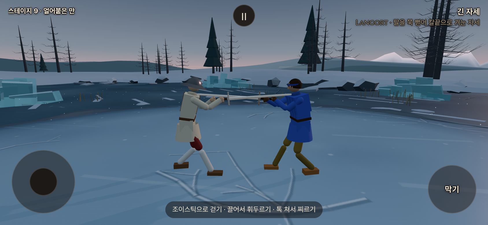
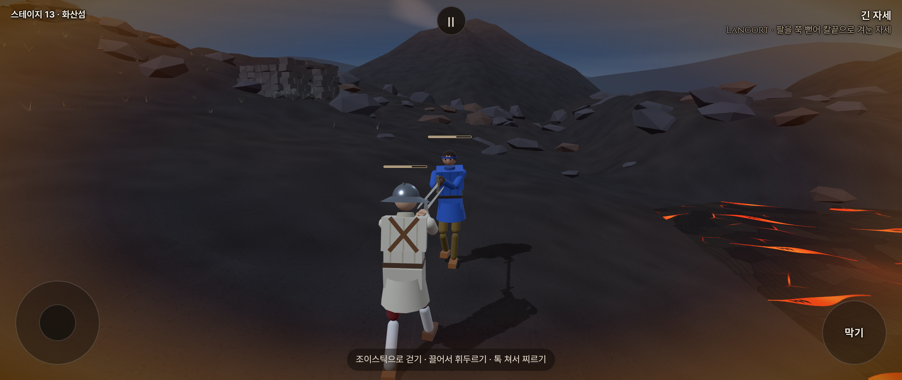

# 기력 준비 비용·표시·화면 색 경계 수정 — 2026-10-15

사용자가 [앞선 분석](STAMINA_REVIEW_20261015.md) 뒤 흰색+금색 총0.5px, 완충 흐림 완화, 사람 준비 동작 중복 소모와 오른쪽 색 경계 수정을 승인했다. `codex/refork-20261015`, `yoonjl-svg/halfsword-codex`에서만 수정한다. 유파 동작·보법 정의는 변경하지 않았다.

게임 변경: 준비 비용 `f933bc07`, 표시/색 합성 `2f593ba6`. 공통 접촉 연결은 `combat.js`, 화면 연결은 `main.js`를 수정했다. 우화와의 분담 합의를 뜻하지 않는다.

## 준비와 공격

기존의 빠른 손 이동 즉시 청구를 보완했다. 기존 긋기 분류를 재사용하되 해금과 독립된 기력 장부에서 실제 손 이동을 쌓는다. 중앙 공격선·기술 방향이 확인되거나 큰 동작이면 공격을 확정한다. 공격선을 가르지 않고 머리·어깨·옆·허리 준비 자리에 옮긴 짧은 동작은 추가 청구하지 않는다. 애매한 입력은 끝까지 보류하고, 준비 도중이라도 실제 타격이나 자기 칼이 상대 칼을 향해 부딪힌 접촉이면 공격 비용을 확정한다.

- 실제 이동0.06m 미만의 흔들림은 제외. 0.12초 미만 입력 끊김은 같은 긋기에 포함한다. 기존 기술 해금/고유 동작의 판정 상수는 바꾸지 않는다.
- 반대 방향으로 새 공격선을 가르면 다음 공격으로 청구한다. 빗나간 공격도 비용이 있다. 준비라고 모든 위쪽 움직임을 면제하지 않는다.
- 탭 찌르기·비기·막기 유지·클린치·원래 무게 배율·탈진 규칙은 유지한다. 접촉의 공격/방어 비용 중복도 방지한다.

실제 Skill/물리 루프, 표준 롱소드, 상대와8m 분리하여 같은 손 경로 비교:

| 입력 | 이전 사람 / AI | 수정 사람 / AI |
|---|---:|---:|
| 빠른 어깨 준비→내려베기 | 24 / 12 | 12 / 12 |
| 느린 준비→내려베기 | 12 / 12 | 12 / 12 |
| 허리로 당김→탭 찌르기 | 19 / 7 | 7 / 7 |

해금0/5에서 12종 긋기24사례가 각각 베기12/찌르기7. 중앙에서 머리·양 어깨·양 옆·양 허리로 준비만 하는7경로는0, 공격 취소0, 준비 중 접촉은 한 번 청구했다. 사용자의 의도 자체를 읽는 기능은 아니다. 중앙을 가로지르는 자세 전환은 실제 공격과 같은 경로가 될 수 있어 계속 공격으로 셈한다. 새 유파 동작에 대한 추가 측정이나 모든 자유 입력에 대한 완전한 분류를 주장하지 않는다.

## 화면

바는 흰색 `#f3e9d8` 안쪽0.25px + 기존 강조 금색 `#d9a441` 바깥0.25px, **합계0.5 CSS px**. 두 번째 그림자의 바깥 범위가0.5px이므로0.25+0.5=0.75px가 아니다. 너비56·채움 높이2px와 베이지색 `#b8a88e`는 유지했다. 완충 불투명도15→60%; 채움 자체85%와 합친 실효 불투명도12.75→51%. 소모 중은 기존100%를 유지하며 음수 단계의 맥동도 유지한다. 위치는 기기 픽셀에 맞춰 소수점 위치에서의 흐림을 줄인다.

사용자 사진의 오른쪽 색 단절은 출혈/감정용 별도 전체 화면 CSS 층과 일치하는 형태다. 기존 코드에도 Safari에서 오른쪽 일부가 갱신되지 않는 동일 제보와 blur 제거 이력이 있었다. 이번에는 해당 두 CSS 색막을 제거하고 `screen_tint.js`에서 게임과 **같은 WebGL 캔버스**에 합성한다. 색·세기 계산·그라디언트 범위는 유지하며 효과가 없으면 추가 그리기를 생략한다. 효과가 있으면 사각형1개/그리기1회가 추가된다. 실기기 성능은 미측정이다.

Chromium에서는 원래 Safari 결함 자체를 재현하지 못했다. 따라서 원인 확정이나 iPhone 재발 없음까지 주장하지 않는다. 별도 CSS 층의 일부만 낡게 남는 경로를 제거했고, 출혈+감정3종×화면4크기12조합에서 좌우 끝 픽셀 동일·오른쪽 인접 픽셀 차1/255 이하를 확인했다. 실제 게임도1110×497→1175×497→390×844→1175×497로 바꾸며 캔버스 전체 크기와 색 효과를 확인했다.

## 검증

- `node --test tools/sim/stamina.test.mjs tools/sim/stamina_preparation.test.mjs tools/sim/stamina_integration.test.mjs tools/sim/stamina_clinch.test.mjs`: **43/43**.
- 브라우저 `stamina_smoke.mjs`10, `stamina_clinch_smoke.mjs`7, `stamina_visibility_smoke.mjs`15: **32/32**, 실행/콘솔 오류0. 로컬 프로덕션 빌드·Chromium 모바일 에뮬레이션이다.
- `npm run build` 성공, PWA `bddad028006035fa3db5d919`,345파일/6,763,893바이트. 기존 번들 크기 경고만 있다.
- `node tools/sim/stamina_gates.mjs on|off /workspace/stamina-fix-validation`: 양쪽5관문 통과. 끔은 공통 기준과 동일. 켬 fights12 `5a02a22d`, live_battery `e7ee3d96`, finish_thrust `433ac984`, corr12/12 동일, 무기23종 FAIL/NaN0.
- 앞선 켬 live_battery `807dc4e9`→`e7ee3d96`: 차이는 kata 구간이다. 준비/왕복 입력의 과금이 줄어 저기력 감속이 달라지는 의도한 결과이며 목표 해시나 물리 공식을 수정하지 않았다. kata 칼끝 속도p95는12.8→15.3, 칼 방향 오차 평균23.9→19도다. fights12와 나머지 관문 결과는 앞선 기력판과 같다.
- 최초 단위 검사2건은 손 위치를 고정한 채 속도 신호만 주던 모의 입력이었다. 실제 이동을 포함하도록 고쳤고 준비/실행·헛침 검사를 추가했다. 최초 화면 회전 검사는 가상 시계가 실제 브라우저 레이아웃보다 먼저 진행되어 실패했다. 실제 레이아웃 완료 후 검사하는 것으로 도구를 교정했다. 실패 로그도 저장소 밖에 보존한다.

구조화 결과: [검증 영수증](stamina_fix_20261015_checks.json). 원본 stdout/stderr·사진·최초 실패 로그: `/workspace/stamina-fix-validation/`.

## 실제 게임 화면

아래는 **로컬 프로덕션 빌드**다. 완충 비교는 동일한 물리 프레임에서 이전/새 CSS를 적용해 촬영했다. Safari의 깨진 영역을 합성하지 않았다.

이전 완충15%·흰색0.5px:

수정 완충60%·흰색+금색 합계0.5px:

화산섬, 기력65%·집착0.6/출혈0.3을 촬영용으로 고정한 상태. 오른쪽 끝까지 부드럽게 색이 이어진다. 실제 플레이 중 자연 발생한 감정/부상 수치라는 뜻은 아니다.

## 공개 전달

포크 테스트 페이지: <https://yoonjl-svg.github.io/halfsword-codex/>. 소스 `72ac73b75ee252f762e1444ee4764017b7b29004`를 작업 가지/main에 원자적으로 푸시했고 [Pages38726871498](https://github.com/yoonjl-svg/halfsword-codex/actions/runs/38726871498)가53초에 성공했다. [배포 영수증](stamina_fix_20261015_release.json). 이 환경의 공개 게임 도메인 접근은 네트워크 정책상403이므로 공개판 직접 촬영과 iPhone Safari 검증은 별개로 남는다.
