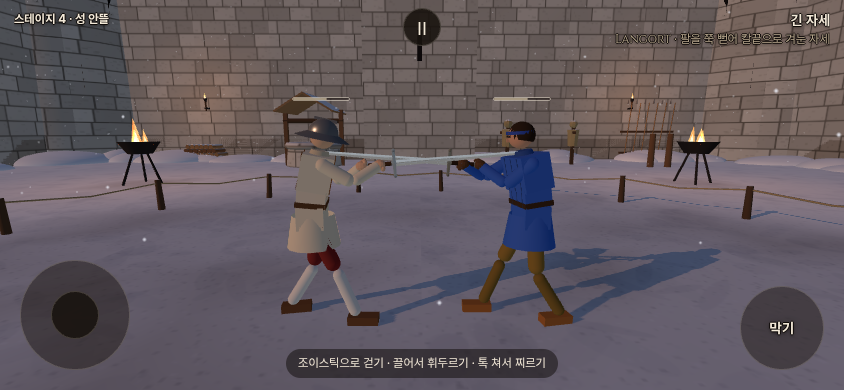

# 기력 바 테두리 대비 · 2026-10-15

사용자 요청: 기존 색 중 배경과 대비되는 색으로 얇은 테두리만 바꾸고, 음수 기력의 점멸과 칼 충돌의 공격/방어 기준을 설명한다. 기준은 포크 `codex/refork-20261015`의 `d24194e6`이다.

## 변경

게임 변경은 `index.html`의 기력 바 CSS뿐이다. 기존 본문색 `--c-text: #f3e9d8`로 바깥쪽0.5px 테두리를 모든 상태에 적용한다.56×2px의 바, 베이지색 채움 `#b8a88e`·불투명도85%, 가득 찼을 때15%로 흐려지는 규칙, 피로 맥동과 탈진 회복 표시는 유지한다. 유파·보법·전투 판정은 변경하지 않았다. 우화 저장소 쓰기·원격 푸시·공개 배포는 하지 않았다.

성 안뜰의 두 바 위아래 배경을 표본으로 비교했다. 기존 기본 UI 색8개 중 선택한 흰색의 불투명 원색 대비 중앙값은5.66:1, 보조 베이지2.93:1, 어두운 글자 외곽색2.91:1이었다. 이는 이 장면의 색 선택 근거이며,0.5px 가장자리의 안티앨리어싱·맥동·가득 참 투명도를 포함한 최종 픽셀 대비나 모든 스테이지의 최솟값은 아니다.

## 실제 화면과 검증

**로컬 빌드 미리보기**. 양쪽 기력60과 측면 관찰 카메라를 준비했다. 같은 게임 프레임에서 변경 전 테두리 CSS를 잠시 적용해 전 사진을 찍고, 제거한 뒤 실제 새 빌드 CSS로 후 사진을 찍었다. 게임 시간·기력·위치가 동일하며 바 주변240픽셀만 다르다. 기본 카메라를 바꾼 기능은 아니다.

- `npm run build` 성공. PWA `abfac41feb8ebf2bcea46e6b`,345파일. 기존 대형 번들 경고만 남는다.
- `node /workspace/stamina-border-validation/capture.mjs`: 브라우저 관측10건·오류0. 양쪽 바의 치수·채움 유지, 새 외곽선, 피로 단계별 맥동 주기·해제 경계, 탈진/동작 줄이기에서 맥동 없음, 가득 참15% 불투명도를 확인했다.
- `git diff --check` 통과. 전투/물리 코드는 바뀌지 않아 앞서 통과한 물리 관문을 반복하지 않았다.
- [표시·대비 검증 영수증](stamina_border_validation.json). 원본 캡처 도구·이미지·로그는 `/workspace/stamina-border-validation/`에 보관했다. 모든 배경·실제 휴대폰의 가독성을 확인한 것은 아니다.

## 질문에 대한 현재 코드 기준

점멸은 기력 숫자 자체가 아니라 피로 단계에 연결되어 있다.0 미만에서1단계(1.8초),−30 미만에서2단계(1.1초)가 되며 바 전체가 불투명도38%까지 부드럽게 흐려졌다 돌아온다. 음수 기력은 채움이0이라 테두리·빈 바가 맥동하는 모습이다. 회복 중2단계는−15에서1단계로,1단계는+15에서 정상으로 풀린다. 따라서 양수가 된 직후에도+15 전까지 맥동할 수 있다. 탈진2.5초와 동작 줄이기 설정에서는 맥동하지 않는다.

칼끼리 부딪히는 물리 반응에는 막기 버튼이 필수가 아니다. `combat.js:bladeClash`가 실제 무기 충돌 쌍에서 양쪽의 `stamina.block(상대)`를 검사한다. 기력 비용의 방어 판정은 다음과 같다.

- 상대에게 유효한 최근 공격 번호가 있어야 한다. 공격 등록 때1.5초, 공격이 계속되는 스텝에서는 현재 시각+0.35초로 유효 시각을 갱신한다.
- 플레이어는 손 목표 움직임의 `skill.swinging` 또는 찌르기/자루치기 상태를, AI는 `mode=attack`·`phase=strike`를 자기 공격 여부로 본다.
- 자기 공격 중이고 방어 유지 중이 아니면 충돌 비용을 공격 비용에 포함해 막기 비용을 더하지 않는다. 그 밖에는 버튼 없이 받아 내더라도 막기 기본3×자기 원래 무게 배율을 청구할 수 있다.
- 상대의 같은 공격 번호에는 한 번만 청구한다. 최근 공격이 없는 단순 접촉은 막기 비용이 없다. 비기·클린치·탈진 등 기존 예외도 유지한다.

이것은 기력 청구를 위한 행동 상태 기준이다. 충돌 힘·방향으로 어느 쪽이 의도적으로 공격/방어했는지 정밀하게 분류하지 않는다. 칼의 실제 충돌·튕김은 물리 엔진이, 몸에 닿은 상처는 상대 속도·날 방향·접촉 부위 등의 기존 계산이 결정한다. 버튼 없는 접촉 모두를 '방어 성공'으로 확정하는 별도 성공률 판정은 아니다.
