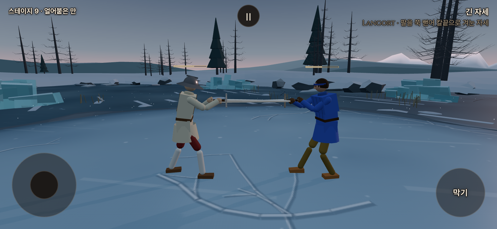

# 플레이어 일반 회복21/s — 2026-10-15 KST

사용자는 실제 플레이에서 사람이 헛공격을 더 많이 시도해 불리하다고 보고하고 **플레이어21/s·AI15/s**를 지정했다. 변경 전은 양쪽15/s였다. 일반 회복만 사람에게40% 늘렸으며, 실제 공방의 승률 균형까지 검증했다는 뜻은 아니다.

게임 변경 `c76b4a6f`: `config.js`에 `playerRecoverPerSecond:21`을 추가하고 `stamina.js`의 일반 회복에서 `aiControlled`로21/15를 선택한다. 비용·회복 시작 대기0.6초·막기 유지/클린치 중 회복 중단·상한100은 유지했다. 탈진의 강제 회복20/s·2.5초·0에서 해제는 양쪽 그대로다. 기력 끔 분기도 그대로다.

사용자는 박차기를 독일 보법으로 주도록 우화에게 전달했다고 알렸다. 상대의 구현 완료로 해석하지 않는다. 이번 작업에서 유파 동작·보법·우화 저장소는 수정하지 않았다.

검증:

- 기력 단위/실물리44/44. 실제 사람/AI 분기,0.6초 대기 뒤21/15 회복,100 상한, 클린치 비용 동등·종료 뒤 회복 차이, 탈진2.5초 강제 회복을 확인했다.
- 기존 기력 브라우저10/10, 추가 동시 회복/촬영1/1. 실행·콘솔 오류0. 기력20·대기 완료로 준비한 양쪽을2초 회복시켜 사람62·AI50 확인. 최초 촬영 도구는 기본 템포1.1을 놓쳐 실제 물리2.2초를2초로 기대했다. 촬영 URL만 `tempo=1`로 명시해 교정했으며 게임 기본 템포는 변경하지 않았다.
- 공통5관문(기력 켬) 통과: fights12 `5a02a22d`, live_battery `e7ee3d96`, finish_thrust `433ac984`, corr12/12 IDENTICAL, weapon_smoke `27b922fc`·23OK/FAIL0/NaN0. 앞선 기력판과 같음(corr 전체 출력의 실행 시간은 제외). 기력 끔 관문은 이번 변경에서 반복하지 않았다.
- `npm run build` 성공. PWA `555ea3c8eee56253ffd13e9e`,345파일/6,763,963바이트. 기존 번들 크기 경고 외 오류 없음.

명령: `node --test tools/sim/stamina{,_preparation,_integration,_clinch}.test.mjs`, `node tools/sim/stamina_gates.mjs on /workspace/stamina-recovery-validation`, `node tools/browser/stamina_smoke.mjs`, `node tools/browser/stamina_recovery_smoke.mjs`(브라우저 도구에 로컬4173 URL과 출력 경로 전달).

[검증 영수증](stamina_recovery_20261015_checks.json). 원본/최초 실패 로그: `/workspace/stamina-recovery-validation/`.

아래는 **로컬 프로덕션 빌드의 실제 게임 화면**, 비교를 위해 같은20과 회복 대기 완료 상태를 준비했다.2초 뒤 왼쪽 플레이어62·오른쪽 AI50이다. 실제 휴대폰 FPS나 자연 공방을 촬영한 것은 아니다.

공개 테스트: <https://yoonjl-svg.github.io/halfsword-codex/>. 배포 완료는 후속 영수증에 기록한다. 클라우드 네트워크 정책으로 공개 게임 직접 열람이 차단되어 공개 화면 재검증은 별개로 남는다.
