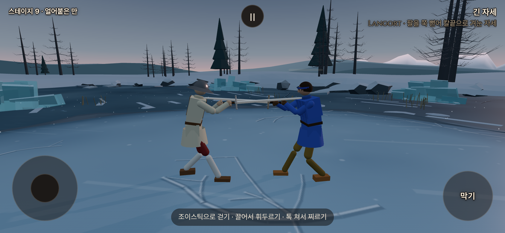
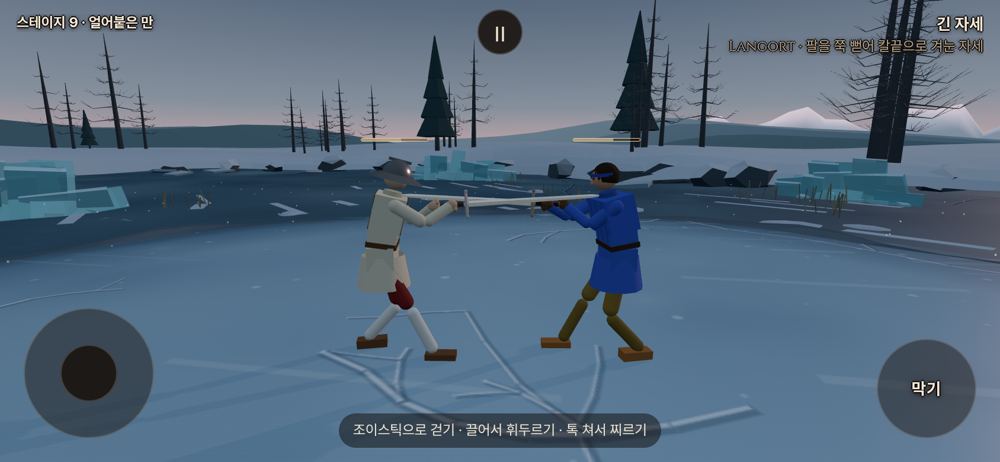
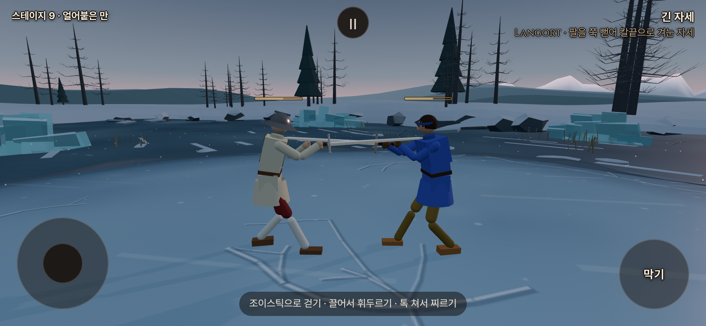

# 기력 표시·사람 준비 동작 재검토 · 2026-10-15

사용자가 공개 테스트 후 특정 카메라 각도의 빈 바처럼 보이는 현상, 흰색+주황 계열 이중 테두리, 사람의 준비 동작 중복 소모에 대한 분석과 의견을 요청했다. 기준은 `5b3eafba`다. **원인 분석·브라우저 임시 시안 단계**이며 게임 소스·유파·보법·공개판은 수정하지 않았다.

## 확인된 준비 비용 차이

기존 실물리 하네스에서 표준 롱소드 두 자루, 거리8m, 같은 손 목표 경로로 비교했다. AI의 자율 선택은 멈추고 기존 `startAttack`→`startStrike`를 호출했다. 사람은 같은 경로를 직접 조작한다. 자연 결투의 평균치나 전체 유파 통계가 아닌 통제된 재현이다. 아래 숫자는 회복 후 잔량이 아니라 **누적 공격 소모량**이다.

| 준비와 공격 | 사람 | AI |
| --- | ---: | ---: |
| 손을 어깨 준비 자세로0.16초에 올리기만 함 | 12 | 0 |
| 위 준비→잠깐 유지→내려베기 한 번 | 24 | 12 |
| 같은 준비를0.6초로 느리게→같은 내려베기 | 12 | 12 |
| 쟁기 자세로0.1초에 당김→탭 찌르기 | 19 | 7 |

원인은 `Stamina.observeStroke`가 사람의 빠른 손 목표 이동을 즉시 공격으로 청구하기 때문이다. `skill.swinging`은 평활화된 손 목표 속도1.5m/s 초과이며, 방향90도 초과 변화 또는0.06초 이상의 끊김 뒤에는 새 긋기다. `classifyStroke`는 기술이 식별되지 않아도 기본 `cut`을 반환한다. 따라서 기술에 해당하지 않는 준비 자세 이동도12를 낼 수 있다. AI는 `observeStroke`를 건너뛰고 `startStrike`에서만 행동 비용을 청구하므로 준비가 무료다.

이전 검증은 짧은 끊김·작은 흔들림·해금 여부와 무관한 계산을 확인했으나, 빠른 준비→공격을 사람의 한 공격으로 묶어야 한다는 경우를 충분히 다루지 못했다. 단순한 체감 문제가 아니라 실제 비대칭이다.

## 표시 조사

기력100에서 바 전체 불투명도15%와 채움 자체85%가 겹쳐 채움의 실효 불투명도가12.75%다. 얼어붙은 만·밤의 포세이돈 두 무대에서 가득 찬 채움이 거의 투명해 보이는 화면을 확인했다. 흰 테두리도 함께 흐려진다.

양쪽 기력을60으로 둔8개 관찰 카메라 각도에서는 모두 채움 `scaleX(0.6)`, 바 불투명도1을 유지했다. HUD가 화면 좌표로 그리는 DOM이라3D 조명이나 깊이 가림을 직접 받지는 않는다. 카메라에 따라 배경과 소수점 화면 좌표가 바뀐다. 현재는 물리 화면 픽셀에 위치를 맞추지 않아2px 높이 가장자리가 흐려질 가능성이 있다. **제보한 특정 각도의 별도 채움 소실은 확정 재현하지 못했으며**, 이것을 완충 투명도 하나로 단정하지 않는다. 기력 음수에서 빈 채움은 기존 설계다.

## 테두리 시안

기존 강조 금색 `#d9a441`은 주 단추·선택 표시·비기 알림에 쓰인다. 더 주황색인 `#ffa040`은 밤 무대 불티에도 있지만 UI 공통 강조색과는 다르다.

같은 게임 프레임·기력60·844×390 CSS픽셀/DPR2에서 CSS만 임시 적용했다. 베이지색 채움은 그대로다. 아래는 **공개판 변경 전의 로컬 비교 시안**이다.

흰색0.25px+금색0.25px, 총0.5px:

금색0.5px+기존 HUD 외곽색 `#0d0907`0.5px, 총1px:

두 시안은 **색뿐 아니라 총두께도 다르다**. 두 번째가 더 잘 드러나지만 기존보다 두껍다. 흰색과 금색은 둘 다 밝아 밝은 배경에서 함께 약해질 수 있다. 대비 목적에는 밝고 어두운 조합이 유리하다. 현재0.5px를0.25px씩 쪼개면 DPR1에서는 한 선이 물리 픽셀의1/4이라 두 색의 구분이 안정적이지 않다. 실제 휴대폰과 모든 스테이지를 검증한 것은 아니다.

## 권고와 후속 수용 기준

1. 준비 동작 비용 비대칭을 먼저 고친다. 유파 동작 감지와 기력 청구의 경계를 분리하고, 사람의 준비→공격→회수를 한 공격 주기로 다룬다. 준비/회수에는 별도 공격 비용을 청구하지 않고 실제 공격을 실행할 때 한 번 확정한다. 해금 여부와 무관하게 작동해야 한다.
2. 손을 올리는 방향만으로 준비라고 단정하면 올려베기·당겨베기를 무료로 만들 수 있다. 칼날의 경로·속도와 준비 자세를 함께 보고, 헛친 공격도 비용을 내도록 설계한다. 접촉은 공격 확인을 보완할 수 있으나 접촉한 공격만 비용을 내게 만들지 않는다. 실제 후속 공격은 새 비용, 짧은 입력 끊김/복귀는 중복 비용 없음으로 검증한다. 이 판정 설계는 아직 구현·성능 검증 전이다.
3. 우선 수용 기준은 위 빠른 준비→내려베기12, 당김→찌르기7, 느린 준비와 빠른 준비의 같은 총비용이다. 올려베기·당겨베기·헛치기·연속 두 공격·공격 취소·방어 전환·비기 중복도 별도로 확인한다. 준비라고 분류한 동작 자체로 실제 공격이 발생하는 경우도 무료 공격이 되지 않아야 한다.
4. 완충 시 바 전체를15%로 흐리는 규칙부터 보완해 채움이 읽히도록 하고, 화면 위치·두께를 실제 픽셀에 맞춰 이동 중 흐림을 줄이는 방향을 검토한다. 음수 피로 맥동은 유지한다.
5. 색은 기존 금색+짙은 외곽색을 우선 권고한다. 더 얇게 만드는 요구와 두 색을 또렷하게 구분하는 요구 사이에는 실제 픽셀 한계가 있으므로 총두께를 숨기지 않고 시안으로 정한다.

## 재현과 근거

- `node /workspace/stamina-review-20261015/preparation-probe.mjs`: 같은 손 경로의 빠른/느린 준비 비교.
- `node /workspace/stamina-review-20261015/drawback-probe.mjs`: 당김 후 탭 찌르기 비교.
- `node /workspace/stamina-review-20261015/hud-probe.mjs`: 두 무대·표시 상태·8각도, 관측16건·브라우저 오류0. 가짜 시계로 물리를 진행하고 실제 렌더를 촬영했다.
- [수치·상태 원본](stamina_review_20261015.json). 원본 코드·로그·추가 밤 무대 사진은 `/workspace/stamina-review-20261015/`에 있다.

게임 코드는 변경하지 않아 빌드·기존 전체 물리 관문을 반복하지 않았다. 공개판 재배포도 하지 않았다.
