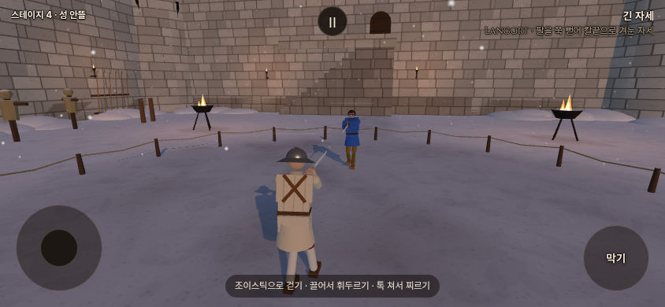
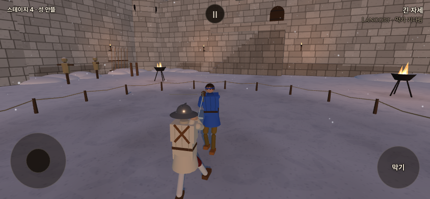
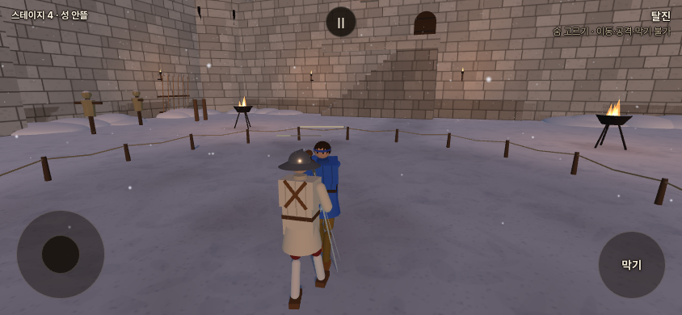
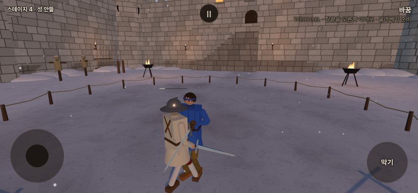

# 기력 2차 적용 · 2026-10-15

## 확정 범위

사용자가 전달한 `stamina_2026-10-15-2.md`를 바탕으로 마지막 대화의 직접 지시를 우선한다.
- 막기 성공률·막기 자세 개선은 보류. 비용은 설계 시작값 3×무게로 둔다.
- 방어 유지 중 사람·AI 모두 회복 중단. 마지막 비용 사건 뒤 0.6초가 지났으면 방어 해제 후 회복. 강제 탈진 회복이 우선한다.
- 공격 비용은 고유 동작 해금과 무관하다. 짧은 끊김·자동 막기 이동을 중복 공격으로 청구하지 않는다.
- 무게는 **처음 장착한 온전한 칼의 실제 강체 질량**을 고정하며 파손 뒤에도 유지한다.
- 탈진은 2.5초간 공격·막기·자발적 이동 불가. 물리 피격과 균형 디딤은 유지한다. 기력 0에서 지침 상태로 해제, +15에서 정상.
- 포크 `codex/refork-20261015`만 수정한다. 우화 원본 병합·쓰기 없음. 유파 궤적·보법 정의는 변경하지 않는다.

연결: `stamina.js`, `fighter.js` 공통 힘/이동, `skill.js` 비용·입력 제한, `ai.js` 비용·휴식 판단, `combat.js` 실제 접촉 비용, HUD/소리. 두 팀의 분담이 합의된 것으로 주장하지 않는다.

기준은 공통 게임 `fdd6455`, 이번 작업 직전 포크 `50359cb8`이다. [첫 구현 기록](STAMINA_20261015.md)의 지속 시간 비용·0 하한을 아래 규칙으로 대체했다. **로컬 구현·검증이며 공개 배포·원격 쓰기는 하지 않았다.**

현재 포크에는 첨부 문서가 언급한 최신 본판의 '첫 걸음 박차기'가 없다. 보법을 새로 이식하지 않고 기존 이동에 거리 비용만 붙였다. `pushCost: 12`는 예약값이며 일반 첫 걸음에 임의로 청구하지 않는다. 첨부 문서의 최신 본판 병합 권고보다 사용자의 유파 동작·보법 보호 지시를 우선했다.

## 적용한 규칙

| 항목 | 적용값 |
| --- | --- |
| 기력 범위 | 시작100, 하한−50. 음수에서도 행동 가능, −50에서 탈진 |
| 비용 | 베기12·찌르기7·실제 막아 받기3 × 무게. 비기35 한 번 |
| 무게 | `clamp(sqrt(파손 전 실제 질량 / 1.6), 0.75, 1.5)` |
| 걷기 | 자발적 이동 거리0.6m당1, 일본1.5. 무게 배율 없음 |
| 회복 | 마지막 공격·막아 받기·비기 후0.6초부터15/s. 걷기는 회복 시계를 초기화하지 않음 |
| 방어 유지 | 사람 버튼·AI 방어 상태 모두 회복 중단, 유지 자체 비용 없음 |
| 지침 / 심한 지침 | 0 미만 제어 속도0.7, −30 미만0.5. 정상 복귀+15, 심한 지침 해제−15 |
| 탈진 | 2.5초 행동 제한·20/s 강제 회복. 끝에서 정확히0·지침으로 복귀 |
| AI 휴식 | 보통20 미만, 공격 성향은−10 미만에서 새 공격 중단·물러남.35에서 재개 |
| AI 압박 | 상대 지침/탈진 때 공격 결심 문턱을 각각0.2/0.45 낮춤 |

걷기는 골반의 실제 수평 이동을 누적한다. 정지 흔들림·제자리 입력·넘어진 상태·균형 디딤·기술 내딛기·비기 중 이동은 제외한다. 반대 방향 피격 이동을 제외하고 최대3m/s로 이상치를 제한하지만 **이동 의도와 같은 방향의 외력까지 완전히 분리하는 계측은 아니다.**

플레이어는 기존 고유 동작의 분류 함수를 `attack_stroke.js`로 공유하며 강화 해금에 의존하지 않는다.0.06초 미만 끊김·작은 방향 흔들림은 같은 긋기,90도 초과 방향 전환은 새 긋기다. 탭 찌르기·손잡이 찍기·AI 기술은 시작 이벤트에서 한 번 청구한다. 자동 막기 자세 이동은 공격으로 세지 않는다. 실제 칼 충돌은 상대 공격 번호로 중복 제거한다. 비기는 구성 베기·찌르기·걸음에 추가 비용을 받지 않는다. 기존 권총은 발당2×무게를 유지한다.

탈진은 입력 제한보다 공통 물리 상태를 우선해 AI 지형 우회·기술 걸음·예약된 비기도 멈춘다. 이미 실행 중인 발도도 해제하며 팔·칼의 동적 물리와 양손 잡기를 복구한다. 피격·중력·균형 디딤은 유지하므로 상대에게 맞으면 쓰러질 수 있다. 탈진을 이유로 몸을 공중에 고정하거나 무적 처리하지 않는다.

유파 기술표·자세표·`gait.js`·동작 경로 자료는 수정하지 않았다. 공통 손 목표 추종 시간, 관절 힘·속도 상한에 기력 배율을 연결했다. **물리 칼끝 속도의 목표 배율 보정은 아직 완료하지 못했다.** 아래 실측과 남은 범위를 반드시 함께 전달한다.

## 화면·소리

머리 위 바는 우측 상단 보조 메시지와 같은 `#b8a88e`,56×2px·채움 불투명도85%다. 일반 상태 바깥 테두리는 없다. 가득 차면15% 불투명도로 옅어지고, 지침은 빈 바가 은은하게1.8초/1.1초 주기로 맥동한다. 탈진 중에는 회색 베이지 `#948e7c`로 **2.5초 회복 진행도**를 표시한다. 이때 차오르는 바는 현재 기력이 양수라는 뜻이 아니다.

탈진 시 손·칼을 내리고 작은 어깨/몸통 호흡을 덧씌웠다. 기존 숨 녹음을 재사용하며 회복량을 상처·출혈에 연결하지 않았다. 상대 숨은 위치 음향으로 낸다. 실제 휴대폰의 음량·FPS는 미검증이다.

아래는 **로컬 개발판 실제 렌더링**,844×390 모바일 가로 에뮬레이션이다. 비교할 상태를 준비해 촬영했고 자연 결투의 연속 장면은 아니다. 맥동과 숨소리는 정지 사진만으로 검증할 수 없다.

| 가득 찼을 때 | 기력 빚·심한 지침 |
| --- | --- |
|  |  |

| 탈진·칼을 내리고 회복 | 탈진 해제 후 기력 회복 |
| --- | --- |
|  |  |

## 검사와 회귀

- 단위·실물리 **26/26**, 브라우저 실제 입력 **10/10**, 브라우저 오류0. 파손 전 질량, 해금0/5, 짧은 끊김, 실제 칼 접촉, 비기35, 사람/AI 방어 회복, 탈진2.5초·입력 무시·발도 취소, 일시정지·재시작을 검사했다.
- 빌드 성공, PWA `92d0092c01fffd70a392766d` /345파일. 기존 대형 번들 경고는 남는다.
- 기력 끔은 fights12·live_battery·finish_thrust·weapon_smoke의 원래 전체 stdout 해시와 일치한다. corr는12/12 IDENTICAL이며 출력에 실행 시간이 있으므로 전체 해시를 고정 기대값으로 삼지 않는다.
- 기력 켬은 의도한 비용·휴식 판단 때문에 fights12/live_battery 결과가 달라졌다. 모든 관문 종료0, corr12/12 IDENTICAL, 무기23종 FAIL/NaN0. **기대값 파일을 고치지 않았다.**

| 관문 | 끔 | 켬 |
| --- | --- | --- |
| fights12 | `7c95ba21` | `5a02a22d` |
| live_battery | `e7ee3d96` | `807dc4e9` |
| finish_thrust | `433ac984` | 동일 |
| corr_s0 | 12/12 IDENTICAL | 12/12 IDENTICAL |
| weapon_smoke | `27b922fc`,23OK | 동일 |

fights12 사망 판9/12→9/12, 판당 넘어짐1.3→0.9, 판당 상처9.0→7.3. live_battery 연속 동작의 손목 오차0.144→0.163m, 칼 방향 오차19.0→23.9도이며 둘 다 서 있는 상태로 끝났다. 이는 기능 검증과 짧은 비교 결과이며 재미·균형의 확정 판정은 아니다.

## 실제 입력·대련 측정

고정 입력 플레이어:2초 자세 안정 후 새 장부로30초 측정, 상대 AI는 끄고8m 간격, 피격 없이 같은 입력을 반복했다. 아래는 초 단위이며 `—`는30초 안에 미도달이다.

| 입력 | 0 이하 | 심한 지침 | 첫 탈진 |
| --- | --- | --- | --- |
| 롱소드 베기0.5초 주기 | 4.025 | 5.025 | 6.025 |
| 롱소드 베기1초 주기 | 15.025 | 20.025 | 23.025 |
| 레이피어 찌르기 시도0.5초 주기 | 8.508 | — | — |

문서 계산표와 차이가 난다. 실제 손 입력을 일정 주기로 계속 넣으면 칼이 느려져도 입력 긋기 주기가 저절로 길어지지 않는다. 따라서 계산표의 '지침 때문에 공격 간격이 늘어나 소모가 줄어든다'는 가정이 일반 베기에는 그대로 성립하지 않는다. 찌르기는 동작 종료 전 재입력을 받지 않아30초간39회만 수락했다. 정상 속도의 꾸준한 베기라도 계속 누적하면 탈진한다. 비용을 임의로 낮춰 표에 맞추지 않았다.

AI 대련은 현재 본판 `main` 방식으로 기력 켬/끔 각각48판:6무기×8판, 자리 교대, 같은 시드1000~1007,30초 제한. 무기별 기본 유파5종을 사용했다. 아래 승/패/무는 해당 무기 대 롱소드의8판 집계로, 유파 전체의 우열을 확정할 표본은 아니다.

| 무기(유파) | 끔 승/패/무 · 평균초 | 켬 승/패/무 · 평균초 |
| --- | --- | --- |
| 롱소드(독일) | 2/4/2 ·17.97 | 2/5/1 ·17.77 |
| 레이피어(이탈리아) | 2/4/2 ·19.25 | 2/4/2 ·19.34 |
| 츠바이핸더(이베리아) | 2/6/0 ·17.43 | 2/6/0 ·17.32 |
| 우치가타나(일본) | 0/4/4 ·22.89 | 0/4/4 ·22.89 |
| 청강검(중국) | 3/5/0 ·18.58 | 3/4/1 ·18.08 |
| 팔쉬온(독일) | 5/3/0 ·14.17 | 5/3/0 ·14.17 |

전체 평균18.381→18.261초. 비유한 좌표/속도0. **기력 켬48판의96검객 모두 기력0까지 도달하지 않았고 탈진0회였다.** 이 표본으로 자연 탈진의 세기나 저기력 AI 균형을 검증했다고 말할 수 없다.

별도 강제 탈진 실험: 롱소드·2.3m 간격에서 실제 상대 AI가 공격하는 동안 플레이어를−50으로 만든4시드. 모두 정확히2.5초 뒤 탈진 해제·생존, 구간 중 상처 사건은2/0/3/5회, 끝 상태는 일어나는 중/서 있음/일어나는 중/일어나는 중이었다.3/4에서 넘어지는 강한 불이익이다. 사용자 지정2.5초는 유지했다. 자연 발생 확률이나 사망률 추정으로 쓰지 않는다.

## 공속 실측과 남은 조정

동일 `zornhau` 기술·출발 자세를5무기에 적용하고, 측정 동안 기력 단계를 고정했다. 실제 칼날70% 지점의 최고 속도를 동작 시작부터 손 경로 완료 후0.3초까지 쟀다. 모든 경우 서 있음·비유한 값 없음. 같은 기술의 기계적 비교이며 각 유파 대표 공격을 모두 잰 것은 아니다.

| 무기 | 지침 최고 속도/정상 | 심한 지침 최고 속도/정상 |
| --- | --- | --- |
| 롱소드 | 0.756 | 0.630 |
| 레이피어 | 0.797 | 0.803 |
| 츠바이핸더 | 0.853 | 0.862 |
| 모노호시자오 | 0.805 | 0.697 |
| 청강검 | 0.850 | 0.479 |

손 경로 시간은0.117→0.158→0.217초로 길어진다. 공통 손 목표·관절 속도 제어에는0.7/0.5를 적용했고 팔·손목 힘은 내부 시작값0.49/0.25다. 그러나 **실제 칼끝 최고 속도는 목표0.7/0.5에 일괄 수렴하지 않으며, 레이피어·츠바이핸더는 심한 지침의 최고치가 지침보다 조금 높다. 공속 보정 완료로 보고하면 안 된다.**

별도 탐색에서 팔 힘만 더 줄이거나 추가 회전 감쇠를 넣는 방식은 무거운 칼의 결과를 일관되게 개선하지 못했다. 과도한 감쇠 실험에는 물리 불안정도 있어 게임에 넣지 않았다. 유파 경로·보법을 바꾸거나 칼끝 속도를 강제로 잘라 수치만 맞추지 않았다. 후속 조정은 정상/지침/심한 지침의 실제 공격 속도·도달 시간·균형을 무기별 대표 공격에서 함께 비교해야 한다.

## 재현·보관

```sh
node --test tools/sim/stamina.test.mjs tools/sim/stamina_integration.test.mjs
npm run build
node tools/sim/stamina_gates.mjs off /tmp/stamina-gates
node tools/sim/stamina_gates.mjs on /tmp/stamina-gates
node tools/sim/stamina_duels.mjs main off
node tools/sim/stamina_duels.mjs main on
node tools/sim/stamina_scenarios.mjs
node tools/sim/stamina_speed_probe.mjs
node tools/sim/stamina_exhaustion_probe.mjs
# 별도 터미널에서 npm run preview -- --port 4173 실행 후:
PW_CHROMIUM=/usr/bin/chromium node tools/browser/stamina_smoke.mjs http://127.0.0.1:4173 /tmp/stamina-browser
```

브라우저 도구는 Playwright와 Chromium이 설치된 환경에서 빌드 미리보기 서버로 실행한다. 가짜 시계로 입력·물리를 진행하고 중간 GPU 그리기만 생략하며 촬영 시 실제 렌더링한다. 개발 서버의 페이지 교체가 검사를 끊는 경우가 있어 최종 검사는 고정된 빌드에서 했다. 서비스 워커를 Playwright로 강제 차단하면 등록 결과가 정상 브라우저와 달라 PWA 오류가 발생하므로 기본 허용 상태로 검사한다. 실제 기기 FPS 검사가 아니다. [검증 영수증](stamina_v2_validation.json)에 전체 해시·판별 집계·속도 표·스크린샷 해시를 보관했다. 원시 stdout/stderr·96판 개별 기록은 `/workspace/stamina-v2-validation/`에 있다.
