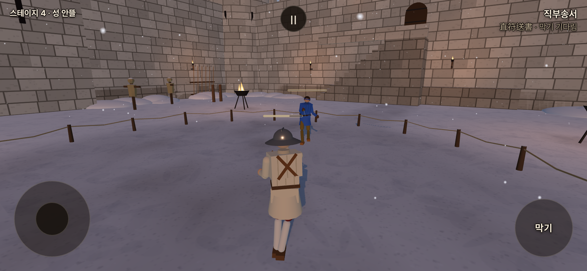
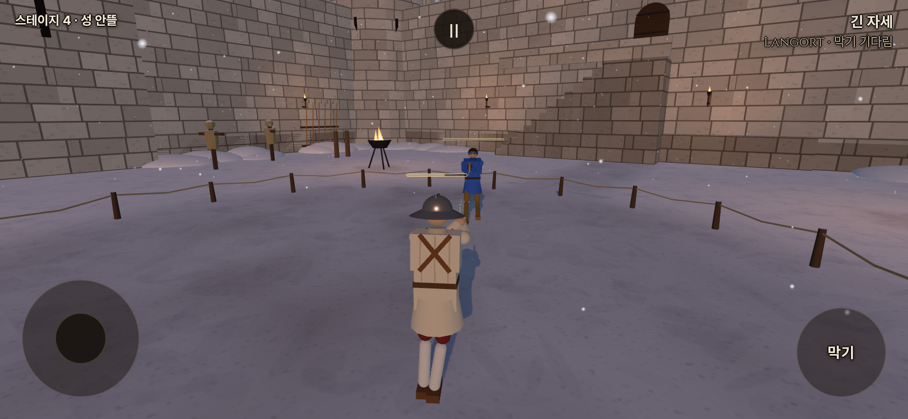
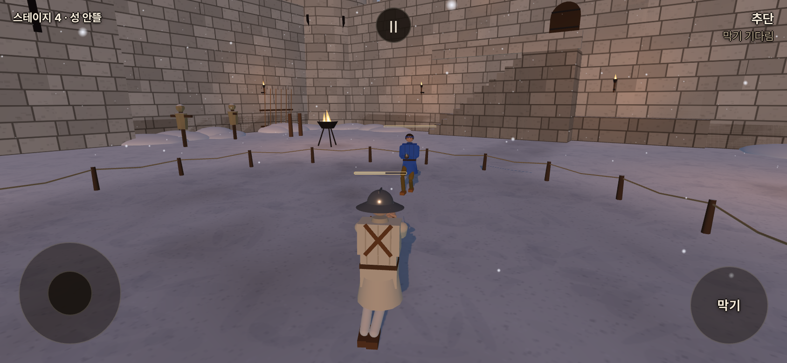

# 걷기 비용과0.62m 기준 — 2026-10-15 KST

사용자가 걷기 비용0.7·1.4·2.1과 거리 기준0.6→0.62m를 지정했고, 후속 답변으로 **0.7은 동방**이라고 확정했다. 게임 변경 `577f4d53`은 `config.js`의 거리/비용표와 `stamina.js`의 유파별 비용 선택이다.

| 현재 유파 | 자발적 걷기0.62m당 비용 | 실제 입력에서5회 청구한 비용 |
| --- | ---: | ---: |
| 동방(`chinese`) | 0.7 | 3.5 |
| 일반(독일·이탈리아·이베리아·기타) | 1.4 | 7 |
| 일본 | 2.1 | 10.5 |

사람/AI에 같은 표를 적용한다. 실제 이동 거리를 누적해0.62m를 넘을 때 비용을 청구하고 나머지 거리는 다음 청구에 이어 쓴다. 실제 보폭이나 발 애니메이션의 한 걸음을 바꾼 것이 아니다. 제자리 입력·비자발적 이동·기술/비기 이동 제외는 그대로다. 걷는 중 일반 회복도 가능하다. 사람21/s·AI15/s, 탈진 강제 회복20/s·2.5초는 유지한다.

이 포크의 변경 전 값은 일반1·일본1.5였으며 동방0.5 구간이 없었다. 따라서 일반/일본은 청구1회당40% 증가, 이 포크의 동방은1→0.7이다. 거리 기준도 바뀌므로 일반/일본의 거리당 비용 증가는 약35.5%다. 사용자 지정값을 적용했으며 기존 포크 전체를40% 인상했다고 해석하지 않는다.0.62m가 독일 보법 평균과 맞는다는 근거는 사용자 설명이며 이번에 새로 실측한 보폭 수치는 아니다.

유파 동작·보법·AI 판단·회복 수치는 수정하지 않았다. 포크 `yoonjl-svg/halfsword-codex`만 작업했다.

검증:

- 기력 단위/실물리45/45. 사람/AI×6개 유파,0.62m 직전/도달/나머지 거리, 걷기 중 회복과 제자리 비용0을 확인했다. 공격 준비·클린치·탈진 통합 검사도 통과했다.
- 기존 기력 브라우저10/10, 추가 실제 걷기3/3. 청강검/롱소드/우치가타나의 실제 유파와 입력 비용을 확인했다. 실행·콘솔 오류0.
- 공통5관문(기력 켬): fights12 `18a6e736`, live_battery `e7ee3d96`, finish_thrust `433ac984`, corr12/12 IDENTICAL, weapon_smoke `27b922fc`·23OK/FAIL0/NaN0. 걷기 비용/문턱 변경으로 fights12만 이전 `5a02a22d`에서 달라졌다. 사망 판9/12→8/12, 판당 넘어짐0.9→0.8, 상처7.3→7.3. 기대값 파일은 수정하지 않았다. 기력 끔 관문은 이번에 반복하지 않았다.
- `npm run build` 성공. PWA `b39292ced709e3f1f1b5c51c`,345파일/6,764,035바이트. 기존 대형 번들 경고 외 오류 없음.

명령: `node --test tools/sim/stamina{,_preparation,_integration,_clinch}.test.mjs`, `node tools/sim/stamina_gates.mjs on /workspace/stamina-walking-validation`, `node tools/browser/stamina_smoke.mjs`, `node tools/browser/stamina_walking_smoke.mjs`(각 브라우저 도구에 로컬4173 URL과 출력 경로 전달).

[검증 영수증](stamina_walking_20261015_checks.json). 원본 로그는 `/workspace/stamina-walking-validation/`에 있다. 실제 휴대폰 FPS와 공방의 승률 균형을 검증한 것은 아니다.

아래는 **로컬 프로덕션 빌드의 실제 게임 화면**이다. 기력70으로 준비하고 AI를 멈춘 뒤, 실제 막기 버튼 유지로 회복을 막고 옆으로 걸었다. 청구5회(청구 거리3.10m) 후 동방66.5·일반63·일본59.5다. 촬영 시 남은 이동 거리는 각각0.077/0.039/0.116m로 다음 청구에 이어진다. 숫자나 게이지를 이미지에 합성하지 않았다.

| 동방66.5 | 일반63 | 일본59.5 |
| --- | --- | --- |
|  |  |  |

공개 테스트: <https://yoonjl-svg.github.io/halfsword-codex/>. 소스 `79f503d6fe061c21c1aea9ab23fec6a3d4ea6a9a`를 우리 main/작업 가지에 원자적으로 푸시했고 [Pages38733140289](https://github.com/yoonjl-svg/halfsword-codex/actions/runs/38733140289)가45초에 성공했다. [배포 영수증](stamina_walking_20261015_release.json). 클라우드 네트워크 정책으로 공개 게임 직접 열람이 차단되어 공개 화면 재검증은 별개로 남는다.
