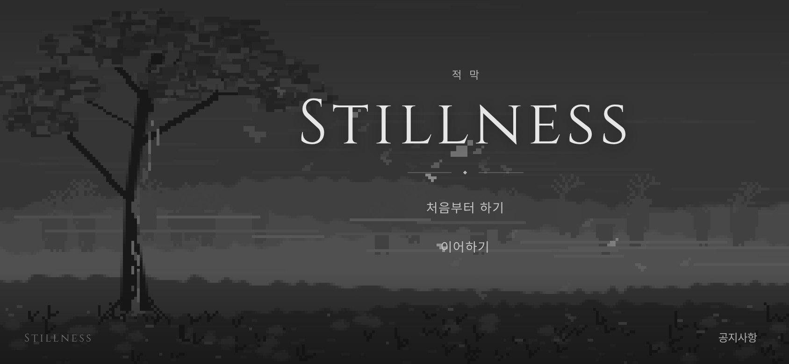
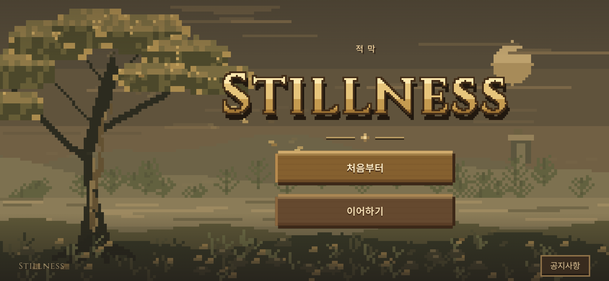
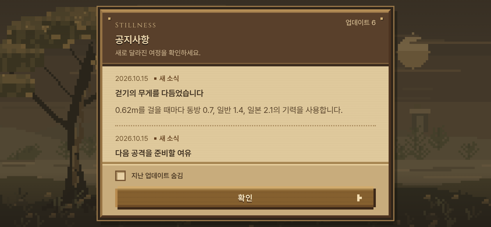

# 따뜻한 픽셀 시작 화면 2안 — 2026-10-15 KST

사용자가 첫 시안을 '너무 차갑고 현대적'이라고 평가하고, 픽셀 그래픽 게임의 인상을 디자인에 반영하며 두 시작 메뉴 뒤에 눈에 띄는 배경 박스를 두라고 요청했다. `c84b8ca0`에서 **`start-pixel.html`**을 추가했다. 첫 시안 `start.html`은 그대로 비교할 수 있다.

- 배경은 따뜻한 제한 팔레트의 픽셀 숲·노을·물가로 새로 그렸다. 화면 한 픽셀에 해당하는 도트를3~4CSS px로 확대한다. 낙엽과 짧은 바람 전환은 이어지며 움직임은20fps 이하로 제한한다.
- 제목은 기존 Cinzel600을 저해상도 캔버스에 그린 뒤 픽셀 테두리·단계별 밝기·그림자를 넣었다. 새 폰트 파일로 교체하지 않았으며 읽을 수 있는 Stillness 제목도 DOM에 유지한다. 캔버스를 준비하지 못하면 웹폰트 제목으로 표시한다.
- '처음부터'·'이어하기'는 불투명한 나무 패널이다. 큰 화면278×60px, 가로 휴대폰250×48px,4px 테두리·계단 모서리·밝은 위쪽/어두운 아래쪽 음영으로 구분한다. 누르면3px 내려가고 선택된 항목에 픽셀 표식이 붙는다. 기본 글자/바탕 색의 대비는 각각 약5.01:1·6.43:1이다(장식과 그림자를 제외한 색 계산).
- 공지창은 나무 틀·밝은 종이색 본문·진한 잉크색 글씨·점선 구분으로 바꿨다. 스크롤, 읽음 기억, 지난 업데이트 숨김은 동일하다. 새 시안의 저장 키는 `stillness.start-preview.pixel.notices.v1`로 나눠 첫 시안을 읽었어도 새 시안의 공지부터 확인할 수 있다.

`src/pixel_grove.js`, `src/start_pixel.css`, `start-pixel.html`을 추가하고 공통 시안 진입점에서 테마를 선택한다. 새 CSS는 픽셀 시안에만 적용한다. 기존 게임의 실행 경로·유파·보법·기력·계정/진행 데이터는 수정하지 않는다. 두 버튼은 선택 반응까지인 UI 시안이며 계정 인증과 게임 진행 연결은 후속 범위다.

검증:

- 픽셀 시안13/13, 첫 시안 회귀13/13. 공지/읽음/숨김/재접속/저장소 거부/손상/선택 반응, 기존 웹폰트로 그린 픽셀 제목과 불투명한 두 버튼을 검사했다. 실행·콘솔·HTTP 오류0.
- PC1440×900, 모바일844×390·390×844·568×320·320×568에서 화면과 스크롤/버튼 영역을 확인했다. reduced motion에서는 정지 화면으로 바로 전환한다. 실제 휴대폰/Safari/FPS 검증은 아니다.
- 공통5관문(기력 켬)은 이전과 같다: fights12 `18a6e736`, live_battery `e7ee3d96`, finish_thrust `433ac984`, corr12/12 IDENTICAL, 무기23OK/FAIL0/NaN0(`27b922fc`). 기력 끔은 반복하지 않았다.
- 최종 `npm run build` 성공, PWA `ce1841a25797f64176a6ca01`,350파일/6,800,002바이트. 기존 대형 번들 경고 외 오류 없음.

명령: `node tools/browser/start_screen_smoke.mjs http://127.0.0.1:4173 <출력폴더> start-pixel.html`(첫 시안은 마지막 인자 `start.html`), `node tools/sim/stamina_gates.mjs on /workspace/start-pixel-validation`, `npm run build`.

[검증 영수증](start_pixel_20261015_checks.json). 원본 로그·녹화 프레임: `/workspace/start-pixel-validation/`.

아래는 **같은844×390·DPR2 조건의 로컬 프로덕션 실제 브라우저 촬영본**이다. 별도 합성 이미지가 아니며 공지 확인 뒤 시작 화면을 촬영했다.

| 첫 시안 | 픽셀 2안 |
| --- | --- |
|  |  |

새 공지창:

[PC 화면](../screenshots/start_pixel/title-desktop.png) · [세로 화면](../screenshots/start_pixel/title-phone-portrait.png) · [실제 브라우저 전환 녹화](../screenshots/start_pixel/wind-transition.mp4).

2안 주소: <https://yoonjl-svg.github.io/halfsword-codex/start-pixel.html>. 소스 `9754fb2037978185097598ec865c186f86874910`를 포크 main/작업 가지에 원자적으로 푸시했고 [Pages38742527122](https://github.com/yoonjl-svg/halfsword-codex/actions/runs/38742527122)가53초에 성공했다. [배포 영수증](start_pixel_20261015_release.json). 클라우드 네트워크 정책으로 공개 페이지 직접 접속이 차단되어 화면 검증은 위 로컬 프로덕션 촬영과 구분한다.
