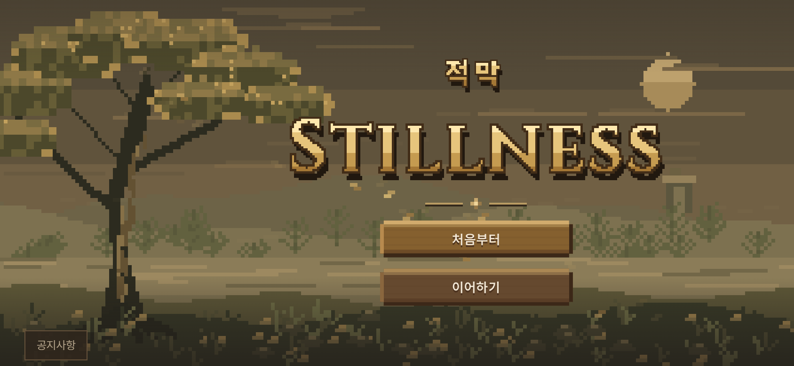

# 픽셀 시작 화면 제목·버튼·공지 정리 — 2026-10-15 KST

이 시안은 사용자 승인 후 [롱소드·공지 하단 정리](START_PIXEL_SWORD_20261015.md)만 추가로 수정했다. 아래는 해당 승인 시점의 이력이다.

사용자 요청으로 기존 `start-pixel.html` 시안을 다듬었다. 구현 `ced47392bb22bc99a09958bea1a81c9ae7d176d7`.

- **적막**: 기존 Pretendard600을 저해상도로 그리고, 영문과 같은 픽셀 테두리·금색 명암·그림자를 적용한다. 이전12px보다 크게, 영문보다 작게 표시한다. 그림자를 포함한 실제 도트 영역은 PC44px, 휴대폰 약36px이며 영문은 각 화면에서 더 크다. 원래 문자는 DOM에 유지하고 글꼴/캔버스 실패 시 일반 글자로 표시한다.
- **처음부터·이어하기**: 박스 가로·세로를 각각18% 줄였다. 큰 화면278×60→약228×49.2px, 가로 휴대폰250×48→205×39.36px.320px 세로 화면에서도 기존 반응형 폭의82%다. 불투명한 나무색 바탕과 도트 모서리는 유지한다.
- **왼쪽 하단**: 중복 Stillness 표기를 지우고 공지사항 버튼을 옮겼다. 보조색12px 글자와 얇은 테두리로 정리했다.
- **공지창**: 중복 브랜드와 설명 문구를 시각적으로 덜어내고, 따뜻한 짙은 갈색 바탕에 본 게임의 본문 `#f3e9d8`, 보조 `#b8a88e`, 강조 `#d9a441`만 사용한다. 제목17px, 제목/본문/확인14px, 날짜/읽음/숨김12px. 새 소식 표시에만 금색을 쓴다. 스크롤·읽음·지난 업데이트 숨김은 유지한다.

변경 파일은 시안 HTML/CSS·픽셀 제목 생성·시안 진입점과 브라우저 검사다. 첫 시안 `start.html`, 본 게임 실행 경로·기력·유파 동작·보법은 수정하지 않았다. 두 시작 버튼은 여전히 선택 반응까지인 UI 시안이며 계정/진행 연결은 후속 범위다.

검증:

- 픽셀14검사·첫 시안13검사 통과, 실행/콘솔/HTTP 오류0. 한글/영문 크기 관계, 각 화면의18% 축소 비율, 왼쪽 공지 위치, 공지창 색3개·크기3단계, 읽음/숨김/재접속/저장소 손상·거부를 확인했다.
- 화면1440×900,844×390,390×844,568×320,320×568에서 넘침 없이 조작 가능. 실제 휴대폰/Safari 검증은 아니다.
- 마지막 호버색 보정 후 프로덕션 재빌드, 기본·호버·선택 상태6개의 글자/바탕 대비4.5:1 이상 확인, 최종 사진7장을 다시 촬영했다. 대비 계산에는 테두리·줄무늬·그림자를 포함하지 않는다.
- 공통5관문(기력 켬)은 이전과 같다: fights12 `18a6e736`, live_battery `e7ee3d96`, finish_thrust `433ac984`, corr12/12 IDENTICAL, 무기23OK/FAIL0/NaN0(`27b922fc`). 초기 재포크 기준과 다른 fights12는 앞서 적용한 걷기 비용 변경 결과이며 이번 화면 수정으로 달라지지 않았다.
- 최종 빌드/PWA 성공: `a5dd924d5ccfd352b729a6f2`,350파일/6,799,781바이트. 기존 대형 번들 경고 외 오류 없음. 색상만 보정한 뒤 물리 관문/첫 시안 전체를 반복하지 않았다.

[검증 영수증](start_pixel_refined_20261015_checks.json). 원본 로그·검사·최종 사진: `/workspace/start-pixel-refined-validation/`.

아래는 **동일한844×390·DPR2 조건의 로컬 프로덕션 실제 브라우저 촬영본**이다. 이미지 합성 없이 공지 확인 뒤 촬영했다.

| 수정 전 | 수정 후 |
| --- | --- |
|  |  |

정리한 공지창:

[세로 화면](../screenshots/start_pixel_refined/title-phone-portrait.png) · [PC 화면](../screenshots/start_pixel_refined/title-desktop.png).

배포 주소: <https://yoonjl-svg.github.io/halfsword-codex/start-pixel.html>. 소스 `e7237a0048895513665bb57bf4933770331cb6d8`를 포크 main/작업 가지에 원자적으로 푸시했고 [Pages38745218093](https://github.com/yoonjl-svg/halfsword-codex/actions/runs/38745218093)가1분26초에 성공했다. [배포 영수증](start_pixel_refined_20261015_release.json). 클라우드 네트워크 정책으로 공개 페이지 직접 검증은 차단되어 있으며 위 사진은 로컬 프로덕션 화면이다.
