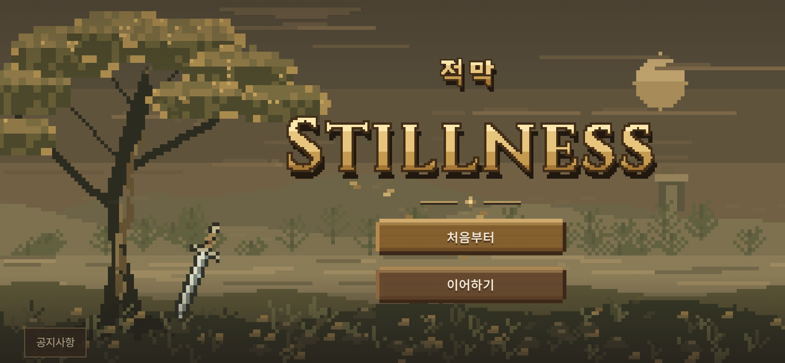
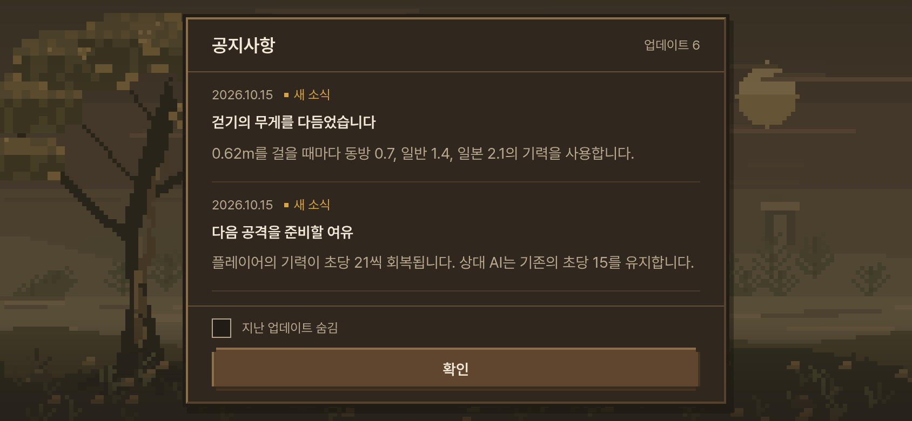
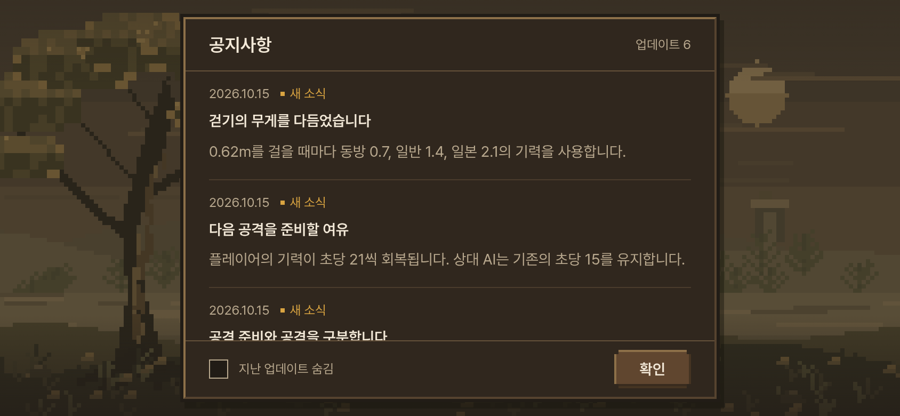

# 시작 화면 롱소드·공지 하단 정리 — 2026-10-15 KST

사용자가 나머지 시안은 승인하고, 나무 밑에 비스듬히 꽂힌 롱소드 한 자루와 공지창의 작은 확인 버튼/한 줄 하단 배치를 요청했다. 구현 `ca8885413c61fab79d32ad977cd823658b3efb6b`.

- 기존 픽셀 숲 캔버스에 롱소드 한 자루를 추가했다. 나무 오른쪽 뿌리 곁에서 수직 기준 약22도 기울며, 긴 양날 칼몸·십자 가드·긴 가죽 손잡이·폼멜을 그린다. 흙과 풀이 칼끝을 가리고 작은 지면 그림자가 받친다. 화면 크기에 따라 나무 곁에서 크기를 맞추며 배경 재생성 때만 그린다.
- 공지창 하단은 왼쪽 '지난 업데이트 숨김', 오른쪽 **72×36px 확인**의 한 줄이다. 하단 높이는 큰 화면/세로61px, 가로 휴대폰53px로 줄여 본문 공간을 확보한다.320px 세로 화면에서도 겹침 없이 표시한다.
- 승인된 타이틀·메뉴 박스·배경 나머지·색/글자 위계는 그대로다. `src/pixel_grove.js`, `src/start_pixel.css`와 기존 브라우저 검사만 변경했다. 본 게임·기력·유파/보법·첫 시안·계정/진행 데이터는 변경하지 않았다.

검증: 픽셀 시안14/14, 실행/콘솔/HTTP 오류0.1440×900,844×390,390×844,568×320,320×568에서 하단 정렬/간격·버튼 크기·스크롤·제목 크기·선택·읽음/숨김·손상/차단 저장소·reduced motion을 확인했다. 실제 휴대폰/Safari 검증은 아니다. 첫 시안 검사는 변경이 없어 반복하지 않았다.

공통5관문(기력 켬) 통과: fights12 `18a6e736`, live_battery `e7ee3d96`, finish_thrust `433ac984`, corr12/12 IDENTICAL, 무기23OK/FAIL0/NaN0(`27b922fc`). 직전 기력판과 같다. 빌드/PWA 성공 `99682673d66cac9fdbd3c289`,350파일/6,800,879바이트, 기존 대형 번들 경고 외 오류 없음.

[검증 영수증](start_pixel_sword_20261015_checks.json). 원본 로그와 사진은 `/workspace/start-pixel-sword-validation/`.

아래는 **로컬 프로덕션 실제 브라우저844×390·DPR2 촬영본**이다. 합성/이미지 편집 없이 촬영했다.

| 이전 공지 하단 | 한 줄로 줄인 공지 하단 |
| --- | --- |
|  |  |

[PC 화면](../screenshots/start_pixel_sword/title-desktop.png) · [세로 화면](../screenshots/start_pixel_sword/title-phone-portrait.png).

주소: <https://yoonjl-svg.github.io/halfsword-codex/start-pixel.html>. 배포 완료 여부는 후속 영수증에 기록한다. 공개 페이지 직접 확인은 클라우드 접속 제한으로 수행할 수 없으며 화면 검증은 위 로컬 프로덕션 촬영과 구분한다.
