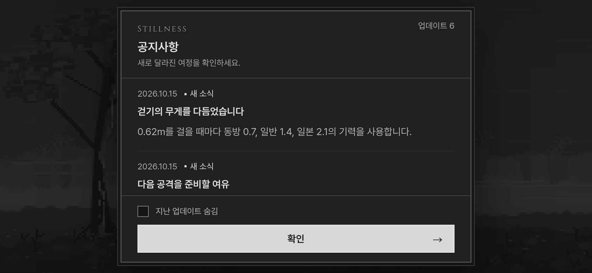
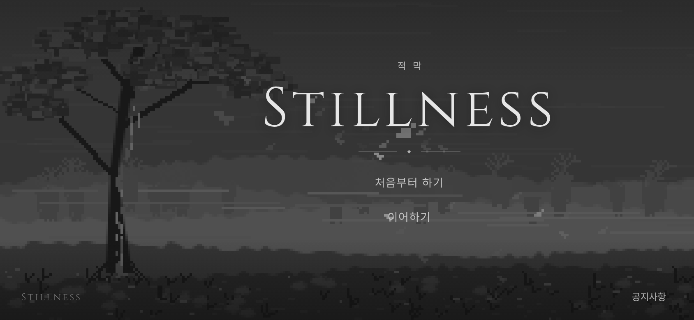

# Stillness 공지·시작 화면 시안 — 2026-10-15 KST

사용자는 앱을 열었을 때 스크롤 가능한 최신 업데이트 공지를 먼저 보여 주고, '지난 업데이트 숨김'을 기억한 뒤, 확인을 누르면 모노톤 픽셀 바람과 낙엽을 거쳐 로그인 화면에 큰 Stillness 제목과 '처음부터 하기'·'이어하기'가 뜨는 시안을 요청했다.

구현 `4bb2d8f8`: **`start.html`에서 이 흐름을 독립적으로 검토한다.** 기존 게임 첫 화면을 대체하거나 실제 계정을 만들지 않았다. 두 시작 버튼은 선택 반응까지 구현하며, 인증·새 게임 초기화·저장 게임 불러오기는 후속 범위다. 게임 진행/설정 저장소도 수정하지 않는다.

- 공지: 현재 포크에 배포된 기력 변경6건을 최신 순으로 표시한다. 제목·한두 줄 요약·날짜, 본문만 스크롤, 아래의 체크박스와 확인 버튼은 고정이다.
- 읽음: 목록에서 실제 보인 항목을 확인 버튼을 누를 때 기록한다. 아래까지 스크롤하지 않은 항목은 남는다. 체크박스는 다음 실행부터 적용한다. 숨김을 켜고 모두 읽었으면 바로 시작 화면으로 간다. 시작 화면 아래 '공지사항'에서 전체 목록과 숨김 설정을 다시 열 수 있다.
- 저장: `stillness.start-preview.notices.v1`에 공지 고유ID와 숨김 선택을 저장한다. 현재 브라우저에 한정하며 계정/기기 간 동기화는 아니다. 잘못된 저장값이나 저장 권한 거부 시에도 실행한다. 후속 공지는 `src/update_notes.js`에 새 고유ID로 추가한다.
- 연출: 저해상도 캔버스의 회색조 나무·산등성이·풀, 바람 픽셀과 낙엽. 확인 뒤0.45초부터 제목을 드러내고1.8초 뒤 버튼이 활성화된다. 강한 바람은 약2.2초 뒤 잦아들고 소수의 잎이 천천히 흐른다. 배경은 크기 변경 때만 그리고 움직임은24fps 이하로 제한한다. 문서가 숨겨지면 멈추며 '동작 줄이기' 환경에서는 정지 화면으로 바로 전환한다.
- 글꼴: 기존 로컬 Cinzel400(제목)·Pretendard400/600(한글). 새 폰트·외부 에셋·의존성을 추가하지 않았다. 제목은 사용자의 큰 표기 요청대로 확장하고 나머지는12/14/17px 체계를 따른다.

파일: `start.html`, `src/start_preview.js`, `src/start_screen.css`, `src/pixel_wind.js`, `src/update_notes.js`, Vite의 별도 빌드 진입점. 본 게임의 `index.html`·`main.js`·물리·AI·보법·기력 파일은 변경하지 않았다. 화면은 회색조 픽셀 시안이며 실제 게임 무대를 찍은 배경이 아니다.

검증:

- 시안 Chromium13검사: 첫 공지/스크롤, 기존 Cinzel 실제 렌더링, 두 선택지의 반응 및 게임 저장 보존, 숨김 재접속/미열람 항목 보존, 전체 읽음 후 바로 시작, 전체 공지 재열기/숨김 해제, 손상된 저장값, PC1440×900·모바일844×390/390×844/568×320/320×568, 동작 줄이기, 저장소 거부. 실행·콘솔·HTTP 오류0.
- 기존 게임을 같은 프로덕션 빌드에서 시작하여 fight 상태 진입 확인. 기존 걷기0.62m와 사람/AI 회복21/15 유지.
- 공통5관문(기력 켬)은 이전 걷기 변경판과 같다: fights12 `18a6e736`, live_battery `e7ee3d96`, finish_thrust `433ac984`, corr12/12 IDENTICAL, 무기23OK/FAIL0/NaN0(`27b922fc`). 기력 끔 관문은 반복하지 않았다.
- `npm run build` 성공: PWA `7ffe1c1c5668b75d25067046`,349파일/6,782,393바이트. 기존 대형 번들 경고 외 오류 없음. 빌드의 폰트·스크립트·CSS가 상대 경로여서 Pages 하위 경로에 맞는다.

명령: `node tools/browser/start_screen_smoke.mjs http://127.0.0.1:4173 /workspace/start-screen-validation/browser`, `node tools/sim/stamina_gates.mjs on /workspace/start-screen-validation`, `npm run build`.

[검증 영수증](start_screen_20261015_checks.json). 원본 로그·녹화 프레임은 `/workspace/start-screen-validation/`에 있다. 실제 휴대폰 Safari/FPS 및 계정 서비스 검증은 포함하지 않는다.

아래는 **로컬 프로덕션 시안의 실제 브라우저 촬영본**이다. 애니메이션은 [실제 화면 녹화](../screenshots/start_preview/wind-transition.mp4)에서 볼 수 있다. 녹화는844×390 브라우저의 연속 프레임117장과 실제 간격으로 인코딩했으며 별도 이미지를 합성하지 않았다.

공지창 · 휴대폰 가로:

바람이 지나가며 나타난 시작 화면 · 휴대폰 가로:

[PC 화면](../screenshots/start_preview/title-desktop.png) · [휴대폰 세로 화면](../screenshots/start_preview/title-phone-portrait.png).

시안 주소: <https://yoonjl-svg.github.io/halfsword-codex/start.html>. 소스 `1b92b7987d829b286b344eba94dd7145708073af`를 포크 main/작업 가지에 원자적으로 푸시했고 [Pages38740005090](https://github.com/yoonjl-svg/halfsword-codex/actions/runs/38740005090)가40초에 성공했다. [배포 영수증](start_screen_20261015_release.json). 클라우드 네트워크 정책으로 공개 게임 직접 열람이 차단되어 공개 화면 재검증은 별개로 남는다.
