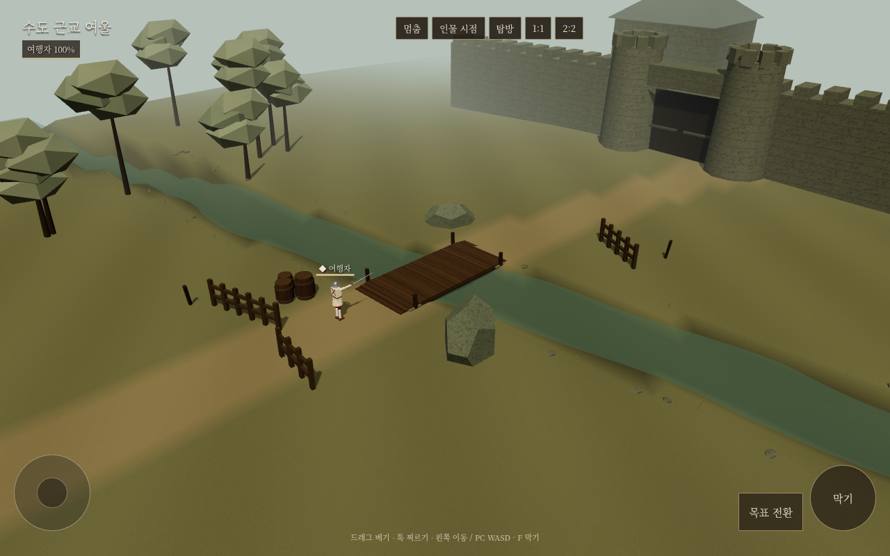
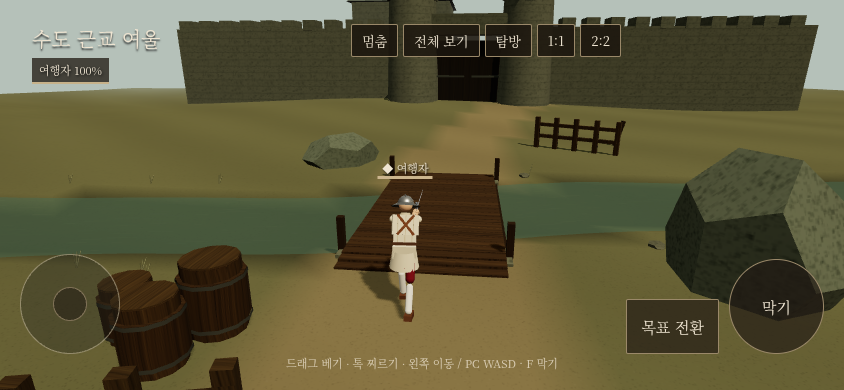

# 수도 근교 여울 — 실제 전장 첫 검토판

2026-10-29 · 샛별. 사용자 지시로 구현한 독립 시험판. 우화 main53629cf4의 인물·전투·보법을 사용한다. **정식 생사전 연결·우화 전달 전이며, 미감과 인간 전술은 사용자 피드백 대기다.**

## 실제 구현

- 성문으로 이어지는 옛길과 낮은 목교, 양쪽 강변, 비스듬하게 휘어 흐르는 얕은 물길.
- 명목 경계 면적408㎡(소품 점유 전). 일반265.46㎡의 약1.54배. 다리 아래와 위를 면적으로 중복 계산하지 않았다.
- 물길 폭 대략3~4m, 중심 수심 약22cm. 다리 너비3m/길이7m/상판 높이10cm. 양끝70cm는 완만한 경사다.
- 다리 위는 이동100%, 여울 중앙은60%, 물가에서는 부드럽게 정상속도로 돌아온다. 기력·공격 속도·물리 시계의 별도 변경 없음.
- 바위3개, 하역터의 오크통3개, 짧은 목책3구간. 소품은 고정물. 목책은 기둥과 가로대만 충돌하며 틈을 보이지 않는 벽으로 막지 않는다.
- 수면 무늬가 이동한다. 유체·실시간 반사·굴절·입자·군중·파괴 파편은 없다.
- 탐방(무상대), 1:1, 2:2와 인물/전체 시점. PC WASD·F·마우스, 휴대폰 왼쪽 조이스틱·오른쪽 손길/막기.
- 접근 중 AI는 다리/여울의 실제 이동 배율과 소품을 반영한 작은 경로망을 사용한다. 정적 노드 간 비용은 캐시하고 재계산은4Hz. 근접·후퇴·유파 손길/보법은 기존 처리.

## 변경 경계

`src/capital_ford/`는 전장·입력·독립 팀전 연결부다. `ford.html`, `vite.ford.config.js`가 별도 진입점이다. 기존 파일 변경은 `src/wetland_ground.js`의 선택적 지표 이동 배율 훅2줄뿐이다. 기존 null/문자열 지표 경로는 동일하다.

4인 연결부는 자체10/25 동시전 실험의 어댑터를 최신 전투 코드에 연결했다. **우화의16팀 생사전UI/저장/보상/일정과 연결하지 않았다.** 일반게임의 진입·저장을 수정하지 않고 이 페이지도 localStorage를 쓰지 않는다. 실제 정식 통합은 우화와 팀전 엔진 계약을 확인한 다음 별도 작업이다.

## 검증 결과

- 공통5관문 모두 종료0. 4종 출력바이트 일치; corr_s0는 마지막 실행시간만34.0→36.4초 차이,12개 IDENTICAL 결과 모두 일치. [원자료](results/common.json) 및 before/after 로그 보존.
- 바닥/다리7개 레이와 발 높이 함수의 최대차0.00000021m. 초기에 완만한 곡선 경사와 삼각형이8.7mm 어긋나던 것을 실제 직선 경사와 일치시켰다.
- 실제 인물이 x=-2.7→2.7m를 통과한 시간: 다리3.025초, 여울3.967초. **120Hz 시뮬레이션 시간**이며 벽시계·실제 휴대폰 프레임률이 아니다. 양 끝 물가 구간을 포함하므로 전체 도하시간은 단순1/0.6배와 다르다. [지형·물리 원자료](results/terrain.json)
- 4AI20초 안정성 확인: 좌표 유한, 전투 진행. 승패/밸런스 비교를 위한 표본이 아니다.
- 컴파일판 브라우저에서 PC1280×800, 휴대폰844×390(탐방/2:2)·390×844(1:1)의 실제 키/터치·입장·이동·멈춤/계속·시점 전환, 저장 비변경, HTTP/JS 오류 검사를 통과했다. 결과는 [브라우저 기록](screens/browser.json).
- 처음 탐방이 매틱마다 무상대 표적 초기화로 입력을 지우던 문제를 수정했다. 브라우저 자동화의 잘못된 키 표현도 실제 `w` 입력으로 수정했다. 낮은 화면에서 멈춤 창이 상단 버튼을 가리던 문제는 크기·레이어를 조정했다. 먼 강바닥에도 외곽 지형 높이가 더해져 강이 끊겨 보이던 문제는 하천 바닥에 외곽 융기를 적용하지 않도록 고쳤다.

## 비용과 남은 한계

배경은 **8메시·9,132삼각형**. 최초21,134에서 전투 바깥 지형 격자를 성기게 했다. 전체 장면의 실제 그리기 호출은 인물·그림자를 포함해 이보다 많다. 고정 콜라이더60개(공유 바닥/다리1 + 경계32 + 소품27), 새 동적 배경물0. 물리120Hz·해결 반복6은 기존과 같다.

브라우저는 클라우드 Chromium/SwiftShader로 검사했다. 실제 휴대폰 FPS나4인 비용의 개선율을 확정하지 않는다. 명목 경계는 기존 방식의 보이지 않는 충돌경계다. 외곽의 시각적 안내, 비대칭 시작점 공정성, 장무기 끼임, 리볼버 상대 엄폐효과, 부상 인물 도하는 추가 인간 검토 대상이다. 현재 전투 예시는 근접 무기만 사용한다. AI에게 동적 아군 회피/교량 예약 기능은 없으므로 혼잡을 없앴다고 주장하지 않는다.

## 재현

```sh
npm ci
node tools/capital_ford/verify.mjs
node tools/capital_ford/build.mjs
python3 -m http.server 5293 --directory dist-ford
# 다른 셸. Playwright와 /usr/bin/chromium 필요(PW_CHROMIUM으로 경로 교체 가능).
node tools/capital_ford/browser.mjs http://localhost:5293/
```

공개 경로: `https://yoonjl-svg.github.io/halfsword-codex/encounters/capital-ford-20261029/`




## 공개 확인

자체 main `f9991042` / Pages Actions `40870952798` 성공. 공개181파일5,859,828bytes가 빌드와 SHA-256 모두 일치했다. 공개 주소의844×390 실제터치 탐방 이동/4인입장·저장비변경·HTTP/JS오류0도 확인했다. [발행 영수증](publication.json), [공개 브라우저](public-browser.json).
