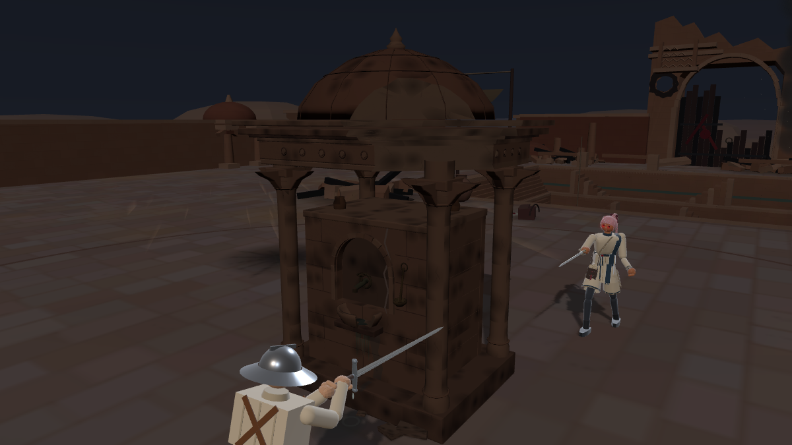
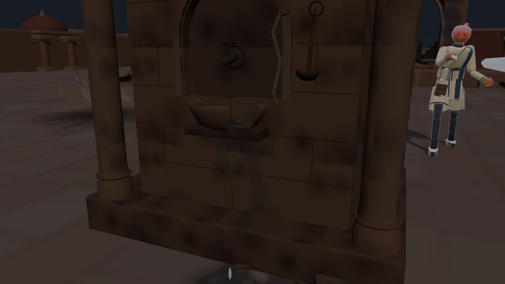

# 밤 중정 정수탑 — 부분 파손과 누수

2026-10-21. 사용자 승인: 중앙 정수탑 지붕/처마 한쪽 파손·벽 균열·물받이 파손을 적용하고, 고장 나 조금씩 물이 떨어지거나 새는 상태. 이전 밤 중정 `10c6b5e39b99b7097120a4f454b9a0f61bda7b58` 위 후속.

## 실제 변경

- 밤 전용 `stage_courtyard_damaged_cover.js`에서 기존 정수탑 모델을 재사용한다. 공유 낮 모델/충돌 정의를 수정하지 않는다.
- 처마 한 귀퉁이의 약13%에 해당하는 평면 영역을 잘라 실제 지붕 윤곽을 바꾼다. 돔 하단도 같은 방향으로 일부 소실. 절단면은 밝은 사암 면, 모서리에는 작은 불규칙을 둔다. 본체·기둥·높이/엄폐 유지.
- 앞 물받이의 약48°(둘레13%) 조각이 떨어져 내부가 열린다. 기존 속이 빈 그릇의 단면을 유지하고, 돌 조각은 기단 가까이 낮게 둔다.
- 출수구→물받이, 깨진 물받이→바닥 두 경로에서 작은 물방울이 각각 **0.26~0.88초의 비균일 간격**으로 떨어진다. 자유낙하와 물받이 바깥쪽 흐름을 표현하며 바닥/물받이에 닿으면 작은 파문을 만든다.
- 벽과 기단에 젖은 흐름, 바닥에 가장자리가 옅게 사라지는 작은 물웅덩이. 물은 환경 연출이며 새로운 미끄러짐/회복/피해 효과 없음.
- 기존 중정 물방울 소리를 작은 세기로 재사용한다. 요청은 간헐적으로 발생하며 기존 오디오의 최소8초 간격 제한을 유지한다. 매 방울마다 큰 소리를 내지 않는다.

## 실제 화면

[전투 시점](shots/01_fight.png), [휴대폰](shots/06_mobile.png), [실제 게임 8초 영상](shots/leak.webm). 영상은 무음 촬영이며 확대 사진/영상은 관찰 카메라다. 생성 이미지가 아니다.

## 검증·한계

- 실제 빌드판 브라우저: 오류0, 물방울 생성/착수 수가 시간에 따라 증가, 낮↔밤 전환 시 누수 객체 정리·재생성 확인. 충돌체9개 유지. [기록](shots/review.json).
- 실제 총·걷기·총수 우회·카메라·정리 검사 결과가 이전 밤 중정과 완전 동일. [실측](verification/night_cover.json), [원본 파일 동일성](verification/unchanged_gameplay.json).
- 낮 스테이지/공유 정수탑 형상·충돌/캐릭터·설정·AI·싸움꾼 파일은 이전 커밋과 바이트 동일. 이번 범위와 무관한 전체 대련은 반복하지 않았다.
- 초기 단면의 검은 삼각형 얼룩과 지나치게 검은 물때를 확대 검수 후 수정. 최종 물받이는 속이 빈 그릇을 유지하는 부채꼴 파손이다.
- 지붕 파편은 시각 표현이며, 상부 장식의 기존 근사 충돌 껍질을 유지한다. 실제 신체 높이의 몸체 차폐와 동선은 이전과 같다. 이동 가능한 파편/수리 기능은 없다.
- 데스크톱 Chromium의 모바일 화면 검사다. 실제 휴대폰 성능이나 인간 전투 체감 측정으로 확대 해석하지 않는다.

## 위치와 재현

소스는 포크 `codex/courtyard-ruins-20261021`에 보존한다. 원본 우화 저장소 수정/새 전달 없음. 정식 여정 편성은 그대로, 기존 별도 검토 페이지를 갱신한다.

`node tools/browser/build_courtyard_ruins.mjs`로 격리판 생성 → 정적 서버 실행 → `node tools/browser/courtyard_ruins_review.mjs http://127.0.0.1:4524/game`. 영상은 `node tools/browser/courtyard_leak_video.mjs`로 실제 게임 녹화. Playwright/Chromium/ffmpeg 필요. 첫 영상 생성 전에는 저장된 영상/사진을 사용하거나 촬영 서버를 먼저 준비한다.

되돌림은 이번 독립 후속 커밋만 취소한다. 이전 포격 폐허/검은 연기 시안은 보존된다.
