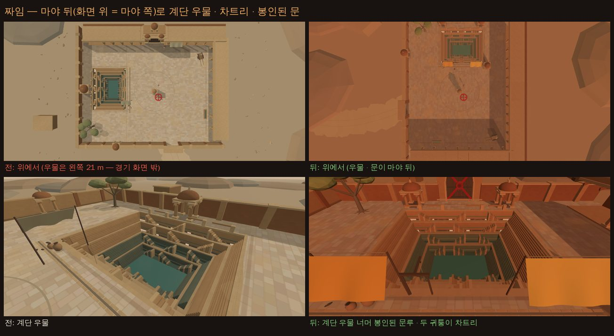
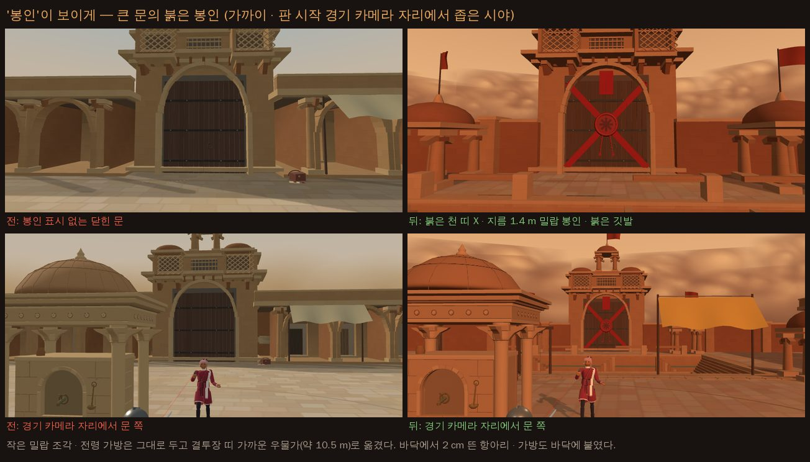

# 봉인의 중정 고침 — 리뷰에서 찾은 것을 다 고침 (2026-10-17)

> **사장님 10/17 15:4x "다 고쳐서 올려"** — 디자인 리뷰(`docs/design/courtyard_review_2026-10-17.md`, 판정 '고쳐서 넣기')의 고칠 목록 1~9 와 11 을 모두 고쳤다. 이름은 그대로 **'봉인의 중정'**(목록 10 의 ①).
> 봉인의 중정은 이제 **여정 12 번째 — 2 막 산호 항구 바로 뒤, 잠든 습지 앞**이다. **마야는 중정에서만** 나온다(붉은 회랑 후보를 뺐다).
> 한 장 요약: `docs/design/courtyard_fix_2026-10-17/courtyard_fix_sheet.jpg`

- 바탕: 리뷰 커밋 1930074 위. 커밋 다섯 — 카메라(383e06a) · 무대 고침(1d62d77) · 카드 뒷면(e7a924c) · 여정(8cbd475) · 이 문서.
- 잰 곳: 이 상자의 빌드판(`npm run build` → `vite preview`) · 헤드리스 크롬(SwiftShader — 그래픽 칩 없이 CPU 로 그림). **시간 수치는 폰 수치가 아니다**(같은 기계에서 견주기만). '전' = 1930074 빌드판, '뒤' = 이 가지 빌드판. 마야는 늘 권총(`&foeWeapon=pistol`).
- 새 값은 모두 **사장님 확인 전**(확인표 2050~2061 · 2064). 여정 순서 · 마야 자리만 사장님 결정(2062 · 2063).

## 한눈에

| # | 무엇 | 전 | 뒤 |
|---|---|---|---|
| 1 | 장애물 곁 카메라 | 급수정 · 습지 석상에 등을 대면 카메라가 내 몸 0.06~0.68 m · 허리 높이 0.9 m 로 들어감 | 거리 3.03~3.05 m · 높이 2.3 m 그대로 두고 옆으로 돌아 봄. 바닥 지도 무너짐 중정 3.9 % → 0 · 습지 2.1 % → 0 |
| 2 | 때 · 색 | 흐린 한낮 회베이지 · 바닥 L\* 63.5 · 내 캐릭터 분리 42 %(리뷰) | 장마 앞 늦은 오후 · 주황 모래 안개 · 장밋빛 사암 · 바닥 L\* 43.2 · 분리 93~94 % · 마야 88 % |
| 3 | 급수정 그림자 | 바닥에 그린 그늘 — 그 안에서도 몸 밝기 그대로(0.98 배) | 실제 그림자 — 그늘 안 몸 0.66 배 |
| 4 | 카드 뒷면 | 옛 기본 뒷면 | 중정 뒷면(`px_courtyard_*` + 회색 상대 칸) |
| 5 | 소금 사막과 겹침 | 상대 뒤 큰 아치 문 · 양옆 회랑 · 우물은 화면 밖 | 마야 뒤에 계단 우물 · 차트리 · 자로카 창 · 봉인된 문 |
| 6 | 붉은 봉인 | 문에 표시 없음 · 밀랍 조각은 20 m 밖 몇 화소 | 붉은 천 띠 X · 지름 1.4 m 밀랍 봉인 · 붉은 깃발 셋 |
| 7 | 바람 | 돌풍에 먼지 얼룩만 · 소리 그대로 · 소금 사막 우물 고리 소리를 다시 씀 | 모래 줄 · 깃발 · 천 · 먼 안개 · 바람 소리 +6.1 dB · 이 무대만의 우물 소리 둘 |
| 8 | 판석 무늬 | 1536² | 1024² |
| 9 | 먼 모래 띠 · 급수정 잔무늬 | 15 장 따로 · 26,924 삼각형 | 모래폭풍 한 메쉬 · 14,172 삼각형 |
| 10 | 이름 | '봉인의 중정' | 그대로 |
| 11 | 점검 주소 | — | 중정 사진 · 점검은 모두 `&foeWeapon=pistol`(마야 권총) |

## 사장님께 여쭐 것

1. **바닥 밝기** — 리뷰가 권한 L\* 50~55 보다 어두운 **43** 이다. 해를 낮추고 주황빛을 입히니 이 밝기에서 내 캐릭터가 가장 또렷했다(분리 93~94 %). 더 밝은 바닥을 원하시면 판석 밝기만 올리면 된다(분리는 그만큼 준다).
2. **급수정 벽을 따라 미끄러질 때 카메라가 한 번 넘어간다** — 돌에 등을 붙인 채 옆으로 끝까지 가면, 카메라가 돌 속을 지나가지 않게 반대쪽으로 한 번에 넘어간다(영화의 장면 바꿈처럼 — 한 화면에 최대 102°). 일부러 만든 걷기 길에서만 나왔고, AI 싸움 다시 보기(중정 · 습지)에서는 0 번. 넘어가는 대신 '그때만 돌을 반투명하게'로 바꿀 수도 있다.
3. **그리기 247 → 325** — 급수정 · 두 사람이 실제 그림자를 드리워서(그림자 지도에 한 번 더 그림). 밤의 소금 사막(348)보다 적다. 무늬 메모리는 14.8 → 8.7 MB 로 줄었다.
4. **새 값** — 해 높이 20° · 하늘 · 돌 색 · 바람 세기 · 카메라 돌림 값 등은 확인표 2050~2061 · 2064(모두 '사장님 확인 전').

## 1. 장애물 곁 카메라 — 먼저 고침 (383e06a)

- **전**: 카메라 길이 급수정 둘레 원(1.73 m)에 막히면 원 앞으로 **당기면서 높이도 내 몸 높이까지 내렸다.** 돌에 등을 대면 카메라가 내 몸 안 · 허리 높이에 붙어 내 캐릭터가 사라졌다. 잠든 습지 석상도 같은 함수라 같은 일(0.06 m).
- **뒤**(`src/arena_obstacle.js` `clampStageCamera`): **당기지도 내리지도 않는다.** 카메라 거리 · 높이는 평소 그대로(3.04 m · 2.3 m). 돌의 실제 꼴(충돌체 — 상자 · 원기둥 · 캡슐 · 돔)이 카메라 자리를 막거나 카메라 → 내 머리 · 가슴 · 골반 일곱 점의 시선을 막으면, **내 몸을 축으로 카메라를 옆으로 돌려** 막히지 않는 가장 작은 각을 찾는다(어깨 쪽 먼저). 폰은 카메라를 손으로 못 돌리니 늘 내 몸이 보이게.
- 화면마다 고른 쪽을 지키고(돌 앞에서 좌우로 튀지 않게), 막히면 빨리(0.06 s) 돌아 나가고 풀리면 천천히(0.3 s) 제자리로 온다.
- 중정 급수정 · 습지 석상 둘 다(장애물이 없는 무대는 그대로).

`tools/sim/courtyard_camera_map.mjs` — 바닥 0.5 m 칸마다 서서 둘레 열두 방향의 상대를 볼 때(main.js 와 같은 순서로 카메라를 놓음):

| 칼 거리(2 m) · 바닥 칸 × 열두 방향 | 중정 전 | 중정 뒤 | 습지 전 | 습지 뒤 |
|---|---:|---:|---:|---:|
| 카메라가 내 몸 1.6 m 안(무너짐) | **3.85 %** | **0** | 2.06 % | **0** |
| 카메라 높이 2 m 아래 | 5.22 % | 0 | 2.97 % | 0 |
| 내 가슴이 화면 밖(844×390 · 667×375) | 1.5 % | 0 | 0.52 % | 0 |
| 내 몸이 돌에 절반 넘게 가림 | 0 | 0 | 0 | 0 |
| 상대가 무엇에든 절반 넘게 가림 | 1.83 % | 0.28 % | 0.94 % | 0.02 % |
| 카메라를 옆으로 돌림 | — | 5.4 %(가장 큰 각 93.7°) | — | 2.1 %(53.1°) |

- 총 거리(4 m)에서도 무너짐 중정 4.85 % → 0 · 습지 2.54 % → 0, 2 m 아래 6.58 → 0 · 3.66 → 0, 가슴 화면 밖 1.89 → 0 · 0.64 → 0.
- 상대가 급수정 자체에 가리는 몫은 0.08 → 0.12 %(칼 거리) — 전엔 당긴 카메라가 돌 앞에 와서 돌이 덜 가렸다. 그 대신 내 몸이 상대를 가리는 일(1.76 → 0.16 %)이 거의 없어졌다.
- 걷기 확인(`--walk` — 1/60 s 로 걸으며 화면마다): 돌에 등을 붙이며 물러날 때 · 돌 둘레를 한 바퀴 돌 때 한 화면에 1.6° 아래로 부드럽다. 돌 벽을 따라 옆으로 미끄러지거나 돌을 끼고 지나갈 때 한 번 반대쪽으로 넘어간다(중정 83~102° · 습지 38~57°) — 위 '여쭐 것' 2.
- AI 싸움(가짜 시계 60 fps — 중정 0.7 분 · 습지 1.2 분): 카메라 돌림 0 번.

## 2. 때 · 색 — 장마 앞 늦은 오후

- **해**: 34° 흰빛 → **20° 주황**(`#ffb27a`). 판 시작 카메라의 뒤 오른쪽(어깨 쪽)에서 비춰, 카메라가 보는 내 등 · 마야 앞 · 봉인된 문 · 계단 우물 먼 벽이 해를 받는다. 긴 그림자는 화면 안쪽(마야 쪽)으로 눕는다.
- **하늘**: 회베이지 → **주황 모래 안개**(지평선은 밝은 주황 · 위로 갈수록 짙은 먼지빛 · 해 쪽은 노랗게 번짐). 마야 뒤 지평선에 **다가오는 모래폭풍**(먼 모래 띠 열다섯 장을 한 메쉬로 — 반지름 165~195 m · 높이 34~52 m).
- **돌**: 회베이지 → **장밋빛 · 황토 사암**. 판석은 빛깔 31~38° → 16~24°, 밝기를 낮춰 화면 바닥이 더 어둡고 산호 항구 모래와 빛깔이 다르다.
- **2 막 색 차례**: 바다 파랑(산호 항구) → **장밋빛 · 주황(중정)** → 초록(습지) → 검정 · 빨강(화산섬). 전에는 '모래 → 더 옅은 모래 → 초록'으로 읽혔다.

같은 틀 사진의 화소 평균(CIE L\*a\*b\* — L\* 밝기 · C\* 채도 · 색상각, 리뷰와 같은 잣대):

| 무대 | 경기 화면 | 하늘(넓은 각 위 22 %) | 바닥(넓은 각 아래 30 %) |
|---|---|---|---|
| 산호 항구 | 50.3 · 18.5 · 89° | 60.7 · 7.1 · 175° | 46.3 · 26.2 · 84° |
| **봉인의 중정 — 전** | 54.0 · 18.6 · 77° | 72.9 · 9.8 · 83° | **63.5** · 19.3 · **79°** |
| **봉인의 중정 — 뒤** | 44.5 · 37.1 · 55° | 68.7 · **36.8** · 65° | **43.2** · 34.5 · **55°** |
| 잠든 습지 | 29.0 · 14.2 · 115° | 35.0 · 15.9 · 124° | 23.0 · 13.2 · 107° |
| 소금 사막 | 41.0 · 14.2 · 56° | 66.5 · 22.2 · 21° | 42.4 · 9.4 · 55° |

- 바닥 빛깔이 산호 항구 모래(84°)와 갈렸다(55°). 소금 사막 바닥도 55° 지만 채도 9.4(회갈색) — 중정은 34.5(장밋빛)라 채도로 갈린다. 하늘도 소금 사막 분홍(21°)과 다른 주황(65°).

`tools/browser/stage_light_check.mjs --hold=15000`(우리 조명 약속 점검 — 844×390, 상대 다섯):

| 상대 | 내 캐릭터 분리 전 → 뒤 | 상대 분리 전 → 뒤 | 판정 |
|---|---|---|---|
| 하인리히 | 54 → **94 %** | 77 → 81 % | 통과 |
| 브란 | 70 → **94 %** | 99 → 45 % | 통과 |
| 마르그레테 | 84 → **93 %** | 100 → 96 % | 통과 |
| **마야** | 85 → **93 %** | 99 → **88 %** | 통과 |
| 광기의 마야 | 84 → **93 %** | 97 → 87 % | 통과 |

- 분리 = 캐릭터 화소 가운데 둘레 바닥과 밝기가 16 넘게 다른 몫. 리뷰 때 잰 내 캐릭터 분리 42 %(상대 셋)는 같은 빌드판을 다시 재니 54~85 % 였다(싸움 장면에 따라 흔들림). 고친 뒤 93~94 %(다른 때 잰 값 83 % 까지) — 이웃 무대(66~94 %)의 위쪽.
- 무대 빛(조명 약속의 E): 1.47 → **0.89**(포세이돈 0.78 · 산호 항구 0.83 · 습지 0.84 · 소금 사막 1.20). 캐릭터 빛 기준을 0.5 → 1.0 으로 올려 두 사람에만 카메라 쪽 보조광을 조금 채웠다 — 크림색 내 옷이 장밋빛 바닥보다 한 단 밝다.
- **마야는 여전히 또렷**(88 %). 빨간 옷이 붉은 돌에 붙지 않게 무대의 빨강은 봉인 · 깃발에만 쓰고, 우물가 차양은 사프란 · 강황빛으로 했다. 브란(갈색 옷)은 이 바닥에서 덜 또렷하지만(45 %) 중정엔 마야만 나온다(사장님 결정).

## 3. 급수정 실제 그림자

- 바닥에 그렸던 급수정 그늘을 지우고 **급수정이 실제 해 그림자를 드리운다**(이 무대만의 그림자 상자 — 가로 ±11 m · 1024² · 결투장 어디에 서도 급수정과 그 그림자가 상자 안). 기둥 · 처마 · 돔 꼴 그대로, 해가 20° 라 길게(약 10 m) 마야 쪽으로 눕는다. 판 시작 두 자리는 비켜 간다.
- **그늘에 든 몸은 해 빛을 덜 받는다**: 몸 부위마다 해 쪽으로 광선 넷을 쏴 급수정에 막힌 몫만큼 해 빛을 줄인다(`src/fighter_light.js` — 무대가 `fighterShade` 를 줄 때만, 다른 무대는 그대로).
- 잰 값(`tools/browser/courtyard_fix_shots.mjs` shade — 마야를 그늘 안 · 밖에 세우고 같은 카메라에서 마야 화소만 셈):

| | 발밑 바닥 안 ↔ 밖 | 마야 몸 안 ↔ 밖 | 몸 비 |
|---|---|---|---|
| 전(그린 그늘) | 123 ↔ 156 | 50.0 ↔ 51.2 | 0.98 |
| 뒤(실제 그림자) | 78 ↔ 97 | 44.3 ↔ 67.4 | **0.66** |

- 다른 건물(담 · 회랑)의 땅 그늘은 전처럼 바닥 무늬에 구워 둔다 — 결투장 띠 밖에서 끝난다.

## 4. 카드 뒷면

- `public/ui/cardbacks/px_courtyard_{tile,frame,center,plaque}` + 회색 상대 칸 `_foe` 넷(`tools/cardbacks/gen_pixel_cardbacks.py` · 회색은 있던 `grey_foe.py`), `src/main.js` `PX_BACKS` 에 바탕색 한 줄(`#3a1f24`) — 사장님 결정(9/28) '새 스테이지를 만들면 카드 뒷면도 함께'.
- 짙은 장밋빛 사암 바탕 · 장밋빛 마름모 격자(자로카 돌 격자) · 위에서 본 계단 우물과 붉은 밀랍 봉인을 번갈아 · 테두리 띠는 처마 위 작은 차트리 돔 · 가운데 큰 밀랍 봉인(여덟 모 별). 빨강은 봉인 두 곳만 — 소금 사막(벽돌 · 문루 안 해 · 소금 결정)과 갈린다.
- 다른 무대 뒷면 조각은 바이트 그대로(다시 뽑아도 같음). 카드 고르기에서 `data-back=px` 확인.

## 5. 소금 사막과 갈라지기 — 마야 뒤로 계단 우물

- 배경을 **반 바퀴** 돌려 계단 우물(바오리) · 귀퉁이 차트리 · 자로카 창 · 봉인된 문이 **마야 뒤, 경기 화면 안**에 온다(전: 우물은 결투장 21 m 옆 — 화면 밖).
- 큰 문은 북쪽 회랑 가운데에서 **계단 우물 너머 서쪽 담**으로 옮겼다(문 앞엔 우물 · 양옆엔 차트리 · 위엔 자로카 창). 비게 된 북쪽 회랑 가운데는 세 칸을 이어 메웠다 — 소금 사막의 '상대 뒤 큰 아치 문 · 양옆 회랑 · 왼쪽 우물'과 다른 짜임.
- 급수정 · 충돌체 · 판 시작 자리 · 사선이 막힌 총수의 돌아가기는 **세상 좌표 그대로**(급수정 길잡이 등록도 중정만) — 바닥 지도 · `tools/sim/courtyard_cover.mjs`(막힘 · 열린 옆 · 돌아가기 · 캡슐 · 카메라 · 치우기) 통과.
- 우물가 차양 둘은 우물 가장자리(결투장 카메라 벽에서 1 m 넘게 밖)로, 봉인된 문을 가리지 않는 자리에.

## 6. 붉은 봉인

- 문짝을 가로지르는 **붉은 천 띠 둘(X)** · 가운데 **지름 1.4 m 밀랍 봉인**(여덟 모 별) · 늘어진 끈 · 문 위 붉은 천 한 자락 · 문루 꼭대기와 우물 너머 두 귀퉁이 차트리의 **붉은 깃발 셋**. 경기 화면(약 38 m)에서 붉은 X 와 둥근 점으로 읽힌다 — 마야 칭호 '붉은 봉인의 전령'과 무대 이름이 이어진다.
- 작은 밀랍 조각 · 전령 가방은 그대로 두고 결투장 띠 가까운 우물가(약 10.5 m)로. 바닥에서 2 cm 떠 있던 항아리 · 가방도 바닥에 붙였다(리뷰 §4).

## 7. 바람 — 보이고 들리게

- 돌풍(처음 4 초 · 9~17 초마다 4~5 초 — 전과 같은 때): **땅을 스치는 모래 줄** 44 가닥(무릎 아래 낮은 띠 — 싸움 읽기를 가리지 않음)이 진해지고(투명 0.05 → 0.35) 빨라진다(0.6 → 6.5 m/s). **붉은 깃발 셋 · 천 둘**이 크게 나부끼고 먼 안개가 8 m 다가온다(결투장 띠 밖만). 바람은 마야 뒤 모래폭풍 쪽에서 화면 오른쪽 아래로 분다.
- **소리**: 바탕에 깔린 바람 겹(거친 바람 700 Hz · 모래 스침 2.6 kHz)이 무대가 알린 돌풍 길이에 맞춰 커졌다 줄어든다 — 돌풍 한가운데 **+6.1 dB**(전 0 dB — 돌풍에도 그대로). 같은 바탕 소리를 돌풍을 보낸 판 ↔ 안 보낸 판으로 두 번 그려 뺀 값.
- **우물 소리 둘을 이 무대만의 소리로**: 6 m 아래 우물물에 떨어지는 물방울의 울림 · 돌풍 끝에 두레박이 우물 돌 가장자리에 닿는 둔한 나무 소리와 출렁임의 되울림(전: 청람잔도 샘 물방울 · 소금 사막 쇠고리를 다시 씀). 천 소리는 붉은 회랑 천 소리 그대로.
- 12 초 바탕 소리 크기 −65.1 → −64.1 dBFS(돌풍 몫) — 앞뒤 무대(산호 항구 −52.0 · 잠든 습지 −61.6)보다 여전히 작다.

## 8. 덜기 · 폰 부담 (목록 8 · 9)

`tools/browser/courtyard_review.mjs` cost(844×420 · 경기 카메라 · AI 멈춤, 헤드리스 — 폰 수치 아님):

| | 그리기 | 삼각형(장면) | 무대 삼각형 | 투명 | 무대 무늬 | 짓기 |
|---|---:|---:|---:|---:|---:|---:|
| 봉인의 중정 — 전 | 247 | 97,787 | 65,282 | 31 | 14.8 MB | 285 ms |
| **봉인의 중정 — 뒤** | **325** | 127,420 | **57,374** | **18** | **8.7 MB** | **260 ms** |
| (리뷰 때) 산호 항구 | 207 | 123,711 | 75,001 | 15 | 7.0 MB | 286 ms |
| (리뷰 때) 잠든 습지 | 245 | 182,437 | 98,764 | 17 | 4.7 MB | 676 ms |
| (리뷰 때) 소금 사막 | 294 | 125,904 | 59,578 | 15 | 11.3 MB | 229 ms |
| (리뷰 때) 밤의 소금 사막 | 348 | 164,257 | 97,764 | 29 | 15.7 MB | 394 ms |

- 판석 무늬 1536² → **1024²**(리뷰가 잰 화면 차이 0.3~0.4 % 화소). 먼 모래 띠 열다섯 장 → **모래폭풍 한 메쉬**. 급수정 잔무늬(폰에서 1~2 화소인 실금 · 꽃잎 공 · 돔 갈빗대 24 → 12 등) **26,924 → 14,172 삼각형**.
- 그리기 · 장면 삼각형이 는 것은 실제 그림자 몫이다 — 급수정 · 두 사람 · 칼이 그림자 지도에 한 번 더 그려진다(무대 삼각형은 줄었다). 기존 무대 범위 안(밤의 소금 사막 348).
- 짓기 = `game.setStage` 뒤 세 바퀴 가운데 값(메뉴가 가리는 동안이라 싸움 중이 아니다).

## 9. 폰 화면 · 판 시작 훑기

- 844×390 · 667×375 · 1280×720 모두 글자 · 단추와 겹치는 무대 물체 없음.
- 판 시작 훑기(`tools/browser/cam_open_shots.mjs --ring`): 뚫음 0 · 마야 · 내 몸 가림 0 · 무대까지 가장 가까이 2.30 m(바닥). 훑기는 마야 쪽으로 끝나며 계단 우물 · 봉인된 문을 보여 준다(전엔 훑기 가운데에서만 우물이 잠깐 보였다).

## 10. 여정 — 스물아홉 판 (사장님 결정 10/17)

- 사장님 10/17 14:xx(원문): "봉인의 중정 이식이 끝나면 마야는 거기서만 나올거야. 예전에 네가 2막 인도양 순서에 마야를 넣자고 제안한 적 있어 그대로 해." → 15:4x "다 고쳐서 올려".
- `src/stages.js` `STAGE_ORDER` — 낮 다섯 · 그곳들의 밤 규칙(10/16 19:4x) 그대로:

| 묶음 | 번호 | 무대 |
|---|---|---|
| 낮 1 | 1–5 | 포세이돈 신전 · 화전 터 · 성 안뜰 · 붉은 회랑 · 대성당 |
| 밤 1 | 6–10 | 그 밤 다섯 |
| 낮 2 | 11–15 | 산호 항구 · **봉인의 중정(12)** · 잠든 습지 · 화산섬 · 청람잔도 |
| 밤 2 | 16–19 | 밤의 산호 항구 · 밤의 잠든 습지 · 밤의 화산섬 · 밤의 청람잔도(중정은 밤 짝이 없어 넷) |
| 낮 3 | 20–24 | 신목의 숲 · 산사 · 얼어붙은 만 · 철불 절벽 · 소금 사막 |
| 밤 3 | 25–29 | 그 밤 다섯 — 끝판 밤의 소금 사막 |

- `STAGE_FOE_EXTRA` 에서 붉은 회랑의 마야 후보(`loggia: ['samira']`)를 뺐다 — 붉은 회랑은 토메. 저장된 '붉은 회랑 · 마야' 이어하기는 그 무대를 새 상대로 연다(무대 자리는 지킴).
- 왼쪽 위 '스테이지 12 · 봉인의 중정' · 잠든 습지는 13. 테스트 고르기의 무대 줄 번호도 지금 차례로. `docs/stages.md` 여정 표(상대 · 숙련도 — 둘째 낮에 마야 1) · 무대 목록에 중정 줄.
- 브라우저 확인(빌드판): 첫 화면 'Stage 1' → 포세이돈(스테이지 1) · 산호 항구 이어하기 지점에서 이기면 지점이 `courtyard` 로 저장되고 다음 판이 '스테이지 12 · 봉인의 중정'(마야 · 권총) · 중정 싸움(마야가 13 초에 네 발) · 습지 싸움(석상) · 콘솔 오류 0.

## 11. 점검 — 관문 그대로

| 관문 | 결과 |
|---|---|
| `node tools/sim/fights12.mjs` | 5dfe035c (같음) |
| `node tools/sim/live_battery.mjs` | 648aca66 (같음) |
| `node tools/sim/finish_thrust.mjs 1 --stand` | 2de06c03 (같음) |
| `node tools/sim/corr_s0.mjs --limits=on,off --scenes=a,b` | 12/12 같음 |
| `node tools/sim/weapon_smoke.mjs` | OK 24 |
| `node tools/text/name_policy.mjs` | 통과 |
| `node --test tools/sim/*.test.mjs` | 93 통과 · 0 실패 |

- 카메라 함수가 바뀌어도 관문이 같은 것은 시뮬이 카메라를 쓰지 않기 때문이다(싸움 물리는 그대로).
- 브라우저 점검(빌드판)의 콘솔 · 페이지 오류: 모두 0.

## 12. 숫자 · 재현

- 바탕 1930074 · 빌드 `npm run build` · `vite preview` · Chromium(SwiftShader) · Node 22.
- 더하거나 고친 도구(게임 값은 안 바꿈 — 사진을 위해 AI 를 멈추거나 사람 · 카메라를 옮기는 것은 그 페이지 안에서만):
  - `tools/browser/courtyard_fix_shots.mjs` — 문 · 우물 · 위에서 · 돌풍 · 카드 고르기 · 그늘 밝기 · 비스듬히 본 그림자 · 돌풍 소리 (`PW_CHROMIUM=<크롬> node tools/browser/courtyard_fix_shots.mjs http://127.0.0.1:<포트> <폴더> --layout=before|after`)
  - `tools/sim/courtyard_camera_map.mjs` — 칸을 더함(카메라 2 m 아래 · 내 몸 가림 · 내 가슴 화면 밖 · 돌린 각) · `--walk` 걷기 확인 (`node tools/sim/courtyard_camera_map.mjs <결과.json> --d=2.0` · `--d=4.0` · `--walk`)
  - `tools/browser/courtyard_fix_sheet.py` — 이 문서 사진 · 한 장 요약 · 색 수치 (`python3 -I tools/browser/courtyard_fix_sheet.py <작업 폴더> docs/design/courtyard_fix_2026-10-17` — 작업 폴더 차림은 그 파일 머리말)
- 있는 도구도 돌림: `tools/browser/courtyard_review.mjs`(compare · positions · phones · cost · sound) · `tools/browser/stage_light_check.mjs --stages=courtyard --foes=heinrich,bran,margarethe,samira,samira_mad --hold=15000` · `tools/browser/cam_open_shots.mjs --ring` · `tools/sim/courtyard_cover.mjs`.
- 그늘 자리: 전 = 마야 (−1.6, 2.9) ↔ (1.2, 2.9)(그린 그늘은 급수정에서 −x +z 쪽), 뒤 = (5.2, −2.9) ↔ (5.2, 0.6)(실제 그림자는 +x −z 쪽) — 카메라는 마야에서 같은 거리.
