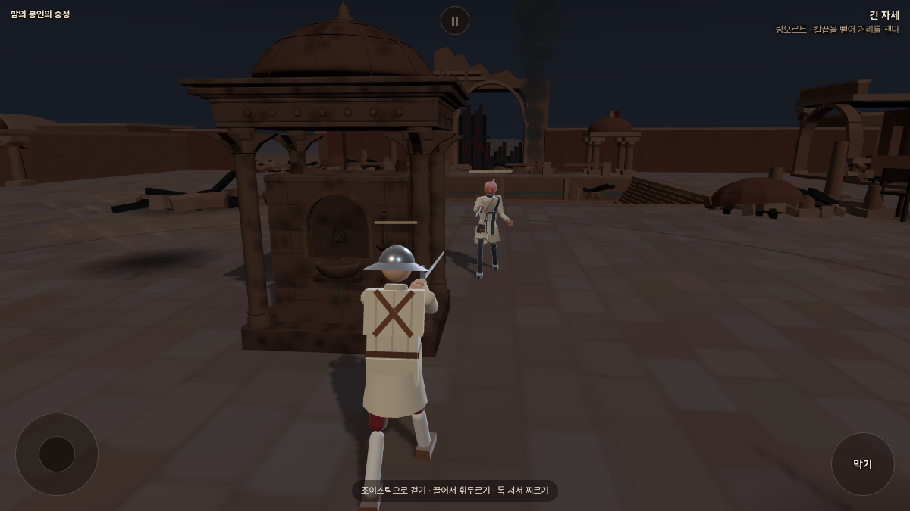
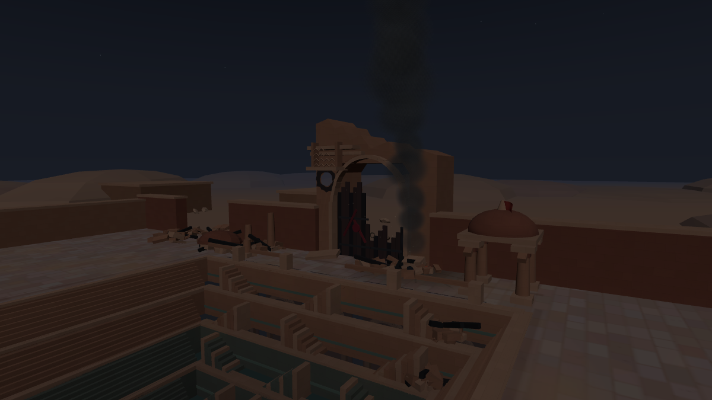

# 밤의 봉인의 중정 — 평화 회담 이후의 포격 폐허

2026-10-21. 사용자 확정 서사와 포크의 실제 시안. 우화 기준 `222c35de5349004c5feb1a1de4082143dc877f64`, 작업 가지 `codex/courtyard-ruins-20261021`.

## 확정된 설정

평화를 위한 사절단이 봉인된 중정에서 비밀회담을 열었다. 명령서가 제때 전달되지 못해 잘못된 교전이 벌어졌고, 큰 전쟁으로 번졌다. 화포류가 표준화된 세계이며, 중정은 포격으로 폐허가 되었다. 새벽 3시에도 검은 연기가 올라온다.

군사 문서고·개전 중지 왕명·죽은 수신자를 기다린다는 이전 제안은 확정 설정이 아니다. 소금길의 암살 모의/학살, 초기 중정 탈출·명령서 소각·군마·장맛비안도 이번 구현에 사용하지 않는다. 광기 마야의 기존 열린 문서가방/깨진 봉인과 이어지지만, 별도의 대사나 정신 상태를 새 정설로 추가하지 않았다.

## 실제 구현

- `courtyard_night`와 표시명 ‘밤의 봉인의 중정’, 상대 `samira_mad`. 현재 원본의 광기 마야는 **세이버**다. 기본 마야의 리볼버와 혼동하지 않는다.
- 문루 상층·차트리 일부 소실, 문짝 파손, 둥근 포탄 관통구와 그을린 가장자리. 남은 붉은 봉인 조각.
- 북쪽 회랑 4칸·맞은편 2칸의 지붕/기둥 붕괴, 담장 파열, 타다 남은 들보, 포탄과 부서진 사암. 큰 잔해는 전투·카메라 통행 밖에 배치.
- 계단우물 깊이 6.25m와 수위 유지. 무너진 정자와 아래 단으로 흘러든 석재. 회담 자리에는 마주 놓인 의자·둘로 부서진 탁자·남겨진 서류.
- 세 곳의 검은 연기: 총 36개의 스프라이트, 세 가지 다른 구름 텍스처, 32초 상승 주기와 비균일 크기·바람 이동. 검은 중심과 희미한 외곽, 재와 작은 잔불. 진행 중 포격/폭발은 추가하지 않음.
- 03:00 어두운 하늘·옅은 별과 달, 인물 보조광. 낮 무대의 주황 하늘과 구워진 낮 그림자는 재사용하지 않음.
- 중앙 급수정은 그을림/균열만 추가. 기존 형상, 충돌9개, 길찾기 반경1.45m, 시작Z 플레이어1.10/상대1.60 그대로. 기존 무대 반경9.192388m 유지.
- 돌 발소리, 기존 중정 바람/천·고리/물방울 연결. 붕괴된 공간의 잔향만 약간 짧게 조정. 새로운 포격음 제작 없음.
- 기본 마야의 과거 설명만 사용자 서사에 맞게 갱신. 캐릭터 외형·성능·AI·무기·유파 동작/보법 변경 없음.

정식 여정 순서는 변경하지 않은 검토용 밤 무대다. 낮 `stage_courtyard.js`와 공유 급수정 형상 파일은 기준 커밋과 바이트 동일하다. 우화 저장소 쓰기/이번 작업 전달 없음.

## 화면

전부 실제 Chromium/WebGL 게임 렌더. 전투 사진은 입력 후 AI를 잠깐 멈춰 구도를 고정했고, 풍경 사진은 관찰 카메라다. 생성형 콘셉트 이미지가 아니다.

[전경](shots/02_overview.png) · [반대편 회랑](shots/04_reverse_arcade.png) · [회담 자리](shots/05_conference.png) · [휴대폰](shots/06_mobile.png)

## 검증

- `tools/browser/courtyard_ruins_review.mjs`: 빌드된 격리판에서 촬영, 콘솔/런타임 오류0, 연기 이동 확인, 낮↔밤 4회 전환·충돌9개·이전 연기 정리 확인. [원자료](shots/review.json).
- 320/390/844px 갤러리 이미지 로딩/가로 넘침, 실제 터치 이동/공격, 일시정지/재개, 새로고침 재시작 확인. [원자료](verification/ui.json).
- 대련은 메모리 저장 공간, PWA 등록 제거. 기존 localStorage 센티넬 보존, 계정 화면을 거치지 않음.
- 공통5관문 정상 종료, corr_s0 12조건 동일·무기 NaN/실패0. fights12/live_battery/finish_thrust는 **이번 기준222c35de와 stdout 완전 동일**. 10/15의 옛 기대해시로 최신 우화의 변경을 실패라고 판정하지 않음. [결과](verification/gates.json), [기준 비교](verification/baseline.json).
- 실제 총·걷기·카메라·정리 검사: 낮/밤 결과는 stageID 외 완전 동일. 엄폐 중앙3발 차단/열린 양쪽2발 명중, 양쪽 이동 충돌·총수 우회 확인. [밤 원자료](verification/night_cover.json).
- 정식 Vite/PWA 빌드와 별도 검토판 빌드 성공. 번들 크기 경고는 기존 대형 게임 번들 특성. 실제 휴대폰 성능/사람의 손맛은 미측정.

초기 화면의 과도한 회색 하늘·원뿔 모양/고리 모양 연기는 검수 중 교체했다. 개발 서버 자동 재탐색으로 촬영 중 두 번 새로고침이 발생하여 실패했으며, 최종 검증은 정적 빌드 서버에서 수행했다.

## 재현·되돌림

`npm ci` → `node tools/browser/build_courtyard_ruins.mjs` → 출력 폴더를 정적 서버로 제공. 기본 출력 `/tmp/courtyard-ruins-preview-20261021`. `node tools/browser/courtyard_ruins_review.mjs http://127.0.0.1:4524/game`로 실제 화면 촬영. Playwright/Chromium 필요, `PW_CHROMIUM`으로 실행 파일 지정 가능.

도입 연결 파일은 `stages.js`, `arena_obstacle.js`, `sound.js`, `stage_detail_sound.js`, `characters.js`; 신규 밤 형상/세부 파일2개. 핵심 동작/물리 정의 전체 덮어쓰기 불필요. 되돌릴 때 이 독립 커밋과 검토용 공개 경로만 제거하면 된다. 우화에게 보낼 때는 당시 최신 main 위에 이 범위만 다시 맞추고 사용자 화면 확인 후 전달한다.
