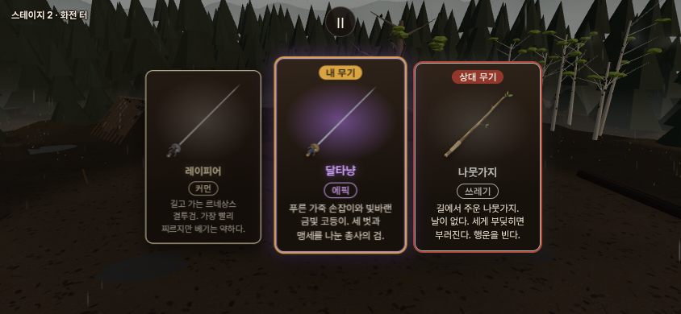
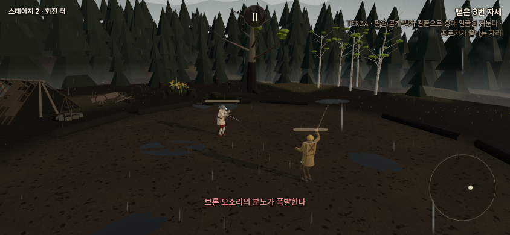

# 레이피어 커먼 · 달타냥 에픽 — 2026-10-21

사용자 지시: “레이피어를 커먼으로 내리고 달타냥 만들어.” 앞서 제안한 에픽을 기준으로 구현했다. 무라마사·마사무네는 역사와 후보 검토만이며 추가하지 않았다. 자체 포크에 적용하고 우화 저장소에는 쓰거나 새 메시지를 보내지 않는다.

## 구현

| 항목 | 레이피어 | 달타냥 |
|---|---|---|
| ID | rapier | dartagnan |
| 등급 | 레어 → 커먼 | 에픽 |
| 유파 | 이탈리아 | 이탈리아 |
| 칼날 / 전체 질량 | 95cm / 1.10kg | 동일 |
| 공통 등급 공격력 배율 | 1.05 → 1.0 | 1.1 |
| 파손 계수 | .032 → .056 | .0104 |
| 외형 | 기존 은빛 코등이 | 푸른 가죽 손잡이·빛바랜 금빛 코등이 |

파손 계수는 매 충돌의 고정 파손 확률이 아니다. 실제 충격량을 기존 식에 넣어 계산한다. 레이피어를 쓰는 기존 NPC에도 커먼 변경이 적용된다. 달타냥의 별도 상태이상·추가 특수 능력은 없다.

달타냥은 뒤마의 《삼총사》 속 인물을 모티프로 한 창작 무기다. 실존 달타냥의 유물이나 프랑스 검술의 정확한 복원이라고 주장하지 않는다. 게임에서 기존 레이피어의 이탈리아 몸꼴·손길·빈팔·막기·런지와 물리 치수를 그대로 사용한다. 프랑스 인물 모티프와 게임의 무기별 유파 분류를 구분한다.

설명: **푸른 가죽 손잡이와 빛바랜 금빛 코등이. 세 벗과 맹세를 나눈 총사의 검.**

`weapons.js`는 finalize 이전 레이피어 사양을 공유하므로 커먼의 계산된 공격력/파손값이 에픽에 상속되지 않는다. `weapon_measured.js`는 동일한 질량·관성·콜라이더에 대한 기존 측정값을 공유하며 새 실측이라고 표기하지 않았다. `frames.js`에 같은 쥠/막기 자리를 등록했다. 유파 동작 정의는 변경하지 않았다.

## 뽑기

등록 25종, 플레이어 카드 21종(간장·막야 묶음으로 20칸). 등급 가중치와 직전 무기 제외 규칙은 그대로다. 커먼 4칸·레어 3칸·에픽 7칸.

| 첫 뽑기 기준 | 이전 | 변경 후 |
|---|---:|---:|
| 첫 카드 레이피어 | 6.75% | 10% |
| 첫 카드 달타냥 | 없음 | 2.285714% |
| 첫 카드 이탈리아 | 6.75% | 12.285714% |
| 두 장 중 이탈리아 하나 이상 | 13.5% | 24.114286% |

기존 무기의 같은 등급 내 비중도 변한다. 커먼 각 13.3333→10%, 남은 레어 각 6.75→9%, 에픽 각 2.6667→2.285714%. 직전 선택/묶음 제외에 따라 후속 뽑기 확률은 달라진다. `draw.json`은 기존 점검의 정확 열거 도구로 새 8,284개 난수 경로를 실제 추첨 함수와 대조한 원자료다.

## 검증

- `node docs/design/dartagnan_20261021/verify.mjs`: 두 검의 물리 부품 동일, 등급별 실제 계수, 플레이어·AI의 이탈리아 분류/쥠/자세/기술/막기/사거리 동일 확인. `contracts.json`.
- 공통 관문 5개: 변경 직전 소스를 별도 복사해 전후 대조. fights12 `5dfe035c`, live_battery `648aca66`, finish_thrust `2de06c03` 모두 전후 동일. 이 값은 이후 기력 개발 등이 반영된 현재 기준이며 10/15 최초 재포크 해시와 구분한다.
- corr_s0 12/12 IDENTICAL. weapon_smoke 24→25종 OK, FAIL0/NaN0; 기존 24줄은 완전 동일하고 달타냥 한 줄만 추가.
- `npm run build` 성공. 원본 stdout/stderr와 빌드 로그는 `logs/`, 요약은 `gates.json`.
- 실제 게임 카드 선택 → 에픽 달타냥 장착 → 이탈리아 자세 표시 확인. 1280×720/844×390 카드 화면, 콘솔·앱 오류0. 첫 자동 촬영은 카드 입력 유예 .45초 이전에 눌러 무시됐으므로, 유예 종료를 기다리도록 촬영 도구를 교정했다. 게임 동작을 바꾸지 않았다.
- 빌드 산출물에서 실제 터치 누름/유지/해제, 달타냥 장착·이탈리아 판정·좌표 유한값·여정 저장 격리·앱 오류0을 확인했다(`touch.json`). 초기 검사는 입력 해제 직후 상태를 읽어 실패했고, 시작 연출 뒤 입력/해제 프레임을 기다리는 검사로 확인했다. 화면은 Chromium의 모바일 크기/터치 에뮬레이션이며 실제 iPhone 성능 검사는 아니다.

## 일본 명검 후보의 역사적 근거

- **무라마사(村正)**: 무로마치 후기 이세 구와나에서 활동한 실제 도공 계열이다. 여러 대에 걸친 제작과 ‘村正’ 명문이 있는 현존품이 있다. 이름 하나가 특정한 한 자루를 뜻하지 않는다. 도쿠가와 가문의 불행과 연결한 요도 이야기는 후대의 전설로 구분해야 한다.
- **마사무네(正宗)**: 가마쿠라 후기, 13세기 말~14세기 초 사가미·가마쿠라에서 활동한 소슈전의 주요 도공이다. 미쓰이기념미술관의 국보 **휴가 마사무네(日向正宗, 단도)** 등 마사무네의 작품으로 전하는 현존품이 근거다. 무명작의 감정·전승에 따른 귀속과 확실한 서명을 구분해야 한다.
- 둘이 스승과 제자였거나 강물 속에서 칼의 성질을 겨뤘다는 이야기는 사실로 쓰지 않는다. 활동 시대도 맞지 않는다. 이번 환경에서 박물관 원문을 새로 열람한 것은 아니므로 현존품의 세부 치수·개별 명문 판독은 제시하지 않았다.
- 게임 후보: 저주를 실제 효과로 만들지 않는 **무라마사 레어**, 명검의 격을 살리는 **마사무네 레전드**. 등급 차이는 현재 로스터를 위한 제안이지 역사적 우열 판정이 아니다. 실제 무기 추가·능력·치수는 별도 결정 사항이다.

## 범위와 후속

우화 main 및 기존 연구 시험판에는 적용하지 않았다. 후속 전달 시 우화 최신 코드의 레이피어 전용 판정이 새 `dartagnan`에도 연결되는지 별도로 확인해야 한다. 현재 포크의 일반 게임에 최신 입력형 막아찌르기가 이식됐다는 뜻이 아니다. 사용자의 검토 후 필요한 전달 규약을 따른다.

## 공개 반영 확인

자체포크 main `c69c8925f66e92c80e7b57a6f48ffecc71399f58`, [Pages 39544062046](https://github.com/yoonjl-svg/halfsword-codex/actions/runs/39544062046) 성공. 원격 40파일 바이트와 src 전체가 검사 소스와 동일함을 확인했다. 기존 시험판은 main의 트리를 그대로 보존했다. [달타냥 테스트](https://yoonjl-svg.github.io/halfsword-codex/?test=1&weapon=dartagnan&foe=bran&foeWeapon=tree_branch&stage=clearing). 브론은 나뭇가지로 지정했다. 공개 도메인은 현재 환경 허용 목록 밖이므로 공개 URL 직접 브라우저 검사는 하지 않았으며, 로컬 실제 빌드/터치 검사와 배포 성공을 구분한다. `release.json`은 작업 가지의 후속 영수증이다.
