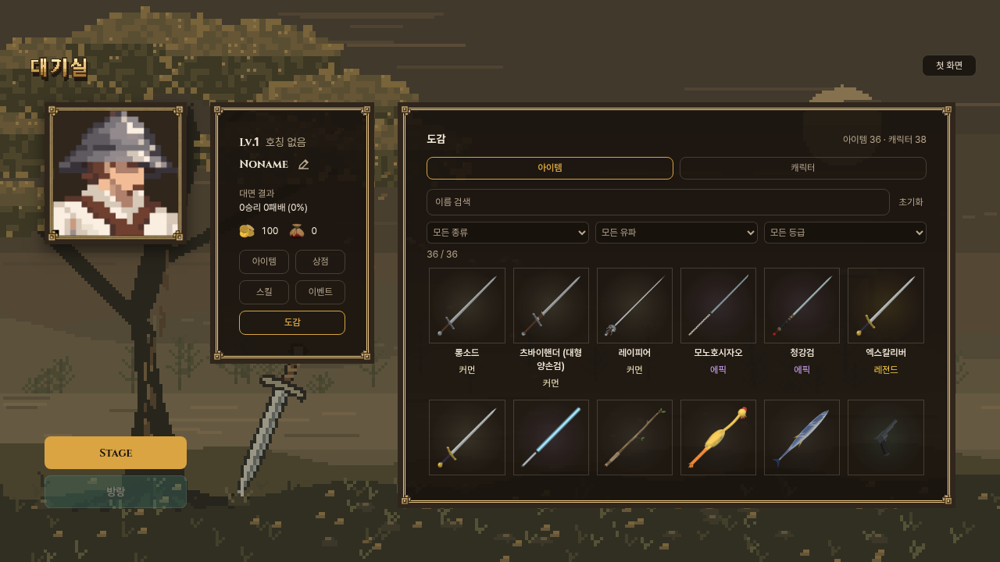
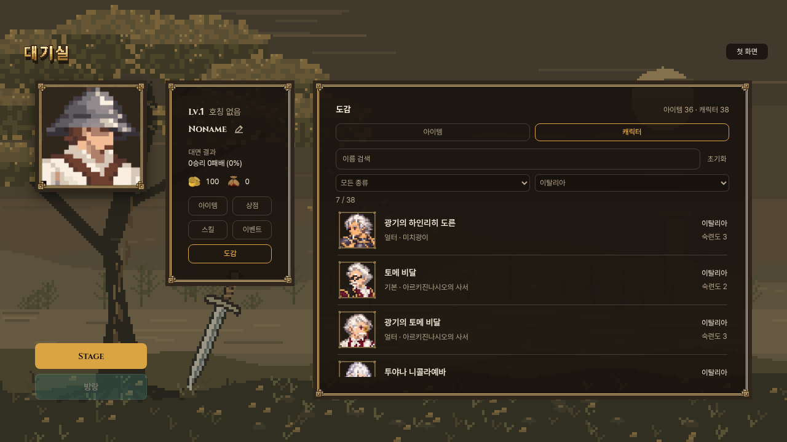
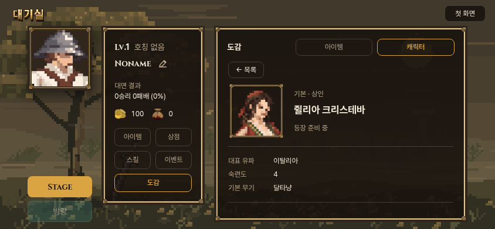

# 대기실 도감 시안

현재는 [3차: 전신 카드·3열·대기실 배색](v3/README.md)이 최신입니다. 아래는 1차 제작 기록입니다.

사용자 요청: 대기실 2단에 도감 버튼을 넣고, 3단에서 모든 아이템과 캐릭터를 열람. 후속으로 기존 캐릭터 목록의 비교 방식을 선호한다고 말씀하셔서, 캐릭터는 프로필·이름·유파·숙련도를 나란히 보는 목록형으로 만들었다. 아이템은 썸네일 격자다.

최신 확인 기준: 우화 main `91151212ff41d97beb76c785c05be5f91ddb2949`. 이 기준 위에 자체 `codex/encyclopedia-20261031`에서 제작. 우화 저장소 쓰기·새 메시지 발송 없음. 예시 화면을 검토받는 단계이며 정식 채택 완료가 아니다.

## 화면

- 2단 기존 네 버튼 아래, 같은 디자인의 도감 버튼.
- 3단 아이템 / 캐릭터 탭. 이름 검색, 종류·유파, 아이템 등급 필터. 조건은 각 탭별로 유지한다.
- 아이템: 34개 무기 + 방어구·장신구 2개 = 36개. 기존 무기·장비 썸네일과 설명/규격 사용.
- 캐릭터: 등록 AI 37명 + 플레이어 1명 = 38명. 기본/얼터는 인접 배치. 프로필과 유파·숙련도를 목록에서 바로 비교한다.
- 선택 시 같은 3단에서 확대와 설명. 목록 복귀 시 검색·스크롤·초점 복원. 기본↔얼터 바로 이동.
- 모든 항목 열람 가능. 발견/획득에 따른 잠금은 이번 시안에 넣지 않았다. 도감은 장착·구매·보상·저장을 변경하지 않는다.





## 데이터와 범위

`weapons.js`, `lobby_equipment.js`, `characters.js`, `schools.js`, `portraits.js`를 읽는다. 독립적인 복제 목록으로 내용·수치를 관리하지 않는다. 유파는 각 캐릭터의 기본 무기에 실제 적용되는 `traditionOf`를 사용하고, 숙련도는 현재 `ai.proficiency`를 표시한다. 생사전 전용 다유파 숙련도표와 혼동하지 않는다.

기존 저장을 위해 남은 뽑기 제외 무기 5개(에스톡·세이버·팔쉬온·간장·막야)도 전체 도감에 포함하되 뒤에 배치하고 ‘뽑기 제외’를 표시한다. 실제 등록 데이터의 `reviewOnly` 인물은 ‘등장 준비 중’ 표시. 쥘리아는 우화 최신 변경을 보존해 기본 달타냥/숙련4, 얼터 레이피어/숙련5다. 새 이야기·새 수치는 작성하지 않았다. 현재 스킬북은 스킬트리로 대체되었으므로 과거 책을 아이템으로 되살리지 않았다.

이전 제작 가지에만 있고 이 기준 main에 등록되지 않은 캐릭터는 임의 추가하지 않았다. 추후 반영 시 데이터에서 자동으로 나타난다. 이 코드는 일반 게임 내 대기실에 통합할 수 있고, 공개 시안은 그 대기실을 분리해 구동한다. 공개 시안의 기존 대기실 조작은 메모리 저장만 사용하며 실제 계정·진행 저장과 분리된다. Stage 단추로 전투를 시작하지 않는다.

## 전달할 코드

- `src/encyclopedia_data.js`: 현재 데이터 정규화/검색/규격 지연 계산.
- `src/encyclopedia.js`, `src/encyclopedia.css`: 목록·상세·필터·키보드·정리.
- `src/lobby.js`, `src/lobby.css`: 새 메뉴/패널과 첫 진입 마운트, 대기실 종료 시 정리. 기존 전투·장비 저장 로직 그대로.
- 미리보기 전용: `encyclopedia-preview.html`, `src/encyclopedia_preview.js`, `vite.encyclopedia.config.js`, `tools/ui/build_encyclopedia_preview.mjs`. 정식 반영 때 필수 아님.

정식 전달할 때에는 그 시점 우화 main의 대기실 변경과 다시 맞춘다. 일반 게임 파일 전체 덮어쓰기 금지. 우화 본판 적용은 사용자 화면 검토 뒤 별도 전달 단계다.

## 검증과 재현

```
node tools/ui/build_encyclopedia_preview.mjs
python -m http.server 4187 --directory dist-encyclopedia
node tools/browser/encyclopedia_check.mjs
npm run build
python -m http.server 4188 --directory dist
node tools/browser/encyclopedia_game_check.mjs
```

320/390/740/844/1280px: 실제 모든 그림 로드, 종류·유파·등급 교집합/공백 없는 한글 검색, 검색 결과 없음, 기본↔얼터, 상세 복귀/초점, 탭 키보드, 아이템 메뉴 왕복, 가로 넘침, 기존 저장 불변 확인. `browser-checks.json` 참조. 휴대폰 가로 화면에서는 제목과 분류 탭을 한 줄로 줄여 목록 공간을 확보했다.

컴파일 본 게임에서도 첫 화면→대기실→도감 실제 터치 경로와 저장 불변 확인(`game-integration.json`). 초기 첫 진입 시험은 기존 스킬트리 이전 안내 창에 가려 멈춰, 그 안내의 확인 버튼을 누르는 실제 순서로 도구를 보완했다. 기존 안내 자체는 수정하지 않았다.

필수 5관문 fights12/live_battery/finish_thrust/weapon_smoke/corr_s0 통과, corr_s0 12건 IDENTICAL. `gates/` 참조. 새 대련 밸런스 실험은 하지 않았다. 전체 게임/PWA 빌드 통과. 자동 브라우저 검사는 실제 아이폰 성능 보증이 아니다.

## 개발일지 복구

시작 확인에서 10/30 일지 미발행 발견. 기존 마감 원고로 수동 발행 복구: Actions `41086304275` 성공, dev-exchange `00df41d742a90ed1b6b8ee10ccbe396468065538`, source `c829517c71d5b31f5eaf47d27ef980ab4dfe92e0`. fresh HTTPS git fetch 해시 확인. 정시 자동발행으로 표현하지 않는다. 이번 새 작업은 10/31 노트에 기록한다.

최신은 [3차 카드형·3열·대기실 배색](v3/README.md). 사용자3열승인후밝은회색배경을거절하여대기실프로필갈색으로수정했다.
