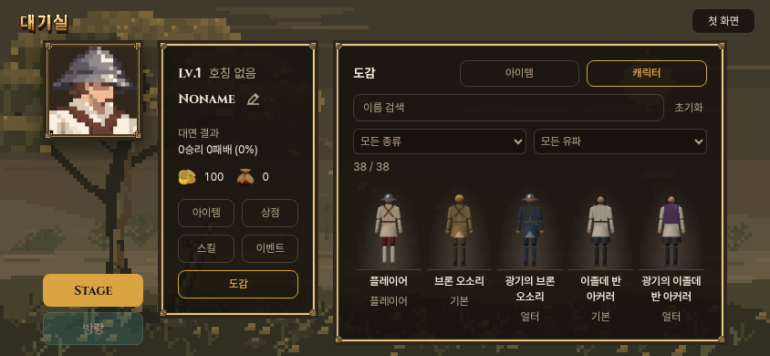
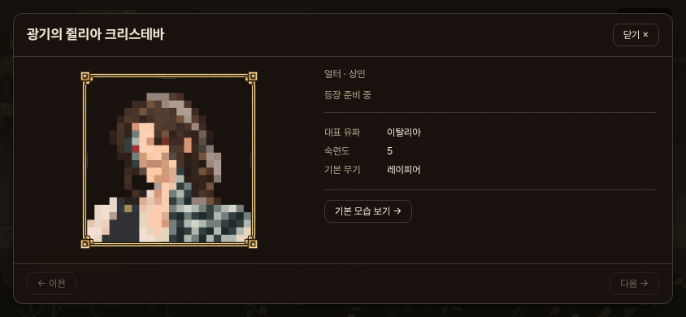
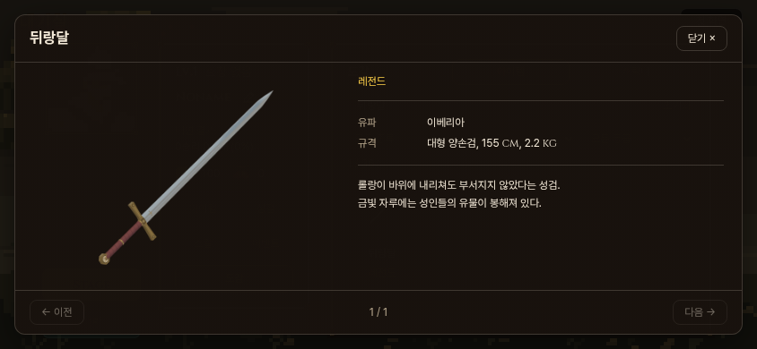

# 도감 2차 — 다섯 칸·정면 전신·팝업

사용자 최신 지시: 아이템과 캐릭터를 모두 한 줄 5개로. 아이템 클릭 시 큰 일러스트+설명 팝업. 캐릭터는 후속 정정에 따라 **기존 정면 도감처럼 실제 모델의 전신을 목록에**, **픽셀 프로필을 팝업에** 표시한다. 앞서 제안했던 팝업 실시간 3D 미리보기는 구현하지 않는다.

## 구현

- 양쪽 동일한 5열 격자. 최대 폭 500px, 작은 썸네일. 긴 이름은 두 줄로 제한하고 팝업에 전체 이름 표시.
- 캐릭터 목록: 현재 main 기반 모델 38종의 실제 정면 전신 사진, 같은 720×960·카메라·축척·발밑 기준선. 기존 초상을 목록에 확대해 쓰지 않는다.
- 캐릭터 팝업: 기존 액자1 픽셀 프로필·유파·숙련도·무기·설명, 기본↔얼터 전환.
- 아이템 팝업: 기존 모델을 별도로 1024²로 렌더한 전체 이미지. 작은 256² 썸네일을 단순 확대하지 않았다. 드루이드 채찍은 승인된 1254² 원본을 바이트 그대로 사용.
- native dialog의 모달 동작, 배경 스크롤 잠금, 닫기·바깥 클릭·Escape, 키보드 초점 순환, 이전/다음, 원래 격자 위치·검색조건·초점 복귀. 긴 설명은 스크롤. 그림은 전체가 들어가도록 contain.
- 프로필·기존 썸네일 원본과 모델 외형·수치·전투·저장 변경 없음. 정적 전신 그림을 쓰므로 브라우저에서 모델 생성/물리 연산을 실행하지 않는다.





## 사진의 정확한 의미

`encyclopedia_models_capture.mjs`는 과거 정면 도감 촬영 도구를 가져와 현행 Fighter/인물별 look/손/안광에 연결했다. 별도 관찰 장면이며 게임 모델 자체를 사용한다. 몸 비례·의상·머리/장식은 바꾸지 않고 양팔의 표시 그룹만 공통 휴식 자세로 내린다. 손에 든 무기는 숨기고 상세에 이름 표시. 물리 스텝을 돌리지 않는다. 정면 +X 정사영, 배경 투명, 전투 기본 반구광1.2/해1.7에 작은 채움광 .35, 톤 매핑 없음. 모든 전투 스테이지의 조명·전투 동작과 동일하다는 뜻은 아니다.

기준 모델 소스는 91151212 기반 dce07c0e. capture/character-report.json의 src 해시와 servedSourceMatches/sourceStable, 38종별 경계·메시 수·눈·손·파일 해시를 확인한다. 머리·뿔·발 잘림 검사 통과. UI 파일은 촬영 중 개발해도 모델 소스가 그대로인지 확인하도록 해시 검사에서 제외한다. PNG 원자료와 전체 contact sheet도 보존한다.

아이템 생성은 기존 weapon_thumbs_page.js의 선택적 size=1024, item_thumbs_page.js의 scale=4(목걸이), armor_thumb.mjs의 선택적 1024 출력값. 기존 기본값256 유지. 그림 생성 도구만 확장했으며 현재 카드 썸네일 파일을 덮어쓰지 않았다. public/ui/encyclopedia/items와 characters가 새 자산 경로다. images.json에74파일 해시/알파/해상도/실제 그림 범위 기록.

## 검증

- 1280/844/740/390/320px에서 두 목록 모두 실제5열, 148개 썸네일·전신·큰 그림 로드, 검색/유파·등급·종류 교집합과 빈결과.
- 실제 팝업/그림 전체 표시, 프로필 경로, 기초/얼터 값, 설명 스크롤, 키보드 초점 가둠/방향키/Escape·바깥 클릭, 목록 초점·스크롤 복귀, 저장 불변, 가로넘침없음. `browser-checks.json`.
- 실제 컴파일 본 게임 첫 화면→대기실→도감→팝업 터치·기본/얼터·닫기·아이템 메뉴 왕복과 저장불변. `game-integration.json`.
- 전체게임/PWA빌드, 공통5관문 통과(corr_s0 12 IDENTICAL). 전투 파일은 수정하지 않았다.
- 초기 팝업의 그림 높이가 본래 비율을 따라 커져 작은 화면에서 아래가 잘렸다. 크기 제한된 그림칸과 contain으로 고침. native dialog의 Tab 순환이 브라우저 바깥으로 나갈 수 있어 명시적 첫/끝 초점 순환 보강. 도구에서는 size 변수 충돌과 ‘rapier.webp’를 물리모듈로 오인한 검사식을 수정했다. 최종 사진/검증에 수정본 사용.
- 실제 아이폰 GPU/사용자 미감 최종 확인을 대신하는 검사는 아니다. 도감 화면에는 GPU 모델 렌더러가 없다.

## 재현과 전달 범위

```
npx vite --host --port 4194
CAPTURE_BASE=http://127.0.0.1:4194 CAPTURE_ASSET_DIR=public/ui/encyclopedia/characters CAPTURE_OUT=docs/design/encyclopedia_20261031/v2/capture node tools/browser/encyclopedia_models_capture.mjs
node tools/browser/encyclopedia_items_capture.mjs http://127.0.0.1:4194
PW_CHROMIUM=/usr/bin/chromium node tools/browser/armor_thumb.mjs http://127.0.0.1:4194 public/ui/encyclopedia/items/kettle.webp 1024
node tools/ui/build_encyclopedia_preview.mjs
python -m http.server 4187 --directory dist-encyclopedia
node tools/browser/encyclopedia_v2_check.mjs
npm run build
python -m http.server 4188 --directory dist
node tools/browser/encyclopedia_v2_game_check.mjs
```

캐릭터 외형/무기 모델이 나중에 바뀌면 해당 ID를 재촬영해야 한다. 새 ID를 코드에 등록할 때 전신 이미지도 함께 제공한다. 현재 데이터의 설명·수치는 여전히 코드 표에서 읽는다.

우화 전달 후보는 1차의 대기실 연결·도감 모듈 + 이번 CSS/모달/데이터 경로 + public/ui/encyclopedia 자산. 미리보기 도구/검증자료는 별도. 상대 main 쓰기·메시지 발송 없음. 사용자 화면 검토 후 전송 시점의 대기실 변경과 다시 동기화한다. 공개 주소는 기존 도감 주소를 갱신하며 1차 정본은 encyclopedia-20261031-v1/에 보존한다.
