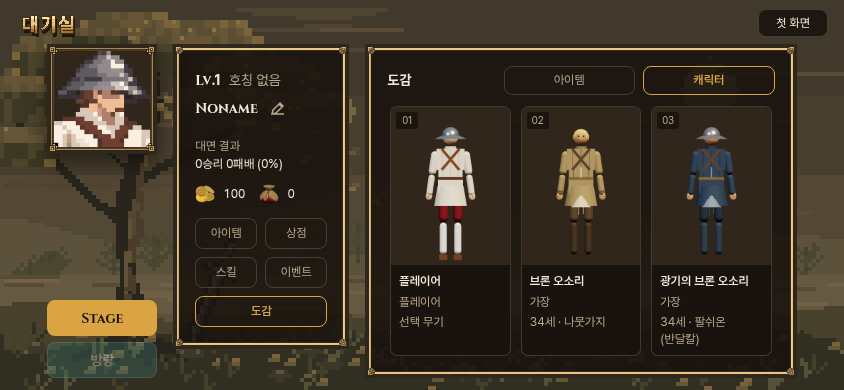
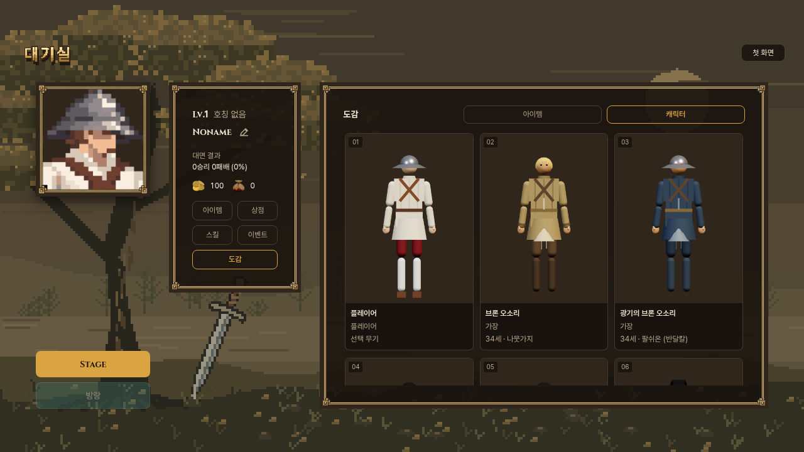

# 도감 3차 — 원본 카드 형식·3열·대기실 색

사용자 승인 기준: 복구한 10/14 캐릭터 정면 도감처럼 큰 전신 카드. 캐릭터는 한 줄3개, 검색·세부분류 공간 삭제. 이어 밝은 배경을 거절하여 대기실 컬러칩으로 맞추도록 지시했다.

## 최종 화면

- 캐릭터3열 고정,3:4 전신,번호·이름·칭호·나이/무기 아래표시. 아이템은 앞서 지시한5열 유지.
- 검색/종류·유파·등급 필터/초기화/개수 영역을 UI와 이벤트 코드에서 제거. 아이템↔캐릭터 전환 단추만 남긴다.
- 전신 그림 바탕은 기존 대기실 프로필의 `#30261c`. 카드 아래바탕/테두리/글자는 `--panel/--line/--c-text/--c-sub`. 원본의 밝은회색은최종본에없다.
- 클릭: 캐릭터 기존픽셀프로필·상세,아이템전체일러스트. 이전/다음·기본얼터·Escape/바깥클릭·초점가둠·목록스크롤복귀 유지.

## 전신 이미지

38종 현행모델을 원본도감의 정면카메라720×960/축척/발밑/휴식팔/조명(hemi2,key3,fill1.2)/ACES exposure1로 재촬영. 사용자 후속에 따라 바탕만 투명으로하여CSS대기실갈색을사용. 손/안광·기존의상과비례포함,무기손사진에서는제외·아래무기명표시. 순수관찰용렌더이며전투조명사진주장아님.

원본18명의옛이름/외형을되돌리지않았다. native source hashes는 v2와동일. sourceStable/servedSourceMatches,전38종경계검사/720×960/alpha확인. 원본프레임·프로필·아이템그림변경0. `capture/character-report.json`, `images.json`.

## 검증

5폭320/390/740/844/1280에서148그림로드,캐릭3열/아이템5열,검색·필터없음,그림3:4/배경rgb48,38,28/글잘림없음/목록영역확보/마지막행접근/프로필·전체그림·기본얼터/초점순환·Escape·바깥클릭·스크롤복귀/저장불변·물리로딩0 통과. `browser-checks.json`.

전체게임/PWA빌드와컴파일본첫화면→대기실→도감터치/팝업/기본얼터/메뉴왕복·저장불변통과. 공통5관문통과,4개stdout v2동일·corr_s0 12IDENTICAL. UI변경외전투파일변경없음.

초기회색배경촬영후사용자정정으로투명재촬영. 초기사진한장에디코딩직후그리기전빈칸이찍혀,최종촬영은디코딩및2프레임렌더완료후캡처. 최종사진모두완료본.

## 이식 범위

기존도감브랜치위 `src/encyclopedia.js/css`,전신38WebP,캡처도구를수정.옛필터도구함수는과거검증자료참조용으로data모듈에남지만현재화면에서사용하지않음.

우리독립예시주소를갱신하고이전v2보존. 우화전달/본판쓰기0. 사용자화면검토전.

## 공개 확인

[새 시안](https://yoonjl-svg.github.io/halfsword-codex/encounters/encyclopedia-20261031/?view=characters&v=3). 공개7f71451b/Pages41096377261성공,현재+v2보존본354파일11,872,846bytes원격SHA256일치. 공개5폭/148그림·3열/5열·배색/팝업/저장불변/오류0확인. `publication.json`, `public-check/`, `remote-assets.json`.
