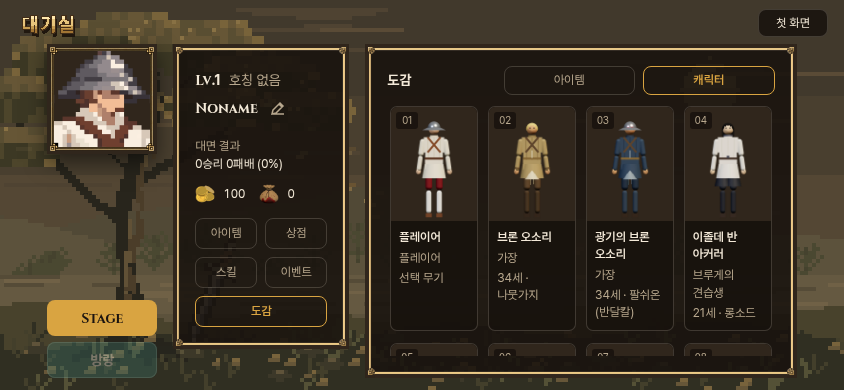
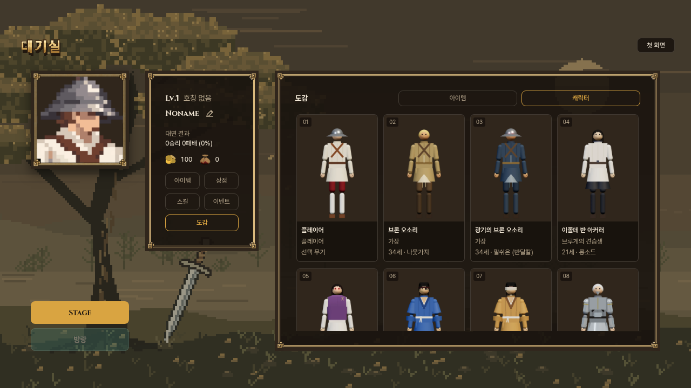

# 도감 4차 — 캐릭터 한 줄4개

사용자 요청으로 캐릭터 카드만3열에서4열로 변경. 원본카드형식·현재38종사진·짙은갈색#30261c·검색/세부분류제거·프로필팝업 유지. 아이템은기존5열. 변경소스는 src/encyclopedia.css의 열수와주석뿐.

기존v3브라우저검사의기대열수만4로바꿔실행.320/390/740/844/1280에서실제4열/아이템5열·148그림·카드텍스트넘침/그림비율/배색·팝업·초점/스크롤복귀·저장불변통과. 미리보기빌드성공. 첫검사는환경재시작으로로컬서버가꺼져연결거부→서버기동후통과. UI배치만바뀌어모델재촬영/전투관문반복없음(이전5관문자료v3보존).

이전3열예시보존. 우화쓰기/전달0,사용자검토용.
