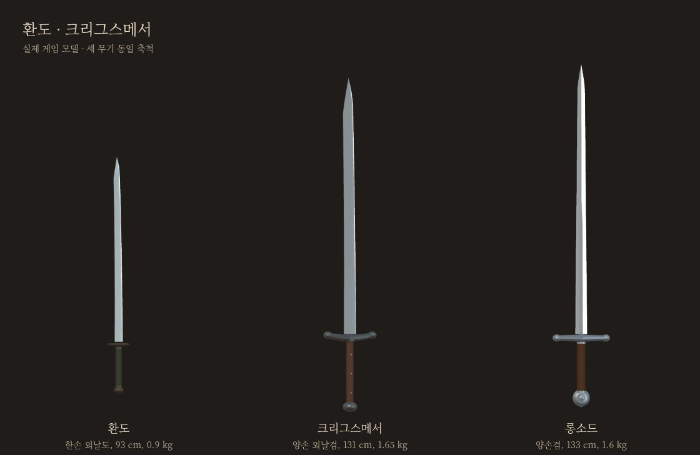

# 환도 · 크리그스메서 — 2026-10-21

사용자 선택: 동방 커먼 환도 / 독일 레어 크리그스메서. 크리그스메서는 대검보다 롱소드에 가까운 사양으로 조정한다. 우화 main `5a63674f728d0da302d2f5dea8d738c0dc383009`을 읽기 전용 기준으로 삼은 자체 포크의 독립 가지다. 정식 게임 전체 교체나 우화 쓰기·메시지 전송은 하지 않았다.

| 항목 | 롱소드(기존) | 크리그스메서 | 환도 |
|---|---:|---:|---:|
| 등급 / 유파 | 커먼 / 독일 | 레어 / 독일 | 커먼 / 동방 |
| 칼날 | 105cm | 100cm | 72cm |
| 전체 물리 길이 | 133cm | 131.2cm | 92.8cm |
| 질량 | 1.60kg | 1.65kg | 0.90kg |
| 손 기준 휘두름 관성 | .272416 | .288246 | .104858 |
| 손 앞 무게중심 | 24.01cm | 25.76cm | 24.94cm |
| 베기 / 찌르기 계수 | 1 / 1 | 1.12 / .90 | 1.10 / .95 |
| 등급 공통 배율 | 1 | 1.05 | 1 |

치수와 분포는 사용자 방향에 맞춘 게임용 추정값이며 특정 유물 실측치가 아니다. 계수 차이가 그대로 실제 피해 차이를 뜻하지 않는다. 크리그스메서는 질량 +3.125%, 관성 +5.811%; 자동 물리 분류도 `two`이며 `heavy`가 아니다. 두 손 중심 간격14cm, 양쪽 손 모두 실제 자루 안에 들어간다. `school:'german'`을 명시했다. 환도는 `one-hand`, `school:'chinese'`로 동방 유파 전체 동작을 재사용한다. 유파 몸꼴·손길·보법·AI·기력 코드는 수정하지 않았다.

## 외형과 역사 범위

- 환도: 조선 군용 외날 도검을 바탕으로 짧은 칼날, 약한 곡률, 작은 원반 코등이, 탁한 녹색 끈과 소박한 금속 끝장식. 일본식 하몬·별도 비기는 없다.
- 크리그스메서: 독일권 양손 외날검 계열의 실루엣. 나무색 자루·리벳3개·한쪽 나겔 손 보호대·약한 곡률·비스듬한 칼끝. 큰 대검의 무게를 줄였다고 주장하기보다 롱소드급으로 설계한 게임형이다.
- 레크휘너의 1478/1482년 메서 교본은 주로 **한손 메서**를 다룬다. 그 자료를 그대로 양손 크리그스메서 전용 교본이라고 쓰지 않는다. 이번 무기는 현재 게임의 독일 양손 동작으로 운용하는 각색이다. 박물관 유물·교본 원문을 이번 환경에서 새로 열람한 연구는 아니다.
- 기존 공통 `swordKit`으로 실제 게임용 모델과 썸네일을 생성했다. 외날/양날은 외형 차이가 있으며 공통 엔진의 날 뒤쪽 판정 한계는 바꾸지 않았다.

## 실측·검사

`ARENA.startHold=0 weapon_measures.mjs --gen --down`으로 롱소드·청강검·두 새 무기를 함께 측정. 새 무기만 기존 롱소드 손 표에 대한 비율을 적용했다. 환도 contact/reach/clinch/rawCut=1.34/1.54/1.06/.35, 유파cutTime .26. 크리그스메서1.57/1.77/1.25/.42, 유파cutTime .31. 정해진 베기 대본의 간격 추정이며 모든 인간 입력의 실제 접촉시간 측정은 아니다. [원자료](measured.json).

- 기존 공통5관문 전후 대조: fights12 / live_battery / finish_thrust 출력 동일. corr_s0 12/12 IDENTICAL, 실행 소요시간 줄만 다름. weapon_smoke 기존26종 결과 동일 + 새2종, FAIL/NaN0. [결과](gates.json), 원본 `logs/before`, `logs/after`.
- 두 무기 × 베기·찌르기·막기·AI, 총8개 3초 호환 검사. 유한 좌표·동작 활성화·원래 무게 기반 기력 연결 확인. [계약/뽑기 원자료](contracts.json).
- 강제 파손: 실제 칼 길이/질량/관성/AI거리 감소, 절단선 위 잔여 메쉬0, 콜라이더 일치, 파편 정리, NaN0. [로그](logs/break.stdout).
- 실제 게임에서 카드 선택/장착, 가로844×390 화면 및 터치 막기 유지·해제·공격 드래그 검사. 앱 오류0, 여정·대기실 저장 변경0, 가로 넘침0. Chromium 모바일 에뮬레이션이며 실제 iPhone 성능 검사는 아니다. [터치](touch.json), [사진 상태](browser.json).
- `npm run build` 성공. 신규 썸네일은 실제 모델에서 생성한256×256 투명WebP.

검사 결과는 호환성·안정성 확인이며 상대 전적이나 인간 손맛의 우위를 확정하지 않는다. 초기 corr_s0 문자열 대조는 실행시간 차이를 실패로 잡았고, 실제12개 결과가 모두 같은지 확인해 시간 줄만 제외했다. 원본 로그는 보존한다.

## 뽑기와 공개 범위

새 플레이어 뽑기24종 / 묶음23칸(간장·막야1칸). 커먼5칸 / 레어4칸. 등급 확률40/27/16/5/7/5 유지, 직전 판 무기 제외 없음. 실제 추첨 함수의 순서 있는550경로를 정확 열거했다. 첫 카드 환도8%, 크리그스메서6.75%; 두 장 중 등장 확률16%,13.5%. 시작 지급품·NPC 고정 무기 미변경.

[별도 검토·대련 페이지](https://yoonjl-svg.github.io/halfsword-codex/encounters/weapons-20261021/). 사진은 로컬의 실제 모델/게임 촬영. 정식 여정 전체 교체와 우화 전달은 별개다. 소스/공개판 SHA와 배포 확인은 `release.json`에 기록한다.
