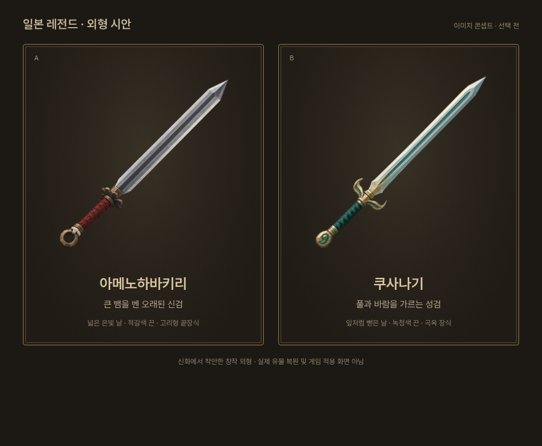

# 일본 신화의 레전드 검 — 썸네일 선택 시안

사용자: 일본 레전드는 실존 도공의 명검보다 엑스칼리버처럼 전설 속 검을 원한다. 아메노하바키리와 쿠사나기 두 후보의 디자인과 썸네일을 먼저 보고 하나를 선택한다.

이번 산출물은 **이미지 생성으로 만든 외형 시안**이다. 실제 인게임 모델 렌더나 게임 적용 화면이 아니다. 무기 등록·밸런스·뽑기·유파 동작·공개 게임은 변경하지 않는다. 우화 전달 지시도 아직 없다.

## 공통 표현

기존 `public/ui/weapons/excalibur.webp`, `uchigatana.webp`, `goujian.webp`를 눈으로 확인하고 구도와 표현을 참고했다. 투명 배경, 검만 단독, 자루는 왼쪽 아래/칼끝은 오른쪽 위. 전체가 들어오는 정사각형, 단순한 면과 절제된 금속 표현으로 기존 저폴리·픽셀 분위기에 맞춘다. 글자·액자·발광 효과는 넣지 않는다.

두 안 모두 신화에 착안한 **창작 형태**다. 실제 유물·왕실 신기의 외형을 고증 복원했다고 주장하지 않는다. 생성 원본은 보존하고, 게임용 최종 썸네일은 선택 후 실제 구현 모델에서 다시 찍는다.

## A · 아메노하바키리 — 큰 뱀을 벤 오래된 신검

- 근거가 되는 이야기: 스사노오가 야마타노오로치를 베어 쓰러뜨릴 때 사용한 검. 꼬리에서 발견한 쿠사나기와 구별한다.
- 실루엣: 상대적으로 넓고 곧은 양날, 칼끝은 각진 창끝처럼 모인다. 큰 면 두 개와 중앙 능선으로 힘을 드러낸다.
- 배색: 은회색 날, 먹빛 손잡이에 적갈색 끈, 소량의 낡은 청동.
- 식별점: 작은 여덟 갈래 철제 코등이와 고리형 끝장식. 짧은 상아색 매듭. 여덟 갈래는 오로치에서 가져온 창작 상징이며 고증된 장식이 아니다.
- 인상: 거칠고 엄숙한 신의 무기. 기존 양손 일본도와도, 금빛 엑스칼리버와도 구별한다.

## B · 쿠사나기 — 풀과 바람을 가르는 성검

- 근거가 되는 이야기: 오로치의 꼬리에서 발견된 검. 야마토타케루가 풀을 베고 불길을 벗어나는 후대의 이야기와 이어진다.
- 실루엣: 곧은 중심축을 따라 중간이 살짝 넓어졌다가 길게 좁아지는 잎 모양 양날. 아메노하바키리보다 가늘고 완만하다.
- 배색: 아주 옅은 청자빛 은색 날, 깊은 녹청색 손잡이, 옅은 낡은 금빛 장식. 녹색 발광검으로 만들지 않는다.
- 식별점: 짧은 풀잎 모양 코등이와 끝장식의 작은 곡옥 한 개. 실제 신기의 모습을 묘사한 것이 아니라 신화적 분위기를 위한 창작 장식이다.
- 인상: 고요하고 정제된 신성함. 풀과 바람의 연상을 단순한 면과 윤곽으로 전달한다.

## 선택 후

사용자가 하나를 고르면 현재 무기 그래픽 제작 방식을 이용해 모델을 구현하고, 양손 일본 유파와의 연결·물리 수치·실제 축소 썸네일을 별도로 검증한다. 이번 선택 시안에는 능력·계수·날 길이를 확정하지 않는다.

## 저장된 결과

- [아메노하바키리 투명 원본](amenohabakiri-original.png)
- [쿠사나기 투명 원본](kusanagi-original.png)
- `comparison.html`: 실제 원본을 같은 크기로 보여 주는 비교 화면. 이미지 파일 자체에 프레임/글자를 합성하지 않았다.
- `images.json`: 각 원본의 크기·RGBA 투명도·경계·SHA256. 원본은 둘 다1254×1254이고, 비교 화면에서는 둘 다308×308로 표시했다.
- `prompts.json`: 생성 프롬프트 보존. 최초 생성 파일도 `/workspace/generated_images`에 그대로 유지했다.

정사각·투명 배경·전체 칼끝/자루 포함·두 실루엣/색 구별을 확인했다. 그림의 표현은 최종 인게임 모델에서 더 단순화할 수 있다. 이번에는 외형 선택 단계이므로 성능이나 게임 동작의 검증 결과로 해석하지 않는다.
