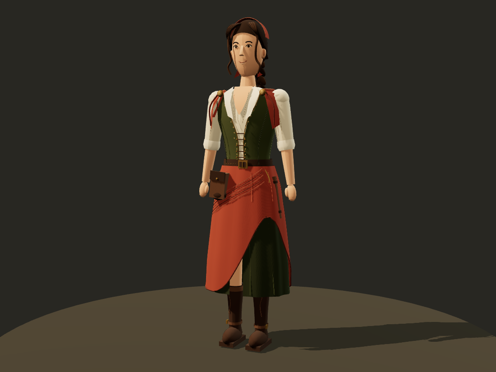

# 쥘리아 크리스테바 · 전신 스케치와 모델링 시안

사용자 요청: 프로필의 과한 눈 높이 차이·일자 입매 수정, 나머지 승인. 원화의 느낌을 이어 전신 스케치와 모델링 제작.

[최신 픽셀 프로필 b-04](../shopkeeper_20261029/revisions/b-04/README.md)는 눈·입 7셀만 수정했다. 원본과 기존 프로필은 보존했다. 이름만 사용자 확정이며 동명의 실존 인물에 관한 설정을 붙이지 않았다.

## 전신 디자인

원화의 붉은 머릿수건·갈색 땋은 머리·녹색 조끼·아이보리 셔츠·짧은 붉은 숄을 이어간다. 가는 어깨/팔, 여밈 장식과 작은 황동 브로치, 비대칭 적갈색 겹치마와 짙은 녹색 속치마, 가죽 장화·작은 돈주머니·장부 통을 추가했다. `fullbody-sketch.png`는 이미지 생성 도구로 만든 컨셉 원화이며 실제 게임 스크린샷이 아니다. 최초 생성 파일도 환경의 generated_images에 보존했다.

## 실제 3D 자산

`model.js`는 Three.js의 메시/색상 재질로 직접 만든 외형이다. `model.glb`로 내보냈으며 정면·사선·옆·뒤·얼굴 사진은 이 모델을 실제 렌더한 화면이다. 전투 화면으로 표시하지 않는다.

- 높이 약1.744m, 가로0.576m(팔 포함), 앞뒤0.339m. 단위m/+Y위/+X앞.
- 25,676삼각형,64메시,23재질. 같은 부위/재질은 병합. 텍스처 없이 색상 재질 사용.
- 몸통/골반/머리·위팔/아래팔/손·다리·머리땋기/장부통을 분리하고 머리/몸통/골반 회전 중심도 배치했다.
- 실제 전투용 피부 가중치·충돌체·신체 파손·유파/숙련도/AI/무기·상점 기능 연결은 이번 외형 시안 범위에 포함하지 않았다. 전투 캐릭터 완성으로 보고하지 않는다.
- Tripo 스킬의 면수·단위·검수 기준을 참고했으나 CLI 미설치라 Tripo API를 사용하거나 크레딧을 소비하지 않았다. 직접 만든 모델이며 생성된 Tripo 모델로 표시하지 않는다.

## 검수

첫 렌더에서 머리 두피 노출, 안팎 치마 관통, 어깨 윗면 빈틈, 목-턱 교차, 땋은 머리가 한 덩어리로 보이는 문제를 발견해 수정했다. 네 방향과 확대를 직접 확인했다. GLB 재로딩·모바일 탭/회전/확대·저장 불변·가로 넘침/JS 오류 점검 결과는 browser-qa.json 및 asset-qa.json에 기록한다. 초기 빌드판을 Vite 개발 서버의 public 경로로 열었을 때 초기화 대기가 시간 초과되어, 실제 배포와 같은 정적 HTTP 서버에서 다시 검증해 통과했다. GPU/휴대폰 실기 성능이나 전투 연동 검증이 아니다.

`node capture.mjs`: 개발 서버에서 네 방향 사진·모바일 조작 검증·GLB 내보내기. `node build.mjs`: 본판과 분리한 `public/encounters/julia-20261029` 검토 페이지 빌드. 일반 src와 다른 캐릭터/보법을 수정하지 않는다. 우화 전송 없음. 공개 완료는 publication.json 참조.

