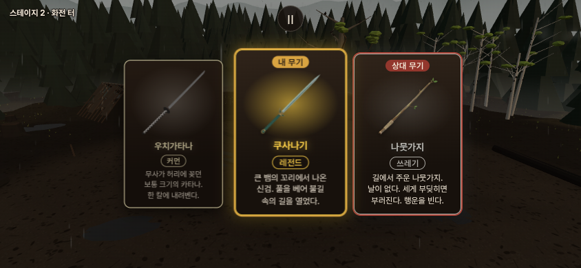
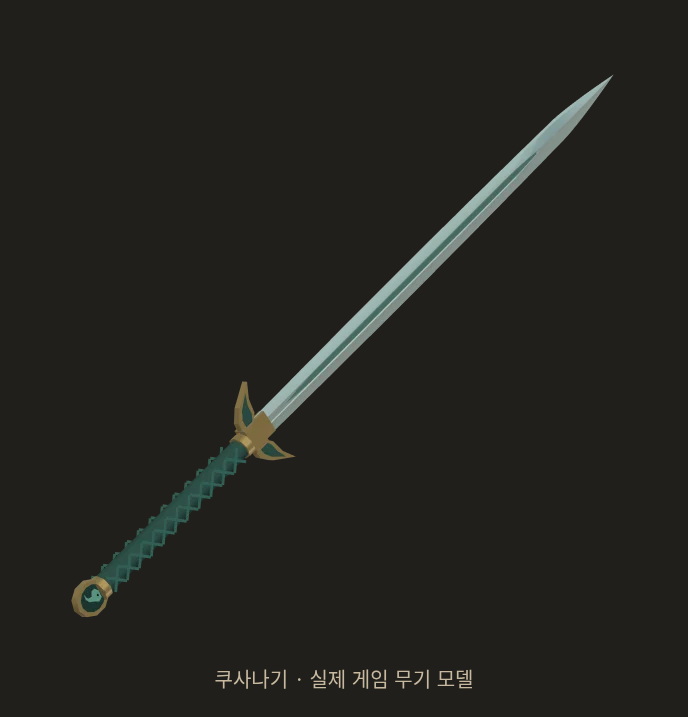

# 쿠사나기 — 일본 레전드 구현

사용자 2026-10-21 “그럼 쿠사나기로 만들자.” 승인. 기준 `7ff56bd4`. 자체 포크에 구현하며 우화 저장소 쓰기·전달은 하지 않는다. 앞선 시안은 선택 자료로 보존한다.

## 구현한 사양

| 항목 | 값 |
|---|---|
| 이름 / ID | 쿠사나기 / `kusanagi` |
| 분류 | 레전드 · 일본 · 양손 보통 · 베기/찌르기 |
| 칼날 / 총질량 / 두 손 간격 | 75cm / 1.10kg / 20cm |
| 무게중심 | 날 시작점 앞 8.29cm |
| 손 기준 휘두름 관성 | 0.12837kg·m², 우치가타나 대비 −41.78% |
| 베기 / 찌르기 / 둔타 계수 | 1.20 / 1.10 / 0.95 |
| 등급 공통 공격계수 / 파손 계수 | 1.20 / 0 |

별도 특수효과는 추가하지 않았다. 계수비가 실제 피해비를 보장하지 않는다. 칼날 길이는 전체 무기 길이와 다르며 `hiltLength`는 물리 원점에서 날 시작점까지의 좌표다.

설명: **큰 뱀의 꼬리에서 나온 신검. 풀을 베어 불길 속의 길을 열었다.**

청자빛 양날 직검, 짙은 녹청색 교차 끈, 풀잎 모양 금빛 코등이, 끝장식의 곡옥을 기존 `swordKit`/절차적 메쉬로 구현했다. 썸네일은 생성 시안의 재사용이 아니라 실제 게임 모델을 같은 도구로 촬영한 256×256 투명 WebP다. 모델의 실제 비례·세부는 양손 그립과 기존 무기 표현에 맞춰 단순화했다. 실존 신기의 복원이라는 주장은 하지 않는다.

## 자루 비례 수정

사용자가 “손잡이가 길어진 이유는?”이라고 질문했다. 초기 모델이 기존 우치가타나의 손/칼날 좌표를 그대로 재사용해 시안보다 자루가 과하게 길어졌음을 설명하고, 약31cm로 줄였다. 두 손 중심 간격20cm를 유지하되 실제 그립 콜라이더가 두 손을 포함하도록 고쳤다. 코등이는 물리 손 원점 앞24→9cm, 날 시작점25→10cm로 옮겼다. 칼날75cm·총1.10kg 유지, 날0.60/자루0.28/끝장식0.10/코등이0.12kg.

그림만 줄인 것이 아니므로 사거리와 관성도 달라졌다. 초기 관성+3.16% 설명은 **최종안에 적용하지 않는다**. 최종안은 손 가까이 칼날을 두어 더 쉽게 회전하는 짧은 양손 직검이다. 손맛·전투상 우위는 별도 사용자 검토가 필요하다. 초기 화면/물리는 `initial-long-hilt/`에 보존했다.

## 일본 검술과 연결

공통 유파 몸꼴·손길·보법은 수정하지 않았다. 일본 양손 쥠과 우치가타나의 보통 틀을 사용한다. 자동 물리 분류도 `two`로 확인했다. 기존 외날/양날 피해 판정의 공통 한계도 이번 무기 추가로 바꾸지 않는다.

`weapon_measures.mjs --gen --down`, `ARENA.startHold=0`으로 쿠사나기와 롱소드·우치가타나를 같은 실행에서 측정했다. 새 무기의 생성값은 contact1.23 / reach1.31 / clinch0.95 / cutTime0.21. 같은 실행의 롱소드1.62 / 1.75 / 1.25 / 0.28에 대한 비율로 기존 게임 기준에 연결해 **1.19 / 1.35 / 0.95 / 0.31**, 유파 cutTime0.23을 등록했다. [원자료](measured.json).

이는 정해진 베기 대본의 궤적을 이용한 거리/시간 추정이다. 실제 적에게 닿는 시간 전체나 인간의 모든 입력을 실측한 값이 아니다. 같은 실행 우치가타나 reach가 contact보다 1cm 작게 나오는 등 대본/걸음의 한계도 원자료에 보존했다. 기존 무기의 측정표를 소급 수정하지 않는다.

## 검증

- `verify.mjs`: 실제 부품 질량·무게중심·관성·파손 확률, 플레이어/AI 일본 유파 연결 확인. 우치가타나와 같은 몸꼴·쥠·막기·기술을 쓰는지 비교했다.
- 두 무기 × 베기·찌르기·막기·발도 8개 물리 대본: 모든 동작 활성화, 발도 완료, 유한 좌표/속도, 파손 없음. 막기 중 실제 칼 접촉도 확인. 승률·막기 성공률·인간 손맛 검증으로 확대 해석하지 않는다. [원자료](contracts.json).
- 공통5관문: fights12 `5dfe035c`, live_battery `648aca66`, finish_thrust `2de06c03` 기존 결과 동일. corr_s0 12/12 IDENTICAL. weapon_smoke 기존25줄 동일+쿠사나기1줄, FAIL0/NaN0. 기준은 직전 달타냥 구현 이후이며 `c69c8925`와 변경 직전 `7ff56bd4`의 src/tools/sim 동일 확인. [검증 기록](gates.json).
- 실제 게임 카드 선택→장착→일본 자세, 데스크톱/모바일 크기 확인. 브라우저 앱 오류0. [상태](browser.json).
- 실제 빌드 모바일 터치로 막기 누름/유지/해제, 장착·유파·유한 좌표·테스트 모드의 여정 저장 격리 확인. [터치 결과](touch.json). Chromium 에뮬레이션이며 실제 iPhone 검사는 아니다.
- `npm run build` 성공. 최종 썸네일과 빌드 산출물 바이트 일치 확인. 상세 로그는 `logs/`. 자루 수정 중 개발 서버의 HMR로 카드 촬영이 중단된 첫 실행은 별도 로그에 보존하고, 소스 수정 종료 후 다시 촬영했다.

## 뽑기와 범위

일반 무기 뽑기에 등록했다. 시작 지급품에는 추가하지 않는다. 직전 선택 무기 제외/등급 가중치는 기존 규칙을 따른다. 첫 뽑기 기준 쿠사나기는 첫 카드 **1.6667%**, 두 장 중 하나 이상 **3.3333%**. 간장·막야가 한 추첨칸인 점을 포함해 실제 함수의9,580경로를 정확 열거했다. [원자료](draw.json).

아메노하바키리·NPC 고정 무기는 변경하지 않았다. 기존 연구 시험판도 유지한다. 공개 배포 상태와 검증 SHA는 후속 `release.json`에 기록한다.
