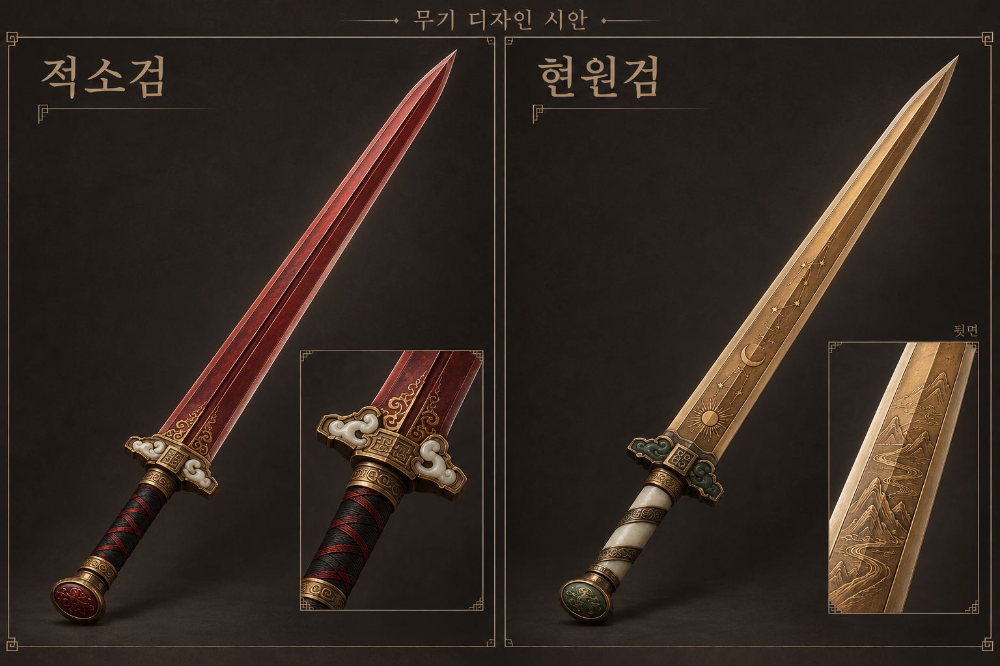

# 적소검·현원검 디자인 시안 — 2026-10-25

최신 사용자 지시: 두 자루 모두 디자인을 먼저 제출하고 피드백 후 실제 구현한다. 앞선 적소검 즉시 제작 요청보다 이 지시가 우선한다. 게임 코드·물리·추첨·섬네일 연결은 변경하지 않았다. 새 시안에 대한 우화 전달도 하지 않았다.

## 첨부 자료

- 적소검(赤霄劍): 한 고조 유방이 길을 막은 흰 뱀을 두 동강 낸 붉은 검. 한나라를 세운 신화의 시작. 끝이 무거운 단칼, 내려찍기는 중력의 도움을 받고 회수는 더딘 방향. 한손·날 0.80m·1.3kg·무게중심 0.42m(칼끝 쪽)·휘두름 관성 약0.26·붉은빛. 무게중심의 기준점은 이번 설명에서 손 기준으로 해석했으며 아직 물리로 구현하거나 실측하지 않았다.
- 현원검(軒轅劍): 황제(黃帝)가 수산(首山)의 구리로 만든 신검. 한 면에는 해·달·별, 다른 면에는 산과 강이 새겨졌다는 성왕의 검. 치수·질량·게임 계수는 아직 지정되지 않았다.

위 내용은 사용자 제공 기획의 전승 설명이다. 유물 복원이나 출처별 역사 검증 결과로 제시하지 않는다.

## 1차 외형

- **적소검:** 붉은 강철의 중앙 능선과 밝은 날선, 칼끝 쪽까지 폭을 유지하는 직선 양날검. 검은 감개와 붉은 교차 끈, 금동·백옥 코등이와 짧은 구름 상감. 흰 뱀 설화는 백옥 장식의 모티프로만 암시한다. 광원·불꽃 효과 없음.
- **현원검:** 구릿빛 검신과 밝은 날선, 상아빛 옥 자루·짙은 녹옥·금동 장식. 앞면 천문 문양과 뒷면 산천 문양을 분리한다. 뒷면은 우측 확대칸에 제시했다.
- 공통: 단정한 한손 직검, 작은 중국식 코등이. 신화의 창작 해석이다. 3D 모델·게임 섬네일 원본이나 실제 게임 촬영이 아닌 **이미지 생성 디자인 자료**다.
- 동방 레전드 분류는 적소검 제작 착수 때 제안한 방향으로, 이 시안만으로 사용자 확정·게임 등록으로 간주하지 않는다.

## 보존과 다음 단계

원본 `chixiao-xuanyuan-v1.png`(1536×1024), 재현용 프롬프트 `prompt.txt`. 생성 원본 `/workspace/generated_images/exec-a0bd65ac-63e0-4a17-ab5c-2bd5fdb20b9a.png`도 유지한다. 픽셀 격자가 고정된 게임용 아트로 주장하지 않는다.

사용자 외형 피드백을 받은 뒤 모델링·실제 물리·게임 섬네일을 진행한다. 이탈리아 베기 수정 완료 후 수행할 MSG-S-016 상성 실험은 별도 보류 상태다. 기존 코드 da70ac0b를 기준으로 준비한 자체 작업 가지 `codex/chixiao-20261025`는 아직 기능 변경이 없다.
