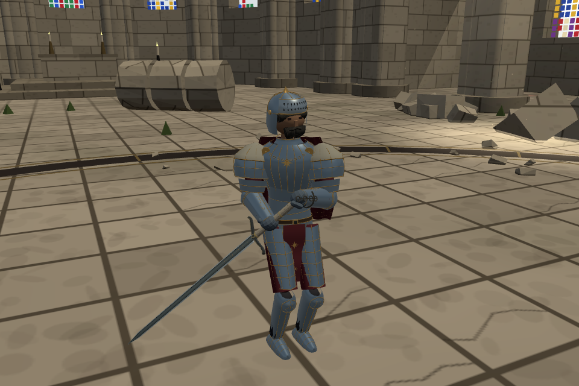
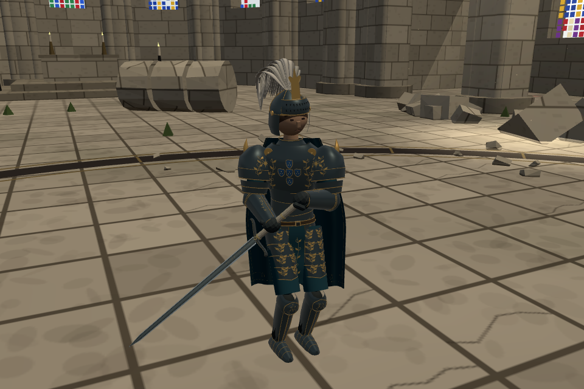
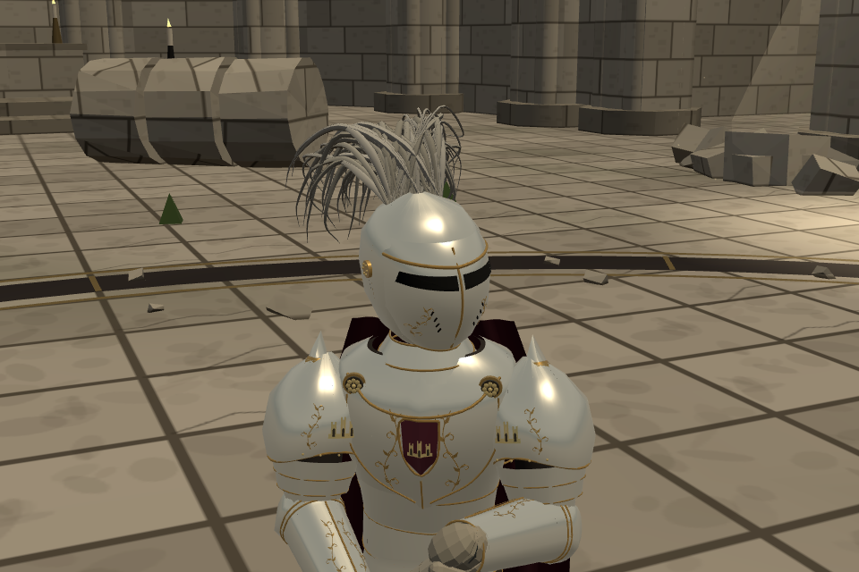

# 2·3번 실제 모델과 세바스티앙 어깨 단순화 — 2026-10-22

사용자 요청: 앞서 본 2번·3번도 실제 모델링. 세바스티앙은 사자를 제거하고 더 단순한 솟은 장식으로 교체.

- 기준 `247965292d3b29e62573956cbceb614a923e2072`.
- 어깨 수정 `4ab01aac`; 두 새 모델 `00ef69df`.
- 가지 `codex/royal-models-20261022`. 모든 소스와 공개판은 **yoonjl-svg/halfsword-codex**에만 기록. 우화 메시지·원격 쓰기 없음.
- 공개 검토: [두 새 인물](https://yoonjl-svg.github.io/halfsword-codex/encounters/royal-concepts-20261022/?v=00ef69df), [세바스티앙](https://yoonjl-svg.github.io/halfsword-codex/encounters/returned-king-20261022/?v=00ef69df). 배포 성공·공개 바이트 검증은 `publication.json` 참조.

## 실제 구현

| 대상 | 원화에서 가져온 구분점 | 게임 연결 |
|---|---|---|
| 2번 `bernardo`, 베르나르도/사슬의 영웅 | 청회 판금·금빛 세로 능선·수염·올린 투구 가리개, 짧은 붉은 망토/옅은 어깨 천, 왼팔의 끊어진 사슬, 5겹 허리 판 | 티소나·기존 이베리아 숙련4 시작값, 판금13, 얼굴 열린 새 투구 |
| 3번 `black_king`, 검은 왕(임시) | 흑금 판금·청록 긴 망토와 앞자락·다섯 방패 문장·열린 젊은 얼굴·큰 흰 깃털 | 동일한 검토용 티소나/AI 시작값, 판금13, 얼굴 열린 새 투구 |
| 세바스티앙 | 기존 사자/날개 제거. 금테 받침과 짧은 사각뿔 형태의 상아색 금속 돌기 | 견갑 위 실측4.05cm. 본판 자식으로 부착하여 기존 판금 경계·수치 보존, 파손 시 함께 떨어짐 |

기존 1번 외형+3번 서사로 만든 세바스티앙은 그대로 별개로 둔다. 3번 원화의 정식 독립 인물명/서사는 확정하지 않았다. 새 두 인물은 검토용 손님으로 등록했으며 정식 여정에 편성하지 않았다. 새 전용 기술·유파 몸꼴·보법·새 무기는 만들지 않았다. 원화는 [기존 시안](../iberian_boss_concepts_20261022/README.md)에 보존되어 있다. 역사 복식 실측 복원은 아니며 게임 형식으로 각색한 모델이다.

## 실제 사진





위는 빌드된 게임의 실제 전투 장면이며 카메라만 옮겼다. `foe-gameplay.png`/`hero-gameplay.png`는 기본 게임 카메라. `front/`, `angle/`, `rear/`는 같은 제작 모델을 중립 조명/공통 축척·휴식 팔 자세로 찍은 관찰 사진이다. 원화나 별도 이미지 생성으로 대체하지 않았다. `pass1/`은 초기 검토 이력이며 공개한 최종 사진이 아니다. 최종 세 관찰 보고서의 전 소스 SHA256이 커밋 `00ef69df`와 일치함을 확인했다.

첫 검사에서 어깨 천을 몸통에 고정하니 팔을 내린 관찰 자세에서 공중에 들렸다. 어깨 판에 붙어 움직이는 짧은 덮개로 고쳤다. 깃털은 겹친 평면 대신 얕은 마름모 단면을 가진 개별 입체 깃으로 수정했다. 완성은 게임 내 외형/연결 기준이며, 사용자 미감 승인을 받은 것으로 기록하지 않는다.

## 검증

- `verify.mjs` → `contracts.json`: 기존34인물/기존룩/여정순서/기존투구설정 보존. 세바스티앙 모든 판금 경계·수치 동일, 양쪽 새 장식의 파손 연결 확인.
- 새 두 인물의 베기/찌르기×이마·얼굴·턱12접촉: 이마 투구 보호, 열린 얼굴은 살, 턱 아래는 기존 목 약점. 투구 장식 단계 탈락·완전 파손 확인.
- 새 인물×양 역할×시드2 = 8판, 각12초. 몸 좌표/속도 유한, 방어구 파손·잔해 처리 확인. 승률/최종 보스 밸런스 시험이 아니다.
- 공통5관문 `run_gates.py` → `gates.json`: fights12/live_battery/finish_thrust/weapon_smoke는 기존 출력과 동일. corr_s0 12조건 IDENTICAL. 망토/깃털 최종 수정은 시각 메시 자식만 변경했고 그 후 모델 검사를 다시 수행했다.
- 실제 모바일 브라우저 3인×양 역할6조건: 올바른 무기·유파·갑옷, 막기 터치/공격 드래그, 저장 불변, 콘솔 오류0. `browser.mjs`, 각 인물의 `browser-checks.json`.
- 소개 페이지320/390/844/1200px: 사진 로딩·가로 넘침·링크8조건 통과. `pages.json`. 실제 배포 구조의 대련6개 링크 진입은 `public-game.json`.
- `npm run build` 통과. 기존 번들 크기 경고 유지. 중립 정면 촬영 렌더 비용: 2번166calls/69,410tri, 3번190calls/81,703tri, 세바스티앙158calls/97,705tri. 실제 휴대폰 FPS 미측정.

## 재현·이식

소스: `src/outfit_royal_concepts.js`와 `src/character_royal_concepts.js`, 연결은 `characters.js`, `outfits.js`, `looks.js`, `config.js`. 세바스티앙은 `outfit_returned_king_v2.js` 한 파일. 새 모델은 기존 v2 판금의 배/골반/팔뚝/정강이/발 셸을 공유하며 머리·가슴·어깨·허벅지는 각각 새로 만든다. `newOutfitHelpers`, 기존 머리/장식 파손과 판금 연결에 의존한다.

```sh
node docs/design/royal_models_20261022/verify.mjs
python3 docs/design/royal_models_20261022/run_gates.py
npm run build
# dist를5210에 제공한 뒤 각 MODEL_ID=bernardo,black_king,sebastian
MODEL_ID=bernardo node docs/design/royal_models_20261022/browser.mjs
```

`verify.mjs`는 OLD_SOURCE로 기준 소스 위치를 지정할 수 있다. `prepare_public.py`는 우리 공개 검토 트리에 두 검토 페이지를 준비한다. 우화의 최신 main 호환화/실제 전달은 이번 요청이 아니며 수행하지 않았다. 되돌릴 때 새 손님 소스 커밋과 어깨 커밋을 각각 되돌릴 수 있다. 이전 원화·사진·사자 소스는 과거 커밋에 보존되어 있다.

10/21 개발 일지의 원격 발행 여부를 신선한 fetch로 확인했다(`daily-publication-check.json`). 이번 작업은10/22 작성 노트에 추가하며, 아직 오늘23:30KST 발행본이라고 주장하지 않는다.
