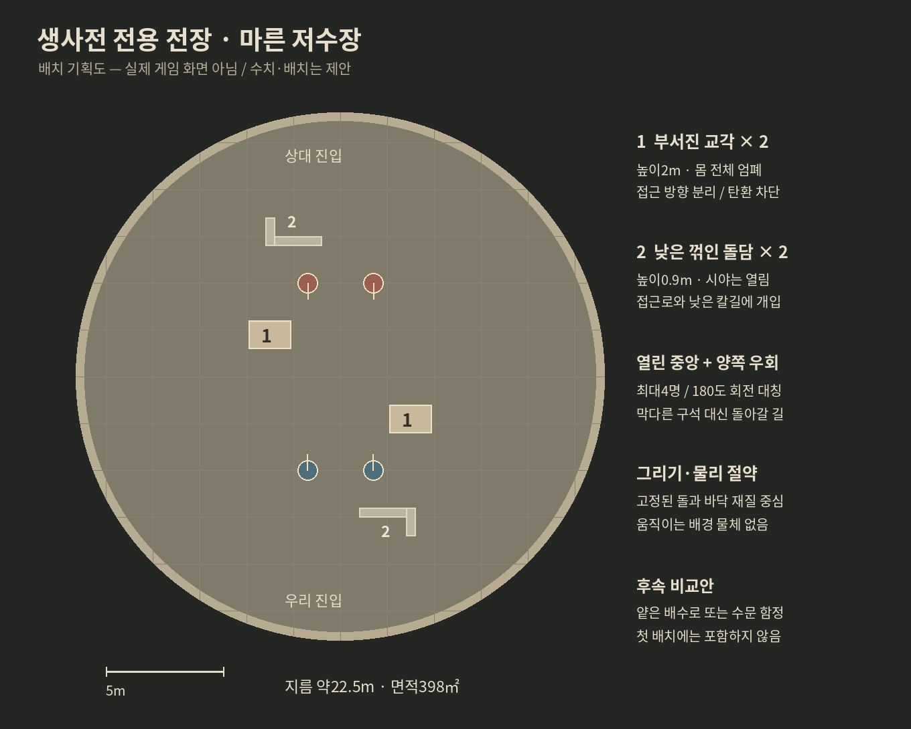

> 이전 제안. 사용자가 인공적인 장애물 배치로 느껴진다고 지적해 추천에서 제외했다. 현재 제안은 README.md.

# 생사전 전용 전장 제안 — 마른 저수장

2026-10-29 KST · 샛별. **기획안이며 게임 구현·성능 측정·우화 전달 전.** 사용자의 약 1.5배는 과거 넓이 합의처럼 바닥 면적 기준으로 해석했다. 아래 수치·명칭은 제안이다.

## 후속 요청 반영 — 진흙 이외의 지형과 함정

사용자가 새로운 장애물·험로·함정도 제안하도록 범위를 넓혔다. 아래 초안의 진흙은 비교 후보로 남기고, **최신 첫 구현 추천은 두 교각 + 낮은 ㄱ자 돌담2곳, 평지**로 바꾼다. 진흙을 다른 이름의 감속 구역으로 바꾸는 대신, 실제 무기 궤적과 접근로가 달라지는 구성을 택한다. 배치도는 이 최신 추천을 표시한다.

| 후보 | 플레이 선택 | 비용/주의 | 권고 |
|---|---|---|---|
| 낮은 ㄱ자 돌담 | 높이0.9m, 긴 변2.4m/짧은 변1.2m/두께0.4m. 가까이 붙으면 다리 쪽 접근을 막지만 자신의 낮은 베기나 회수도 돌에 걸릴 수 있다. 한 명이 모서리를 지키고 동료가 옆으로 도는 선택 | 두 곳 합계 상자4개, 고정 메시 합침. 공격을 일괄 감산하지 않고 실제 접촉만 사용. 넘기/점프를 새로 전제하지 않으며 양끝 우회 가능 | 첫 판 추천 |
| 얕게 꺼진 배수로 | 깊이0.2m, 바닥 폭0.8m+양옆1.1m 경사로, 총 폭3m. 약10.3도 비탈에서 디딤과 서로 다른 높이의 칼길이 생김. 양끝으로 평지 우회 | 고정 바닥 메시 하나로 가능. 기존 화산 경사 기반 재사용하되 별도 지형 제작. 실제 우위·걸림은 검증 전, 고지 피해 보너스 없음 | 두 번째 비교안 |
| 비스듬한 넓은 석축 | 높이0.25m/오르는 길3m. 낮은 고지에서 내려칠지, 옆으로 돌아 평지에서 붙을지 선택 | 가벼운 고정 지형. 높이 차이가 찌르기/막기/발 디딤에 주는 양쪽 손익 검증 필요 | 배수로와 택일 |
| 한 번 내려오는 수문 빗장 | 눈에 보이는 옆 레버를 무기로 쳐 작동. 금속 소리·움직임으로 약0.8초 예고 뒤 좁은 통로를 닫아 상대 둘을 나눔. 옆 우회로 항상 개방 | 한 개의 운동학적 물체와 경로 갱신. 사람이 끼었을 때 중지/밀림 규칙, 무기 끼임, 카메라, 경기 재현을 검증해야 함. 첫 안은 압사 피해보다 분리에 목적 | 후속 함정 후보, 첫 판 제외 |

낮은 돌담의 긴 변 중심은(-2,-5.8)/(2,5.8), 짧은 변은 각각 바깥쪽 끝에서 같은 방향으로 이어지는 회전 대칭 배치다. 시작 슬롯 x=±1.4,z=±4.0과 중앙 폭을 비워 진입 직후 걸리지 않게 한다. 교각2개+돌담 상자4개 = 배경 장애물 충돌체6개, 기존 바닥/경계 포함39개를 잠정 목표로 한다. 새 동적 물체0개. 담의 점유 면적2.56㎡를 추가로 빼면 통행 가능한 명목 면적은약391.32㎡(일반의1.474배)다. 담으로 모든 통로를 한 명 폭으로 만들지 않는다.

떨어지는 잔해 더미·굴러다니는 돌 여러 개·깊은 즉사 구덩이는 이번 추천에서 제외한다. 앞의 둘은 추가 물리 접촉이 늘고, 뒤의 것은 긴 대회의 부상/생존 전략보다 한 번의 밀림이 승패를 지배할 우려가 있다. 새로운 후보들을 한 전장에 전부 넣는 제안은 아니다.

## 확인한 현재 상태

- 우화 main `53629cf4`, 생사전 가지 `wk/saengsa`의 `d398b2f829729bb88a00695212ecd5a08fe12939`를 이번 요청 범위에서 읽었다. 상대 저장소에는 쓰지 않았다.
- [최신 생사전 설계](https://github.com/yoonjl-svg/halfsword/blob/d398b2f829729bb88a00695212ecd5a08fe12939/docs/design/saengsa_2026-10-29.md): 나+동료 둘 중 1~2명, 동시 출전, 내가 출전하면 직접 조작하고 동료만 출전하면 관전. 현재 시험판은 빠른 결과 계산이며 실제 팀전 엔진은 아직 연결 전이다. 옛 자체 8팀 시험판을 현재 16팀 설계로 오인하지 않는다.
- `src/config.js` 일반 전장 반경 = 6.5√2 = 9.192388m. 테두리 안 면적265.464579㎡, 지름18.384776m. 실제 경계 콜라이더 중심은 반경에 .25m를 더한32각형이므로 명목 원 면적과 충돌로 제한된 면적은 다르다.
- `src/wetland_ground.js` 기존 진흙은 중앙 이동 배율 .4. 자발 이동·기술 디딤에 작용하며 중력·물리 시간·공격 자체를 늦추는 효과는 아니다.
- `src/arena_obstacle.js` 습지/중정 장애물·AI 우회·카메라 보호가 있으나 단일 중심 장애물을 전제로 한다. 둘 이상의 구조물은 목록 기반 우회/카메라/사선 연결이 필요하다.
- `src/etna_ground.js`, `fighter.groundHeightAt/groundVelocityAt`에 경사 지형 기반이 있다. 바닥 접촉이 발 체중 받침에 연결되므로 시각 메시만 기울이는 변경은 불충분하다.

## 장소와 외형

왕의 후견인이 사용을 멈춘 왕실 저수장을 생사전 장소로 열었다. 물을 뺀 원형 석조 바닥, 예전 수로를 받치던 두 교각, 물이 덜 마른 진흙이 남는다. 담에 남은 수위 자국·바닥의 배수 홈·오래된 왕실 각인으로 용도를 설명한다. 관중이나 군중 애니메이션은 없다.

회베이지 석재 / 잿빛 마른 흙 / 짙은 갈색 진흙 / 낮은 채도의 황동 흔적. 밝은 흐린 낮으로 인물·칼·네 명의 위치를 읽기 쉽게 한다. 새로운 밤 무대가 아니므로 기존 새벽3시 밤 규칙의 대상이 아니다. 바닥은 주변 땅·외곽 담과 이어져 공중의 원형 판처럼 보이지 않게 한다. 표면 세부는 재질 무늬로 만든다.

## 초기 비교안 — 교각과 진흙의 크기·배치

| 요소 | 제안 | 전투에서 하는 일 |
|---|---|---|
| 원형 영역 | 반경11.258330m, 지름22.516660m, 면적398.196869㎡ | 일반 명목 면적의1.5배. 각 길이는√1.5배 |
| 부서진 교각2개 | 각 폭1.8×깊이1.2×높이2.0m, 중심(-3,-1.8)/(3,1.8) | 칼·탄환을 실제 차단. 상대 둘의 접근 방향을 갈라 일시적으로1:1 만들기, 부상 동료가 물러날 틈 만들기 |
| 진흙2곳 | 교각 바깥쪽(-5.6,-1.8)/(5.6,1.8), 약4.2×2.8m 타원 | 짧지만 느린 길과 더 먼 마른 길 중 선택. 외곽 길 전체를 막지 않음 |
| 진흙 강도 | 중앙 이동75%, 가장자리0.4m에 걸쳐 정상속도로 이어짐 | 기존 습지40%보다 약하게. 별도 기력세금·피해·무작위 넘어짐은 추가하지 않음 |
| 시작 후보 | 각 팀 x=±1.4, z=±4.0m | 진흙 밖·정면 시야 확보. 최대4명, 한 명 출전시 별도 중앙 슬롯도 검토 |
| 대칭 |180도 회전 대칭 | 양 팀에 같은 엄폐·진흙·우회 기회. 두 교각 사이와 양 바깥으로 이동 가능 |

교각이 차지하는4.32㎡를 빼면 바닥은약393.88㎡(일반 명목 면적의1.484배). 진흙은 걸을 수 있는 영역이다. 도식은 위 치수의 기획 배치이며 카메라·무기 여유를 실측한 최종 좌표가 아니다. 내부 통로는 최소3m 이상을 지키고, 회전하는 긴 무기·두 사람·넘어진 몸을 넣어 확인한다. 넓어진 만큼 시작 간격도 자동1.5배로 늘리지 않는다.

## 공통 판단 — 왜 처음에는 평지인가

엄폐물은 접근/사선을, 진흙은 이동 시간을 바꾼다. 서로 다른 두 선택을 적은 물체로 제공한다. 높은 단상·급경사·좁은 계단을 동시에 넣으면 네 명의 발 디딤/넘어짐/장애물 접촉이 복잡해지고 사람이 화면 밖에서 공격받기 쉽다.

경사가 필요하다면 후속 비교안으로 가장자리에 **높이0.25m / 길이3m, 약4.8도**의 넓은 돌턱을 제안한다. 별도 고지 피해 보너스 없이 실제 높이 차이로만 작동한다. 지형 높이·법선·충돌·발 받침·쓰러진 몸·카메라를 함께 검증하기 전에는 추천 기본안에 넣지 않는다. 경사 자체가 무조건 비싼 것은 아니며, 첫 판에서는 접촉 안정성의 불확실성을 줄이려는 결정이다.

## 그리기와 물리 비용 (진흙 비교안, 최신 돌담안은 위 추가6개)

배경만의 잠정 제작 목표: 그림자/인물/UI를 뺀 본 렌더 패스에서8~12회 그리기, 삼각형1만개 이하. **실측 성능 수치가 아니다.** 같은 재질의 바닥·담·교각은 합치고 기존 픽셀 표현과 색 규칙을 따른다. 수위 자국·파임·균열·고정 그림자는 작은 재질 무늬에 담는다. 반사 수면, 굴절, 풀/관중/동물, 날씨 입자, 흔들리는 천, 파괴되는 건축물은 넣지 않는다. 기존 인물 조명과 칼·몸의 가독성은 유지한다.

물리는 기존 평면 바닥1개+경계32개를 재사용하고 **교각 상자2개**를 추가하는 수준을 목표로 한다. 최신 돌담안은 총6개 장애물 충돌체를 쓴다. 교각의 작은 깨짐은 걸림을 만들지 않는 범위의 시각 세부로 처리한다. 진흙은 좌표 기반 배율 검사여서 유체 시뮬레이션/추가 동적 물체가 필요 없다. 숨은 끌어당김이나 상대만 느려지는 보정은 없다.

GPU를 덜 쓰는 것이 CPU 물리 예산으로 그대로 환산되지는 않는다. 그리기 제출의 CPU 비용·GPU/발열 여유는 줄일 수 있지만,4인 랙돌·관절·캐릭터끼리 충돌 비용은 별도다. 물리Hz/해결 반복수/입력 빈도를 몰래 낮추지 않는다.

## 팀전 엔진과 연결할 부분

1. 전장 전용 radius를 그림·물리 경계·AI 경계·효과·시작점·카메라에서 공유한다. 전역 ARENA를 바꿔 일반 무대까지 넓히지 않는다. 현재 main 카메라 바깥 제한10.5m도 전장값을 사용하게 해야 한다.
2. 두 교각의 같은 치수 목록을 렌더·충돌·길찾기·총알 사선·카메라가 읽는다. 현재 단일 원형 우회 함수를 두 번 부르는 방식은 서로 반대쪽으로 유도할 수 있어 피한다. 짧은 고정 길목 그래프와 국소 회피로 먼저 검토한다.
3. 생사전 전용 진흙 지도와 배율을 모든 출전자가 같은 조건으로 받는다. 기존 라트나 전용 마른 길 감각을 모든 AI에 그대로 부여하지 않는다. 기본 걸림 회피와 전술적인 진흙 회피를 구별한다.
4. 엄폐가 되었다고 근처 적을 잊거나 벽 너머로 달리지 않도록 팀전 표적 선택과 연결한다. 높은 장애물이 사람과 동료/옆 상대를 동시에 가리지 않는지 모바일 카메라 확인. 전투 유파 몸꼴/보법은 재설계하지 않는다.
5. 대진·회복·장비·저장·보상은 현재 우화 생사전 체계를 그대로 소비한다. 맵/배치 버전과 씨앗을 경기 기록에 남겨 재현/다시보기와 일치시킨다.

## 구현 후 검토 기준

- 같은4인/무기/입력으로 빈 평지와 이 전장을 비교: 브라우저 물리 스텝 시간, 그리기 제출 및 지원시GPU 시간, 평균보다 p95/p99 프레임 시간과 누적 밀림. 배경 단독 수치와 전투 전체 수치를 분리. 실제 폰 성능을 서버 소프트웨어 렌더 수치로 대신하지 않음.
- 사람이1:2와2:2를 직접 해 엄폐로 두 상대를 잠깐 분리할 수 있는지, 부상자를 뒤로 뺄 틈이 있는지, 총알이 실제 돌에 막히는지, 마른 길 우회가 선택 가치가 있는지 확인. 단순 AI 승률보다 이 경험을 우선한다.
- 장애물/진흙으로 받은 이득과 손해 모두 기록: 첫5초와30초의 피해교환, 공격받을 수 없는 상태로 무한 원돌기, AI 걸림·동료 길막·카메라 가림·경계 탈출. 맵 때문에 선택이 늘었는지 확인하며 높은 생존율 하나만으로 통과시키지 않는다.
- 구현 순서: 평면/경계/두 교각 → 카메라·실제 차폐 → 다중 장애물 우회 → 진흙 →4인 성능/인간 검토. 실제 시안이 나오면 게임 스크린샷과 별도 시험 링크로 보고한다.

이번에는 코드 열람·면적 계산·배치 기획까지만 완료했다. 게임 코드·공개 게임·우화 main·메시지를 변경하지 않았다.
