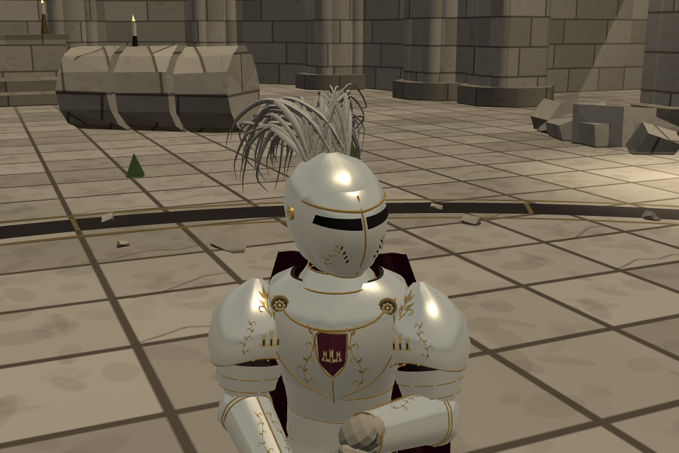

# 세바스티앙 — 어깨 위쪽 금장 보완

사용자 요청: “세바스티앙은 어깨 갑옷 위쪽에도 약간의 장식을 추가하자.”

양쪽 견갑 위의 비어 있던 부분에 작은 금빛 잎 5개와 짧은 덩굴선 두 줄, 가는 줄기를 얕게 더했다. 기존 금장 색과 곡면을 따르며 어깨의 폭·높이·판금 형태를 키우지 않았다. 아래쪽 성문 문양·기존 잎 장식·투구·말총·망토는 유지했다.

[이전 실제 게임 사진](before-detail.png)과 새 사진은 같은 게임 카메라·시각 조건이다. [전후 비교](comparison.png)는 검토 페이지의 두 사진을 그대로 촬영한 것이다. 정면·사선·뒤쪽 사진은 동일 축척의 중립 조명에서 촬영한 실제 모델 확인용 사진이다.

- 기준 `6a70187a`, 기능 `a4424b82`, 가지 `codex/sebastian-shoulder-20261022`.
- 변경 소스는 `src/outfit_returned_king_v2.js` 한 파일의 어깨 장식 16줄이다.
- [공개 검토·양 역할 대련](https://yoonjl-svg.github.io/halfsword-codex/encounters/returned-king-20261022/). 공개 완료는 `publication.json` 참조.
- 기존 캐릭터 정의·무기·AI·유파 동작·보법·갑옷 수치는 동일하다. 기존 각 판금의 경계도 동일하며 새 장식의 작은 경계는 기존 견갑 경계 안에 완전히 들어간다.
- 양쪽 장식의 유한한 좌표와 완전 파손 시 부위에서 분리되는 처리를 확인했다. 최초 검사는 파편이 보이지 않아야 한다고 잘못 기대했고, 실제 규칙대로 부위에서 떨어져 나가는지 확인하도록 수정했다. 처음 사용한 `armorBoxes`는 실제 필드가 아니므로 최종 검사에서는 `plateBoxes`의 모든 기존 경계를 직렬화해 대조했다.
- 공통 5관문 통과: 기준 4개 stdout 동일, corr 12조건 `IDENTICAL`. 빌드 성공, 양 역할 시작·모바일 막기/공격 터치·저장 불변·JS 오류 0.
- 검토 페이지 320/390/844/1200px에서 사진 6장 로딩·가로 넘침 없음·중첩 게임 진입과 새 장식 존재 확인.
- `checks.json`, `before-armor.json`, `gates.json`, `logs/`, `browser-checks.json`, `public-checks.json`, 전체 촬영 보고서와 `source-manifest.json`에 근거를 보존했다.

우리 포크의 기존 세바스티앙 검토 페이지를 갱신했다. 우화 저장소 쓰기·전달 메시지는 없다. 사용자 외형 컨펌은 아직 받지 않았다. 되돌림은 기능 커밋만 revert하면 된다.
