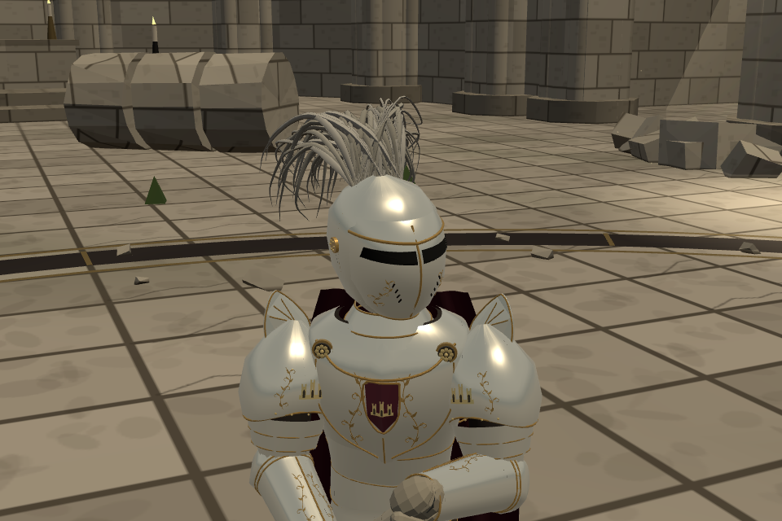

# 세바스티앙 — 위로 솟는 입체 견갑 장식

사용자 정정: 어깨 장식은 무늬가 아니라 **실제로 위로 솟아오르는 구조물**을 뜻했다. 앞서 추가한 잎무늬는 이 요구를 잘못 해석한 중간안이며 이번에 제거했다.

양쪽 견갑 위에 얇고 바깥으로 휘는 금속판을 하나씩 세웠다. 상아색 판과 금테, 세 줄의 가는 능선을 사용했다. 기존 견갑 꼭대기보다 실제 메시 기준 **5.932cm** 높다. 압출 깊이4mm와 가장자리 모따기1.2mm로 앞·뒤·옆면이 있는 입체 부품이다. 나머지 기존 갑옷의 문양과 형태는 유지한다.

- 기준 `86289cd3`, 기능 `f75f2455`, `codex/sebastian-shoulder-20261022`.
- 소스는 `src/outfit_returned_king_v2.js` 한 파일. 앞선 잘못 해석한 무늬를 제거하고 견갑 본판에 입체 부품을 자식으로 붙였다.
- 장식은 본판의 움직임·마모·파손을 따른다. 별도 방어 판정이나 충돌체를 늘리는 기능은 아니다. 기존 모든 `plateBoxes`와 방어 수치·인물 정의를 장식 추가 전과 비교해 동일함을 확인했다.
- 양팔에서 높이·유한 좌표·본판 완전 파손 시 함께 분리되는 것을 확인했다(`checks.json`).
- 5관문은 기준과 동일: 4개 stdout 바이트 일치, corr 12조건 `IDENTICAL`. 빌드 성공.
- 양 역할 전투 시작, 모바일 막기/해제·드래그 공격, 저장 불변, JS 오류0. 검토 페이지320/390/844/1200px 사진6장·넘침 없음·새 장식이 있는 중첩 게임 진입 확인.

[전후 비교](comparison.png)는 같은 게임 카메라에서 찍은 기존 견갑과 입체 장식을 나란히 놓은 것이다. [정면](front.png)·[옆면](side.png)·[뒤쪽](rear.png)은 중립 조명의 실제 모델 확인용 촬영이다. 생성 원화가 아니다. 촬영 당시 전체 src 해시가 기능 커밋과 같은지 `source-manifest.json`으로 확인했다.

[기존 세바스티앙 검토·대련 페이지](https://yoonjl-svg.github.io/halfsword-codex/encounters/returned-king-20261022/?v=f75f2455)를 갱신한다. 사진과 대련 URL에 버전 인자를 붙였다. 실제 공개 완료는 `publication.json` 참조.

우리 포크만 수정했다. 우화 저장소 쓰기·새 전달 메시지는 없다. 사용자 외형 컨펌은 아직 받지 않았다. 되돌림은 이 기능 커밋의 revert이며, 이전 무늬로 돌아갈 경우 그 무늬가 사용자의 정정으로 거절됐음을 유의한다.
