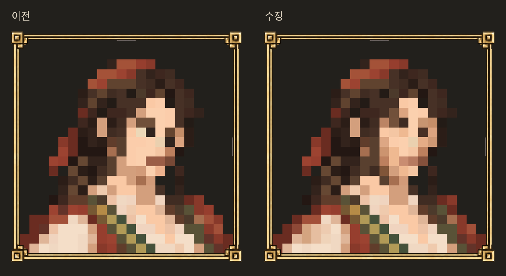

# 활달한 상인 선택 · low 2차

사용자가 세 후보 중 b(활달한 상인)를 선택하고 low의 둔한 눈과 넓어 보이는 인상을 수정하라고 요청했다. 원본은 유지하고 42셀을 다시 편집했다.

- 눈 두 개를 한 행 위로, 짙은 눈썹/눈의 수직 덩어리를 낮은 가로 덩어리로 조정. 먼 눈은 머리 경계에 합쳐지지 않도록 피부 셀을 남김.
- 볼 옆면/턱의 계단형 윤곽과 명암을 좁히고, 밝은 볼의 큰 단색면을 나눔. 입도 덜 짙게.
- 어깨 윗부분을 한 셀씩 안으로, 흰 소매의 부피 명암 조정. 하단22셀/상반신 크롭은 유지.

정사각형1254²,22×22/50px/원점77, 기존 공통 액자·투명배경·두눈/크롭 검수 통과(qa.json). original.png는 선택한 기존 b/original.png와 SHA256가 같다. 이전 b 원본/low는 덮어쓰지 않고 이 폴더를 최신 검토 후보로 지정했다. 재현은 python3 edit.py, 셀 변경 이전/이후와 이유는 sprites.json. 사용자 미감 재승인 전, 게임/우화 미전달.

이름 후보: **마리벨**(추천: 밝고 친근함), **이네스**(짧고 야무짐), **로제타**(능청스럽고 화사함). 아직 이름 확정 전. 전투 유파·숙련도는 별도 [현재 로스터 검토](../../../character_audit_20261029/README.md)를 바탕으로 이탈리아4를 제안했으며 적용하지 않았다.
