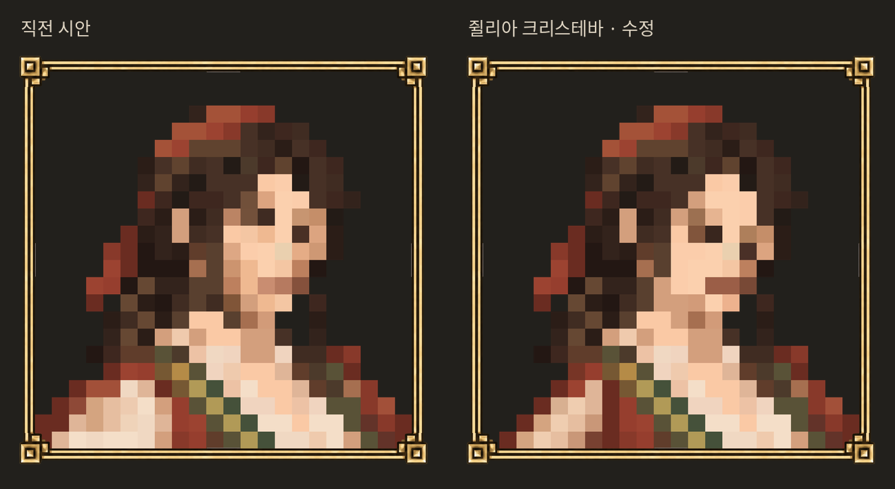

# 쥘리아 크리스테바 · low 3차

사용자가 상인 이름을 **쥘리아 크리스테바**로 확정했다. 이름 외의 전기나 설정은 추가하지 않았다. 최신 low는 이 폴더이며 미감은 사용자 검토 전이다.

- 얼굴·입매·턱·머리·목은 첫 `b/low.png`로 복원. 눈 주변 6셀만 새로 그렸다. 눈은 첫 시안 높이에서 짧은 갈색 눈꺼풀과 짙은 눈동자로 표현했다.
- 화면에서 보이는 왼쪽 어깨와 팔을 안으로 줄이고 소매의 밝은 면도 좁혔다. 오른쪽 몸체는 직전 b-02와 같다.
- 공통 액자1·1254×1254·22×22셀/셀50px/원점77·배경 투명 유지. 얼굴 폭8셀/턱14행/두 눈/상반신 크롭 검수 통과. 아래 변 몸체21셀.
- 원본은 첫 b/original.png와 바이트가 같다. 첫 low와 b-02도 삭제하거나 덮어쓰지 않았다. 모든 재현 셀·변경 이유를 sprites.json에 보존했다.

[최신 low](low.png) · [검수 격자](grid.png) · [고화질 원본](original.png) · [검수 결과](qa.json)

재현: `python3 edit.py` (Pillow·NumPy·Noto Sans CJK 필요). 자동 검수는 격자/원본 보존/수정 범위를 확인하며 미감 승인을 뜻하지 않는다. 비교 이미지는 보기 편하게 축소했고 low.png 자체는 고정 격자를 그대로 유지한다.

이번 작업은 프로필 자산 편집이다. 전투 유파·숙련도는 미정이며 앞서 제안한 이탈리아4를 적용하지 않았다. 게임 연결·우화 전송도 하지 않았다.
