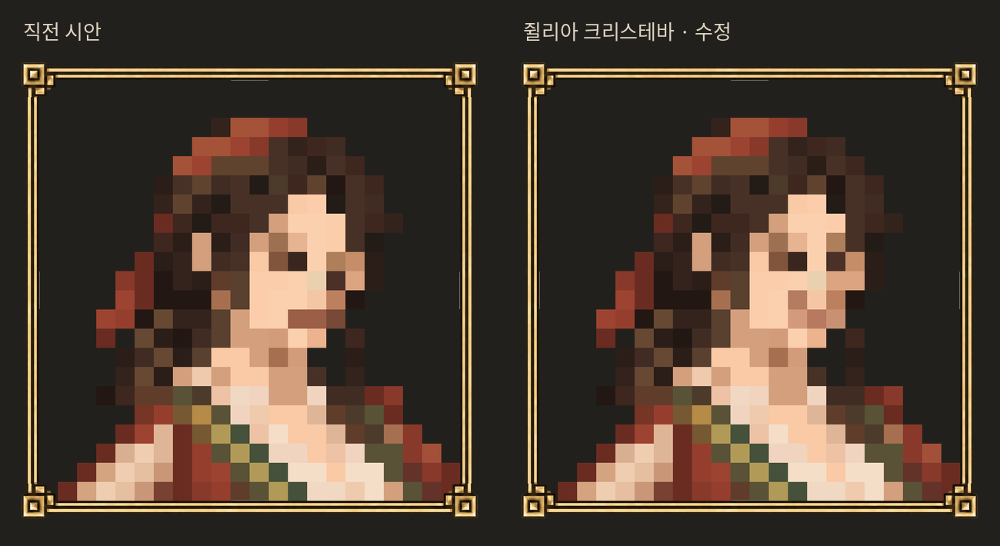

# 쥘리아 크리스테바 · low 4차

사용자는 3차의 눈 높이 차이와 일자 입매만 수정하고 나머지는 승인했다. 이번에는 **눈·입 주변 7셀만** 변경했다. 두 눈동자는 같은 9행이며 화면 오른쪽 눈을 한 셀 올렸다. 일자 입선을 풀어 한쪽 입꼬리가 살짝 올라간 부드러운 미소로 조정했다.

원본/얼굴의 나머지/승인된 어깨·팔/의복/액자는 바이트 또는 셀 단위로 그대로 유지했다. 22×22셀/50px/원점77·1254²·투명 배경·두 눈·크롭 검증 통과. 이전 버전 모두 보존. qa.json와 edit.py로 재현한다. 사용자 미감 확인 전.

이름은 쥘리아 크리스테바. [이어 제작한 전신 스케치·3D 외형 시안](../../../julia_20261029/README.md). 유파·숙련도 제안은 미적용이며 게임 본판 연결·우화 전달은 하지 않았다.
