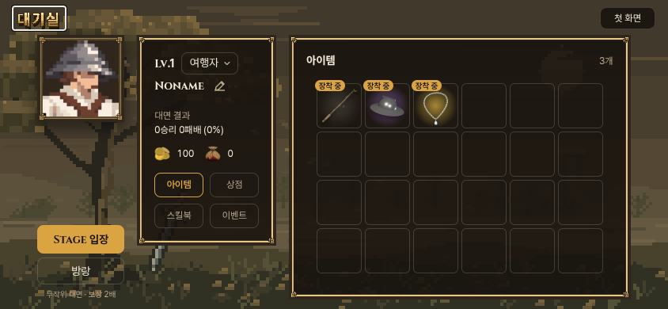
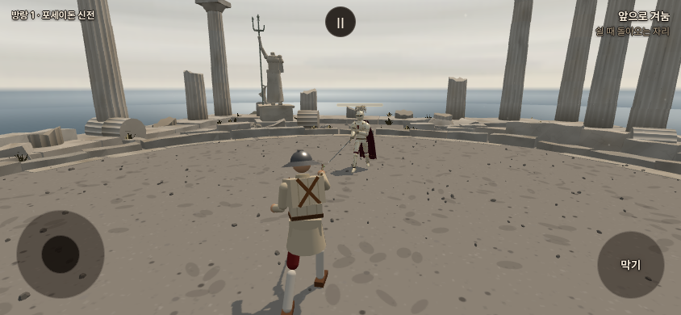
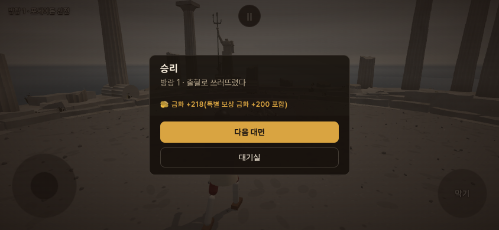

# 방랑 — 전체 클리어 이후 연속 대전 (2026-10-23)

사용자 요청: 일반 스테이지를 모두 마치면 별도 버튼으로 무작위 무대·무작위 인물 대전을 이어가는 모드. 일반 보상 두 배, 아르토리아/세바스티앙/몽골 장수 전용 등장. 아르토리아·세바스티앙 승리 금화+200, 몽골 장수 승리 목+5.

기준 소스 `22c75f2d` / 작업 가지 `codex/wander-mode-20261023`. 우리 포크만 수정. 정식 공개 main의 기존 게임 소스를 교체하지 않고 별도 검토판으로 제공한다. 우화 메시지/쓰기/채택 없음.

## 구현과 가정

- 이름 **방랑**은 샛별 제안/작업명이다. 사용자 확정 이름으로 기록하지 않는다.
- 일반 순차 여정29개를 각각 클리어하면 영구 해금. 같은 첫 무대를 반복해 누적29승을 쌓아도 열리지 않는다. 대기실 `Stage 입장` 아래 같은 버튼 스타일로 `방랑`을 별도 배치.
- 기존 순차 진행의 저장 위치 앞 무대는 누적 승리 수와 맞는 경우 가져온다. **옛 저장이 이미 마지막을 지나 첫 무대로 돌아왔거나 사용자가 처음부터 시작한 경우, 누적 승리만으로 전체 클리어를 증명할 수 없다.** 그 경우 자동 해금하지 않는다. 새 기록에서는 무대별 완료가 보존된다.
- 무대30종(기존29+완성된 밤 중정), 외형34종(해당 무대 인물30+아르토리아 두 모습+세바스티앙+백린). 각각 균등·독립 추첨, 동일 조합 반복을 막는 추가 규칙 없음. 보관용 맵/미확정 베르나르도·검은 왕은 제외.
- 아르토리아 기본/광기 모두 일반 대성당 후보에서 빠지고 방랑 전용. 세바스티앙/백린도 방랑 전용. 명시적인 개발용 인물 고정 링크는 관찰·검증 목적으로 유지.
- 승리 금화 **10~30(5~15의 두 배)**, 참수 재화 **2**. 패배 차감은 기존1~5 그대로. 추가 보너스는 배율 적용 **뒤** 더하며 승리 조건(참수와 무관). 아르토리아 광기에도 같은 금화 보너스.
- 패배 시 연속 대전 종료, 대기실에서 새 무작위 대전을 시작하는 방식을 구현. **검은 왕 후속 작업 중 사용자 응답으로 이 방식이 확정됨.** 도중 이탈은 기존처럼 차감 없이 같은 무대·상대·카드/선택 무기를 이어간다.
- 방랑 저장과 일반 순차 체크포인트 분리. 매 대면 체력/기력 초기화는 기존 새 판 규칙. 새 능력치 상승·유파 동작 변경 없음.

## 저장·재현

`lobby_progress.js`의 기존 저장에 `wander`를 추가한다. 전용 판 상태·참수 지급 여부·승리 보상과 지갑을 한 항목에 원자적으로 기록한다. 결과 뒤 새로고침/대기실 복귀로 같은 보스 보상을 두 번 받지 않는다. 저장 쓰기가 막히면 이번 실행의 미저장 값을 유지해 오래된 지갑을 다시 읽지 않는다.

- 순수 규칙: `src/wander_rules.js`
- 실제 연결: `main.js`, `game_entry.js`, `lobby.js`/`.css`
- 전용 인물 경계: `stages.js`/`characters.js`
- `VITE_WANDER_REVIEW=1`은 별도 체험 빌드에서 대기실로 바로 여는 옵션. 기본 빌드는 이 옵션 없이 제작.
- 체험판의 모든 localStorage 쓰기는 `stillness.preview.wander.20261023:` 접두 저장으로 격리. 전체 개방 체험 데이터만 제공하며 실제 저장/계정/클리어 기록을 해금하지 않는다. 보스 링크는 첫 판만 고정하고 다음은 무작위.

## 실제 화면

앞의 두 장은 로컬 실제 게임 화면. 마지막 장은 보상 연결 확인을 위해 패배 상태를 주입한 결과 화면이며 실제 사람이 보스를 이긴 증거로 쓰지 않는다. UI 흐름 검증 중 상대 AI를 멈춘 구간이 있으며 아래 전투 관문과 구별한다.

## 검증

- `node docs/design/wander_mode_20261023/rules.test.mjs`: 반복 클리어 해금 방지/옛 진행 이전/전용 상대 제외/독립 추첨/일반·보스 보상/참수 중복/새로고침 중복/패배0원 하한/장비·구매 후 모드 보존/저장 용량 실패 통과.
- `browser.mjs`: 기본 앱의 첫 화면→일반 대전→대기실→잠금/해금→방랑→보상→다음 무작위 대면→중도 복귀·재개→패배 종료. 모바일 실제 터치 막기/해제·드래그, 일반 체크포인트 불변. 844×390/1200×800/390×844/320×700/667×375 넘침·버튼/프로필 겹침 검사. 세로 폰은 기존 가로 회전 안내 유지.
- `public_browser.mjs`: 빌드된 체험판 세 보스 링크/카드 선택·무기 저장·재개/특별 보상/본래 지갑과 체크포인트 불변. 소개 페이지320/390/844/1200px. 콘솔 오류0.
- `run_gates.py`: 공통5관문. fights12/live_battery/finish_thrust/weapon_smoke 출력 기존과 동일, corr_s0 12조건 IDENTICAL. 새 모드의 보스 난이도/실제 휴대폰FPS 측정은 아니다.
- `npm run build` 통과. 기존500KB 번들 경고 유지.
- 브라우저 도구 첫 실행의 실패는 초기 DOM 이전 fullscreen 대체/`#game` 엘리먼트와 window.game 혼동/읽기 전용 alive에 대입한 결과 주입 오류였다. 테스트 도구를 실제 state API에 맞춰 수정했고 게임 성공 조건을 낮추지 않았다.

## 검은 왕과 세바스티앙 평가 (사용자 중간 질문)

동일 소스의 정면·사선·뒤·실제 전투 사진을 다시 보고 **현 단계는 세바스티앙 우세**로 평가. 폐쇄 투구/상아 판금/포도주 망토의 인물성 및 전투 거리 식별이 더 분명하다. 말총 선의 엉성함과 밝은 갑옷에 묻는 금장은 아쉬움. 검은 왕은 흑금/청록/흰 깃 배색이 강점이지만 단순한 열린 얼굴·목, 하체 반복 금장 밀도와 인물 개성 보완이 필요하다는 주관적 미감 판단이다. 평가 요청으로 모델을 변경하거나 검은 왕을 방랑에 편성하지 않았다.

## 공개와 다음

공개 검토: https://yoonjl-svg.github.io/halfsword-codex/encounters/wander-20261023/ . Pages39807785631 성공/공개477파일 SHA256 일치(10/23 00:47KST). 원격 영수증은 `publication.json`. 사용자의 이름/화면 확인 뒤 보완. 전달 지시가 있으면 그때 우화 최신 main에 맞춘 별도 전달 가지와 원본 소스를 준비한다.
