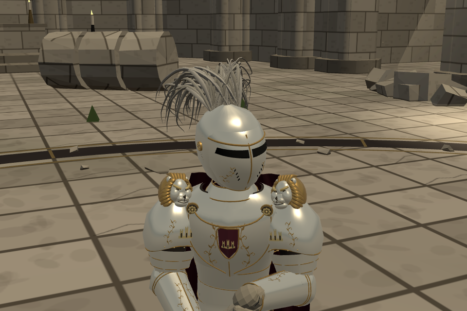
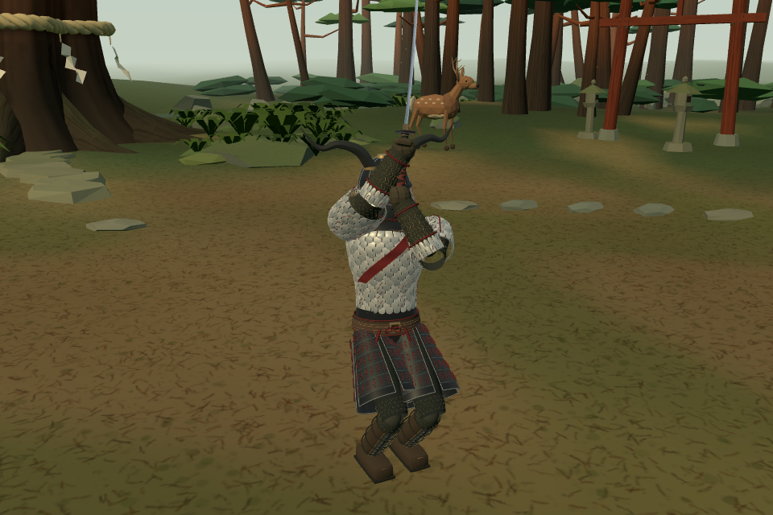

# 몽골 전사 보강 · 세바스티앙 사자 견갑

사용자 지시: 몽골 전사의 디테일·비례를 스스로 검수하고 부족한 곳을 보강한다. 이어 세바스티앙의 날개형 어깨 장식은 의도와 다르므로 **어깨 위에 사자 머리 조각**을 올리라고 정정했다. 날개안은 폐기이며 승인된 외형으로 기록하지 않는다.

## 결과와 자체 평가

- 세바스티앙: 두 견갑의 날개판을 제거. 상아빛 사자 얼굴·금빛 갈기, 앞으로 돌출한 주둥이·턱·코·눈썹·귀를 실제 메시로 구성했다. 기존 견갑 꼭대기보다 약 **6.72cm** 높다. 갈기가 방사형 꽃잎처럼 보이던 첫 판을 다시 평가해, 옆과 아래로 흐르는 갈기로 다듬었다. 정면·사선에서 사자 머리임이 읽히고 몸통 갑옷의 금장과도 이어진다. 실물 유물을 복원한 장식이 아닌 창작 조각이다.
- 몽골 전사: 기존의 긴 통 모양 견갑은 앞뒤 두께를 주 프로파일 기준 약10% 줄였다. 갑찰 가장자리는 실제로 안쪽 윤곽이 줄어드는 모따기로 수정했다. 이전 코드는 안팎 꼭짓점의 깊이만 달라져 제대로 된 모따기가 아니었다.
- 넓고 평평한 허리 갑판은 **다섯 층의 겹판·금속 끝단·쌍으로 꿰는 붉은 끈·구멍**으로 보강했다. 어깨 체결끈과 목둘레의 검정 마감판, 팔꿈치·무릎 안감, 팔 보호대의 리벳·세로 테두리, 겹 허리띠·매듭을 추가했다.
- 자체 재검토에서 가면이 웃는 듯한 인상, 소매 무늬의 과한 대비, 어깨 연결부의 단순한 꼭짓점을 발견했다. 입선·뺨 능선을 다듬고 안감 무늬의 밝기를 낮추었으며 어깨 끈을 보강했다. 첫 시도는 `pass1/`, `pass1-quarter/`에 보존했다.

기존 검은 뿔·은빛 갑찰·붉은 사선띠·분할 허리갑옷을 기준으로 보강했다. 몽골 출신이라는 이유로 몽골식 복식을 새로 섞지 않았다. 사람 몸의 뼈·관절·키·질량은 그대로이며, 공통 정사영 카메라에서 전후 축척을 맞췄다. 머리·손·발·뿔은 잘리지 않았다. 이번 보강을 사용자의 최종 미감 승인으로 간주하지 않는다.

남는 한계: 멀리서 보는 일반 전투 카메라에서는 작은 끈 구멍과 천 무늬가 모두 분리되어 보이지 않는다. 두 인물은 기존 절차적 부위별 모델의 양식을 따르며 고해상도 캐릭터 모델로 교체한 것이 아니다. 중립 관찰 장면에서 백린 208 draw calls /121,506 triangles, 세바스티앙170 /123,949. 백린은 이전195 /72,974보다 세부 비용이 늘었으며 **실제 휴대폰 FPS는 측정하지 않았다**.

## 소스·보존·공개

- 기준 `b0392a2d`, 가지 `codex/warrior-refine-20261022`.
- 사자 장식 `7b5a2d4b`: `src/outfit_returned_king_v2.js` 한 파일.
- 몽골 전사 `e1efe8c4`: `src/outfit_white_scale.js` 한 파일.
- 인물 정의·기존 유파 몸꼴/보법·AI·무기·능력치·정식 여정은 바꾸지 않았다.
- 이전 사진과 원 소스는 기존 작업 가지/문서에 보존했다. 사진을 찍은 소스는 각 촬영 보고서 및 `source-manifest.json`에 기록한다.
- [세바스티앙 검토·대련](https://yoonjl-svg.github.io/halfsword-codex/encounters/returned-king-20261022/?v=e1efe8c4)
- [몽골 전사 검토·대련](https://yoonjl-svg.github.io/halfsword-codex/encounters/white-scale-20261022/?v=e1efe8c4)
- 실제 공개 완료·원격 해시는 `publication.json`을 확인한다. 우리 포크의 두 검토 경로만 갱신한다. 우화 저장소 쓰기/새 메시지 발송0.
- 되돌림: 각 기능 커밋을 따로 revert 가능. 단 사자 커밋을 되돌리면 사용자가 거절한 날개형으로 복귀한다. 원하는 외형으로 재수정할 때 이전 거절안을 최종안으로 오인하지 않는다.

## 검증과 검증 중 발견한 문제

- `check_shapes.mjs`: 기존 모든 인물 정의·여정 회전, 두 인물 몸 위치/회전·질량·판금 수치 동일. 세바스티앙은 모든 기존 `plateBoxes`도 바이트값 기준 동일. 사자 조각은 견갑의 자식이며 견갑 완전 파손 때 함께 분리된다.
- 몽골 전사 초기 수정에서 견갑 끝을 줄이고 허리 갑판 위쪽을 늘리자 피부 표면 표본에서 방어 범위가 달라졌다. **견갑 끝단과 허리 갑판의 구조 테두리 범위는 이전 값으로 복구**, 위로 이어지는 새 겹판은 장식 자식으로 붙였다. 최종 피부 표면 표본은 두 인물 ×8부위 ×1,568점에서, 새 갑옷과 내구도20%의 부분 파손 상태 모두 기존과 동일하다(총50,176 비교). 이는 모든 연속 좌표에서의 완전 동일성을 증명하는 검사는 아니다.
- 검사 도구의 Rapier 벡터 클래스와 JSON 객체 비교 오류, 파손 검사로 참조 중인 판금 스냅샷을 변경한 오류는 숫자 직렬화·스냅샷 복사로 정정했다. 게임 값을 검사 기대값에 맞춰 바꾸지 않았다.
- `verify_white.mjs`: 기존33명·룩·회전, 투구/얼굴/목16표본, 좌우 뿔 파손2단계, 양 역할 ×2씨앗의12초 전투·NaN/파손/안감 잔류 검사 통과. 기존 목 약점 유지.
- 공통5관문: 네 stdout은 기준판과 바이트 동일, corr12조건 `IDENTICAL`. 빌드 성공. 이는 새 인물의 인간 손맛·최종 보스 밸런스 검증은 아니다.
- 두 인물 양 역할 게임 진입·모바일 막기/해제·드래그 공격·저장 불변·JS오류0. 검토 페이지320/390/844/1200px 사진 로딩·넘침·중첩 게임의 새 모델 확인.
- `front/quarter/rear`는 실제 Fighter의 중립 조명 모델 확인 사진. `king/white`의 게임 화면은 실제 전투 장면에서 카메라만 이동한 사진. 생성 원화는 사용하지 않았다.

재현: `node docs/design/warrior_refine_20261022/check_shapes.mjs`, `node docs/design/warrior_refine_20261022/verify_white.mjs`, `python3 docs/design/warrior_refine_20261022/run_gates.py`, `npm run build`. 브라우저 검사에는 빌드 dist를 제공한 뒤 `KING_BASE`를 지정한다. 기준 스냅샷 재생성은 `SHAPE_SOURCE`에 원본 작업 트리를 지정한다.
