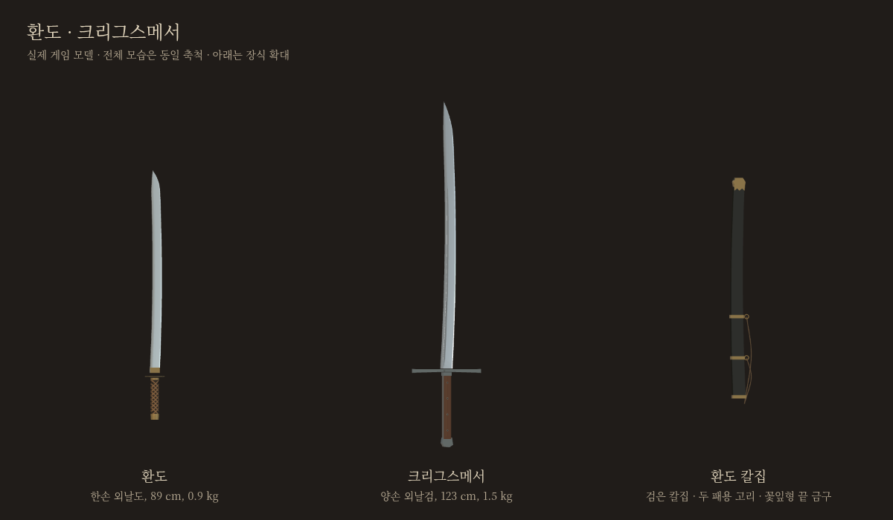
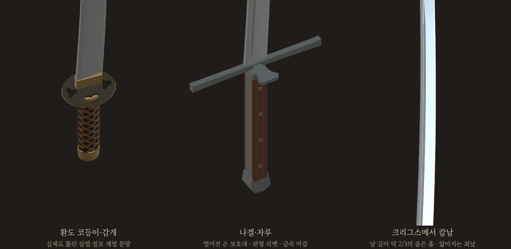

# 환도·크리그스메서 — 실물 조사 반영 완성본

사용자 요청: 조사한 휨·장식·비례를 실제 모델에 반영한다. 환도 날72cm. 크리그스메서는 Knecht Mark II보다 날10cm 연장, 초기 무게+100g에서 후속 사용자 지시 **1.50kg**로 확정. 별도 포크 검토판이며 우화 쓰기·새 메시지 없음.

기준 소스 `ca564844b5e5ba4b3abca1f10da12081211ee43d` (최초 무기 시안, 우화5a63674f 기반). 가지 `codex/weapon-historical-finish-20261021`. 전체 게임의 다른 시스템을 과거판으로 바꾸지 않고 독립 검토 경로에 배포한다.

## 최종 사양

| | 환도 | 크리그스메서 |
|---|---:|---:|
| 유파·등급 | 동방·커먼 | 독일·레어 |
| 날 길이 | 72cm | 95cm |
| 전체 물리 길이 | 88.9cm | 123cm |
| 보이는 전체 길이 | 88.65cm | 122.90cm |
| 질량(칼만) | 0.90kg | **1.50kg** |
| 날 기부 폭 | 3.6cm(사진 비례 추정) | 4.45cm(제조사 제원) |
| 파지 구간 | 감개12.5cm + 양끝 금구, 손잡이 약14.5cm | 갈색 자루23.5cm + 금구, 자루 쪽 전체28cm |
| 양손 간격 | 한손 | 14cm, 두 손 모두 자루 안 |

질량·관성·기력의 원래 무게는 `contracts.json`과 실제 파이터 `equipment.json`으로 확인했다. 환도의 칼집은 별도 시각 소품이며 칼의 질량에 합산하지 않는다. 환도0.9kg는 기존 게임 추정값을 유지했고 실물 계측값이라고 하지 않는다. 기존 베기/찌르기/등급 배율과 유파 몸꼴·보법·AI 정의는 바꾸지 않았다.

## 실물에서 반영한 것

**환도: 부산박물관 군용 환도, 구입10194**

- 끝을 잇는 직선에서 약9mm 휘는 외날 윤곽. 단순 직검에 작은 팁만 굽힌 초기 모델을 대체했다. 곡률 수치는 사진을 해석한 게임값이며 박물관의 곡률 실측은 아니다.
- 전체너비7.1cm를 코등이의 긴 축으로 참고한 얇은 타원형 코등이. 삼엽·칠보 계열 문양 네 곳은 실제로 뚫린 메시이며 검은 무늬를 그린 것이 아니다.
- 갈색 교차 감개를 타원형 손잡이 표면에 맞춰 감았다. 초기 돌출 끝을 확대 사진에서 확인해 보정했다.
- 날뿌리 금구·손잡이 양끝 금구. 유물 사진의 황동색을 참고한 색이며 합금 분석을 주장하지 않는다.
- 검은 칼집·두 패용 고리·꽃잎형 끝 금구. 실물 칼집52cm에 날 연장25cm를 더해77cm로 각색했다. 전투 때 빈 칼집이 골반을 따라 움직이며 휘두르는 칼에 붙어 움직이지 않는다.
- 유물에서 결실된 띠돈은 실물 복원이라고 하지 않고 소박한 연결끈으로 해석했다. 초기 전면 부착은 다리를 가로질러, 최종은 몸 옆에서 뒤로 기울게 배치했다.

**크리그스메서: Albion Knecht Mark II**

- 제조사 전체113/날85cm에서 날만10cm 연장한 전체123/날95cm.
- 날뿌리 폭4.45cm, 점차 가늘고 얇아지는 단면, 약한 휨과 비스듬한 외날 칼끝.
- 양쪽 면에 길이 약2/3의 좁은 홈을 실제 단면으로 넣었다.
- 긴 갈색 양판 자루, 관형 리벳4개를 양면에 배치, 가는 금속 둘레·목재 결.
- 길고 거의 곧은 코등이와 한쪽으로 넓게 벌어진 Mark II형 나겔, 작은 금속 머리 마감. 구형 Knecht와 혼합하지 않았다.

역사적 복원과 게임 각색의 경계 및 출처는 [이전 조사](references.md), 질량 추산은 [MASS_REVIEW.md](MASS_REVIEW.md). 참고 사진을 배포 에셋에 복제하지 않았으며 새 게임 형상은 코드로 제작했다.

## 실제 적용

- `src/historical_weapon_details.js`: 두 모델, 홈·투각·감개·리벳, 환도 칼집.
- `src/weapons.js`: 최종 치수·질량분포와 모델 연결.
- `src/fighter.js`: 선택적 `dressWeapon` 시각 소품 연결 두 줄. 기존 시각 난수 격리 사용, 물리·질량·갑옷 효과 없음.
- `src/weapon_measured.js`: 새 파지/물리로 측정한 두 무기의 간격·시간만 갱신.
- `public/ui/weapons/{hwando,kriegsmesser}.webp`: 최종 실제 모델에서 촬영한256px 투명 썸네일.

## 검증

- 공통5관문 통과. fights12/live_battery/finish_thrust는 기존 시안과 출력 동일, corr_s0 12/12 동일. weapon_smoke는 기존 다른26무기 결과 보존·새2무기 정상, NaN/실패 없음. 마지막 질량 변경 후 새 무기 smoke/계약·측정 재검증.
- 실제 물리8조건(무기2×베기·찌르기·막기·AI), 양손 파지·유파 연결·기력 원래질량 확인. 추첨550경로 정확 열거, 확률 변경 없음.
- [형상·파손 검사](geometry.json): 곡선 날이 콜라이더 밖으로 나가는 최대 거리 환도1.95mm/크리그스메서5.91mm. 파손 뒤 본체가 절단선에서 끝나고 질량 감소, 원래 무게 기력 규칙·빈 칼집 유지.
- 코등이 구멍 네 개와 실제 광선 통과 확인. 게임의 코등이 충돌은 기존과 같은 단순 콜라이더이며 문양 구멍별 통과 판정을 추가한 것은 아니다.
- 최종 빌드 성공. 모바일844×390 실제 터치 막기 유지/해제·공격 드래그·저장 불변·넘침 없음. 실제 휴대폰 하드웨어 성능 측정은 아니다.
- 장착 사진은 실제 게임 장면에서 카메라만 가까이 옮긴 관찰 화면이며 별도 일러스트가 아니다. 전체/확대 비교는 동일 게임 모델의 관찰 렌더다.
- 첫 파손 검사는 공통 엔진의 톱니 절단면(최대3.9cm)을 미절단 잔여로 잘못 포함했다. 본체 메시와 기존 breakFace를 구별해 실제 잔여가 절단선 안인지 검증했다. 첫 장착 촬영은 개발 서버 소스 갱신으로 재탐색되어 실패했고 최종 정적 빌드에서 다시 촬영했다.

새 통계로 전투 우위나 사람 손맛을 증명한 작업은 아니다. 모델·물리 호환성·입력·저장·파손을 확인했다.

촬영 후속: 개발 전용 썸네일 경로를 정적 빌드에서 열려던 첫 호출은404/대기로 실패. 해당 단계는 기존 정식 썸네일 생성기로 이미 완료되어 최종 카드·장착 촬영에서는 제외했고, 최종 결과는 capture-final 로그와 browser.json이다.

## 공개 검토판

구현 소스 `387f3e09`, [휴대폰 검토·대련 페이지](https://yoonjl-svg.github.io/halfsword-codex/encounters/weapons-historical-20261021/). 최종 빌드 `88edf4dcff60791f5dcf29aa`, 게임에 필요하지 않은 기존 연구판 디렉터리5개는 제외하고468파일 보존. 사진6장/320·390·844·1200px 넘침없음/두무기 대련 진입·실제질량 확인(`gallery.json`). 공개 배포 확인은 후속 `publication.json`을 참조한다.

공개 확인 완료: main `0497d76c`, Pages `39591787706` 성공. 2026-10-21 20:26 KST 공개476파일 전체 바이트 일치. 구현 후 갤러리 검사 추가 소스 가지 끝은 `bdd007ce`. [배포 영수증](publication.json).
