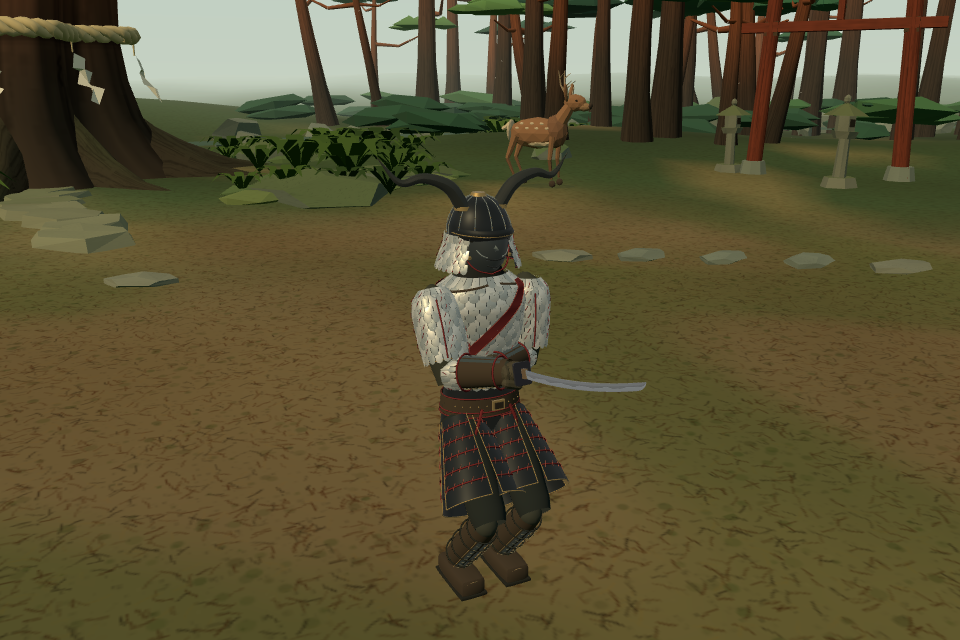
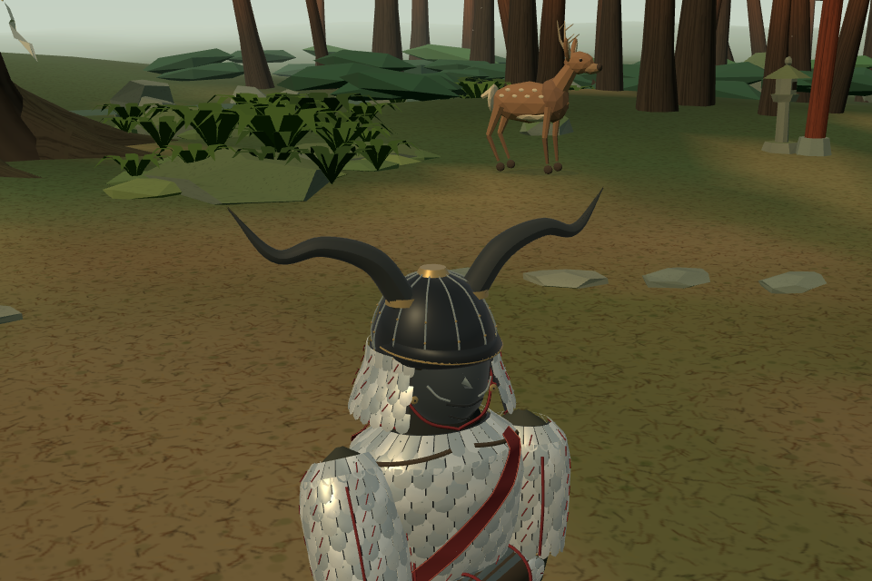

# 백린의 전사 — 레퍼런스 기반 새 캐릭터

사용자 지시: 제공한 세 장의 무사 사진을 최대한 따라 새 전사를 제작한다. 일본 유파를 수련한 몽골 전사라는 출신 설정 때문에 의상을 몽골식으로 재해석하지 않는다. 실제 이름과 자세한 서사는 아직 미정이며 `백린의 전사`는 작업명이다.

## 실제 모델





정면 [front.png](front.png), 사선 [quarter.png](quarter.png), 뒤쪽 [rear.png](rear.png)은 동일 카메라 축척·중립 조명의 **실제 Fighter 모델 확인용 사진**이다. 실제 게임 확대 사진은 신목의 숲 전투 중 카메라만 가까이 옮겨 촬영했다. 생성 원화나 사전 렌더 그림을 게임에 적용된 것처럼 표시하지 않는다.

## 외형과 연결

- 크게 굽은 검은 뿔, 검은 투구와 어두운 가면, 옆·뒤로 퍼지는 은빛 목가리개.
- 가슴·등·어깨의 겹친 은빛 갑찰, 앞뒤의 붉은 사선 띠, 붉은 끈과 작은 리벳.
- 바깥으로 벌어지고 여러 폭으로 나뉜 검정 허리 갑옷. 붉은 가로 묶음과 가는 금속 테두리.
- 어두운 팔·정강이 보호구, 천 바탕의 작은 반복 문양, 가죽 신발.
- `white_scale` 손님 등록. 기존 일본 유파 / 무라마사 / 숙련 3을 시작값으로 사용한다. 새 몸꼴·보법·흘림 규칙을 만들지 않았다.
- 갑찰 11부위는 기존 판금 규칙, 가면 투구는 기존 철투구 수치와 얼굴 보호 범위를 사용한다. 목 약점과 가죽 신발은 유지한다. 뿔 두 개와 투구는 실제 파손 규칙으로 분리된다.
- 정상 여정의 캐릭터 회전과 기존 33명의 정의는 그대로다. 전용 무대·정식 이름·최종 난이도·프로필은 아직 정하지 않았다.

레퍼런스를 게임의 기존 부위별 모델로 옮긴 창작 복식이다. 역사적인 몽골·일본 유물 한 벌의 복원이라고 주장하지 않는다. 별도 생성형 3D 서비스는 사용하지 않았다.

## 소스와 검토 경로

- 기준: `410341b9` (돌아온 왕의 외형 보완·공개 검증 뒤).
- 기능: `9e39d2a1`, `codex/white-scale-samurai-20261022`.
- 새 모듈: `src/outfit_white_scale.js`, `src/character_white_scale.js`.
- 최소 연결: `characters.js`, `looks.js`, `outfits.js`, `config.js`의 투구 정의.
- 공개 검토: <https://yoonjl-svg.github.io/halfsword-codex/encounters/white-scale-20261022/>. 발행 완료 여부는 `publication.json`으로 확인한다.
- 상대 역할: `game/?test=1&weapon=longsword&foe=white_scale&stage=sacred_grove&uniqueStage=5&nosw=1`.
- 직접 조작: `game/?test=1&hero=white_scale&weapon=muramasa&foe=bran&foeWeapon=tree_branch&stage=sacred_grove&uniqueStage=5&nosw=1`.
- `uniqueStage=5`는 모든 유파 책을 열어 시험하는 조건이다. 무대 번호가 아니다.

우리 포크의 별도 검토판만 발행한다. 우화 저장소 쓰기와 전달 메시지는 없다. 사용자의 외형 검토를 최종 미감 승인으로 미리 간주하지 않는다. 기능 되돌림은 이 독립 기능 커밋의 revert, 공개 검토판은 해당 새 경로만 제거하면 된다.

## 검증

- `verify.mjs`: 기존 33명·룩·여정 회전 스냅샷 동일. 새 인물 일본 유파/무라마사/11부위 갑주 확인.
- 투구·얼굴·턱·목의 베기/찌르기 16표본. 기존 목 구역을 투구로 덮어 보호하지 않는다.
- 좌우 뿔별 파손 2단계 검사. 첫 시험은 12초 전투 뒤 이미 부서진 뿔을 새 뿔처럼 기대해 실패했다. 초기 상태에서 방향별 분리 검사를 수행하도록 시험을 고쳤다. 기능을 바꿔 기대값에 맞추지 않았다.
- 양 역할 × 2씨앗, 각 12초 AI 전투: NaN 없음, 투구·갑옷 완전 파손 처리와 속옷/목 연결 유지 확인. 승률·손맛 최적화를 입증하는 시험은 아니다.
- 공통 5관문: fights12/live_battery/finish_thrust/weapon_smoke 출력은 기준판과 바이트 동일. corr_s0 12조건 `IDENTICAL`. `gates.json`과 `logs/` 보존.
- 빌드 성공. 브라우저 양 역할 시작, 모바일 터치 막기/해제·드래그 공격, 저장 불변, JS 오류 0.
- 검토 페이지 320/390/844/1200px: 사진 6장 정상 로딩, 가로 넘침 없음, 중첩 게임 링크 부팅 확인.
- 모델 확인 장면: 195 draw calls / 약 7.3만 삼각형. 실제 휴대폰 FPS는 측정하지 않았다.
- 촬영은 기능 커밋 전에 했으므로 촬영 보고서 HEAD는 이전 기준이다. `source-manifest.json`에서 촬영 당시 전체 src 해시와 기능 커밋의 파일 일치를 확인했다.

재현:

```sh
node docs/design/white_scale_samurai_20261022/verify.mjs
npm run build
# dist를 5204에서 제공한 뒤
KING_BASE=http://127.0.0.1:5204/ node docs/design/white_scale_samurai_20261022/browser.mjs
# 공개 검토 디렉터리를 5200에서 제공한 뒤
node docs/design/white_scale_samurai_20261022/public_check.mjs
```

`browser-checks.json`, `public-checks.json`, `contracts.json`과 사진·전체 촬영 보고서를 함께 보존한다.
