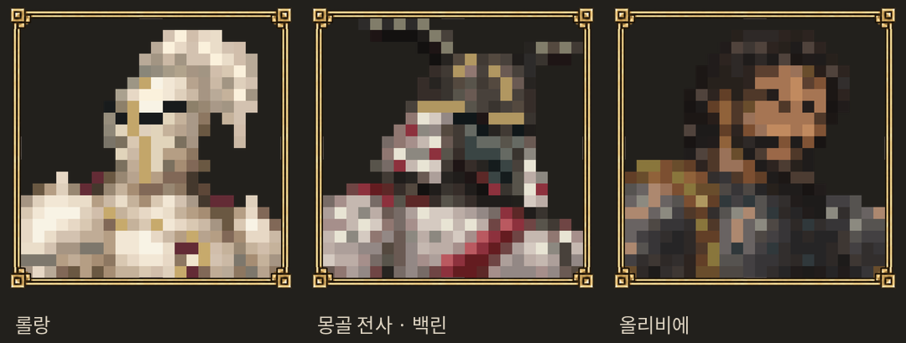

# 확정 프로필 3명 — 롤랑 · 몽골 전사 · 올리비에

사용자 “그래 이렇게 확정. 우화에게 보내. 셋 다 보내” 승인에 따른 최종본입니다. 원본/low/실제 격자선 이미지 각3장, 공통액자1, 최종 셀 편집 데이터와 해시 manifest를 함께 전달합니다.



## 1. 기준과 범위

- 수신 최신 main 기준: `59deba27b164ba76c85294904d200ddbba052d64`.
- 제작 소스: `e619152b1dfd4c57a731864fbf10a338003aa90b` (샛별 포크).
- 전달 가지: `codex/hero-profiles-handoff-20261024`. 위 수신 기준 위에 **이 묶음만 추가**했습니다. 적용 커밋은 전달 메시지에 고정합니다.
- 경로: `art/hero-profiles-20261024/`와 이 인계서·검증 도구. 게임 소스/저장/유파/모델/기존 프로필/기존 임시3장은 변경하지 않습니다.

## 2. 최종 그림과 ID 연결

| 사용자 확정명 | 묶음 ID | 최신 수신 ID | 연결 주의 |
|---|---|---|---|
| 롤랑 | sebastian | roland | 왼쪽 투구 면 음영 보강, 지정 검은 눈끝 유지 |
| 몽골 전사 · 백린의 전사 | white_scale | white_scale | 기존 확정 눈가림/뿔·갑찰 유지 |
| 올리비에 | black_king | bernardo | 수신측에서는 개명 후 복장v2. 이 그림은 승인된 이전 v4/수신 v1 복식 |

**올리비에 최종 눈:** 별도 시안 눈영역을 두 칸 위로 이동한 뒤, 각 눈 가장 오른쪽 끝을 (13,7)/(16,8)로 한 칸 내렸고, 이 두 셀만 #6E503B→#4F3829로 어둡게 했습니다(좌표0부터). 마지막 색 변경은 정확히5000픽셀, 다른 부분 불변입니다. 이전 v4 눈매나 중간 시안 대신 이 묶음의 `black_king/low.png`를 사용해 주세요.

최신 수신 코드 `src/portraits.js`에는 `roland/white_scale/bernardo`가 임시 프로필로 등록되어 있습니다. 올리비에 그림을 전달하지 않거나 이름 때문에 누락하지 않도록 대응을 명시했습니다. **현재 베르나르도v2 복식과 완전히 일치한다고 표시하지 않으며, 이 그림 전달을 근거로 캐릭터 개명/복장을 되돌리지 않습니다.** 선택된 원본은 그대로 보존하고, 실제 연결 판단은 수신측에서 해 주세요.

## 3. 제작 규칙·파일 사용

- `original.png` = 액자1을 적용한 고화질 정사각형 원본. 반드시 low와 함께 보존.
- `low.png` = 게임용, 인물22×22셀/50px 고정격자/원점(77,77). **low128은 승인된 표현 단계 이름이며 셀 크기128px라는 뜻이 아닙니다.** 단순 모자이크 대신 셀별 편집한 최종본입니다.
- `grid.png` = 검수용 격자선 포함 이미지. 게임용 low를 대신하지 않습니다.
- 모두1254×1254 RGBA, 인물 뒤 투명, 공통액자는 원래 해상도 유지. 게임에서 CSS 액자를 다시 겹치지 않습니다.
- 얼굴 핵심 폭 롤랑8/백린7/올리비에8셀, 턱14행·동일 상반신크롭. 두 투구의 가림 설정 유지. 올리비에 두 눈 위치는 최종 사용자 미세수정이 일반 눈높이 규칙보다 우선합니다.
- `sprites.json`은 셀/팔레트 편집 원본. `frame1.png`는 기존 공통프레임과 SHA256 동일합니다. 재생성/해시 검증은 아래 도구를 사용합니다.

현재 수신 UI는768² WebP를 사용합니다. 연결 시 원본 PNG는 보존하고 **수신측 기존 변환 규칙(Pillow LANCZOS, WebP quality95/alpha100/method6)**으로 필요한 세 장만 파생시키면 됩니다. 기존33장의 프로필·player2 연결·예비HD/low 모드·격자 토글은 보존해 주세요. 본 전달은 승인 원본 묶음이며 UI 연결 패치를 강제하지 않습니다.

## 4. 검증과 한계

```sh
python3 docs/import/hero_profiles_20261024/verify.py
```

이 도구는9개 PNG 크기/RGBA/해시, 공통프레임, 셀 고정격자/투명도, low/grid 재합성 일치, 최신 ID 연결을 검사합니다. 게임 소스·실제 게임 화면·전투를 변경하지 않으므로 게임 대련이나 빌드를 새로 수행한 것으로 주장하지 않습니다. 제작측 기존34초상/프레임107파일 불변도 확인했습니다. 실제 원격 전달 여부와 SHA는 별도 메시지/영수증을 따릅니다.

## 5. 적용 및 되돌림

```sh
git fetch https://github.com/yoonjl-svg/halfsword-codex.git codex/hero-profiles-handoff-20261024
# 메시지에 고정된 단일 전달 커밋만 cherry-pick
```

본판에 자산이 추가되는 단계이며 저장 형식/의존 라이브러리 변경은 없습니다. 전달 커밋 revert로 추가 묶음만 제거합니다. 이후 수신측에서 UI까지 연결했다면 그 연결부터 되돌려야 하며, 기존 임시 초상은 본 묶음에서 삭제하지 않았습니다.
