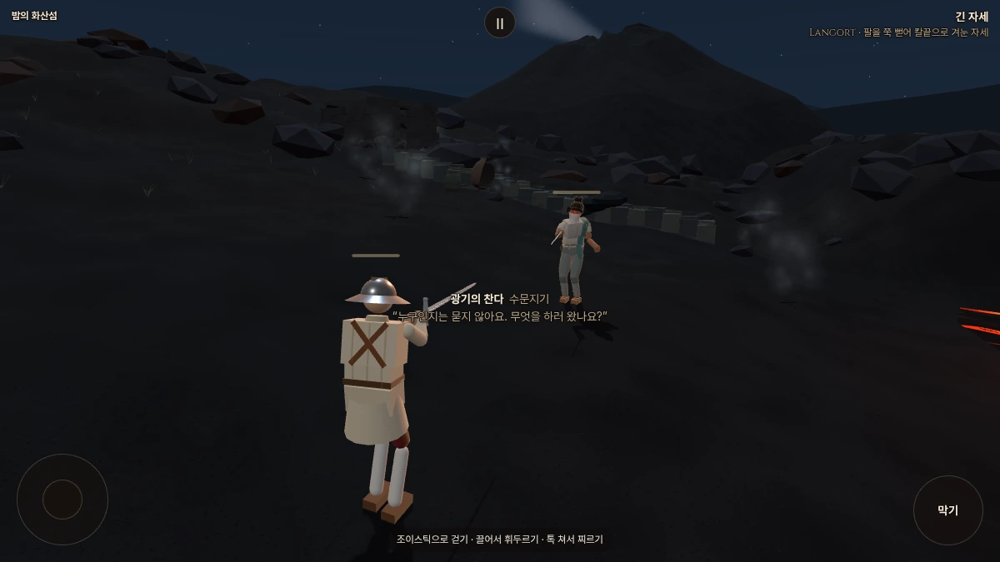
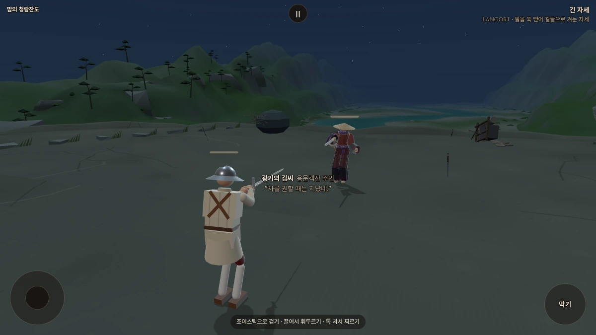
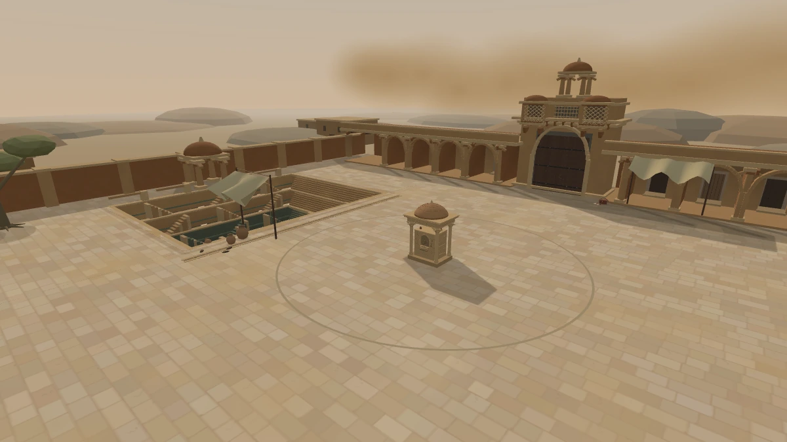
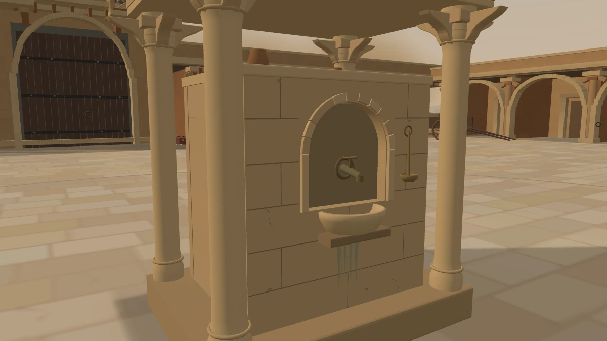
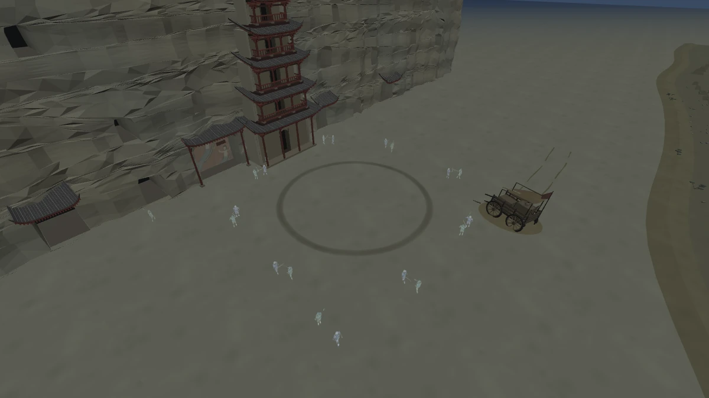
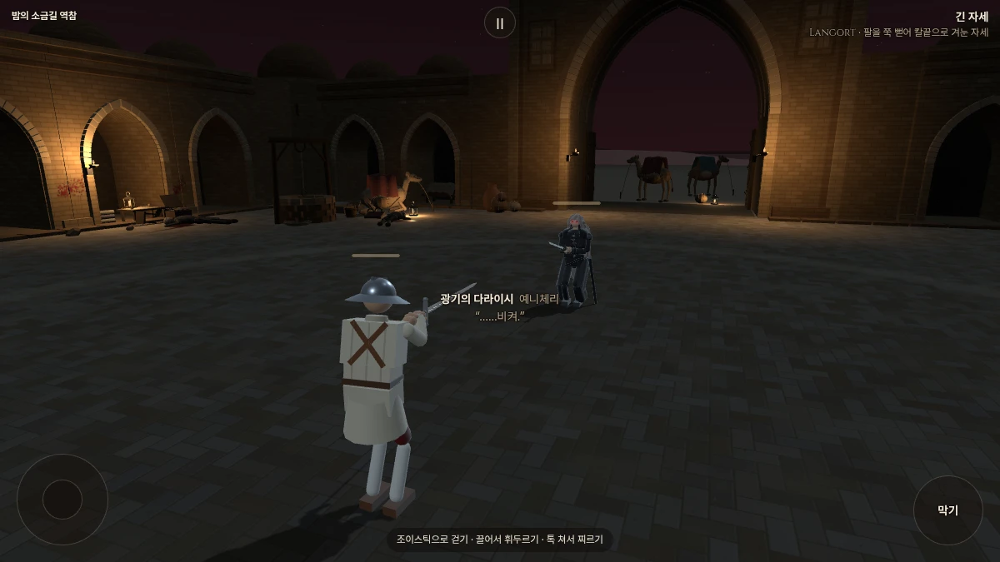
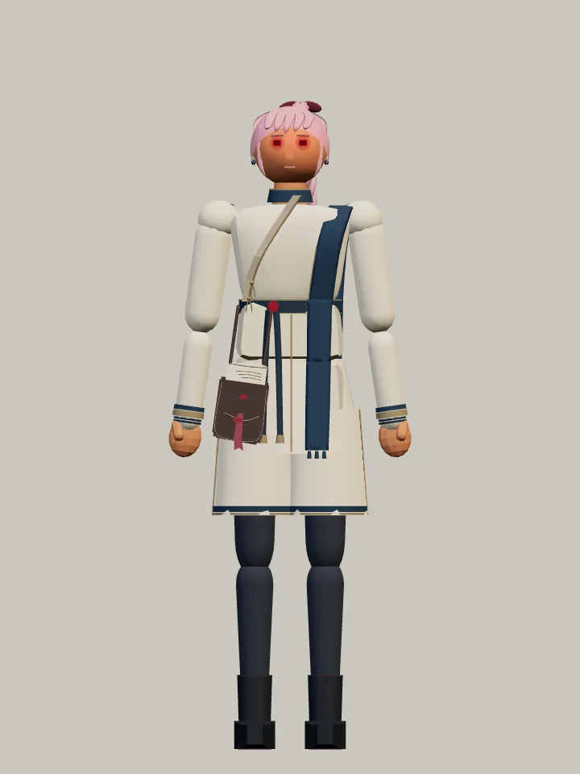
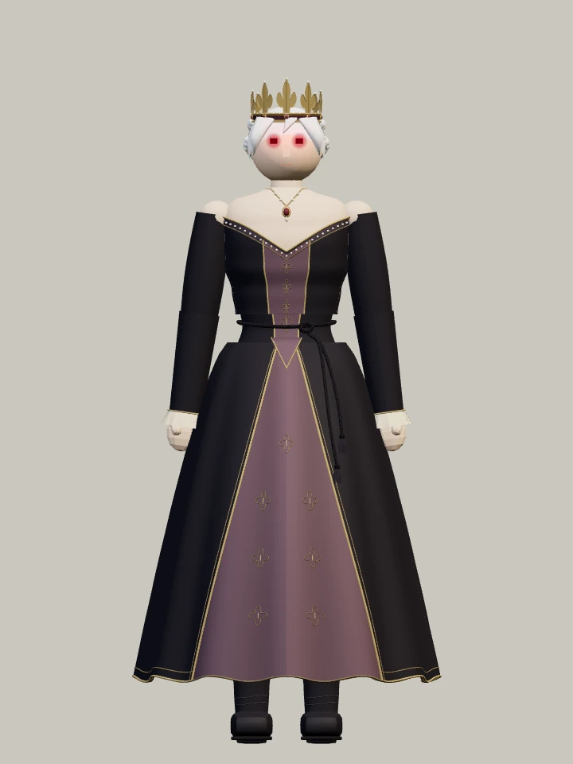
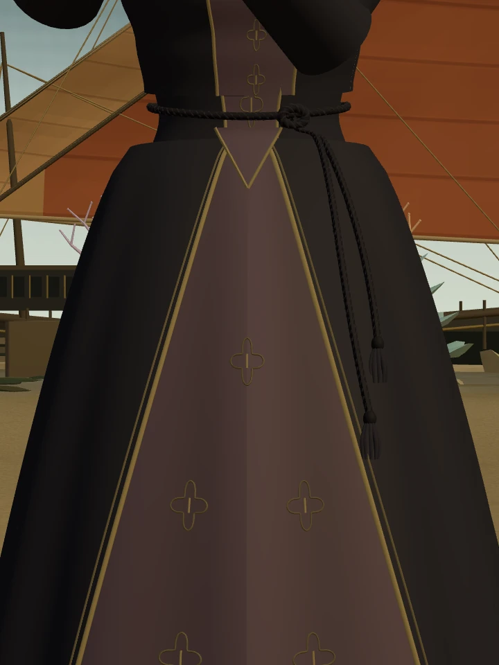
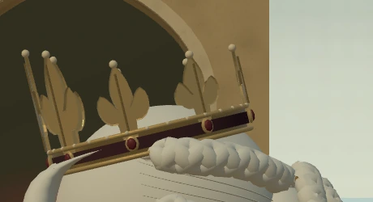

# 샛별 → 우화: 밤 무대 후속·중정·황약사의 검·얼터 최종본

2026-10-17. 사용자의 이번 지시 **“여기까지의 작업물과 메모를 우화에게 규약에 맞게 전달해”**에 따른 전달이다. 이전 문서의 ‘컨펌/발송 대기’는 당시 상태이며 이번 발행을 막는 미승인 표시가 아니다. 폐기 시안은 최종안에 포함하지 않는다.

## 1. 기준과 결과

- 수신 기준: `yoonjl-svg/halfsword` main **`f21266d6bcb3c44c02e0bd365a68cda5416ad6d1`**. 기력 접촉 보정·용사의 눈물·대기실 미리보기·UI 수정까지 포함한다.
- 전달 저장소/가지: **`yoonjl-svg/halfsword-codex` / `codex/content-handoff-20261017`**. 위 수신 기준에서 시작한 별도 전달 가지다.
- 우리 최종 원본: **`eb6fadbc`**, 공개 게임 소스 **`429751b46941ef04509a47d17660f4777e15c65d`**. 원본 범위 `0532969f54f316237d3d5c3426b572256760ee58..eb6fadbc` 중 아래 기능·의존 파일만 이식했다.
- 정확한 코드/문서 결과 SHA와 발행 직전 원격 재확인 시각은 같은 날 `dev-exchange`의 `docs/devmeet/messages/2026-10-17-content-handoff.json` 및 `.md`에 고정한다. 문서 자신의 SHA를 문서 안에 넣는 순환 참조는 하지 않는다.
- 지난 실제 전달은 `c09e074bd3b6ba59ac950e18bc6680f15c6b9c72`(첫 10쌍), 우화의 `87114cb` 수입 이후다. **구 준비본 `7f3b0f29`를 가져오면 후속 수정이 빠진다. 이번 가지가 이를 대체한다.**

## 2. 최종 작업물과 파일 범주

| 항목 | 전달하는 최종 상태 | 중심 파일 |
|---|---|---|
| 찬다·밤 화산섬 | 호칭 **식물학자**(원본/얼터). 재빛 복식·짧고 얇은 흰 가림천. 새벽3시, 조금 더 어두운 화산과 넓게 퍼지는 지열 수증기12곳, 막힌 물길/마지막 물 | `outfit_alter_fifth.js`, `stage_night_fifth.js`, `stage_etna.js`, `etna_ground.js` |
| 김씨·밤 청람잔도 | 적갈색 옷·풀린 긴 머리. 습격 흔적/버려진 짐/땅에 박힌 동양식 검7자루(전투 구역3, 바깥4). 실제로 황약사의 검을 들고 싸움. 원본 김씨는 모르겐슈테른 | 위 파일, `outfit_renji_baji.js`, `renji_sword_wrap.js` |
| 황약사의 검 | 에픽 한손 둔기, 1.6kg, 둔타1.6, 파손0, 손~끝0.93m. 납작한 검 윤곽과 흰 천. 일반 카드 추첨·장착에 포함 | `weapons.js`, `weapon_measured.js`, 무기 썸네일 |
| 마야의 봉인의 중정 | 라자스탄 사암 역참의 지상 안뜰·깊은 계단우물·모래바람·회랑/담장/진입로. 중앙 급수정의 석재/급수구/물받이/국자 세부. **실제 물리 엄폐9개** | `stage_courtyard.js`, `stage_courtyard_cover.js`, `arena_obstacle.js` |
| 병마용·밤 철불 절벽 | 원래 갑옷·창백하고 조금 비치는 사람 얼굴·얇은 흰 대장군 망토. 사방의 오·월 교전8쌍+행군4명(총20). 행군은 창3/검1, **깃발 없음** | `outfit_alter_terracotta.js`, `outfit_yue_cloak.js`, `stage_dunhuang_night.js`, `stage_yue_apparitions.js` |
| 다라이시 기본/얼터 | 우화v7 바탕에 곡선 앞섶·슬림한 옆머리·한 줄 앞머리·목/셔츠 틈 보완·칼집8mm 안쪽. 기본/얼터 머리 모두 **따뜻한 애쉬 실버**. 얼터는 중성에 가까운 검정, 머리끈·허리 장식 같은 붉은색, 공통 안광 | `looks.js`, `outfit_daraishi_front.js`, `outfit_silver_wanderer*.js`, `outfit_alter_daraishi.js` |
| 밤 소금길 역참 | 위장 상인들의 술탄 암살 모의, 살의에 깨어나 닥치는 대로 벤 다라이시. 낙타3·모의 자리·**사체 총3구**. 반대편 모호한 상인/암살자와 끌린 피, 기존 피 웅덩이에서 가는 흐름 연장, 벽2곳 비산. 어두운 검붉은 하늘/국소 불빛 | `stage_dayr_night.js`, `stage_dayr_caravan.js`, `stage_dayr_blood.js`, `stage_dayr_far_side.js` |
| 마야 얼터 | 아이보리/먹청색 옷·봉인이 뜯긴 서신함. 기존 총·몸·성향 유지 | `outfit_alter_royal_messenger.js` |
| 아르토리아 얼터 | **v4-alter13**. 검은 고전 궁정 드레스, 가는 소매/완만한 V목선/긴 겹치마. 더 좁은 V목걸이. 고유 앞머리3조각 유지, 뒤통수 하단이 채워진 궁중 땋은 올림머리. 백합 금관 균등72%, 미세 광택. 검은 꼬임 허리끈은 가장 잘록한 복부로 약7cm 올리고 매듭·길이가 다른 두 술도 함께 이동 | `outfit_artoria_ballroom.js`, `outfits.js`, `fighter.js`의 선택 인자 연결 |

황약사의 검 최종 표기:

> 흰 천으로 감싼 검. 오랫동안 풀지 않은 듯 단단히 매여 있다.<br>
> “번뇌는 기억력 때문이라더군.” (취생몽사: 몽롱한 일격)

- 내부ID **`brothers_sword`** 유지. 별도 혼란/수면/몽롱 상태이상 없음. 이름만 ‘검’이고 실제 날·가시·베기·찌르기·갑옷 무시 없음. 에픽 공통 공격 배율1.1은 별도 둔타 계수 상향이 아니다.
- 밤 무대 총14개, 얼터16명. **마야/아르토리아는 얼터만 추가했으며 새 전용 밤 무대는 아직 없다.** 중정은 낮 시안이다.
- 모든 밤은 새벽3시. 무대마다 연관된 흔적2개 이상, 철불 절벽은 사용자 지정 대규모 교전이 그 역할을 대체한다. 새 힘/체력/적극성 강화 없음.
- 아르토리아는 사용자 승인 예외로 **실제 판금11부위→0, 판금 이동 감속 해제**. 원본 아르토리아 판금은 유지한다. 김씨의 실제 무기 교체도 승인된 예외다.
- 숨은 설정: 다라이시는 기억을 잃은 사사키 코지로. 무사시에게 기습당할 때와 비슷한 살의에 반응해 밤에 깨어난다. 공개 설명은 이를 직접 폭로하지 않는다.
- 금관은 유럽 백합 문양을 활용한 창작이며 특정 왕관 유물 복원이 아니다. 병사 창은2.51m/낮춘 운반 자세이며 춘추전국 출토 유물 규격의 고증 완료로 기록하지 않는다.

폐기안 재적용 금지: 찬다 검은 반가면/긴 흰 천, 김씨 구슬발/운반바구니, 다라이시 에메랄드·족쇄/탈옥, 소금길 앉은 사체(4구판), 병사 깃발, 아르토리아 비키니·짧은 현대 원피스·퍼프 소매·바깥 팔 M재단·초커·긴 가슴 사슬·긴 한 갈래 머리. 비키니 전용 모듈/등록은 전달 실행 코드에서 제외했다. 다른 `LOOK_ARCHIVE` 과거 버전은 기존 방식의 참고 보관이며 현재 선택은 위 표다.

## 3. 수신판에 맞춘 연결과 보존

- **전체 트리를 맞추지 않았다.** 수신 최신판 위에 필요한 기능과 의존 범위만 얹었다. 수신판 유파·보법·전투/기력·총기·대기실/계정 코드를 덮어쓰지 않았다. `checks/preserved.json`에26파일의 바이트 보존을 기록했다.
- 수신판의 **모든 얼터 숙련도+1(상한5)** 규칙을 유지하고 신규6명도 그 공통 후처리 전에 등록했다. 이 규칙은 우리 공개 원본과 다른 수신판 정책이다. `retainBaseStats`는 구 하인리히식+20%를 막는 표식으로만 사용하며 +1 숙련도를 막지 않는다. 동일 숙련도에서 원본과 새 얼터의 AI/성향은 같다(김씨 무기ID만 예외). 기존 하인리히+20%도 보존했다.
- 충돌3곳: `characters.js`에서 신규 얼터 뒤에 수신판 숙련도 후처리 유지; `looks.js`에서 수신v7 위 최신 승인 `v7-silver-c` 선택; `outfit_silver_wanderer_detail.js`에서 수신v8 칼집 위치에8mm 안쪽 보정만 더함. 우화의 기존v7 복귀를 새 창작으로 다시 계산하지 않는다.
- 수신판 **24스테이지 여정 편성/후보표는 그대로**. 새4밤/중정은 빌더·이름·상대가 등록되어 시험URL로 열 수 있다. 새 여정 삽입 및 마야/아르토리아 밤 후보 편성은 이 전달에서 하지 않았다. 기존 `cathedral_night`의 아르토리아 후보를 자동 얼터로 바꾸지 않는다.
- `fighter.js`는 장식 호출에 `this.groups`를 선택4번째 인자로 넘기는 **한 줄 변경**. 아르토리아 끈 위쪽은 복부, 아래는 골반 렌더 변환을 따라가게 하는 시각 정점 보정뿐이다. 몸·관절·기력·용사의 눈물 코드는 그대로다. 기존3인자 호출도 유효하다.
- 중정만 고정 충돌9개·시작Z1.85·총수 사선 우회. 보이지 않는 피해 보정 없이 총알/몸/칼이 실제 돌 형상에 막힌다. 외곽 반경9.192388m/면적265.4646㎡, 중앙 기단2.2×1.7m. 다른 스테이지 우회 규칙과 유파 동작은 보존한다.
- 새 밤 빌더의 사운드/지형 연결, 중정 석재 발소리·천/물방울/고리 소리는 기존 계통을 재사용한다. 밤 청람잔도 새 울음은 억제한다. 새 상주 음원 파일/외부 CDN은 필요 없다.
- `tools/pwa/build.mjs`는 **검토 사진 `encounters/`를 오프라인 필수 캐시에서 제외**한다. 게임 에셋/소리/새 무기 썸네일은 캐시 대상이다. 전달 사진은 `docs/import/.../screenshots`에 있어 게임 다운로드에 붙지 않는다.
- 신규 무기는 끝에 추가해 기존 무기 순서와 시뮬 난수 순서를 보존한다. 저장 형식/버전 마이그레이션 없음. 새 무기ID를 가진 저장을 과거판으로 되돌릴 때에는 장착/이전 무기 값을 기존ID로 바꾸는 것이 안전하다.

## 4. 다음 작업 요청 — 이번 코드에는 미적용

사용자가 **다음 보낼 때 우화에게 메모로 전달**하라고 한 요청이다. 현재 수신판에서도 기존 값임을 확인했다.

1. 냉동 참치 `frozen_tuna.mBlunt` **2.6 → 2.4**.
2. 고무 닭 `rubber_chicken.mBlunt` **1.6 → 1.2**.
3. **AI 한정** 리볼버 재발사 간격을 **현재의1.8배**. 플레이어 제외. 공통 `GUN.cooldown=.8초`를 바꾸지 말고 기존 인물 `gunCooldownK` 위에 AI 배율을 한 번만 곱한다. 일반AI .8→1.44초, 마야(내부samira)1.2→2.16초. 첫 발 대기·8초 전체 장전·피해·명중률 변경 지시 아님. 실제 발사는 겨눔/거리/상태로 더 늦을 수 있다. AI 소유 여부로 판정하고 fighter.index로 판정하지 않는다. 재시작/무기교체에서 중복배율 금지.

모르겐슈테른1.6·황약사의 검1.6은 유지한다. 요청3항목의 구현/채택 완료를 이 발행으로 주장하지 않는다.

기존 연구 상태도 다시 구별한다. 독일 보법 후속 구현은 우화 작업을 수입한 것이며 샛별의 새 독립 보정 완료가 아니다. 동방 AI 비공격 상태 가벼운 발 후보는 독립192판에서50승→41승으로 **미채택**(청강36→23/각96, 구천14→18/각96); 사람 가벼운 발 유지/AI 공격 상태만, `cnAiTune=0`. 결과는 이미 [기력 연구 메시지](https://github.com/yoonjl-svg/halfsword-codex/blob/cfdc1daa271cc7b8773c29e75833a95b9d1342e7/docs/devmeet/messages/2026-10-16-stamina-contact.md)에 발행했다. 이번 수신 기준에는 우화의 기력 접촉 보정 수입도 이미 들어 있어 중복 이식하지 않았다.

수신 기준의 [MSG-S-012 막기 줄 읽기 연구 요청](https://github.com/yoonjl-svg/halfsword/blob/f21266d6bcb3c44c02e0bd365a68cda5416ad6d1/docs/devmeet/notes/2026-10-17-uhwa.md)은 확인했다. 이번 전달은 콘텐츠 묶음이며 해당 연구 결과/막기 재설계는 포함하지 않는다. 별도 후속 과제로 남긴다.

## 5. 검증과 한계

동일 수신 기준을 먼저 실행한 뒤 이식판과 비교했다. 원시 stdout/stderr·JSON은 `saetbyeol_content_2026-10-17/checks`에 보존한다.

| 검사 | 결과 |
|---|---|
| fights12 / live_battery / finish_thrust | 각각 `5dfe035c` / `648aca66` / `2de06c03`, 수신 기준과 바이트 동일 |
| corr_s0 | 양쪽12/12 IDENTICAL |
| weapon_smoke | 기존23종 출력 바이트 동일 + 새 검1종 정상. 전체24종 FAIL0/NaN0. 해시 `7085b282`→`729ce58e`는 새 행 추가 때문 |
| 새 검 물리 | 양쪽 자리12대련/실제25타격 모두둔타, 파손없음. 강제 고충격512회,6방향/상태 접촉, 카드128씨앗에서 추첨·중복/이전무기 제외 확인 |
| 중정 물리/카메라 | 가려진3사선 총알막힘/상처0, 열린2사선 피격. 몸/캡슐 통과 방지, 총수3배치 사선우회, 전환 충돌정리. 브라우저 충돌9개·카메라61표본 내부0·보이는 형상과 총알 충돌 비교 |
| 새6얼터 실제 게임 | 수신판+1정책, 동일숙련도 AI 보존,6초씩 실제 물리/AI·형상·장식·사운드 연결·화면/예외 검사. 상세는 `checks/browser.json` |
| 밤 무대 전환 | 새4밤 각각4회 낮/밤 전환에서 중복루트/기하·텍스처 누적 없음. 병사 일시정지/재개 확인 |
| 오프라인 | 네트워크 차단 뒤 중정 실제 대련 시작·엄폐/소리 로드 성공, 검토 사진 캐시 제외 |
| 빌드 | `npm run build` 성공. PWA 387파일/7,609,499바이트, 버전 `7ffe0e24c7e3bad959693285` |

**기존 `stamina_gates.mjs` 자체는 무기23종 해시를 기대하므로 이식 후 종료코드1을 낸다.** 기대값을 임의 수정하지 않았다. `smoke-comparison.json`으로 기존23행 동일/새1행 정상임을 별도 검증한 의도된 목록 확장이다. 나머지4관문은 도구 자체에서도 통과한다. 새 브라우저 검사 초기에 설명 끝의 공통 능력 표기를 빠뜨린 검사기 기대문장을 바로잡았으며 게임 문구를 바꿔 통과시키지 않았다.

실물 iPhone/Safari FPS, 장시간 누수/밸런스 승률, 새 여정 편성, 실제 청감의 재심사는 이번 범위에서 하지 않았다. 브라우저 검사는 Chromium 모바일 가로 에뮬레이션/소프트웨어 WebGL이다. 최신 스크린샷은 아래에 첨부하고 이전 폼의 사진을 최종 증거로 섞지 않는다.

재현 명령(저장소 루트, Node24/의존성 설치 및 Chromium 필요):

```sh
npm run build
node tools/sim/stamina_gates.mjs on /tmp/content-gates
node tools/sim/brothers_sword_check.mjs /tmp/sword.json
node tools/sim/courtyard_cover.mjs /tmp/cover.json
npm run preview -- --host 127.0.0.1 --port 4196 --strictPort
# 별도 터미널:
node tools/browser/content_handoff_check.mjs http://127.0.0.1:4196 /tmp/content-browser
node tools/browser/courtyard_cover_check.mjs http://127.0.0.1:4196 /tmp/cover-browser.json
```

## 6. 실제 화면과 되돌림

전달 기준 위 재실행6장: `screenshots/recipient-*.png`. 아래는 사용자 검토에 사용한 **우리 포크 최종 형상** 사진이다. 원본 경로/고정 소스는 `checks/screenshot-sources.json`으로 구별한다.












원본 상세 검토 페이지: [밤5차](https://yoonjl-svg.github.io/halfsword-codex/night-encounters-5.html), [중정](https://yoonjl-svg.github.io/halfsword-codex/maya-courtyard.html), [철불 절벽](https://yoonjl-svg.github.io/halfsword-codex/night-encounters-6.html), [소금길 역참](https://yoonjl-svg.github.io/halfsword-codex/night-encounters-7.html), [마야/아르토리아](https://yoonjl-svg.github.io/halfsword-codex/royal-messenger-alters.html), [아르토리아 최종 상세](https://yoonjl-svg.github.io/halfsword-codex/artoria-ballroom.html?v=429751b4#waist-height). Pages는 우리 원본 검토용이며 수신판의 실제 채택/배포 확인 링크가 아니다.

되돌림: 전달 코드 커밋을 `git revert <message의 code_commit>` 하면 수신 기준의 기존 콘텐츠/연결로 돌아간다. 문서/사진 커밋은 별도이며 필요하면 함께 revert한다. 이후 수신팀 변경이 얹혔다면 겹치는 연결을 검토한 뒤 되돌린다. 작업·기록을 삭제하는 강제 reset은 필요 없다.

우리 포크에 전달 가지/메시지를 발행한 상태와 우화가 실제로 읽고 채택한 상태는 별개다. 수신/채택은 상대의 명시적 기록 전까지 미확인으로 둔다.
