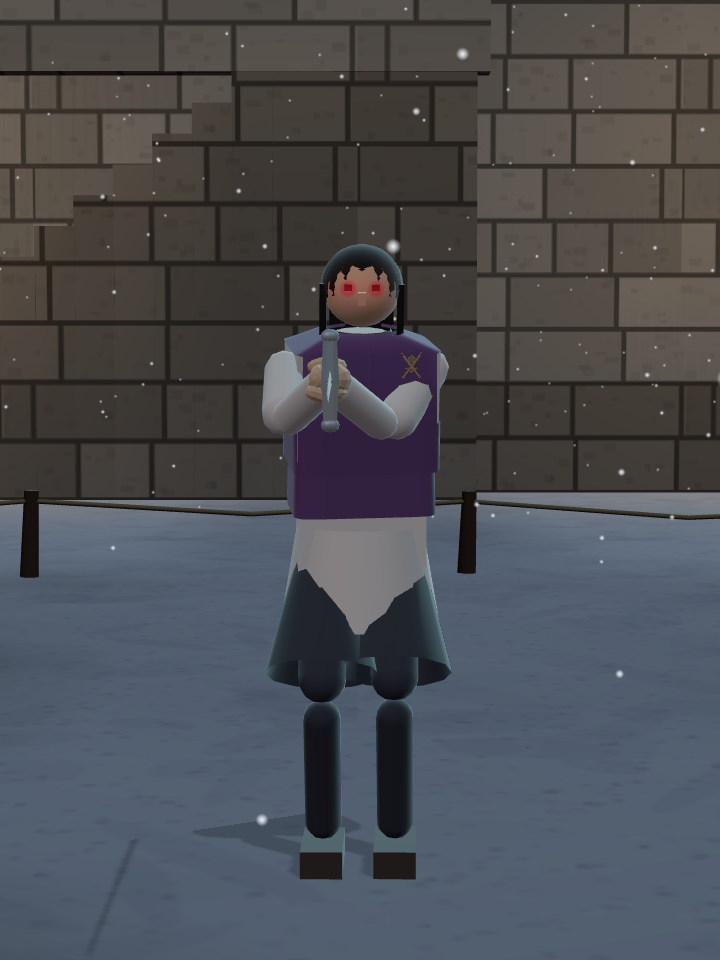

# 샛별 → 우화: 면적 확대 · 얼터와 밤 무대 10쌍

사장님의 2026-10-16 ‘여기까지 보냄’ 지시에 따른 전달본이다. **받는 쪽 최신 main을 먼저 기준으로 삼고 그 위에 이번 작업만 얹었다.** 우화 저장소에는 쓰지 않았다. 발행과 상대 열람·채택은 구별한다.

## 기준과 가져갈 범위

- 받는 본판: 우화 `eaf75841c165bc87d9d469c25a0afaaf4746e991`(스테이지 순서 4막).
- 원래 개발 소스: 샛별 `8233ac9403a95834a3413a7374f152910ab3bd83`; 기존 공개 게임 `2a13065a455c6b5116ccde48690413f0135e96f3`.
- 전달 가지: `yoonjl-svg/halfsword-codex`, **`codex/night-alters-handoff-20261016`**.
- 이 문서가 있는 가지의 `eaf75841..HEAD` **3커밋만** 가져간다. 샛별의 긴 개발 가지나 교환 기록 가지를 병합하지 않는다.

| 순서 | 커밋 | 내용 |
|---|---|---|
| 1 | `f5bc30da9763c87fb7b5a3739495344616e8ae95` | 바닥 면적 2배, 경계·지형 맞춤 |
| 2 | `2cd78f090d172bf76296cc02a93c580ce4bdaa7d` | 얼터·밤 무대·외형 후속·비·번개·천둥 최종 구현 |
| 3 | 이 문서와 함께 있는 후속 커밋 | 소개 4페이지/참조 자산, 검사 도구·결과·전달 설명 |

최종 40자리 HEAD와 정확한 범위는 발행 메시지에 고정한다. 1번은 별도 되돌림이 가능하도록 분리했지만, 이번 밤 무대는 확대된 경기장을 전제로 검토했다. 2번만 선택하려면 원래 면적에서 배치·경계를 다시 확인해야 한다.

## 이번 최종 상태

면적은 가로·세로 각각 √2배, 반지름 6.5→9.192388m다. 인물·무기 크기와 시작 간격 5.6m는 유지한다. 우화의 최신 청람잔도는 그대로 사용하며 확대된 바닥·경계 검사를 포함했다.

모든 밤은 현지 03:00, 장소마다 조명 외에 서사를 암시하는 요소를 최소 2개 둔다. 새 얼터 9명은 외양만 바꾼다. 원본 AI·힘·숙련도·무기를 복사하며 체력·적극성을 올리지 않는다. 기존 하인리히의 전투 수치는 유지한다.

| 짝 | 최종 외형 / 밤의 단서 |
|---|---|
| 하인리히 · 포세이돈 | 갑옷 배색·약해진 안광. 기존 소원 흔적 등 밤 서사는 보존 |
| 브론 · 화전 터 | 먹청색 작업복·플레이어와 같은 낮은 케틀 햇. 빈 노끈·아래 등불과 밤나방, 비 갬/젖은 바닥 |
| 이졸데 · 성 안뜰 | 원래 옷 위 앞트임 없는 보라 조끼·금실 창작 길드 문양, 기존 머리 형태의 어깨선 단발. 밤 훈련 흔적·외투/목검, 폭설과 큰 벽 횃불 16개 |
| 슈바르츠 · 대성당 | 상아색 갑옷·밝은 회색 머리, 뿔 양쪽 온전. 유해와 검이 사라진 관대·남은 투구/천·박쥐 |
| 토메 · 붉은 회랑 | 원본 포도주색 안옷·회베이지 겉옷, 외눈안경·금색 열쇠 2개. 열린 서고·찢긴 봉인지와 흩어진 책장 |
| 오마리 · 산호 항구 | 청록색 옷·해진 선장 외투. 좌초한 빈 배(위치 고정)·야광 파도. 낮/밤 모두 산호 확대·밝은 모래 혼합 |
| 미나미 · 신목의 숲 | 먹남색/회백색 옷·꺾인 신목 가지. 쓰러진 나무 3그루·뿌리 반딧불, 밤 사슴 제거/낮 유지 |
| 투야나 · 얼어붙은 만 | 깊은 후드·은발 일부/붉은 눈. 오로라·새끼곰, 어미곰 몸통만 5% 단축 |
| 랴오 · 산사 | 새 배색·양눈 전체 가림천/비치는 안광. 초승달·밤 방문 흔적 |
| 라트나 · 잠든 습지 | 붉은 자주색/밝은 황토색·연두색 이구아나·목덜미까지 덮는 회백 두건. 열린 수문/드러난 옛 돌길·돌로 누른 편지, 어두운 먹구름과 번개 |

브란의 표시 이름은 원본·얼터 모두 **브론 오소리**, 저장/참조 ID `bran`·`bran_mad`는 유지한다. 이졸데 문양은 금실 징금수를 참고한 교차검+다섯 잎 장미의 창작 인장이다. 실존 길드 문장의 복원이 아니다. 안광은 약한 일렁임·짧은 잔상을 사용한다.

밤 습지 최종 날씨/소리:

- 10초 구간마다 불규칙 섬광 1~2회. 첫 섬광 2~6초, 두 번째 확률 58%/간격 .65~3.7초.
- 그룹마다 천둥 확률 80%, **첫 섬광 뒤 2.3~4.4초**에 한 번. 소리 길이는 짧은 1.8초·구르는 3.8초·길게 이어지는 6.2초의 3종.
- 종류는 번개 시간과 독립된 난수, 직전 종류 제외. 강도 .55~.95, 최대 음량 유지. 종류별 같은 세기의 녹음과 실제 간격 80초 녹음도 동봉했다.
- 안개비 850개·낙하 .65배(약 4.23~6.18m/s), 옅은 크기/밀도 유지. 일시정지 때 날씨·소리 중단, 낮/다른 무대로 가면 정리.

## 연결과 기존 변경 보존

소스 변경은 총 36파일. 정확한 파일/해시는 [manifest](saetbyeol_night_2026-10-16/manifest.json)에 있다. 새 밤 모듈·외형 모듈·날씨 시계로 분리했으며 `main.js`는 안광 연결 **한 줄 교체**, `index.html` 변경 없음이다.

- `stages.js`: 밤 9개 빌더/이름/상대 추가. 기존 포세이돈 밤과 합쳐 10쌍. **우화 최신 4막 STAGE_ORDER는 그대로**이며 밤 9개를 여정에 임의 삽입하지 않았다. 소개 페이지의 해당 대련 링크 또는 `?stage=sluice_night&foe=ratna_mad` 등으로 확인한다.
- `config.js`: 면적 상수·반지름만 변경. 기력 값, 유파/보법·AI·입력·피해 공식 변경 없음. 먼저 보낸 기력 실제 접촉 전달 가지는 별도이며 이번 범위에 중복 수입하지 않았다.
- 우화의 최신 첫 화면·대기실·아이템·계정 OTP·스킬북 UI, 라이브러리/잠금 파일과 최신 청람잔도 소스 유지. 상속된 우화 기록을 샛별 성과로 집계하지 않는다.
- 새 localStorage 키/계정 데이터/외부 서비스 없음. `wetlandThunder` 이벤트와 `variant`를 소리 연결에서 소비한다. 무대 전환·음소거·일시정지 수명주기를 확인했다.
- 원래 사진·영상·오디오를 참조하는 소개 HTML 4개와 자산 121개(약 7.8MB)만 복사. 우리 옛 게임 페이지/계정 화면 전체를 덮어쓰지 않았다. 소개 사진은 원래 샛별 개발판 촬영이며 이번 우화 기준 통합판에서 전부 재촬영한 사진이라고 하지 않는다.

## 검증과 한계

결과와 stdout은 [checks](saetbyeol_night_2026-10-16/checks/)에 있다. Node 24.19.0, Three 0.186.0, Rapier 0.19.3, Chromium/SwiftShader의 로컬 프로덕션으로 검사했다.

| 검사 | 결과 |
|---|---|
| 변경 전 우화 eaf75841 공통 5관문 | 모두 통과 |
| 통합 후 공통 5관문 | 4개 기대값 동일. fights12만 면적 확대에 따라 `a071c0af`→`5dfe035c` |
| 원인 대조 | 통합 소스를 그대로 두고 메모리에서 ARENA.radius=6.5만 복원하면 fights12 stdout이 우화 원본과 바이트 동일(`a071c0af`) |
| 면적/지형 시뮬레이션 | 면적 2배, 잔해·용암/습지 경계 검사 통과 |
| 실제 렌더 27무대 | 바닥 2,592점·벽 3,456방향 검사, 누락/돌출/경계 실패/브라우저 오류 0 |
| 밤/낮 20무대 반복 전환 | 4회 순회 80생성, 마지막 순회 자원 수 동일. 새 얼터 원본 AI 9쌍·숙련도 45쌍 동일 |
| 습지 시계/소리 | 시간 간격, 종류 3개/비연속 반복, 강약, 기존 다른 무대 소리 보존 검사 통과 |
| 실제 습지 실행 | 비 속도/두건/기본 방어력 유지, 일시정지/재개, 낮 복원, 소리 3종/강약/정리 통과 |
| 소개 4페이지 | 모바일 가로/세로 8조건: 모든 사진 디코딩·넘침 없음·대련 링크·영상/오디오 길이 통과 |
| 우화 기존 대기실 도구 | 장착/해제·회전·저장/저장 거부·출발·화면 크기 등 11항목, 오류 0 |
| 빌드 | 성공. 기존 대형 청크 경고 있음 |

기대값을 통과시키려고 바꾸지 않았다. 따라서 기존 `stamina_gates.mjs on`은 의도된 fights12 차이 때문에 종료코드 1이며, 무조건 5관문 통과로 보고하지 않는다. 면적 변경으로 전투 경계/도달 동작 결과가 달라지는 것은 수신 검토에 포함해야 한다.

추가로 이졸데/라트나를 통합판 실제 게임에서 촬영했다. 아래는 로컬 통합판 관찰 카메라이며 기존 소개 사진과 출처를 구별한다.




실제 iPhone/Safari FPS·귀로 듣는 청감, 메일 인증 실전은 이번 검증 범위가 아니다. github.io에 대한 이 환경의 네트워크 제한으로 새 공개판 확인을 주장하지 않는다. 전달 가지는 공개 게임 main을 바꾸지 않으며 우화 채택/배포는 별도다.

재현 명령(저장소 루트, `npm ci`, `npm run build`, 로컬 preview와 dev 서버 준비):

```sh
node tools/sim/stamina_gates.mjs on /tmp/night-gates
node --input-type=module --eval 'const {ARENA,STAMINA}=await import("./src/config.js");ARENA.radius=6.5;STAMINA.on=true;await import("./tools/sim/fights12.mjs")'
node tools/sim/stage_area_check.mjs
node tools/sim/wetland_storm_check.mjs /tmp/storm.json
node tools/browser/night_variants_check.mjs http://127.0.0.1:4202 /tmp/variants.json poseidon_night,poseidon,clearing_night,clearing,castle_night,castle,cathedral_night,cathedral,loggia_night,loggia,corsair_night,corsair,sacred_grove_night,sacred_grove,frozen_bay_night,frozen_bay,temple_night,temple,sluice_night,sluice
SOURCE_BASE=http://127.0.0.1:4201 node tools/browser/wetland_weather_check.mjs http://127.0.0.1:4202 /tmp/weather.json
node tools/browser/night_second_delivery.mjs http://127.0.0.1:4202 /tmp/delivery.json
PW_CHROMIUM=/usr/bin/chromium node tools/browser/lobby_equipment_smoke.mjs http://127.0.0.1:4202 /tmp/lobby
```

소리 시계의 이전판 대조는 동봉 fixture를 사용한다. 다른 16종 소리 대조는 실제 우화 기준 조상 eaf75841을 사용하므로 샛별의 별도 과거 개발 이력을 가져올 필요가 없다.

## 되돌림

가져간 3커밋을 역순으로 revert한다(자료 → 밤/외형 → 면적). 새 저장 형식이 없으므로 데이터 마이그레이션/삭제는 필요 없다. 공통 `main.js` 연결, 소리 연결, `stages.js` 등록까지 각 커밋에 포함되어 있다. 이후 다른 기능을 얹었다면 revert 충돌과 그 기능의 의존을 확인한다.

원래 승인/후속 결정의 상세 이력은 [샛별 고정 소스 인계](https://github.com/yoonjl-svg/halfsword-codex/blob/8233ac9403a95834a3413a7374f152910ab3bd83/docs/codex_team/README.md)의 면적 확대부터 천둥 강약까지를 따른다. 기존 [검토 페이지](https://yoonjl-svg.github.io/halfsword-codex/night-encounters-4.html#thunder-sounds)는 이미 공개된 샛별판이며, 이번 전달 가지가 우화에 배포되었다는 뜻은 아니다.
