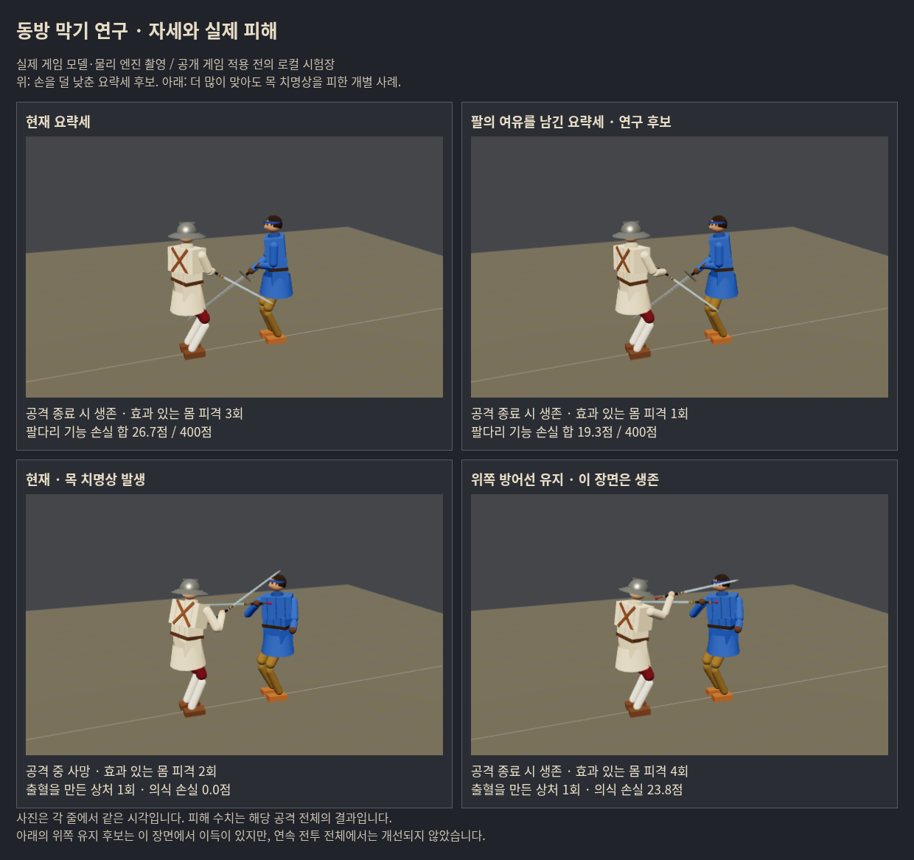

# 동방 막기: 피격 횟수보다 피해·생존으로 다시 평가

**가장 남길 가치가 있는 후보는 손을 덜 낮추고 상체를 덜 트는 요략세다. 방어 위주 조작에서는 생존 이득이 두 표본에서 관찰됐지만, 반격을 섞으면 유지되지 않았다.** 기존 읽기와 이 몸꼴만 조합한 `compact-native`를 후속 후보로 보존한다. 전체 전투의 개선이 확인됐다는 뜻은 아니며 생산 게임에는 적용하지 않았다.

사용자의 새 판단 기준을 적용했다. 약30초 종합 득실, 인간 플레이어의 이득, 실제 누적 피해와 치명도를 우선한다. 새 피격1건이나 완전 차단 실패만으로 후보를 탈락시키지 않는다. 상대는 기존 AI, 플레이어는 실제 막기·이동·탭 명령을 대본으로 입력한다. **실제 사람이 플레이한 결과도 AI끼리 대련한 결과도 아니다.** 사람의 조작을 단순화한 가정이다.

## 무엇을 바꿔 비교했나

기준 게임 `0bd04a51fe07d6e8b3a7d493e7d493dc6eb8ce8b`, 앞선 연구 `defab0bc`. 우리 포크 가지 `codex/chinese-parry-benefit-20261017`. 새 몸꼴은 사용자 허용에 따라 연구 도구 안에서만 바꾸었다.

| 후보 | 변경 |
|---|---|
| low-preview | 낮게 들어오는 칼을 보고 기존 요략세 미리 준비 |
| compact | 위 읽기 + 요략세 손을 덜 낮춤, 상체 비틀림 완화 |
| compact-native | **기존 읽기 + compact 몸꼴만** |
| hang | 자루를 더 높이고 앞에 칼을 드리우는 낮은 몸꼴 |
| cross / roof | highL의 새 전방 사선 / 가로 가림 몸꼴 |
| upper-retain / upper-peak | 손이 내려가도 실제 칼이 위에 남으면 위쪽 줄을 잠깐 유지 |
| speed20 | 동방 플레이어의 막기 손 패드 이동만4.5→5.4, 공격/AI/힘은 그대로 |

compact 손 목표는 가슴 기준 `[.20,-.48,-.08]→[.30,-.30,-.04]`, 칼 방향 `[-63,-54]→[-65,-50]`, 가슴 돌림−30→−15°, 숙임8→4°, 몸 낮춤.11→.08m. 팔을 덜 펴도 칼끝으로 낮은 공격을 가릴 수 있는지 시험했다. 새 자세를 역사 원전의 복원으로 주장하지 않는다. AI의 몸꼴·다른 유파·보법·비기 자동 연결은 변경하지 않았다.

## 30초 전투: 이득과 손해를 함께 본 결과

먼저 씨앗101~104, 상대 롱소드/청강검, 시작2.2m, 두 조작 유형16조건씩 선별했다. `compact-native`는 전체 사망9→6이어서 독립 검증으로 넘겼다. 다른 후보의 단일 공격 개선만으로 출시를 결정하지 않았다.

독립 조건은 새 씨앗201~204, 롱소드/청강검/**츠바이핸더**, 시작**1.9m**, 동일한 두 조작 유형으로24조건씩. 이 결과에 맞춰 수치를 다시 조정하지 않았다. 아래 수치는 판당 평균이며, 어느 한쪽이 패배하거나30초가 되면 판을 끝낸다.

| 독립24조건 | 현재 | 새 요략세만 | 미리 읽기+새 요략세 |
|---|---:|---:|---:|
| 플레이어 사망 |12|12|14|
| 상대 격파 |1|0|4|
| 혈액 손실 |25.3%|27.9%|27.2%|
| 팔다리 기능 손실 합 / 최대4 |0.962|1.079|0.963|
| 적용된 의식 손실 합 |0.458|0.510|0.602|
| 무릎·쓰러짐·일어나는 시간 |3.95초|4.72초|4.17초|
| 막기 기력 지출 |11.81|10.97|11.34|
| 실제 효과 있는 몸 피격 합 |381|374|363|

**피격은 줄었지만 전체 피해·사망은 개선되지 않았다.** ‘미리 읽기+새 요략세’는 격파도 늘고 사망도 늘어 더 극단적인 결과였다. 피격 수나 사망 하나만으로 모든 이득을 지우거나 단순 점수로 합치지 않았다.

조작별로 보면 중요한 차이가 있다.

| 새 요략세만(compact-native) | 선별 사망: 현재→후보 | 독립 사망: 현재→후보 |
|---|---:|---:|
| 움직이며 방어에 집중 |6/8→3/8|9/12→7/12|
| 방어 후 탭 반격 포함 |3/8→3/8|3/12→5/12|

따라서 **방어 특화 후보로 보존할 이유는 있다.** 다만 작은 표본이며 실제 사람의 조작 비중은 알 수 없다. 독립 방어형에서도 혈액 손실은28.17→28.12%로 거의 같고 팔다리 손실은1.048→1.160으로 늘었다. 생존 증가의 대가를 함께 본다. 반격형의 악화 원인이 자세→공격 전환 자체인지는 아직 분리하지 못했다. 몸 변화에 따라 상대 행동과 입력 대본의 후속 판단도 달라진다. 두 유형을 실제 인간의 사용 빈도처럼 평균내거나 한쪽 결과만으로 채택하지 않는다.

조기 사망/상대 격파로 노출 시간이 달라지므로 피해 평균만으로 우열을 정하지 않는다. 특히 사망자가 일찍 끝나 피해가 적게 기록된 경우를 이득으로 세지 않는다.

## 새 몸꼴의 물리적 진전과 남은 한계

올려베기1.1/1.5m, 접촉 .10~.35초 전을 .025초 간격으로 눌러44회 비교했다. 요략세가 완전히 적용된 구간의 어깨→손 목표 최대 거리는 현재**64.5cm**, 후보**51.5cm**였다. 물리 팔 길이는57cm이며 후보의 측정424프레임에서 길이를 넘은 프레임은0이었다. 기존 IK도 길이를 제한하므로 ‘팔을 늘렸다’는 변화가 아니라, 목표·상체·칼 조합을 팔이 닿을 범위로 옮긴 것이다.

그러나 두 버전 모두22입력에서 칼날 상처가 남았다. 입력 허용 구간의 확보나 자세 선택 문제 전체 해결로 부르지 않는다. 도달 가능한 목표와 실제 칼의 차단은 별개다. 측정에는 접촉 뒤 프레임도 포함된다.

## 더 많이 맞아도 더 나아진 실제 사례

청강검 역방향 베기,1.1m, .9417초 입력에서 위쪽 유지 후보는 **몸 피격2→4회**였지만, 목 치명상을 머리 둔타·작은 팔 상처로 바꾸어 생존했다. 현재의 목 상처 심각도2.487, 후보의 의식 손실.238/검 든 팔 기능 손실.015였다. 이 장면은 사용자 기준대로 분명한 부분 이득이다.

하지만 이 후보의 선별16연속 전투는 사망9→11, 출혈·팔다리 손실도 증가했다. 따라서 위 사례를 전체 개선으로 확대하지 않는다. 위쪽 준비 자세의 기억과 해제를 더 세밀하게 다뤄야 한다.

상단은 올려베기 .95초의 같은 순간, 하단은 위 치명상 사례1.175초의 같은 순간. 피해 수치는 공격 전체 결과다. 공개 게임에 적용된 화면이 아니라 실제 엔진을 사용한 로컬 연구판이다.

## 다음 개선의 우선순위

1. **도달 가능한 요략세를 출발점으로, 막기와 반격 전환을 함께 설계한다.** 방어에만 머물 때의 생존 이득을 공격으로 돌아갈 때 잃는지, 손/칼의 복귀 경로·반격 거리·입력 해제 시점을 분리해 확인한다. 현재 인과관계가 확정된 것은 아니다.
2. **손의 목표와 실제 칼날이 지나가는 시각을 구별한다.**3.008초에 막기를 눌렀는데 손 패드가 내려간 것을 따라 방어선이3.608~3.683초에 아래로 바뀌고, 실제 칼이3.792초 머리를 친 사례를 확인했다. 위쪽 줄을 오래 붙잡기만 해서는 낮은 공격의 손해가 커졌다.
3. 새 몸꼴/입력 여유의 이득은 혈액·의식·팔다리·생존과 반격 기회로 평가한다. 더 많은 피격을 허용하더라도 실제 손해를 줄이면 후보로 남긴다. 최종 우선순위는 실제 인간 플레이에서 방어 버튼의 이득으로 검증해야 한다.

## 계측·검증·범위

- 단일 공격570회(현재+9후보 각각57), 최대30초 전투200회(선별128+독립72), 입력 폭44회. 이 행들을 같은 분모의 독립 대전으로 합치지 않는다. 추가 범위/계측 검증과 중단한 초기 도구 실행은 별도다.
- 피해는 기존 `applyWound` 전후 변화로 계측. 혈액 손실, 적용된 의식/팔다리/균형 손실, 행동 제약 시간, 기력 지출을 따로 보존한다. 에너지나 깊이 합을 HP로 부르지 않는다. 혈액은1=100%, 팔다리는4부위 각각1, 의식 손실 합은 회복 사이 여러 번 맞으면1을 넘을 수 있다.
- 실제 입력 지연은 보이는 칼 속도/거리로 감지 후.16~.32초의 가정. 버튼 유지.65~1.10초+근접 동작 중 연장, 거리 조절 스틱, 반격형은 공격 후 쉬는 틈에 탭. 상대의 기술명/AI 모드/미래 피격을 조작 판단에 사용하지 않는다. 실제 인간 입력 기록은 없고 비기 자동 연결도 없다. 기력 시작100, 기존 플레이어 투구 물리 유지, 장비 최대기력 보너스·지형·여러 난이도는 이번에 비교하지 않았다.
- 초기 도구에서 스틱 원값/탈진 차단/탭 inputActive를 main과 대조해 수정. 초기 실행은 `pilot-v1`로 분리했고 최종 결과는 instrumentation2만 쓴다.
- 기본57조건이 이전 원자료의 상처·기력·생존·혈액과 정확히 일치. 유파/막기 책 범위9짝, 해제/거리밖4, 계측 유무1짝 통과. 실제 게임 버튼18검사 통과, 앱 예외0. 실제 엔진 사진4개의 피해 결과가 Node와1e−7 안에서 일치. 빌드/구문/차이 검사 통과.
- `src`, 공개 자산, 패키지, 엔트리는0bd04a51과 동일. 연구용 도구/문서만 변경. 공개판/우화/비기 연결 변경0. 사용자 결과 검토 전 우화 전달 없음.

[실행 전 계획과 단계별 가설](../../design/chinese_parry_benefit_prereg_20261017.md) · [계산 결과](report.json) · [파일 해시](manifest.json).

재현: `node tools/sim/chinese_benefit_screen.mjs`(기본4종, 나머지는 `KINDS`), `KINDS=base,compact,compact-native SEEDS=201,202,203,204 ATKS=longsword,qinggang,zweihander GAP=1.9 LABEL=confirm node tools/sim/chinese_benefit_live.mjs`, `node tools/sim/chinese_benefit_window.mjs`, `node tools/sim/chinese_benefit_verify.mjs`. 기본 출력 `/workspace/chinese-parry-benefit-20261017`.

화면: 기존 Vite4197에서 `node tools/browser/chinese_benefit_input_probe.mjs`, `node tools/browser/chinese_benefit_capture.mjs`. `node tools/sim/chinese_benefit_report.mjs docs/research/chinese_parry_benefit_20261017`로 압축 원자료에서 보고서를 재생성한다.
