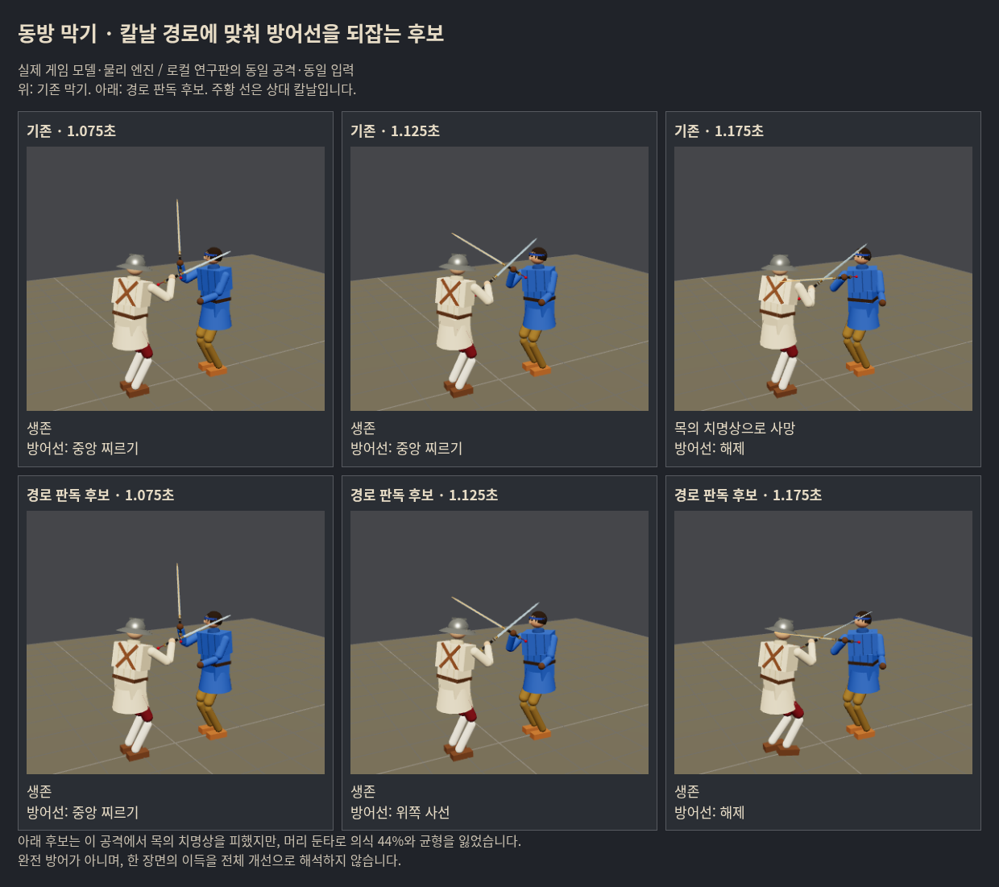

# 동방 막기 — 실제 칼날 경로·접점 보정 실험

2026-10-17. 사용자 ‘그래 해봐’에 따라 구현·비교했다. 부모 연구21148f78, 받은 게임 기준0bd04a51. **경로 판독·유지 후보는 치명상/의식 손실에서 진전이 있지만 팔 보호와 입력 여유가 해결되지 않았다.** 손5cm·칼15° 보정을 결합하면 오히려 악화했다. 경로 후보를 후속 연구의 기준으로 보존하며 전체 출시 개선으로 확정하지 않는다.

## 무엇을 구현했나

- 상대 손 목표 대신 **현재 칼끝·70% 지점의 위치/속도**로 칼날의 이동·회전을 짧게 예측한다. 머리·가슴·검을 든 팔로 내려오는 경로에서 위쪽 방어 방향을 고른다. AI 공격 이름·내부 준비 단계·미래 실제 충돌을 읽지 않는다.
- 읽은 위쪽 방향을 물리 접촉·칼의 이탈·새 아래 위협에 따라 유지/해제한다. 750ms는 낡은 잠금 상한이다. 버튼 해제·공격·탈진·무기 상실에는 즉시 놓는다.
- 별도 후보로 손 목표 최대5cm, 칼 방향 최대15°의 작은 접점 보정을 비교했다. 힘/서보 상한/피해/기력 공식은 그대로다. 기존 팔 목표보다 더 멀리 뻗는 보정은 거절한다. `maxHand`는 **요청한** 이동량이며 실제 적용을 보장하는 값은 아니다.
- 동방 막기 책을 사용하는 플레이어만 대상. 기존 몸꼴 정의/다른 유파/AI/보법/비기 연결은 변경하지 않았다. `src/fighter.js`에는 기본 제어기가 사용하지 않는 선택적 hook 두 줄만 추가했다. 연구 제어기는 실험 도구 또는 브라우저 import 교체로만 설치된다.

수치·범위·후보 선택을 먼저 기록한 [실행 전 설계](../../design/chinese_parry_contact_prereg_20261017.md)를 따른다. 독립 결과를 본 뒤 수치를 맞추지 않았다.

## 결과와 판단

첫 선별은 실제 위험 단일57조건×4안, 최대30초16조건×3새안(기준16은 이전 정확 재현 자료 재사용)이다. 단일/연속 전투/입력 검사의 분모를 합쳐 성공률로 만들지 않는다.

| 최대30초 선별16조건 | 기존 | 경로만 | 위치 보정만 | 결합 |
|---|---:|---:|---:|---:|
| 플레이어 사망 | 9 | **6** | 8 | 11 |
| 무기 상실 | 8 | 7 | **4** | 7 |
| 상대 격파 | 3 | 0 | 1 | 1 |

생존 신호가 가장 큰 **경로만(path)**을 유일한 독립 후보로 선택했다. 위치 보정만의 무기 유지 이득도 부분 결과로 보존하되 이번에 더 확대하지 않았다. 결합안의 적은 혈액 손실은 더 이른 사망에 따른 노출 감소가 섞이므로 개선으로 해석하지 않았다.

새401~404·롱소드/청강검/츠바이핸더·방어/반격형·시작1.9m, 총24조건씩 최대30초 비교:

| 독립24조건 | 기존 | 경로 후보 |
|---|---:|---:|
| 플레이어 사망 | 11 | **9** |
| 누적 의식 손실 평균 | .481 | **.285 (약41% 감소)** |
| 누적 팔다리 기능 손실 평균 | **.717** | .860 (약20% 증가) |
| 무기 상실 | **11** | 12 |
| 혈액 손실 평균 | 19.68% | 19.50% |
| 다운/무릎/일어남 시간 평균 | 2.101s | 2.085s |
| 상대 격파 | **4** | 3 |
| 반격 입력(탭) | 42 | 55 |
| 막아 받기 비용 평균 | 11.25 | 10.31 |

기존 사망을 피한 조건3, 새로 사망한 조건1이다. **한 회귀 때문에 자동 탈락시키지 않지만, 생존2회 개선만으로 종합 순이득을 확정하지도 않는다.** 반격 입력은 늘고 상대 팔다리 피해도 늘었지만 격파는 감소해 반격 품질 개선은 확정할 수 없다.

- 방어형12: 사망6→5, 의식 손실.669→.324. 팔다리.706→1.108·무기 상실6→8·혈액19.8→23.9%는 손해다.
- 반격형12: 사망5→4·팔다리.728→.613·무기 상실5→4·혈액19.6→15.1%는 이득. 격파4→3·다운1.126→1.222s는 손해다.
- 총 노출시간509.17→526.99s이며 사망/상대 격파 때 종료한다. 각 짝의 같은 종료시각까지만 적용 상처를 비교해도 팔다리.635→.791, 의식.437→.253이다. 팔다리 악화는 오래 살아서 더 맞은 것만으로 설명되지 않는다. 혈액/의식/팔다리는 서로 다른 실제 효과이며 임의의 ‘HP 총점’으로 합산하지 않았다.
- 이 명령 모형에서는 음수 기력/탈진이 발생하지 않았다. 실제 탈진 전투의 균형이나 모바일 체감을 검증했다고 하지 않는다.

## 인간 입력 여유

청강검 사선 내려베기, 무방어 접촉 전100~300ms를25ms씩 바꿔1.1/1.5m에서 각9입력, 기존/후보 총36조건을 비교했다.

- **1.1m:** 베임 없는 입력4/9→2/9. 평균 의식 손실.174→.063은 이득이나 팔다리.024→.095는 손해다. 입력 이후 아무 상처도 없는 조건은1→0이다. 가까운 거리의 입력 여유 개선은 입증하지 못했다.
- **1.5m:** 무상처7/9 그대로.250/275ms 입력의 팔 기능 상실도 그대로다.
- 단일 공격57조건에서는 사망1→0이나 팔다리 손실.139→.148이었다. 단일 장면 이득을30초 결과 또는 실제 사람 체감으로 환산하지 않는다.

**판단:** 실제 칼날 경로를 읽어 방어선을 되잡는 방법은 계속 개발할 가치가 있다. 아직 ‘버튼을 믿고 누를 수 있는 동방 막기’가 완성된 것은 아니다. 후속 우선은 경로 후보가 머리 피해를 줄이는 대신 검 든 팔을 노출하는 접촉 순간을 좁혀, 기존 몸꼴의 칼 중간 부분이 팔 앞을 먼저 덮도록 맞추는 것이다. 이번의 일괄5cm/15° 보정을 확대하거나 유지시간만 늘리는 방식은 추천하지 않는다.

## 실제 화면

아래는 실제 게임 모델/물리 엔진에서 같은 입력·같은 공격을 찍은 로컬 연구판이다. 위 기존, 아래 경로 후보. 칼을 주황 선으로 표시했다. 사진 재생 결과의 실제 피해·기력·방어 전환이 Node 원자료와 정확히 일치한다. Three 렌더링 난수는 물리 난수와 분리했다.



청강검 talhoReves·1.1m·200ms 앞 입력: 기존1.142초 목 치명상 → 후보 머리 둔타. 의식44%와 균형 손실이 남으므로 완전 방어라고 부르지 않는다. 시뮬레이션 전체에 공개 게임과 같은 피해 판정을 사용했다.

## 검증과 한계

- 공통5관문 전후 모두 exit0. 출력 동일하며 `corr_s0`의 벽시계 실행시간29.8→37.5s만 다르다. 해시 비교에서는 이 시간 문자열만 정규화했다.
- 이전 기준57조건의 피해·기력 정확 일치. 다른 유파/막기 책 없음9짝 일치. **실제로 경로 잠금이 걸린 후** 버튼 해제/공격/탈진/무기 상실/거리 이탈10검사 통과.
- 실제 게임 페이지의 버튼/키·탭·회복·공격 비용·연결/비기 미발동18검사, 브라우저 오류0. 빌드 통과(기존 큰 bundle 경고 유지).
- 각 비교는4개의 결정적 난수 씨앗에서 파생한 명령 조건이다. 독립적인 인간24명의 승률이나 통계적 확정으로 말하지 않는다. 인간은 직접 플레이하지 않았다.
- 예측은180ms 이내의 현재 강체 속도 근사이고 회전 외삽 상한.85rad가 있다. 몸의 실제 충돌체 대신 부위 중심·근사 반경으로 거른다. 칼끝 속도2.5m/s 미만이면 예측이 빠지며 접촉이 없는25ms 이후 잠금이 풀릴 수 있다. 느려진 근접 칼을 끝까지 읽는 보강도 남아 있다.
- `path`, `fit-only`, `path-fit` 모두 연구용이다. **공개main·우화 변경/발송0**. 사용자의 화면 검토 전에 우화에게 전달하지 않았다.

## 재현·되돌림

```sh
# 이 연구 가지와 의존성 설치 후
KINDS=base,path,fit-only,path-fit LABEL=screen node tools/sim/chinese_contact_trials.mjs
KINDS=path,fit-only,path-fit LABEL=explore node tools/sim/chinese_contact_trials.mjs
KINDS=base,path LABEL=confirm SEEDS=401,402,403,404 ATKS=longsword,qinggang,zweihander GAP=1.9 node tools/sim/chinese_contact_trials.mjs
node tools/sim/chinese_contact_timing.mjs
# Vite 4197 구동 후 (브라우저 스크립트 BASE로 주소 변경 가능)
node tools/browser/chinese_contact_input_probe.mjs
node tools/browser/chinese_contact_capture.mjs
node tools/sim/chinese_contact_verify.mjs
node tools/sim/chinese_contact_report.mjs docs/research/chinese_parry_contact_20261017
```

`CONTACT_OUT`으로 시뮬레이션 출력 경로 변경 가능. 기본은 `/workspace/chinese-parry-contact-20261017`. 보고/검증은 저장된 gzip 원자료도 읽는다. 단일 조건 정의는 이전 `chinese_player_parry_20261017` 위험 자료에 의존한다. 재현 환경 Node24.19·Rapier0.19.3·120Hz·Three0.186.1. 브라우저는 시스템 Chromium/Playwright가 필요하다.

연구 import 교체를 사용하지 않으면 기본 게임은 기존 제어기다. 이번 연구 커밋을 되돌리면 두 선택적 hook과 도구/자료도 제거된다. 부모 연구 결과는 그대로 보존한다. [기계 집계](report.json) · [검증](verification.json) · [파일 해시](manifest.json)
