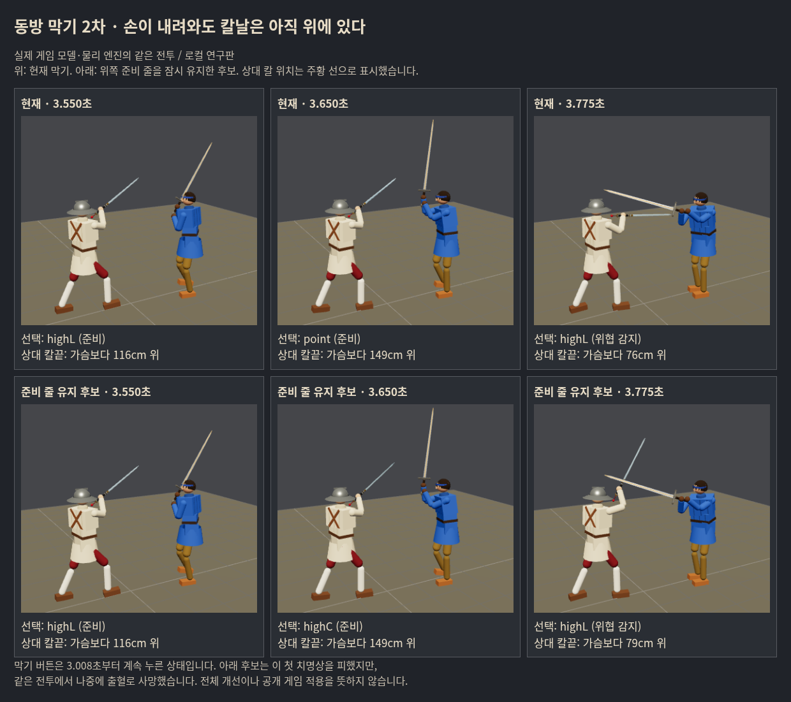
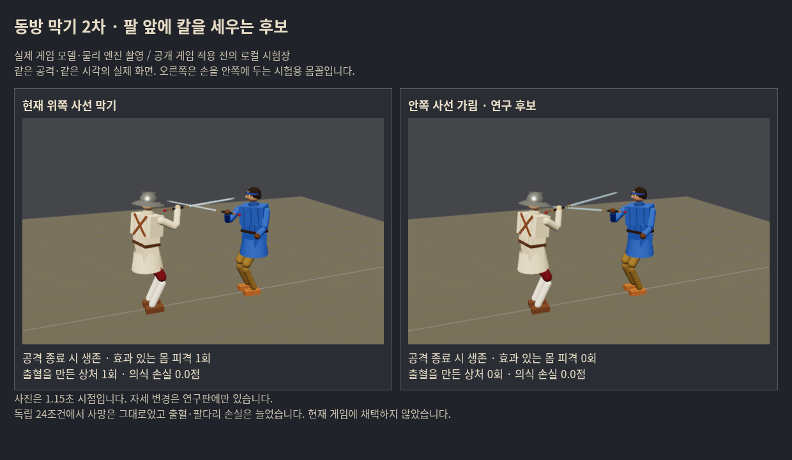

# 동방 막기 2차 — 가장 큰 빈틈과 개선 가능성

**지금 우선 고칠 빈틈은 ‘버튼을 유지해도 방어선이 안정되지 않아 검을 든 팔을 내주는 것’이다.** 특히 상대 손의 위치와 실제 칼날 위치가 어긋나는 사선 내려베기에서, 위쪽 준비 → 가운데/아래 → 위쪽 막기로 되돌아가는 전환이 반복된다. 단순히 늦게 눌렀거나 유지시간이 짧아서 생기는 문제로만 설명할 수 없다.

이것은 기준 전투를 재생한 범위에서의 연구 우선순위다. 모든 실제 인간 전투에서 가장 흔한 원인이라는 통계적 결론은 아니다. 새 몸꼴은 반격형 조작에서 부분 가능성을 보였으나 전체 순이득은 아직 입증하지 못했다. **게임 채택0, 우화 전달0.**

## 1. 마지막 치명상보다 앞선 팔 손실

기존 연구의 최대30초 전투40조건(선별16+독립24)을 다시 재생했다. 계측을 추가해도 플레이어/상대 피해·생존·기력·명령이 원자료와 정확히 같았다.

- 막기 제어가 실제 작동하는 동안 검을 든 팔의 기능을 깎은 상처가50건 있었다. 이것은50번의 독립 공격/막기 실패가 아니라 적용된 상처 건수다.
- 그중15건 직전에는 **칼끝이 가슴보다50cm 이상 높은데 준비 줄이 가운데/아래를 거친 뒤 위쪽으로 복귀**하는 기록이 있었다. 이15건은 방어 중 검을 든 팔의 기능 손실 중 약48%를 차지했다. 샘플링은50ms, 직전250ms를 조사했다. 연관성을 뜻하며 그 전환만이 피해의 유일한 원인이라는 증거는 아니다.
- 전체 사망21조건 중13조건은 무기를 잃은 상태로 끝났다. 검을 든 팔의 기능 저하는 실제로 무기 낙하를 일으킨다(`fighter.js applyWound`). 무기 상실 뒤에는 버튼을 눌러도 막기 제어가 작동하지 않는다. 이13건 모두를 처음 팔 상처 하나의 인과로 환산하지는 않는다.
- 실제 방어 중 팔다리 기능 손실 합25.633 중 검을 든 팔15.817(약62%). highL 줄은 방어 중 의식 손실4.055/7.095(약57%)·팔다리 손실8.154/25.633(약32%)를 차지했다. 서로 다른 공격 빈도/거리/노출 시간이므로 고유 실패 확률로 해석하지 않는다. lowL의 출혈 손실도 커서 아래 방어를 포기해서는 안 된다.

현재 기다림/따라가기는 상대 손의 패드 좌표를 보고 준비 줄을 정한다. `threatNow`는 실제 칼끝/타격점의 투영으로 위협을 감지하지만, 두 판단은 같은 시점에 바뀌지 않는다. 방어선이 먼저 내려가고, 실제 위협 감지는 나중에 위쪽 줄을 요구하는 구간이 있다. “줄이 highL로 표시된다”와 “칼이 실제로 그 공격을 가리고 있다”는 다르다.

## 2. 실제 장면

씨앗103/롱소드/방어 위주/초기거리2.2m. 막기 버튼3.008초부터 유지. 현재 판은3.65초에 point 준비 줄로 이동하고3.79초 머리 치명상. 준비 줄 유지 후보는 그 첫 치명상을 피하지만 같은30초 전투에서23.71초 출혈로 사망한다. **한 치명상을 막은 이득은 인정하되 전투 전체 생존 개선으로 부르지 않는다.**

사진은 실제 Three/Rapier 모델과 계산을 사용한 연구 시험장이다. 주황 선은 실제 상대 칼날 위치를 읽어 표시한 해설선이다. 최종 사진의 Node/브라우저 피해·사망·기력은 정확히 일치한다.

## 3. 네 후보의 득실

첫 두 후보는 몸꼴/힘/속도를 바꾸지 않았다. 뒤 두 후보는 위쪽 사선 highL 몸꼴만 바꾸며, 기다림 시간 수정과 섞지 않았다.

| 후보 | 변경 | 선별16조건 사망 | 평균 혈액 손실 | 평균 팔다리 기능 손실 합 |
|---|---|---:|---:|---:|
| 현재 | 기준 | 9 | 21.9% | .836 |
| delay12 | 준비 줄 판단에120ms 전 손 위치 사용 | 9 | 23.3% | .925 |
| gate20 | 실제 칼이 위에 남으면 위쪽 준비 줄 최대200ms 유지 | 10 | 22.5% | .802 |
| inside | 손을 안쪽에 접고 칼을 왼 위로 세우는 몸꼴 | 8 | 19.4% | .770 |
| inside-ready | 같은 새 몸꼴을 준비 단계에도 적용 | 13 | 19.0% | .606 |

inside-ready의 작은 피해 합은 더 빨리 죽어 노출 시간이 줄어든 영향도 있다(총 관측232.5초, 기준339.0초). 피해 수치 하나로 우수하다고 고르지 않는다. 팔다리는 각각1인 네 부위의 실제 감소 합이며 HP 점수와 다르다.

inside가 상대적으로 유망하여 **새 씨앗301~304·3무기·2조작·거리1.9m,24조건**에서 검증했다. 결과를 보고 그24조건에 맞춰 조정하지 않았다.

| 독립24조건 | 현재 | inside |
|---|---:|---:|
| 사망 / 상대 격파 | 13 / 1 | 13 / 1 |
| 무기 상실 | 11 | 11 |
| 평균 혈액 손실 | 27.3% | 28.9% |
| 평균 팔다리 기능 손실 합 | .945 | 1.079 |
| 평균 적용 의식 손실 | .518 | .463 |
| 평균 쓰러짐·무릎·일어남 시간 | 3.49초 | 4.82초 |
| 평균 막기 비용 | 8.16 | 7.03 |

의식 손실은 줄었지만 출혈/기능 손실/행동 제약은 늘었다. 총 피격332→328만으로 개선이라 할 수 없다. 현재로서는 전체 채택 근거가 부족하다.

다만 사용자 원칙대로 부분 이득은 보존한다. **반격을 섞는12조건**에서는 사망6→6, 무기 상실6→3, 혈액 손실30.4→25.8%, 의식 손실.345→.309였다. 반대로 방어 위주12조건은 무기 상실5→8·혈액24.1→32.1%로 악화했다. 이는 새 몸꼴을 반격형 후속 후보로 남길 이유이며, 전환 자체가 이득의 원인이라고 확정하거나 바로 조건부 적용할 이유는 아니다. 물리 변화 뒤 상대 행동과 관측 기반 입력도 달라진다.

## 4. 인간의 입력 여유

청강검 사선 내려베기/거리1.1·1.5m에서 무방어 첫 베임보다100~300ms 앞에 누르는9시점(25ms 간격)을 비교했다. 총36시행.

- 1.1m: 베임 없는 입력4/9→1/9. 대신 평균 팔다리 손실.0241→.0065, 의식 손실.1745→.1378. 베임 수와 피해 크기가 서로 다른 방향이다.
- 1.5m: 베임 없는 입력7/9→7/9, 무기 상실2→1. 그러나 베임이 없는 시점의 배열은 달라져 연속된 안전 입력폭 확대를 입증하지 못했다.
- 새 몸꼴의 완전 적용 highL 구간 손 목표는 최대35.2cm로 물리 팔57cm 안. 범위 밖0/26프레임. 접촉 뒤 프레임도 포함하며, 이 수치가 전환 전체의 안전을 증명하지 않는다. 기준 highL에는 덧씌우기가 없어 같은 기준의 계측 프레임0이며 팔길이0이라는 뜻이 아니다.

사람에게 유리하려면 단순 평균보다 **적당히 일찍 눌렀을 때 피해를 적게 받는 구간의 연속성**, 준비/방어/반격의 조작 부담도 필요하다. 이번 입력 모형은 실제 사람 기록이 아니므로 체감 개선은 미확정이다.

## 5. 개선 가능성과 다음 우선순위

가능성은 있다. 한 번의 머리 치명상을 둔타로 바꾸거나, 반격형에서 팔과 무기를 보존하는 이득은 실제로 관찰됐다. 하지만 **정해진 자세를 더 오래 유지하거나 더 빨리 취하는 것만으로 안정적인 동방 막기가 되지는 않았다.**

다음은 ‘자세 이름 선택’과 ‘실제 받아낼 위치’를 분리한 작은 물리 보정이 우선이다. 기존 동방 몸꼴을 바탕으로, 현재 관측되는 칼날의 선분·속도에 맞춰 손과 칼 각도를 좁은 범위에서 조절하여 **검을 든 팔 앞에서 먼저 접촉**하게 한다. 접촉/실제 이탈을 확인하기 전에는 손 목표만 보고 반대쪽 준비로 먼저 넘어가지 않게 한다. 상·하 방향을 무조건 잠그면 올려베기에 약해지는 비용도 함께 검사해야 한다.

이것은 **다음 연구 가설, 미구현**이다. 공격 이름/AI 의도/미래 접촉 시각을 미리 읽거나, 피해 무효 판정·추가 방어 확률을 넣는 안이 아니다. 새 후보는 약30초의 생존·출혈·팔 기능·반격 기회와100~300ms 입력 오차에서 비교한다. 비기 자동 연결은 이번에 구현하지 않았다.

## 6. 재현과 검증

- 기준 소스 `0bd04a51fe07d6e8b3a7d493e7d493dc6eb8ce8b`, 부모 연구 `64ffa8339148f2d69f2a5f5a15b789705431ba34`.
- 사전 설계: [후보 고정·순서·제외 자료](../../design/chinese_parry_gap_prereg_20261017.md).
- 기준 재생40, 단일 공격285(기준+4후보×57), 새 선별 전투64, 독립 전투48(기준·후보 각24), 입력폭36. 이들을 독립 인간 대전473판으로 합쳐 부르지 않는다. 조작 두 종류가 같은 첫 교전을 공유하는 조건도 있다.
- 계측40조건 원자료 정확 일치, 기준57 물리/피해/기력 일치, 다른 유파/막기 책 없음6짝 동일, 해제·범위·공격 비용4검사, 브라우저 실제 버튼18검사, 사진4장면 Node 피해 동일. 빌드·구문·차이 검사 통과. 기존 물리 공통5관문은 게임 소스 미변경으로 재실행하지 않았다.
- 사진 첫 시안은 객체 생성이 물리 난수를 소비해 결과 불일치. `raw/pilot-visual-*`로 분리/결론 제외 후 시각화 난수를 분리하여 다시 촬영했다. 촬영 없는 실험 원자료는 영향 없음.
- 원자료 압축/해시: `raw/`, `manifest.json`. 요약: [report.json](report.json).
- `node tools/sim/chinese_gap_report.mjs docs/research/chinese_parry_gap_20261017`로 압축 자료에서 보고서 재생성 가능.
- `KINDS=base,delay12,gate20,inside,inside-ready node tools/sim/chinese_gap_trials.mjs` 단일 공격. `LABEL=confirm SEEDS=301,302,303,304 ATKS=longsword,qinggang,zweihander GAP=1.9 KINDS=base,inside node tools/sim/chinese_gap_trials.mjs` 독립 전투.
- Node24.19/Rapier0.19.3/Chromium. 실험은 실제 막기/스틱/탭 API를 쓴 명령 모형+상대 AI이며 AI끼리 대련이나 인간 플레이테스트가 아니다.

공개판·우화 저장소·생산 src/assets·비기 연결을 바꾸지 않았다. 사용자가 검토하기 전 우화에 발송하지 않는다.
