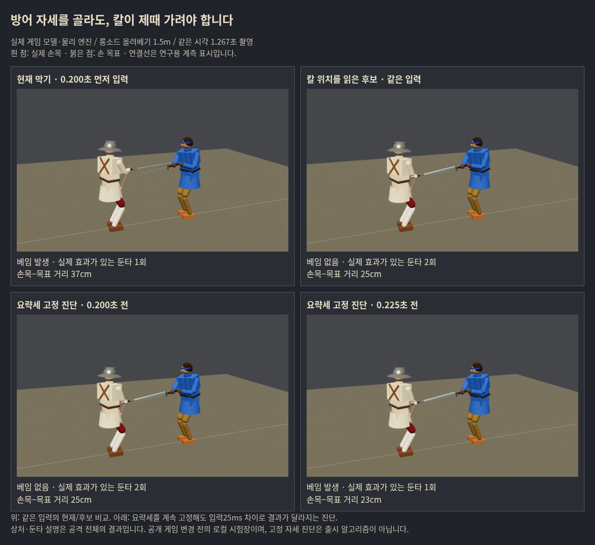

# 동방 방어: 칼 경로·자세 선택·실제 도착 연구

**이번 연구에서 안정적인 입력 구간을 확보한 출시 후보는 없다.** 칼의 실제 위치를 읽으면 일부 공격은 더 일찍 준비하지만, 자세 선택을 고정해도 입력25ms 차이로 베임이 생겼다. ‘칼날 상처가 없었음’ 중에도 실제 둔타가 남아, 이를 완전한 막기 성공으로 세면 플레이어의 손해를 놓친다.

기준은 사람의 경험이다. 아래는 사람이 막기 버튼을 누르는 시점을 재현한 물리 시험이며 실제 인간 플레이/승률 통계가 아니다. 동방 비기 자동 연결은 미래 계획으로만 두었다. 공개 게임/우화 저장소/메시지는 변경하지 않았다.

## 기준·범위

- 연구 시작 `204ef85738f873e59c83c13f1dbda1286023bc63`, 실제 게임 소스 `0bd04a51fe07d6e8b3a7d493e7d493dc6eb8ce8b`.
- 우리 포크 `codex/chinese-parry-path-20261017`. 이전 연구와 같은 기준을 유지해 원인 비교 중에 새 상류 변경을 섞지 않았다.
- 플레이어 청강검, 기력 장부는 이전에 고친 `playerModel:true`. 기존 몸꼴/보법, 손 패드 속도4.5, 무기/피해/기력 수치는 보존했다.
- 네 읽기 후보는 `tools/`에서만 선택 기준을 바꿨다. 별도 물리 진단 한 가지는 **막는 동안에만 공격용 손목 앞섬을 .5→0**으로 했으며, 읽기 후보나 출시안과 구별했다. 이 진단도 악화되어 미채택이다.
- [실행 전 가설과 확대 기록](../../design/chinese_parry_path_prereg_20261017.md), [계산 결과](report.json), [해시·검증 기록](manifest.json).

## 1. 선택 문제와 자세의 한계를 먼저 분리했다

이전 위험19공격에서 무방어 첫 칼날 상처 .20초 전에 누르는 조건을 사용했다. 기존6줄을 하나씩 처음부터 고정하는114회 진단이다. 미래 공격에 맞춘 고정은 원인 분리용이며 실게임 후보가 아니다.

현재9실패 중4개는 어떤 기존 줄을 고정하면 칼날 상처가 없어졌다.5개는 여섯 줄 모두 실패했다. 그5개를 .30초 전 입력으로 다시 검사하자2개는 칼날 상처를 피했지만, 가로베기3조건은 여전히 전부 실패했다. **기존 자세를 일찍 고정한 범위의 한계**이며 어떤 동적 방어로도 불가능하다고 단정하지 않는다.

구체적으로 롱소드 올려베기1.5m: 누르는1.042초에 칼끝은 가슴보다 약1.2m 아래인데, 손 패드가 중립이라 현재 읽기는 기다렸다.1.125초에야 lowL을 골랐고1.242초에 다리를 맞았다. 칼 위치로 준비를 앞당길 명확한 사례다.

## 2. 실시간 읽기 후보4개

상대의 현재/과거 칼끝·타격점 위치/속도만 사용했다. AI 기술명·대본 단계·미래 상처 시각은 실시간 후보에서 읽지 않는다.

| 후보 | 위험57조건의 칼날 상처 | 기준에 없던 새 상처 | 결과 |
|---|---:|---:|---|
| 현재 |35|—|기준|
| 칼 높이·좌우로 모든 줄 선택 |36|7|탈락|
| 같은 선택 + 실제 접근 중 짧게 유지 |34|6|탈락|
| 낮은 왼쪽 칼을 보고 요략세만 미리 준비 |33|0|독립/입력 폭 검사로 확대|
| 예측 칼 경로와 기존6자세의 방어선 직접 대조 |41|10|탈락|

요략세 후보 `low-preview`는 칼끝/70% 타격점 중 낮은 점이 가슴−.55m·왼쪽 .08m 밖이면 lowL을 준비하고,−.15m 위 또는 오른쪽 .15m 밖이면 푼다. 거리 범위는 상대 reach+.3m다. 나머지 줄에는 기존 읽기를 쓴다. 단순히 막기 확률을 올린 것이 아니다.

예측 대조 `sweep-fit`은0~.24초의 칼 선분을 외삽하고 각 기존 자세의 손/칼 목표와 거리·이동량을 비교했다. **목표의 기하가 맞아 보여도 실제 손과 칼의 도착을 보장하지 못했다.** 결과가 나빠 작은 선별에서 중단했으며 물리/자세 값을 바꿔 통과시키지 않았다.

## 3. 독립 조건에서는 일부 개선과 새 손해가 함께 나왔다

새 거리1.25/1.65m·속도9/13·롱소드/청강검·8공격64개를 먼저 무방어로 측정했다. 무방어에서 칼날 상처가 난18개에는 타격 .15/.25/.35초 전 입력, 나머지46개에는 .90초 입력을 사용해 총100조건/버전을 비교했다. 이 세트의 결과로 후보 수치를 다시 맞추지 않았다.

| 지표 | 현재 | 요략세 미리 준비 |
|---|---:|---:|
| 칼날 상처 조건 |34/100|30/100|
| 무방어 칼날 상처군의 칼날 상처 |30/54|25/54|
| 입력 뒤 실제 효과가 있는 몸 피격 |65/100|62/100|
| 막기 비용 합계 |126|137.25|

구제한 칼날 상처5개, 새 상처1개다. 새 상처는 **원래 베임 없이 둔타로 맞던** 롱소드 올려베기1.65m/속도9였다. 무방어 원자료에는 복부35.17J/팔12.63J 등의 둔타가 있다. 칼날 상처 없음으로 나눈 나머지46공격에도 둔타 위험은 있을 수 있다. 앞선 진행 보고의 ‘원래 빗나갔다’는 표현을 이 기록으로 정정한다. 앞선 별도64조건에서도16→15지만 새 상처1개가 있었다. 평균 개선만으로 출시하지 않는다.

## 4. 입력 오차를 견디는 폭은 확보하지 못했다

실패를 집중해서 고른6공격에 타격 .10~.35초 전 입력을 .025초 간격11시각으로 시험했다(120Hz 프레임 반올림). 총66조건/버전. 이는 전체 게임의 막기 성공률 표본이 아니다.

롱소드 올려베기1.5m에서 현재는11시각 모두 베임. 요략세 후보는 **.20/.30초 두 시각만** 베이지 않았고, 사이의 .225/.25/.275초는 실패했다. .025초 간격에서조차 연속된 안전 폭을 얻지 못했으므로 더 미세한120Hz 전수 검사를 성공 증명처럼 확대하지 않았다.

같은 공격에서 lowL을 처음부터 끝까지 고정해도 .20/.30/.35초만 칼날 상처를 피했다. 이 실패를 전부 ‘읽은 줄이 중간에 바뀌어서’라고 설명할 수 없다. 힘이나 막기 속도를 올린 후보로 덮지 않았다.

## 5. 실제 도착과 몸 피격에서 추가로 확인한 것

고정 요략세3시각(.20/.225/.30초)의 자세 적용 뒤~타격 전57프레임 모두 손 목표가 실제 어깨에서 팔의 최대 물리 길이 .57m 밖이었다. 초과는 최대 **약6.7cm**, 전환 중 손목−목표 간격은 최대 약56~58cm였다. 칼 방향 오차도 컸다.

이는 모양이 즉시 실현되는 것이 아니라 관절·몸 움직임·충돌을 거쳐야 한다는 근거다. **기존 armIK는 이미 길이 밖 목표를 잘라서 푼다.** 따라서 목표를 단순히6.7cm 당기면 해결된다고 단정하지 않는다. 손·칼 방향·상체가 함께 도달 가능한 조합인지와 전환 경로를 검토해야 한다. 무기 충돌 뒤의 큰 오차를 모두 사전 도착 지연이라고 해석하지도 않는다.

더 중요한 플레이어 지표: .20초 고정은 베임 대신 골반39.8J/다리14.7J 둔타, .30초는 다리28.2J/골반12.0J 둔타가 남았다. 기존 게임은 둔타10J 초과에도 통증·균형 등의 효과를 적용한다(`combat.js`의 applyWound 조건). **베임 감소와 실제 타격 차단을 구별한다.** 집중한6공격66입력은 두 버전 모두 입력 후 효과 있는 몸 피격이 있었다.

별도 원인 진단으로 플레이어가 막는 동안 공격용 `ARM.servoLead`만0으로 해 보았다.57조건36칼날 상처/신규6으로 악화했다. 고정 요략세 입력 폭 일부가 넓어져도 다른 공격의 손해와 둔타가 남았다. 이 한 값을 끄는 수정은 채택하지 않는다.

## 실제 화면

실제 모델·Rapier·Three.js 촬영이다. 흰 점은 실제 손목, 붉은 점은 손 목표이며 표식만 연구용으로 덧그렸다. 같은1.267초 화면이고 피격 설명은 공격 전체 결과다. 오른쪽 위를 ‘완전 방어 성공’으로 읽지 않는다.

## 판단과 후속 우선순위

1. **동방 몸꼴의 목표와 실제 팔·칼 도착을 먼저 맞춰야 한다.** 특히 요략세의 도달 가능한 손 위치/칼 각도/상체 조합과 전환 중 방어선을 함께 본다. 원전 외양을 유지할지와 실제로 막히는지는 별개 검증이다. 이번에는 원본 몸꼴을 바꾸지 않았다.
2. 그 뒤 관측한 칼 경로→자세 선택을 결합한다. 이번 낮은 칼 미리 읽기의 부분 이득은 보존하되, 새 부상과 입력 폭 실패가 있어 그대로 출시하지 않는다.
3. 후속 채택 기준에는 **칼날 상처, 효과 있는 둔타/균형 손실, 막기 비용, 연속 입력 구간**을 함께 넣는다. 비기 연결을 단순 칼 접촉/버튼 상태로 판정하지 않는다. 자동 비기는 미구현이다.

## 검증·보존·재현

짧은 물리 시험1005회(보존941행+범위 비교 기준4회+파일 복구/추가 계측 반복60회), 실제 대전1005판이 아니다. 브라우저 검사는 별도다.

실제 게임 버튼/모바일 탭 경로 기준·후보 각각9항목 통과(총18), 앱 예외0. 버튼 놓기12조건·다른 유파/막기 책 없음4짝·거리 밖2조건 검사를 통과했다. 손 패드 속도·모양·공격 입력이 같은지는 범위별로 확인했으며 사람이 직접 플레이한 체감 검증은 남았다.

빌드/새 모듈 구문/차이 검사 통과. `src`, 공개 자산, 패키지, 엔트리는 기준0bd04a51과 차이0이다. 물리5관문은 생산 코드 변경이 없어 반복하지 않았고 후보 출시 관문 통과라고 주장하지 않는다. 원자료 압축·해시·보고 재생성 및 실제 엔진 사진과 Node 결과 일치를 확인했다.

- 주요 실행: `node tools/sim/chinese_path_oracle.mjs`, `chinese_path_ceiling.mjs`, `chinese_path_screen.mjs`.
- `KINDS=sweep-fit node tools/sim/chinese_path_screen.mjs`; `PATH_MOTOR=no-attack-lead KINDS=low-preview …`는 별도 물리 진단.
- `node tools/sim/chinese_path_validate.mjs`; `SET=window …`로 촘촘한 입력 검사.
- `node tools/sim/chinese_path_holdout.mjs`, `chinese_path_arrival.mjs`, `chinese_path_edges.mjs`.
- `tools/browser/chinese_path_input_probe.mjs`, `chinese_path_capture.mjs`는 기본 내부 Vite4197을 사용한다. 서버 재시작은 저장소에서 `npm run dev -- --host 127.0.0.1 --port 4197`.
- `node tools/sim/chinese_path_report.mjs docs/research/chinese_parry_path_20261017`로 압축 원자료에서 보고 재생성. 이전 기준 원자료는 부모 연구 디렉터리를 사용한다.
- 원자료 `/workspace/chinese-parry-path-20261017`. 출력 파일명 충돌로 기존 low-preview57조건을 다시 측정해 초기 로그와 동일한 것을 확인했다. 추가 reach 계측을 위해 도착 진단3조건도 반복했다. 독립 근거로 중복 집계하지 않고 실행 횟수는 report에 따로 기록했다.
