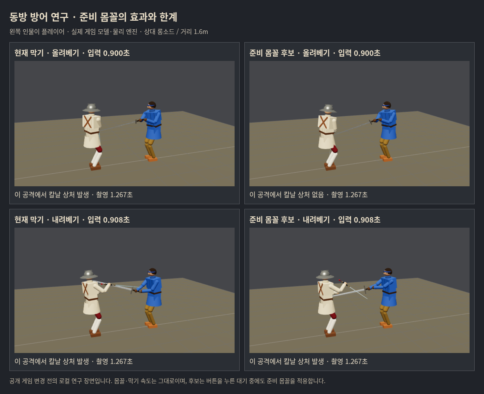
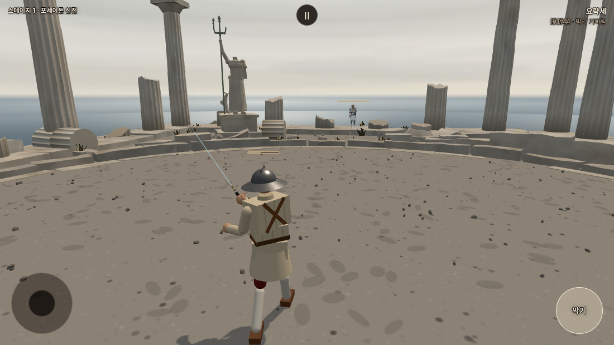
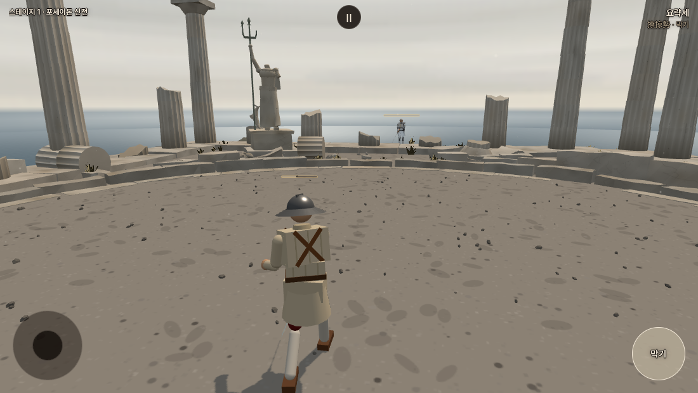

# 동방 플레이어 막기 안정성 · 2026-10-17

**현재 동방 막기는 적정 입력을 보상하는 방어로 충분히 안정적이지 않다. 이번 후보는 모두 출시 미채택이다.** 준비 몸꼴이 풀리는 문제는 일부 개선했지만, 실제로 맞을 공격을 골라 검사하니 부상35/57→34/57에 그쳤다. 유파별 유지시간을 정하기 전에 **막기 방향 선택과 실제 칼의 방어 위치**를 먼저 해결해야 한다.

사용자 기준은 인간 플레이어의 경험이다. AI 대련은 이번에 돌리지 않았다. 물리 엔진에 사람이 누를 법한 시점의 버튼 입력을 주었으며, 이것은 실제 사람의 플레이 테스트나 전체 게임의 승률 통계가 아니다. 동방의 적정 타이밍 방어→비기 자동 연결은 미래 설계로만 기록하고 구현하지 않았다.

## 기준과 계측 정정

- 우화 최신 기준 `0bd04a51fe07d6e8b3a7d493e7d493dc6eb8ce8b`, 연구 시작 병합 `5fca5aee077ebfc828ea368b31e990f709646dc6`.
- 우리 포크 연구 가지 `codex/chinese-parry-player-20261017`. 원본 저장소 쓰기/우화 메시지/공개 게임 교체 없음.
- 최신 기력 문턱−35/−70 반영. 이 기준의 `src`, 공개 자산, 패키지, 엔트리와 연구판의 차이는0이다. 후보는 `tools/`에만 있다. 기존 자세·보법·막기 속도·힘·충돌 판정은 바꾸지 않았다.
- 이전 연구 도구에는 `D.stamina.controller=guard` 연결이 빠져 있었다. 실제 main에는 연결되어 있다. 대본 공격자의 공격 번호·기력 청구도 없었다. **이전 긴 대련 결과를 실제 플레이어의 회복·막기 비용 검증으로 사용하지 않는다.** 이전 조건/결과를 삭제하거나 개선분으로 합산하지 않는다.
- 이번 `playerModel:true`는 실제 main의 연결을 재현하고, 대본의 긋기 시작에 실제 `AI.startStrike`와 같은 기력 청구/공격 번호를 적용한다. 준비 시작에 청구했던 최초 점검은 폐기 후 전부 재측정했다. 공식 원자료는 instrumentation3이다.
- 청강검 플레이어/기력100 시작(최대 기력 장비 보너스0), 이동 없는 방어. 회복21, 막는 동안 회복 중단. 피로·다양한 이동·실제 손가락 반응 분포는 아직 검증하지 않았다.

## 확인한 문제

1. **누르고 있어도 준비 몸꼴이 적용되지 않는 구간이 있다.** 현재 기다림은 손 목표만 옮기고, 동방의 거정세·어거세·요략세 몸꼴은 `defend`에서만 적용한다. 실제 브라우저에서 막기 버튼을 누르고 lowL을 기다릴 때 몸꼴 적용량0, 후보는1이었다. 버튼 회복 억제는 둘 다 정상이다.
2. **그 문제만 고쳐서는 부족하다.** 실제 위험 세트의 기준 부상35조건 중31조건은 상처가 날 때 이미 `defend`였고,18조건은 몸꼴 적용량도 .5 이상이었다. 적용량1은 실제 칼날이 목적지에 닿았다는 뜻이 아니다.
3. **기력 지출 뒤 피격이 실제로 있다.** 같은57조건에서35조건에 상처, 그중21조건은 막기 비용도 지불했다(그21조건의 합계47.25). 칼 접촉 뒤 몸에 닿거나, 유효한 방어가 아닌 접촉에도 비용이 생긴다. 실제 플레이의 평균 손해액/빈도로 확대하지 않는다.
4. **입력 한 프레임 차이에 민감하다.** 정수리 내려베기 1.6m에서 .900초 입력은 준비 몸꼴 후보가 막았지만 .9083초는 팔에 상처. ±.025초의7시각 중 기존7부상/후보4부상이다. 연속된 넓은 성공 구간을 확보했다고 할 수 없다.

## 후보 비교

[사전 기록](../../design/chinese_player_parry_prereg_20261017.md)에 각 확대/추가 실험 전에 이유와 범위를 남겼다. 아래 숫자는 **칼날 상처가 하나 이상 생긴 조건 수**이며 단순 접촉 성공률이 아니다.

| 후보 | 첫64조건 부상 | 기준에 없던 부상 | 판단 |
|---|---:|---:|---|
| 현재 |16|—|비교 기준|
| ready: 대기 중 준비 몸꼴 활성화 |8|0|확대|
| entry: 누른 순간 현재 준비 방향 선택 |12|2|탈락|
| dwell06: 방향 변화 .06초 확인 |16|4|탈락|
| dwell12: 방향 변화 .12초 확인 |21|8|탈락|
| ready-low: 요략세 대기만 활성화 |10|0|확대|
| ready-high: 거정세 대기만 활성화 |14|0|기여 분리용|
| ready-native: 실제3몸꼴만 활성화 |8|0|첫 세트는 ready와 같음|
| watch: 위협 상태를 유지하고 대기 몸꼴만 활성화 |8|0|기전 분리 후 확대|

ready는 기존 타이머가 끝난 뒤 `defLine`을 넣는 방식이다. watch는 플레이어에 전달하는 기존 몸꼴 복사본의 `watch:true`만 켜 읽기/타이머와 분리했다. 치수/손 속도/몸의 힘은 동일하다. 확대에서 둘의 결과가 같아, 준비 몸꼴 활성화만으로 해결되지 않는다는 한계도 확인했다.

독립 거리1.3/1.7m·레이피어/츠바이핸더·19공격·새 입력3시각의228조건: 현재11부상, ready/watch12부상(새 부상1), ready-low11부상(구제0/신규0). ready/watch의 깨끗한 칼 접촉은141→153이지만 막기 비용 합계도290.25→333으로 늘었다. **접촉 증가를 방어 성공 증가로 보고하지 않는다.** 무방어76공격 중 실제 상처는2개뿐이어서 이 세트는 위험 공격의 방어 성능 검증에는 약했다.

## 실제로 맞는 공격만 다시 비교

새 거리1.1/1.5m·롱소드/청강검·19공격을 무방어로 먼저 측정했다.76개 중 실제 칼날 상처가 난19개를 고르고, 각 무방어 첫 상처 시각의 .30/.20/.10초 전에 누른다(120Hz 프레임에 맞춤). 이 타격 시각은 **오프라인 비교 축**이지 게임이 미래를 미리 안다는 뜻이나 사람의 실제 반응 속도가 아니다. 준비 동작 중 피격도 포함하며 .30초 조건 중1개는 준비 시작 전 입력이다. 기준/후보 모두 같은 입력을 쓴다.

| 무방어 첫 타격보다 먼저 누른 시간 | 현재 | ready/watch | ready-low |
|---|---:|---:|---:|
| 0.30초 |12/19 부상|11/19|12/19|
| 0.20초 |9/19|9/19|9/19|
| 0.10초 |14/19|14/19|14/19|
| 합계 |35/57|34/57|35/57|

ready/watch가 구제한 것은 청강검 정수리1.1m/.95초 입력 한 조건. 이57조건에서는 새 부상0이지만, 위 독립 무기 세트의 새 부상1은 그대로 남는다. .20초가 모든 상황의 적정 타이밍이라는 결론은 내리지 않는다. 늦은 입력에도 구제가 가능한 구간, 일찍 누를수록 오히려 불리한 구간을 따로 읽어야 한다.

## 실제 화면과 입력 확인

로컬 시험장 실제 모델·Rapier 물리·Three.js 화면이다. 위는 개선된 올려베기, 아래는 후보도 실패한 내려베기. 사진은1.267초이며 설명의 상처 유무는 공격 전체를 측정한 결과다. 아래 기존 막기의 다리 상처는1.400초, 후보의 팔 상처는1.242초에 난다. 사진만 보고 그 순간 이미 모두 다쳤다고 읽지 않는다.

실제 게임 페이지에서도 버튼 누르기/놓기·회복 중단/재개·막는 중 공격 비용 오청구 없음·모바일 탭으로 공격 전환·비기 미발동을 확인했다. 기준/ready 각각8항목 통과, 앱 예외0. 이는 입력/장부 검사이고 상대는 멀리 옮겨 두었다. 대전 성공률 검사가 아니다. 최초 PC 클릭은 포인터 잠금이라 공격이 아니어서 실제 모바일 탭으로 검사 도구를 고쳤다.

실제 게임 버튼 화면 · 현재 / ready

## 판단과 다음 연구 범위

- 동방은 **적절히 누른 구간에서 신뢰할 만한 방어**를 목표로 한다. 100% 방어, 임의 성공 확률 보너스, 모든 유파의 동일 성공률은 목표가 아니다.
- 이번에는 유지시간 확정값이 없다. .65초를 일괄 늘리는 방식이나 대기 몸꼴 상시 적용을 출시 보정으로 채택하지 않는다.
- 다음 초점은 실패한 실제 위협에서 **칼의 진입 경로→선택한 방어 줄→손/칼의 실제 도착**을 연결하는 것이다. 특히 요략세 상태인데 몸에 닿는 올려베기, 상단에서 내려오는 동안 줄이 바뀌는 공격을 우선한다. 기존 몸꼴/보법 변경과 구별해 연구한다.
- 미래 비기 연계에는 단순 버튼 유지/칼 접촉 대신 유효한 공격 차단과 입력 시점을 연결해야 한다. 구체적인 발동 창/자동 연결은 아직 구현·확정하지 않았다.
- 사람의 실제 손가락 입력·연속 공격·걷기·피로 상황 검증은 남았다. 이번 결과를 인간 체감이 개선됐다는 보고로 대신하지 않는다.

## 보존·재현

정식 대본1926회(이전 확장3963회의 약49%). 실제 대전1926판이 아니다. 진단6회·브라우저/사진은 별도다. 실패 후보를 모든 세트에 반복하지 않았다. 폐기한 준비 비용 청구 자료는 포함하지 않았다. `diagnostic.json.gz`는 논리상 .9초였지만 epsilon 없이 비교해 실제 .9083초에 눌린 별도 진단이며 정식1926회에 포함하지 않는다.

- [계산 결과](report.json), [해시/검증 기록](manifest.json), `raw/*.json.gz` 원자료.
- 도구: `tools/sim/chinese_player_{sweep,risk,jitter,report}.mjs`, `chinese_player_guard.mjs`, `chinese_player_visual.html`, `tools/browser/chinese_player_{parry_probe,capture}.mjs`.
- `CN_READ=ready node tools/sim/chinese_player_sweep.mjs`는 기본64조건. CN_READ=base/entry/dwell06/dwell12/ready-low/ready-high/ready-native/watch도 동일 명령.
- `ATKS=rapier,zweihander GAPS=1.3,1.7 PRESSES=.8,.95,1.10 ATTACKS='<parry_reading_trials.mjs의 ATTACK_NAMES 19개>' TAG=holdout-ready CN_READ=ready node tools/sim/chinese_player_sweep.mjs`로 독립 세트. `PRESSES=-1`은 무방어.
- 위험 세트는 `ATKS=longsword,qinggang GAPS=1.1,1.5 PRESSES=-1`과 동일19공격으로 `risk-unguarded.json` 생성 후 `node tools/sim/chinese_player_risk.mjs`; watch만은 `KINDS=watch TAG=risk-watch`.
- `node tools/sim/chinese_player_report.mjs docs/research/chinese_player_parry_20261017`로 압축 원자료에서 보고 재생성 가능.
- 빌드·구문·차이 검사 통과. 실제 게임 코드가 최신 기준과 같아 기존 물리5관문을 이번 도구 변경만으로 재실행하지 않았다. **이 후보들이 출시 관문을 통과했다고 주장하지 않는다.**
